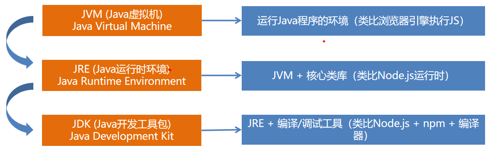

# 构建第一个Java应用程序

面向前端开发者的零基础指南


## 课程目标

- 在Windows上安装JDK（Java开发工具包）
- 安装并配置IntelliJ IDEA（Java集成开发环境）
- 使用IDEA创建Java项目、编写并运行程序
- 理解Java程序的基本结构与运行方式


## Java核心概念

### Java vs JavaScript

| **维度** | JavaScript (前端)        | Java (后端)                            |
| -------- | ------------------------ | -------------------------------------- |
| 运行环境 | 浏览器 / Node.js         | Java虚拟机 (JVM)                       |
| 执行方式 | 解释执行 (JIT)           | 先编译后解释运行                       |
| 源码文件 | .js                      | .java                                  |
| 编译产物 | 无（或内存中）           | .class 字节码                          |
| 入口     | 全局代码或 function main | public static void main(String[] args) |

> [!NOTE]
>
> 语法不同但编程逻辑相似。编译过程可以类比TypeScript的tsc编译成JS


### JVM/JRE/JDK




## 安装和配置JDK

### 下载和安装JDK

> [!CAUTION]
>
> JDK有很多版本，不用追求最新版本。推荐版本：JDK 17（稳定、够用）

- [Oracle JDK（推荐）](https://www.oracle.com/java/technologies/javase/jdk17-archive-downloads.html)   
- [Eclipse Temurin](https://adoptium.net/)   
- [Amazon Corretto](https://aws.amazon.com/cn/corretto/)


### 配置环境变量

为什么要配置环境变量：让命令行找到Java命令。例如：

- javac命令把.java源文件编译成.class文件
- java命令执行编译后的.class文件

> [!NOTE]
>
> 类比：安装Node.js后会自动添加node到PATH，但Java需要手动配置


如何设置环境变量？设置哪些环境变量？

- JAVA_HOME：指向JDK安装目录（给其他软件用）
- PATH：添加 %JAVA_HOME%\bin（让命令行直接识别命令）


如何验证环境变量是否设置正确？

```java
java -version
javac -version
```

预计输出：显示版本号（如 java version "17.0.x" 和 javac 17.0.x），无“不是内部或外部命令”错误。

> [!NOTE]
>
> 类比node -v和npm -v命令


## 创建和运行第一个Java项目


### 下载并安装 IntelliJ IDEA

下载地址：https://www.jetbrains.com/idea/download/

| 对比维度          | **IntelliJ IDEA**                                      | **Eclipse**                                         | **Visual Studio Code (VS Code)**            |
| ----------------- | ------------------------------------------------------ | --------------------------------------------------- | ------------------------------------------- |
| **核心定位**      | 专业的Java集成开发环境(IDE)                            | 经典的开源IDE                                       | 轻量级、可扩展的代码编辑器                  |
| **流行度 (2025)** | **84%** 的Java开发者使用                               | **28%** 的Java开发者使用                            | **31%** 的Java开发者使用                    |
| **费用**          | **社区版(Community)**：免费 **旗舰版(Ultimate)**：付费 | **完全免费** (EPL开源协议)                          | **完全免费**                                |
| **内存占用**      | 较高 (800-1200MB)                                      | 中等 (700-1000MB)                                   | 较低 (300-500MB)                            |
| **新手友好度**    | **8/10**，开箱即用，配置简单                           | **6/10**，配置相对复杂，对新手不太友好              | **9/10**，轻量快速，插件丰富                |
| **Java支持方式**  | 原生支持，为Java深度优化                               | 原生支持，通过插件可扩展其他语言                    | 需安装 **“Extension Pack for Java”** 插件包 |
| **核心优势**      | 业界最强的**智能代码补全、深度分析和重构**能力         | **插件生态极其庞大**，可高度定制                    | **极致轻量、启动快**，多语言开发体验一致    |
| **主要短板**      | 资源消耗较大，旗舰版价格昂贵                           | 界面较为陈旧，智能提示相对较弱                      | 高级Java功能需配置插件，大型项目支持较弱    |
| **适用场景**      | **专业Java开发**、企业级应用、现代框架(如Spring Boot)  | 预算有限的团队、**高度定制化**环境、传统Java EE项目 | 轻量级或小型项目、资源有限设备              |

> [!CAUTION]
>
> IntelliJ IDEA和WebStorm都是JetBrains公司的产品，操作界面类似。注意：从 2025.3 版本开始，JetBrains 推出了统一的安装程序。安装这个统一版本后，Java 和 Kotlin 等核心开发功能依然完全免费使用，当你未来需要更高级的企业级功能（如 Spring 深度支持、数据库工具、Docker 集成等）时需要订阅 Ultimate 版本


### Java应用基本结构

```java
public class HelloWorld { //类声明
    public static void main(String[] args) { //主方法
      	//方法体
        System.out.println("Hello, Java from IDEA!"); 
    }
}
```

> [!NOTE]
>
> main方法是固定入口。可以类比前端项目的index.js中的启动函数


## 常见问题总结

| **问题现象**                      | **可能原因**                           | **解决方法**                                               |
| --------------------------------- | -------------------------------------- | ---------------------------------------------------------- |
| 找不到JDK，项目报红               | IDEA未关联JDK                          | File → Project Structure → SDKs → 添加JDK路径              |
| 运行按钮灰色不可点                | 没有main方法或类未正确声明             | 检查代码中的public static void main(String[] args)是否完整 |
| 控制台无输出或报错                | 代码语法错误（如缺少分号、括号不匹配） | IDEA会在编辑区红色波浪线提示，鼠标悬停查看                 |
| Process finished with exit code 1 | 程序运行时异常（例如除零错误）         | 检查代码逻辑，观察异常信息                                 |

> [!CAUTION]
>
> 善用IDEA的自动纠错功能，类似前端开发中的语法检查


## 作业

下载和配置JDK、安装KDEA并完成“HelloWord”应用