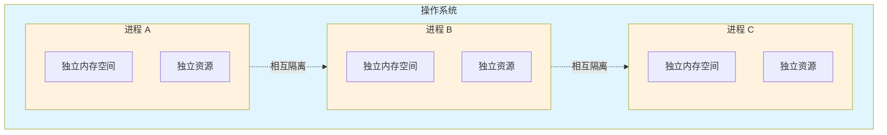
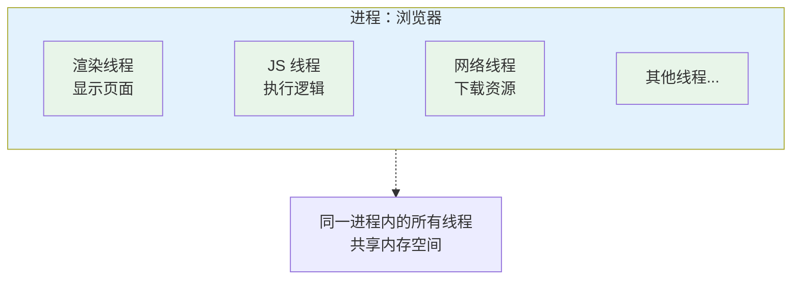
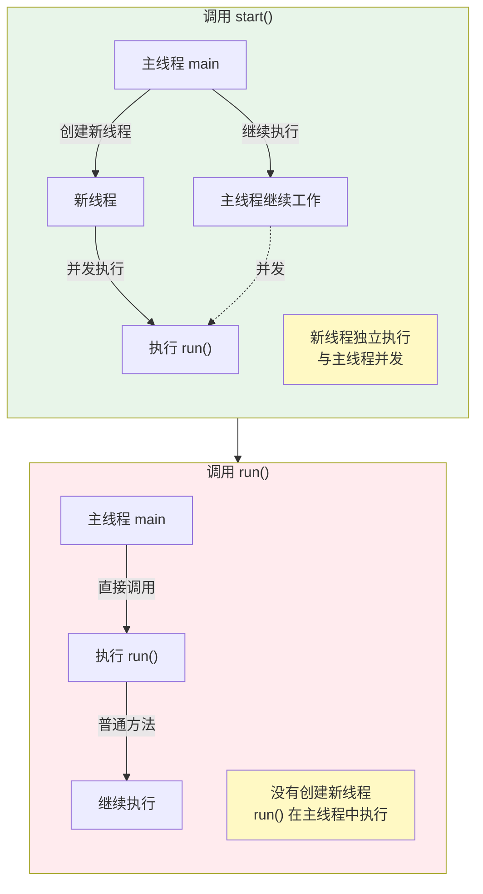

# 线程基础与创建方式

## 课程目标

- 理解进程与线程的概念及区别
- 掌握 Java 中创建线程的三种方式
- 理解多线程程序的执行特点
- 能够编写简单的多线程程序


## 生活中的多线程

在正式学习之前，我们先通过生活中的例子理解什么是“多线程”。

想象一下你正在**做饭**：

- **单线程**：你一个人先洗菜、再切菜、再炒菜、最后装盘——所有事情一步一步按顺序做。
- **多线程**：你请了两个朋友帮忙——一个人洗菜，一个人切菜，你负责炒菜——三个人同时干活，效率更高。

在这个例子中：

| 生活中的概念     | 编程中的概念                       |
| ---------------- | ---------------------------------- |
| 整个厨房         | **进程**（程序运行的环境）         |
| 每个干活的人     | **线程**（执行任务的最小单位）     |
| 一起干活         | **并发/并行**                      |
| 共享的食材和厨具 | **共享资源**（需要协调，避免冲突） |

通过这个类比，你对线程应该有了初步印象：**线程就是程序中的“工人”，多个工人可以同时工作，让程序运行得更快。**


## 进程与线程概述

### 进程（Process）

打开电脑的任务管理器，你会看到很多正在运行的程序：浏览器、音乐播放器、文本编辑器……每个运行中的程序就是一个**进程**。

**进程**是操作系统进行资源分配的基本单位，是正在运行的程序实例。

**进程的特点：**



- 每个进程有**独立**的内存空间（代码、数据、堆栈）。
- 进程之间相互隔离，一个进程崩溃不会影响其他进程。
- 进程切换开销较大（好比搬家，要把所有东西搬走再搬新的进来）。

### 线程（Thread）

一个进程内部可以包含多个执行路径，每个执行路径就是一个**线程**。

**线程**是操作系统调度的最小单位，是进程中的一条执行路径。



**线程的特点：**

- 同一进程内的多个线程**共享**进程的内存空间。
- 每个线程有自己的存储局部变量和方法调用信息，并记录执行位置。
- 线程切换开销较小（好比在房间里换个人干活，不需要重新装修）。

### 进程与线程的对比

| 对比维度  | 进程               | 线程                     | 生活类比                               |
| --------- | ------------------ | ------------------------ | -------------------------------------- |
| 资源分配  | 独立的内存空间     | 共享进程的内存空间       | 每家独立住房 vs 合租公寓               |
| 通信方式  | 进程间通信复杂     | 通过共享变量直接通信     | 打电话 vs 面对面聊天                   |
| 切换开销  | 较大               | 较小                     | 搬家 vs 转身说话                       |
| 创建/销毁 | 开销大             | 开销小                   | 盖楼 vs 招人                           |
| 独立性    | 一个崩溃不影响其他 | 一个崩溃可能导致进程崩溃 | 邻居漏水不影响你 vs 室友吵架全屋受影响 |

### 并发与并行

这两个概念很容易混淆，我们用图来理解：

**并发（Concurrency）**：多个任务在**同一时间段内**交替执行。

```mermaid
gantt
    title 并发执行（单核或多核 CPU）
    dateFormat HH:mm:ss
    axisFormat %H:%M:%S

    section 线程1
    执行 :a1, 00:00:00, 2s
    等待 :a2, after a1, 1s
    执行 :a3, after a2, 2s
    等待 :a4, after a3, 1s
    执行 :a5, after a4, 2s

    section 线程2
    等待 :b1, 00:00:00, 1s
    执行 :b2, after b1, 2s
    等待 :b3, after b2, 1s
    执行 :b4, after b3, 2s
    等待 :b5, after b4, 1s

    section 线程3
    等待 :c1, 00:00:00, 2s
    执行 :c2, after c1, 2s
    等待 :c3, after c2, 2s
    执行 :c4, after c3, 2s
```



> [!NOTE]
>
> 同一时刻只有一个线程在执行，但看起来像同时进行

**并行（Parallelism）**：多个任务在**同一时刻**同时执行。

```mermaid
gantt
    title 并行执行（多核 CPU）
    dateFormat HH:mm:ss
    axisFormat %H:%M:%S

    section CPU核心1
    线程1执行 :a1, 00:00:00, 6s

    section CPU核心2
    线程2执行 :b1, 00:00:00, 6s

    section CPU核心3
    线程3执行 :c1, 00:00:00, 6s
```



> [!NOTE]
>
> 多个核心同时执行不同的线程

**并发和并行对比：**

| 对比维度 | 并发                               | 并行               |
| -------- | ---------------------------------- | ------------------ |
| 核心数量 | 单核或多核均可                     | 必须多核           |
| 执行方式 | 交替执行                           | 同时执行           |
| 生活类比 | 一个人同时给多个客户打电话（轮换） | 多个客服同时接电话 |

> [!NOTE]
>
> 在单核 CPU 上，多线程实现的是**并发**；在多核 CPU 上，多线程可以实现**并行**。Java 的多线程代码在两种情况下都能正常工作，由操作系统负责调度。


## Java 中的主线程

每个 Java 程序启动时，都会自动创建一个**主线程**（`main` 方法所在线程），然后我们可以创建更多的线程来执行任务。

```java
public class ThreadInfo {
    public static void main(String[] args) {
        // 获取当前正在执行的线程对象
        Thread current = Thread.currentThread();
        System.out.println("当前线程名称: " + current.getName());
        System.out.println("线程唯一ID: " + current.getId());
        System.out.println("线程优先级: " + current.getPriority());
    }
}
```

**运行结果：**

```
当前线程名称: main
线程唯一ID: 1
线程优先级: 5
```


## 创建线程的三种方式

### 继承 Thread 类

**步骤拆解：**

1. 创建一个类，继承 `Thread`
2. 重写 `run()` 方法，把要执行的任务写在里面
3. 创建该类的实例
4. 调用 `start()` 方法启动线程

**完整代码示例：**

```java
// 步骤1 + 步骤2：继承 Thread，重写 run()
class MyThread extends Thread {
    @Override
    public void run() {
        // 这个线程要执行的任务
        for (int i = 1; i <= 5; i++) {
            // getName() 是 Thread 类的方法，返回线程名称
            System.out.println(getName() + " 打印: " + i);
            
            // sleep 让当前线程暂停一段时间（模拟耗时操作）
            try {
                Thread.sleep(1000); // 暂停1秒
            } catch (InterruptedException e) {
                e.printStackTrace();
            }
        }
        System.out.println(getName() + " 执行完毕！");
    }
}

public class ThreadDemo1 {
    public static void main(String[] args) {
        // 步骤3：创建线程实例
        MyThread t1 = new MyThread();
        MyThread t2 = new MyThread();
        
        // 设置线程名称（方便区分）
        t1.setName("线程A");
        t2.setName("线程B");
        
        // 步骤4：启动线程（调用 start()）
        t1.start();
        t2.start();
        
        // 主线程自己的任务
        System.out.println("主线程继续执行自己的任务...");
        System.out.println("主线程结束！");
    }
}
```

**可能的运行结果（每次运行可能不同）：**

```
主线程继续执行自己的任务...
主线程结束！
线程A 打印: 1
线程B 打印: 1
线程A 打印: 2
线程B 打印: 2
线程A 打印: 3
线程B 打印: 3
线程A 打印: 4
线程B 打印: 4
线程A 打印: 5
线程B 打印: 5
线程A 执行完毕！
线程B 执行完毕！
```

**重要发现：**

1. 输出顺序每次可能不同，由操作系统调度决定。
2. 主线程先结束，但程序不会退出——因为还有两个线程在执行。
3. `t1` 和 `t2` 交替执行（并发），不是先完成一个再完成另一个。

> [!CAUTION]
>
> 必须调用 `start()` 启动线程，而不是 `run()`！直接调用 `run()` 只是普通方法调用，不会创建新线程。

**错误示例：**

```java
MyThread t = new MyThread();
t.run();  // 错误！这不会启动新线程，只是在当前线程中执行 run()
```


### 实现 Runnable 接口

继承 `Thread` 有局限——Java 是单继承，如果类已经继承了别的类，就不能继承 `Thread` 了。这时可以用 `Runnable` 接口。

**步骤拆解：**

1. 创建一个类，实现 `Runnable` 接口
2. 实现 `run()` 方法
3. 创建 `Runnable` 实例
4. 用 `Runnable` 实例作为参数创建 `Thread` 对象
5. 调用 `Thread` 的 `start()` 方法

**完整代码示例：**

```java
// 步骤1 + 步骤2：实现 Runnable 接口
class MyRunnable implements Runnable {
    @Override
    public void run() {
        for (int i = 1; i <= 5; i++) {
            // 注意：这里要用 Thread.currentThread() 获取当前线程
            System.out.println(Thread.currentThread().getName() + " 打印: " + i);
            try {
                Thread.sleep(1000);
            } catch (InterruptedException e) {
                e.printStackTrace();
            }
        }
    }
}

public class ThreadDemo2 {
    public static void main(String[] args) {
        // 步骤3：创建 Runnable 实例
        MyRunnable task = new MyRunnable();
        
        // 步骤4：创建 Thread，传入 task
        Thread t1 = new Thread(task, "线程A");
        Thread t2 = new Thread(task, "线程B");
        
        // 步骤5：启动
        t1.start();
        t2.start();
    }
}
```

**Runnable 的优势：**

| 优势           | 说明                                               |
| -------------- | -------------------------------------------------- |
| 避免单继承限制 | 类可以实现多个接口，不影响继承其他类               |
| 资源共享       | 同一个 `Runnable` 实例可以给多个线程使用，共享数据 |
| 更符合设计模式 | 将“任务”和“执行任务的线程”分离                     |

**Lambda 简化写法：**

```java
public class ThreadDemo2Lambda {
    public static void main(String[] args) {
        // 用 Lambda 表达式直接定义任务
        Runnable task = () -> {
            for (int i = 1; i <= 5; i++) {
                System.out.println(Thread.currentThread().getName() + " 打印: " + i);
                try {
                    Thread.sleep(1000);
                } catch (InterruptedException e) {
                    e.printStackTrace();
                }
            }
        };
        
        new Thread(task, "线程A").start();
        new Thread(task, "线程B").start();
        
        // 更简洁的写法：直接传 Lambda 表达式
        new Thread(() -> {
            System.out.println("这是匿名线程");
        }).start();
    }
}
```


### 实现 Callable 接口 + FutureTask

前面的两种方式都不能**返回结果**。如果需要线程执行后返回一个结果，用 `Callable`。

**步骤拆解：**

1. 创建一个类，实现 `Callable<V>` 接口（`V` 是返回类型）
2. 实现 `call()` 方法，返回结果
3. 用 `Callable` 实例创建 `FutureTask`
4. 用 `FutureTask` 作为参数创建 `Thread`
5. 启动线程
6. 调用 `futureTask.get()` 获取结果

**完整代码示例：**

```java
import java.util.concurrent.Callable;
import java.util.concurrent.FutureTask;

// 步骤1 + 步骤2：实现 Callable
class MyCallable implements Callable<Integer> {
    @Override
    public Integer call() throws Exception {
        int sum = 0;
        System.out.println(Thread.currentThread().getName() + " 开始计算...");
        for (int i = 1; i <= 100; i++) {
            sum += i;
            Thread.sleep(10); // 模拟计算耗时
        }
        System.out.println(Thread.currentThread().getName() + " 计算完成！");
        return sum; // 返回结果
    }
}

public class ThreadDemo3 {
    public static void main(String[] args) throws Exception {
        // 步骤3：创建 Callable 实例并包装为 FutureTask
        MyCallable task = new MyCallable();
        FutureTask<Integer> futureTask = new FutureTask<>(task);
        
        // 步骤4 + 5：创建线程并启动
        Thread t = new Thread(futureTask, "计算线程");
        t.start();
        
        System.out.println("主线程在等待计算结果时，可以做其他事情...");
        Thread.sleep(500);
        System.out.println("主线程做完了其他事情，现在来获取结果...");
        
        // 步骤6：获取结果（如果计算未完成，会阻塞等待）
        Integer result = futureTask.get();
        System.out.println("1+2+...+100 = " + result);
    }
}
```

**Callable vs Runnable：**

| 对比     | Runnable               | Callable                 |
| -------- | ---------------------- | ------------------------ |
| 方法     | `run()`                | `call()`                 |
| 返回值   | 无（void）             | 有（V 类型）             |
| 异常     | 不能抛出检查类异常     | 可以抛出检查类异常       |
| 使用方式 | 直接给 Thread 或线程池 | 通过 FutureTask 或线程池 |

### 三种方式对比总结

| 方式          | 推荐度 | 适用场景                     |
| ------------- | ------ | ---------------------------- |
| 继承 Thread   | ⭐⭐     | 简单任务，不需要继承其他类   |
| 实现 Runnable | ⭐⭐⭐⭐⭐  | 最常用，灵活，支持资源共享   |
| 实现 Callable | ⭐⭐⭐⭐   | 需要返回结果或抛出异常的任务 |

> [!NOTE]
>
> 实际开发中，**优先使用 `Runnable` 或 `Callable`**，配合线程池使用效果更好。线程池将在后续课程中讲解。


## start() vs run() 的重要区别

初学者最容易犯的错误是混淆 `start()` 和 `run()`。我们用图来理解：



**验证代码：**

```java
public class StartVsRun {
    public static void main(String[] args) {
        Thread t = new Thread(() -> {
            System.out.println("当前线程: " + Thread.currentThread().getName());
        });
        
        System.out.println("=== 调用 run() ===");
        t.run();  // 输出: 当前线程: main（在主线程中执行）
        
        System.out.println("=== 调用 start() ===");
        t.start(); // 输出: 当前线程: Thread-0（在新线程中执行）
    }
}
```

> [!CAUTION]
>
> **记住：启动线程必须用 `start()`，不是 `run()`！**


## 作业

### 作业一：代码阅读——线程执行顺序分析

阅读以下代码，回答下面的问题。

```java
public class OrderTest {
    public static void main(String[] args) {
        System.out.println("1. main 开始");
        
        Thread t = new Thread(() -> {
            System.out.println("2. 子线程开始");
            try {
                Thread.sleep(500);
            } catch (InterruptedException e) {
                e.printStackTrace();
            }
            System.out.println("3. 子线程结束");
        });
        
        t.start();
        
        System.out.println("4. main 继续执行");
        System.out.println("5. main 结束");
    }
}
```

**问题：**

- 请写出代码可能的输出顺序（至少写出两种可能的执行顺序）。
- 为什么输出的顺序会变化？
- `2. 子线程开始` 是否一定会在 `1. main 开始` 之后执行？请说明原因。
- `3. 子线程结束` 是否一定会在 `5. main 结束` 之前执行？请说明原因。

------

### 作业一：代码阅读——混合创建方式分析

阅读以下代码，分析并回答问题。

```java
public class MixedCreationTest {
    public static void main(String[] args) {
        System.out.println("=== 程序开始 ===");

        // 方式1：继承 Thread
        Thread t1 = new Thread() {
            @Override
            public void run() {
                System.out.println("T1: 我是继承 Thread 方式");
                try {
                    Thread.sleep(300);
                } catch (InterruptedException e) {
                    e.printStackTrace();
                }
                System.out.println("T1: 执行结束");
            }
        };

        // 方式2：实现 Runnable
        Runnable task = () -> {
            System.out.println("T2: 我是实现 Runnable 方式");
            try {
                Thread.sleep(200);
            } catch (InterruptedException e) {
                e.printStackTrace();
            }
            System.out.println("T2: 执行结束");
        };
        Thread t2 = new Thread(task);

        // 方式3：Lambda 直接创建
        Thread t3 = new Thread(() -> {
            System.out.println("T3: 我是 Lambda 方式");
            try {
                Thread.sleep(100);
            } catch (InterruptedException e) {
                e.printStackTrace();
            }
            System.out.println("T3: 执行结束");
        });

        // 启动线程
        t1.start();
        t2.start();
        t3.start();

        // 这里调用了 run() 而不是 start()
        t1.run();

        System.out.println("=== 主线程结束 ===");
    }
}
```

**问题：**

- 请列出所有可能输出的执行顺序（至少写出两种不同的执行序列）。
- `t1.run()` 这一行会在什么时候执行？它和 `t1.start()` 的执行方式有什么不同？
- 如果删除 `t1.run()` 这一行，输出结果会发生什么变化？
- 三个子线程（T1、T2、T3）中，哪个最有可能**最后一个**执行结束？请说明原因。

------

### 作业三：奇偶数交替打印

编写一个程序，创建两个线程：

- 线程A：打印所有偶数（2, 4, 6, ..., 20）
- 线程B：打印所有奇数（1, 3, 5, ..., 19）

要求两个线程交替执行（即：偶数、奇数、偶数、奇数……交替出现）。可以使用 `Thread.sleep()` 来控制执行节奏。

**输出示例（每次运行可能略有不同，但应该交替）：**

```
偶数线程: 2
奇数线程: 1
偶数线程: 4
奇数线程: 3
偶数线程: 6
奇数线程: 5
...
```

**要求：** 分别使用两种方式实现：

1. 使用 `Runnable` 接口实现
2. 使用 `Lambda` 表达式简化实现

------

### 作业四：Callable 计算阶乘

实现一个 `Callable<Long>` 任务，计算 `n!`（n 的阶乘）。

**要求：**

- 创建 `Callable`，接收一个整数 `n`，返回 `n!` 的计算结果。
- 在主线程中，创建 `n = 10` 的任务，启动线程。
- 主线程先打印 "正在计算阶乘..."
- 通过 `Future.get()` 获取结果。
- 输出 "10! = 3628800"

**输出示例：**

```
正在计算阶乘...
计算完成！
10! = 3628800
```

**提示：** 计算阶乘时可以使用 `long` 类型，10! = 3628800。
