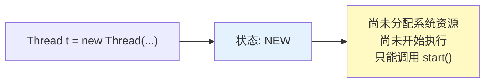
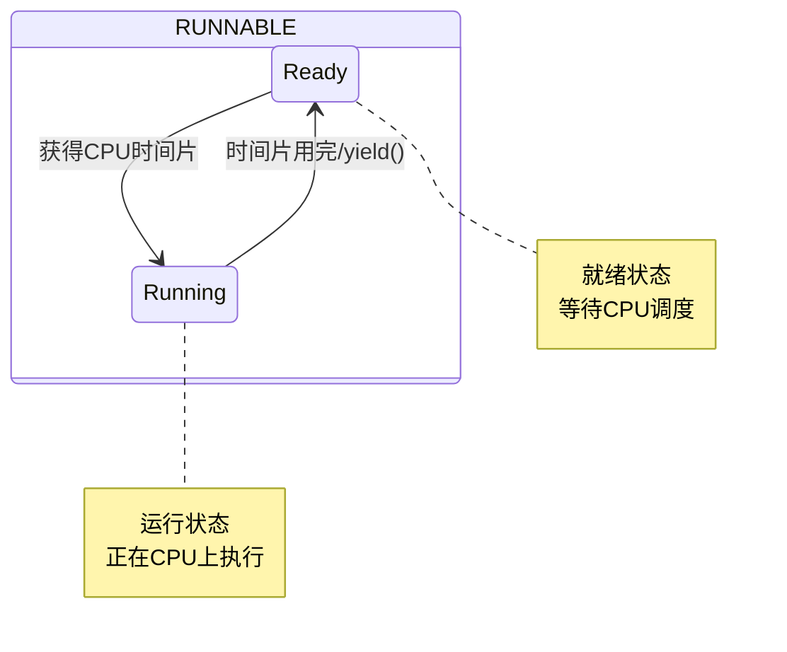
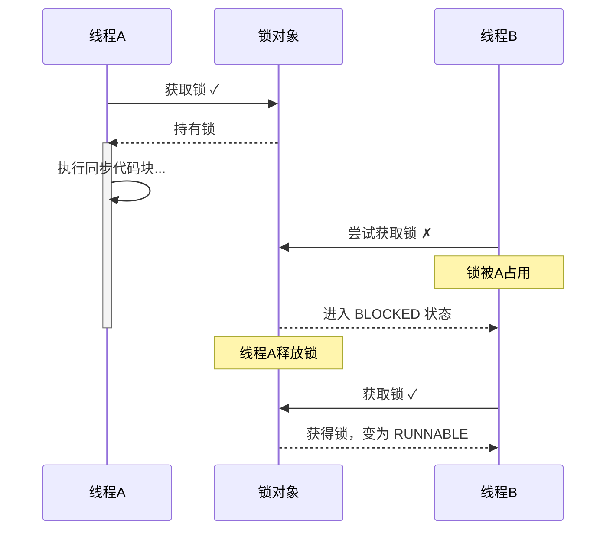
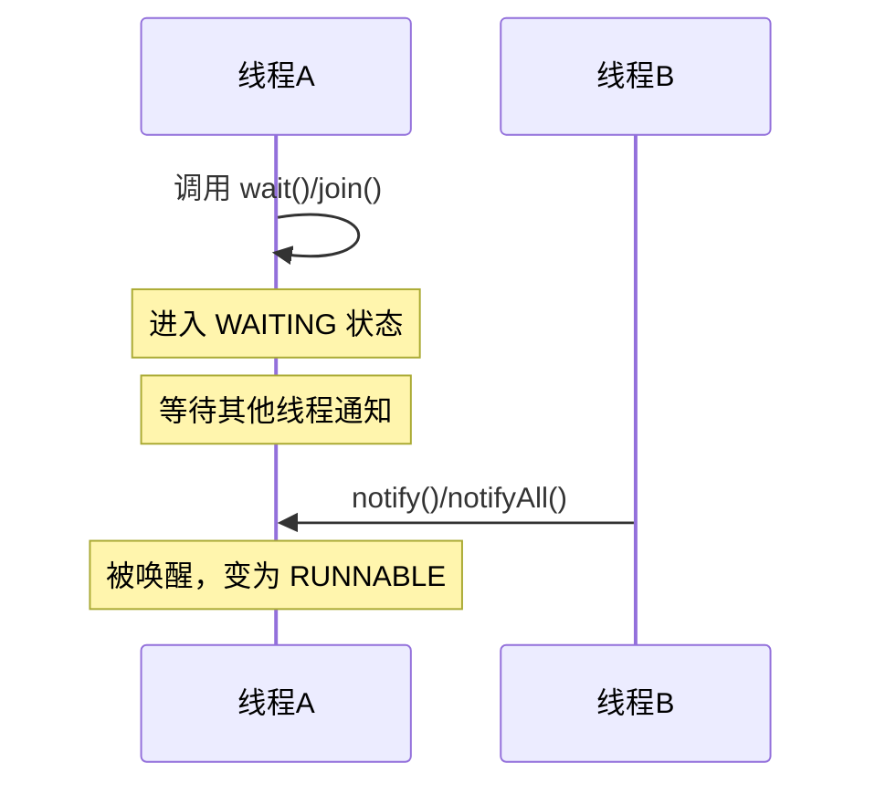
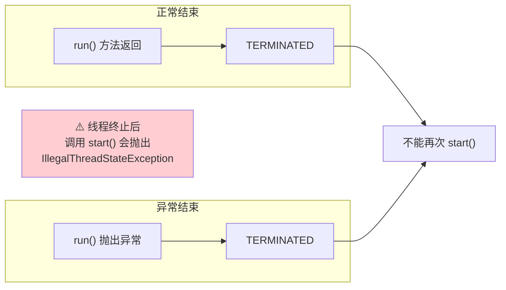
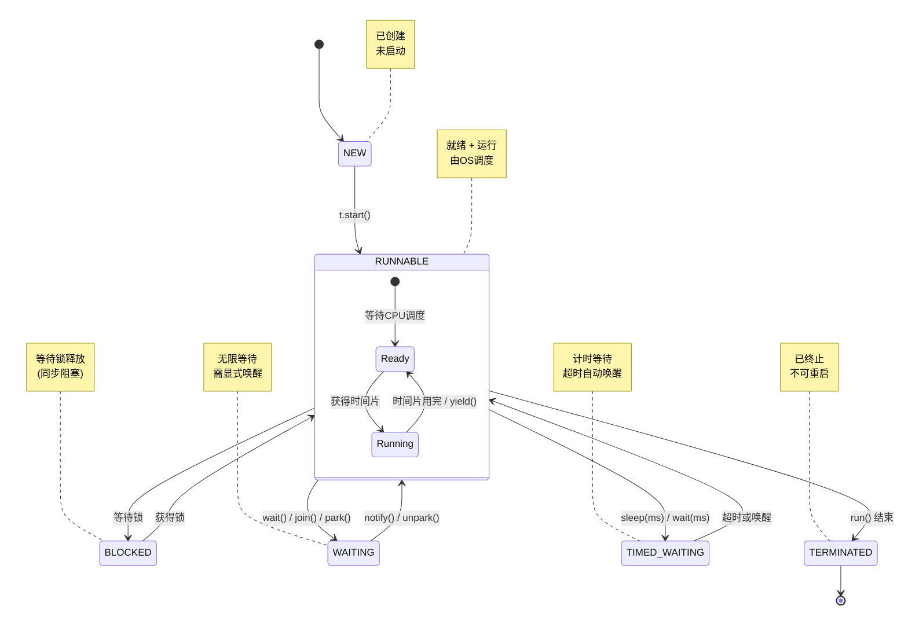
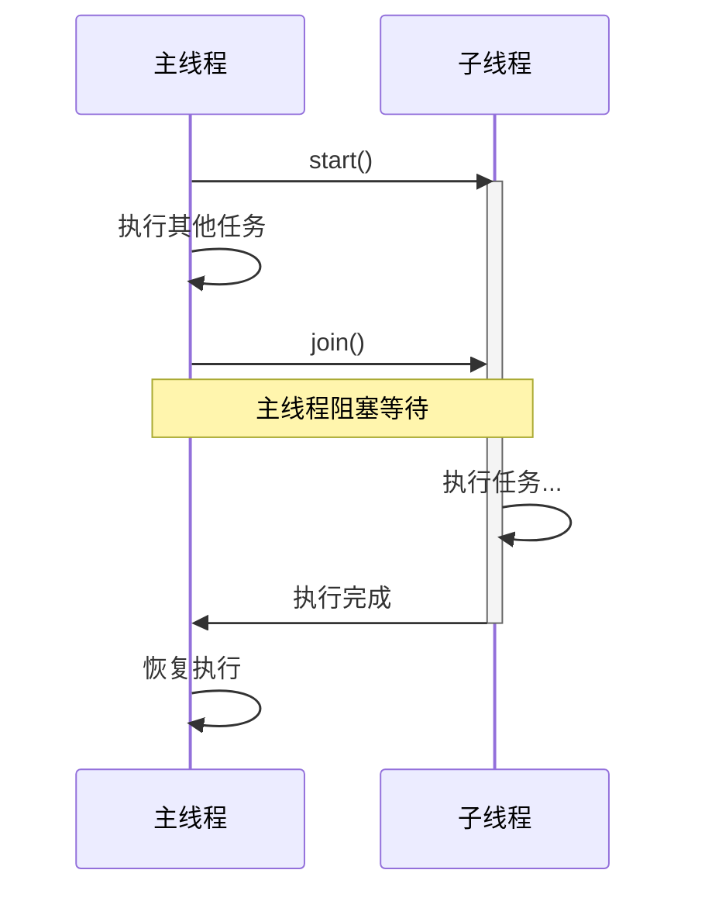
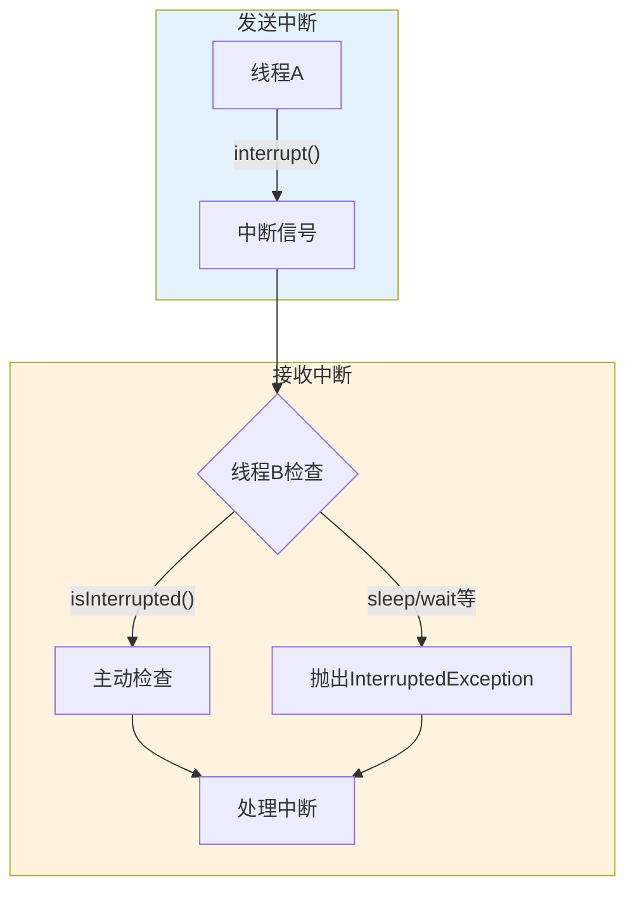

# 线程生命周期与控制方法

## 课程目标

- 理解线程的六种状态及其含义
- 掌握线程状态之间的转换关系
- 掌握线程的核心控制方法（`sleep`、`join`、`yield`、`interrupt`）
- 理解中断机制和守护线程
- 能够编写控制线程执行流程的程序


## 生活中的状态类比

在正式学习线程状态之前，我们先通过生活中的例子来理解“状态”这个概念。

想象你是一个**外卖骑手**，你的状态会随着工作进展而变化：

| 状态         | 生活场景                                     |
| ------------ | -------------------------------------------- |
| **新建**     | 你刚入职，还没开始接单                       |
| **就绪**     | 你打开接单软件，等待系统派单（随时准备接单） |
| **运行**     | 你正在送餐的路上（正在执行任务）             |
| **阻塞**     | 你在等红绿灯（需要等待某个条件才能继续）     |
| **等待**     | 你在等商家出餐（等待某个通知）               |
| **计时等待** | 你在等商家出餐，但只等10分钟                 |
| **终止**     | 你下班了，不再接单                           |

线程也有类似的状态变化，它会在不同的状态之间切换。理解这些状态，是掌握多线程编程的基础。

## 线程的六种状态

Java 中线程共有 **6 种状态**，定义在 `Thread.State` 枚举中：

| 状态      | 英文            | 说明                           | 生活类比                           |
| --------- | --------------- | ------------------------------ | ---------------------------------- |
| 新建      | `NEW`           | 线程被创建，但尚未启动         | 你刚入职，还没开始接单             |
| 就绪/运行 | `RUNNABLE`      | 线程已就绪等待调度 或 正在执行 | 你打开软件准备接单 / 正在送餐      |
| 阻塞      | `BLOCKED`       | 线程等待获取锁                 | 你在等红绿灯                       |
| 等待      | `WAITING`       | 线程无限期等待另一个线程的通知 | 你在等商家出餐（不知道什么时候好） |
| 计时等待  | `TIMED_WAITING` | 线程在指定时间内等待           | 你在等商家，但只等10分钟           |
| 终止      | `TERMINATED`    | 线程执行完毕或被终止           | 你下班了                           |

> [!NOTE]
> 严格来说，Java 中 `RUNNABLE` 状态包含了操作系统的**就绪**和**运行**两个状态。这是 Java 对线程状态的一种简化。

### NEW（新建状态）

线程被创建但还没有调用 `start()` 方法。



```java
Thread t = new Thread(() -> System.out.println("Hello"));
System.out.println(t.getState()); // NEW
t.start();
System.out.println(t.getState()); // RUNNABLE
```


### RUNNABLE（就绪/运行状态）

调用 `start()` 后，线程进入 `RUNNABLE` 状态。这个状态实际上包含两种情况：



- **就绪状态**：线程已准备好执行，等待操作系统调度分配 CPU。
- **运行状态**：线程正在 CPU 上执行。

这两个状态在 Java 中统一表示为 `RUNNABLE`。

### BLOCKED（阻塞状态）

当线程尝试获取一个**被其他线程占用的锁**时，会进入 `BLOCKED` 状态。



```java
public class BlockedDemo {
    private static final Object lock = new Object();

    public static void main(String[] args) throws Exception {
        Thread t1 = new Thread(() -> {
            synchronized (lock) {
                try { Thread.sleep(3000); } catch (InterruptedException e) {}
            }
        });

        Thread t2 = new Thread(() -> {
            synchronized (lock) {
                System.out.println("获取到锁");
            }
        });

        t1.start();
        Thread.sleep(100); // 确保 t1 先获得锁
        t2.start();
        Thread.sleep(100);
        System.out.println(t2.getState()); // BLOCKED
    }
}
```

> [!NOTE]
>
> `synchronized` 关键字用于创建一个锁，可以保证同一时刻最多只有一个线程执行被 `synchronized` 保护的代码块。下一节内容会详细介绍`synchronized` 关键字。


### WAITING（等待状态）

当线程调用了 `wait()`、`join()`、`park()`方法时，会进入 `WAITING` 状态。这个线程需要等待另一个线程的通知才能继续。



```java
public class WaitingDemo {
    private static final Object lock = new Object();

    public static void main(String[] args) throws Exception {
        Thread t = new Thread(() -> {
            synchronized (lock) {
                try { lock.wait(); } catch (InterruptedException e) {}
            }
        });

        t.start();
        Thread.sleep(100);
        System.out.println(t.getState()); // WAITING
    }
}
```


### TIMED_WAITING（计时等待状态）

当线程调用了带有超时参数的方法时，会进入 `TIMED_WAITING` 状态：

- `Thread.sleep(毫秒)`
- `wait(毫秒)`
- `join(毫秒)`
- `LockSupport.parkNanos()`
- `LockSupport.parkUntil()`

```mermaid
gantt
    title TIMED_WAITING 执行过程
    dateFormat HH:mm:ss
    axisFormat %H:%M:%S

    section 线程
    执行中 :active, a1, 00:00:00, 1s
    sleep(5000) :a2, after a1, 5s
    继续执行 :a3, after a2, 1s

    section 时间
    等待5秒 :milestone, after a1, 0s
    超时自动唤醒 :milestone, after a2, 0s
```



```java
public class TimedWaitingDemo {
    public static void main(String[] args) throws Exception {
        Thread t = new Thread(() -> {
            try { Thread.sleep(5000); } catch (InterruptedException e) {}
        });

        t.start();
        Thread.sleep(100);
        System.out.println(t.getState()); // TIMED_WAITING
    }
}
```


### TERMINATED（终止状态）

线程执行完毕（`run()` 方法结束）或因为异常退出后，进入 `TERMINATED` 状态。线程一旦终止，**不能重新启动**。



```java
public class TerminatedDemo {
    public static void main(String[] args) throws Exception {
        Thread t = new Thread(() -> System.out.println("执行完毕"));
        t.start();
        t.join();
        System.out.println(t.getState()); // TERMINATED
        // t.start(); // 会抛出 IllegalThreadStateException！
    }
}
```


## 线程状态转换图

理解了每个状态的含义后，我们来看看线程是如何在这些状态之间转换的：



### 状态转换说明表

| 转换                     | 触发动作                   | 说明                       |
| ------------------------ | -------------------------- | -------------------------- |
| NEW → RUNNABLE           | `start()`                  | 线程启动，进入就绪队列     |
| RUNNABLE → WAITING       | `wait()` / `join()`        | 无限期等待，需其他线程唤醒 |
| RUNNABLE → TIMED_WAITING | `sleep(ms)` / `wait(ms)`   | 等待指定时间后自动唤醒     |
| RUNNABLE → BLOCKED       | 尝试获取被占用的锁         | 进入同步阻塞队列           |
| WAITING → RUNNABLE       | `notify()` / `notifyAll()` | 被其他线程唤醒             |
| TIMED_WAITING → RUNNABLE | 超时到达 / 被唤醒          | 自动恢复或被动唤醒         |
| BLOCKED → RUNNABLE       | 锁被释放                   | 获得锁后恢复执行           |
| RUNNABLE → TERMINATED    | `run()` 执行结束           | 正常退出或异常退出         |


## 线程控制方法详解

### `sleep()` —— 让线程休眠

`sleep(毫秒)` 让当前线程暂停执行指定的时间，进入 `TIMED_WAITING` 状态。


```java
public class SleepDemo {
    public static void main(String[] args) {
        Thread t = new Thread(() -> {
            for (int i = 1; i <= 5; i++) {
                System.out.println(Thread.currentThread().getName() + ": " + i);
                try {
                    Thread.sleep(1000); // 暂停1秒
                } catch (InterruptedException e) {
                    System.out.println("线程被中断");
                    return;
                }
            }
        });
        t.start();
    }
}
```

**`TimeUnit` 工具类：** 更优雅的休眠方式

```java
import java.util.concurrent.TimeUnit;

Thread.sleep(3000);                    // 传统方式
TimeUnit.SECONDS.sleep(3);            // 休眠3秒
TimeUnit.MILLISECONDS.sleep(500);     // 休眠500毫秒
```

> [!NOTE]
> `sleep()` 不会释放锁！如果在 `synchronized` 块中调用 `sleep()`，线程会继续持有锁，其他线程无法进入该同步块。


### `join()` —— 等待线程结束

`join()` 让当前线程**等待**另一个线程执行完毕，再继续执行。



```java
public class JoinDemo {
    public static void main(String[] args) throws Exception {
        Thread t = new Thread(() -> {
            System.out.println("子线程开始工作...");
            try { Thread.sleep(2000); } catch (InterruptedException e) {}
            System.out.println("子线程工作完成！");
        });

        t.start();
        System.out.println("主线程等待子线程完成...");
        t.join(); // 阻塞，直到 t 执行完毕
        System.out.println("主线程继续执行");

        // 带超时：最多等待3秒
        // t.join(3000);
    }
}
```


### `yield()` —— 让出 CPU

`yield()` 让当前线程**主动让出 CPU**，从运行状态回到就绪状态，给其他线程执行的机会。

```java
public class YieldDemo {
    public static void main(String[] args) {
        Thread t1 = new Thread(() -> {
            for (int i = 0; i < 5; i++) {
                System.out.println("线程A: " + i);
                if (i == 2) {
                    Thread.yield();
                    System.out.println("线程A让出CPU");
                }
            }
        });

        Thread t2 = new Thread(() -> {
            for (int i = 0; i < 5; i++) {
                System.out.println("线程B: " + i);
            }
        });

        t1.start();
        t2.start();
    }
}
```

> [!CAUTION]
> `yield()` 只是一个**建议**，操作系统调度器可以忽略它。实际开发中很少使用 `yield()`，它的行为不稳定，不推荐依赖。


### `interrupt()` —— 中断线程

`interrupt()` 用于向线程发送一个**中断信号**，通知线程应该停止正在做的事情。

**中断机制的核心是协作**：中断只是给线程发送一个信号，线程需要**主动检查**自己是否被中断，然后决定如何响应。



**检查中断状态的方法：**

| 方法                   | 说明                                                |
| ---------------------- | --------------------------------------------------- |
| `Thread.interrupted()` | 静态方法，检查当前线程是否被中断，**清除**中断状态  |
| `t.isInterrupted()`    | 实例方法，检查线程 t 是否被中断，**不清除**中断状态 |

**常见中断处理方式：**

```java
public class InterruptDemo {
    public static void main(String[] args) throws Exception {
        Thread t = new Thread(() -> {
            while (!Thread.currentThread().isInterrupted()) {
                System.out.println("工作中...");
                try {
                    Thread.sleep(500);
                } catch (InterruptedException e) {
                    System.out.println("收到中断信号，退出");
                    // 注意：catch 后中断状态被清除
                    // 如需保留，可重新设置：
                    // Thread.currentThread().interrupt();
                    break;
                }
            }
        });

        t.start();
        Thread.sleep(2000);
        t.interrupt(); // 发送中断信号
        t.join();
        System.out.println("程序结束");
    }
}
```

> [!CAUTION]
>
> 1. `sleep()`、`wait()`、`join()` 等方法会抛出 `InterruptedException`，抛出后会**清除中断状态**。
> 2. 捕获 `InterruptedException` 后，通常应该终止当前任务，或调用 `Thread.currentThread().interrupt()` 恢复中断状态让上层处理。


## 守护线程

### 什么是守护线程

Java 中的线程分为两类：

| 类型         | 说明                                         | 例子                   |
| ------------ | -------------------------------------------- | ---------------------- |
| **用户线程** | 普通线程，JVM 会等待所有用户线程结束才退出   | main 线程、自定义线程  |
| **守护线程** | 后台线程，JVM 退出时**不会等待**守护线程结束 | 垃圾回收线程、监控线程 |

### 守护线程生命周期对比

```mermaid
gantt
    title 守护线程 vs 用户线程
    dateFormat HH:mm:ss
    axisFormat %H:%M:%S

    section 用户线程
    主线程 :active, main, 00:00:00, 4s

    section 工作线程
    工作线程1 :w1, 00:00:00, 5s
    工作线程2 :w2, after w1, 2s

    section 守护线程
    守护线程 :daemon, 00:00:00, 8s

    section JVM
    JVM运行 :jvm1, 00:00:00, 5s
    JVM退出 :jvm2, after jvm1, 1ms
```



> [!CAUTION]
>
> 用户线程全部结束后，JVM 立即退出，守护线程被迫终止


### 设置守护线程

在调用 `start()` 之前调用 `setDaemon(true)`：

```java
public class DaemonThreadDemo {
    public static void main(String[] args) {
        Thread daemon = new Thread(() -> {
            int count = 0;
            while (true) {
                System.out.println("守护线程运行中: " + count++);
                try { Thread.sleep(1000); } catch (InterruptedException e) {}
            }
        });

        daemon.setDaemon(true); // 必须在 start() 之前设置
        daemon.start();

        try { Thread.sleep(3000); } catch (InterruptedException e) {}

        System.out.println("主线程结束，JVM 将退出");
        // 守护线程被强制终止
    }
}
```

### 守护线程使用注意事项

> [!CAUTION]
>
> 1. `setDaemon(true)` 必须在 `start()` **之前**调用，否则抛出 `IllegalThreadStateException`。
> 2. 守护线程不应该执行 IO 操作或访问资源，因为 JVM 退出时可能会突然中断。
> 3. 守护线程不能持有“必须释放”的资源（如文件句柄、数据库连接）。
> 4. 适合使用守护线程的场景：监控、日志记录、定时任务、缓存清理等。


## 作业

### 作业一：代码阅读——线程状态识别

阅读以下代码，回答下面的问题。

```java
public class StateReader {
    private static final Object lock = new Object();

    public static void main(String[] args) throws Exception {
        Thread tA = new Thread(() -> {});

        Thread tB = new Thread(() -> {
            while (true) {}
        });

        Thread tC = new Thread(() -> {
            try { Thread.sleep(10000); } catch (InterruptedException e) {}
        });

        Thread tD = new Thread(() -> {
            synchronized (lock) {
                try { lock.wait(); } catch (InterruptedException e) {}
            }
        });

        Thread tE = new Thread(() -> {
            synchronized (lock) {
                System.out.println("E 获得锁");
            }
        });

        tA.start();
        tB.start();
        tC.start();
        tD.start();

        Thread.sleep(500);
        synchronized (lock) {
            tE.start();
            Thread.sleep(500);
            System.out.println("tA 状态: " + tA.getState());
            System.out.println("tB 状态: " + tB.getState());
            System.out.println("tC 状态: " + tC.getState());
            System.out.println("tD 状态: " + tD.getState());
            System.out.println("tE 状态: " + tE.getState());
        }
    }
}
```

**问题：**

1. 程序执行后，五个线程分别处于什么状态？
2. 为什么 tD 是 WAITING 状态而 tE 是 BLOCKED 状态？它们有什么区别？
3. `tB` 是一个无限循环的线程，有什么潜在风险？应该如何改进？

### 作业二：线程状态观察编程题

**题目描述**
编写一个 Java 程序，模拟三个线程协同工作，重点观察线程在不同阶段的状态变化。

**程序功能**：

1. **线程 A（Worker）**：执行一个耗时的计数任务，从 1 到 5，每隔 1 秒打印一个数字。打印完数字后，再额外休眠 2 秒，然后结束。
2. **线程 B（Waiter）**：调用 `threadA.join()` 等待线程 A 完全结束，等待完成后打印 `"Waiter: A finished"`。
3. **线程 C（Monitor）**：每隔 500 毫秒（0.5 秒）打印一次当前所有线程（A、B、C 以及主线程）的状态（使用 `getState()`）。当所有线程（A、B、主线程）都终止后，监控线程打印 `"Monitor: all done"` 并结束。
4. **主线程**：依次启动 A、B、C，然后调用 `threadA.join()` 和 `threadB.join()` 等待它们结束，最后打印 `"Main: exit"`。

**输出示例**（状态输出顺序可能略有差异，但关键状态必须出现）：

```
A: 1
A: 2
Monitor: A=TIMED_WAITING, B=WAITING, C=RUNNABLE, MAIN=TIMED_WAITING
A: 3
Monitor: A=TIMED_WAITING, B=WAITING, C=RUNNABLE, MAIN=TIMED_WAITING
A: 4
A: 5
Waiter: A finished
Monitor: A=TERMINATED, B=RUNNABLE, C=RUNNABLE, MAIN=TIMED_WAITING
Monitor: A=TERMINATED, B=TERMINATED, C=RUNNABLE, MAIN=TIMED_WAITING
Main: exit
Monitor: all done
```

（实际输出中，Monitor 会多次打印，此处仅截取关键片段）

### 作业三：多线程数据统计

编写程序，创建 3 个工作线程分别统计数据，然后主线程汇总：

- 线程A：统计 1-100 的和
- 线程B：统计 1-100 的平方和
- 线程C：统计 1-100 的立方和

**要求：**

- 使用 `Runnable` 或 Lambda
- 使用 `join()` 等待所有线程完成
- 使用共享 `List` 或数组收集结果

**输出示例：**

```
线程A: 1-100 的和 = 5050
线程B: 1-100 的平方和 = 338350
线程C: 1-100 的立方和 = 25502500
所有统计结果总和 = 25845900
```

