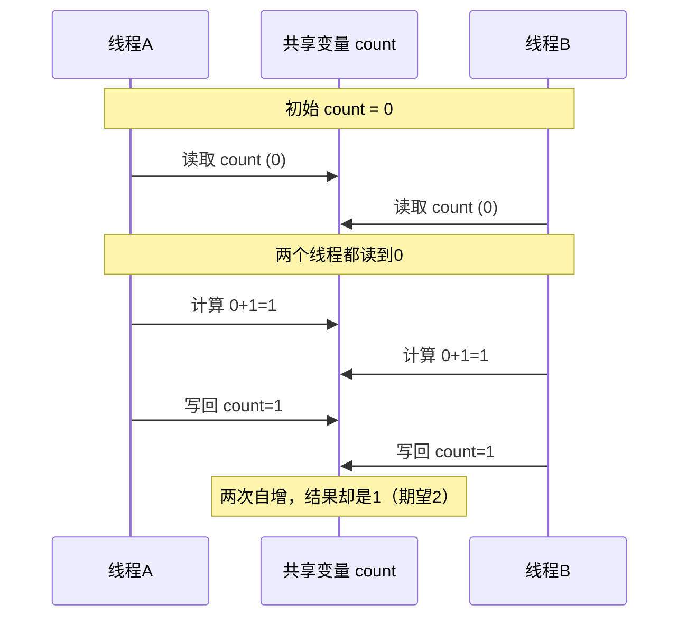
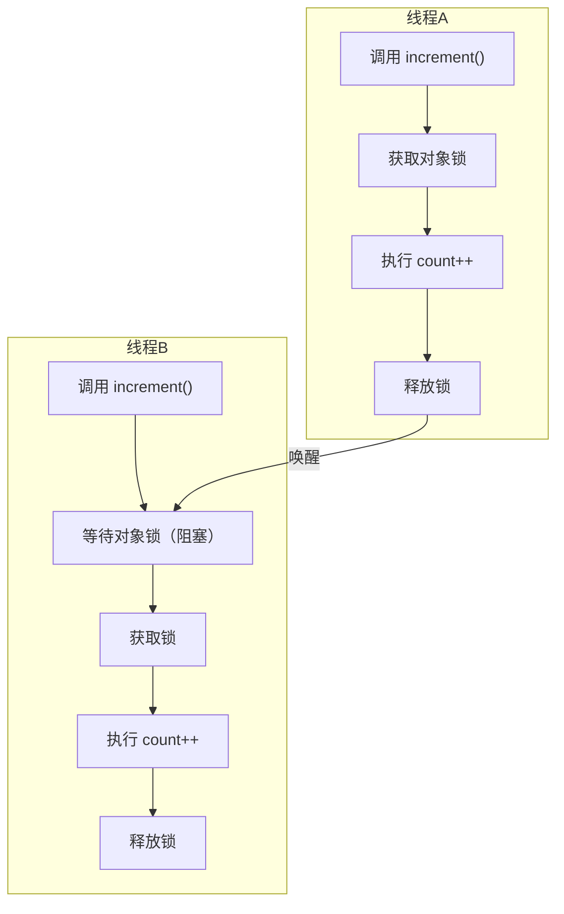
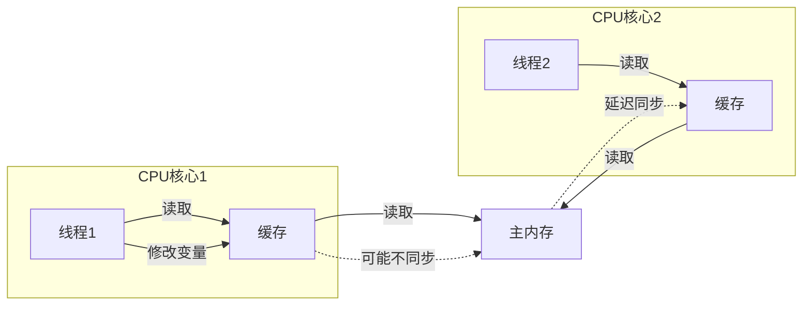
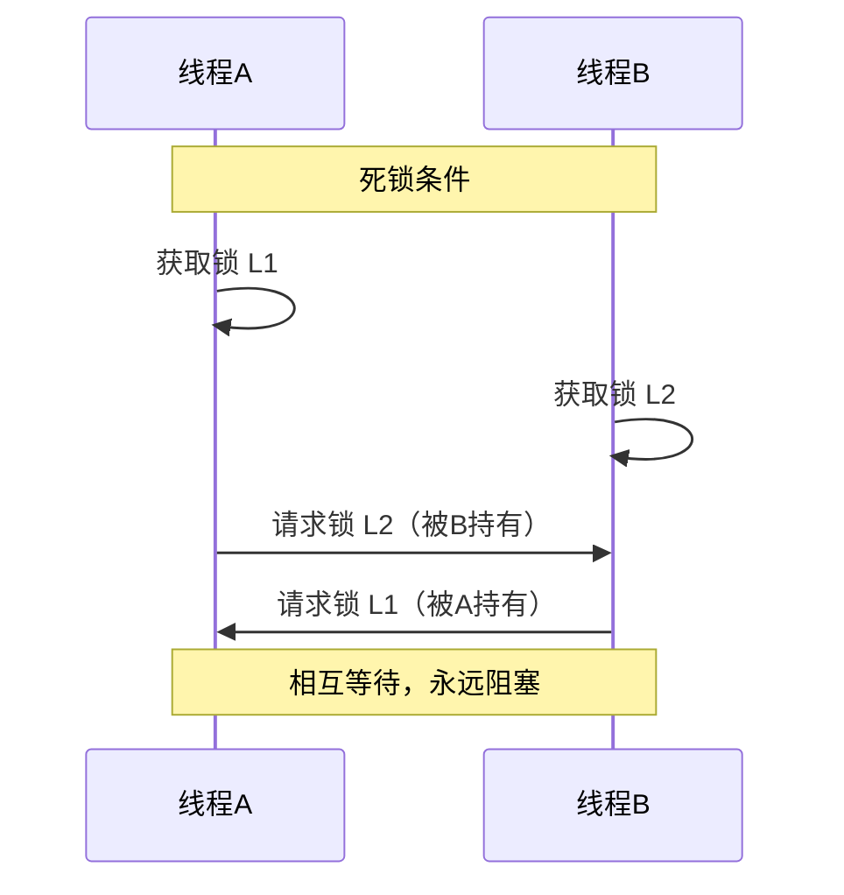

# 线程安全与锁机制

## 课程目标

- 理解多线程环境下线程安全问题的产生原因
- 掌握 `synchronized` 关键字的使用方式（实例方法、静态方法、同步代码块）
- 了解 `volatile` 关键字的作用与适用场景
- 掌握 `ReentrantLock` 的使用方法（`lock`、`unlock`、`tryLock`）
- 理解 `synchronized` 与 `ReentrantLock` 的区别和适用场景
- 理解死锁的产生条件及避免方法
- 能够编写线程安全的代码

------


## 生活中的线程安全问题

在正式学习之前，我们先通过生活中的例子理解什么是“线程安全”。

想象一下，你和室友**共用一台冰箱**（共享资源）：

- **周末采购**：你们说好每人可以拿冰箱里的饮料喝，但谁先拿谁后拿没有规定。
- **问题出现**：有一天你打开冰箱，看到还剩 1 瓶可乐，你正要伸手去拿，同时你的室友也从另一侧伸手去拿——结果两个人同时拿到了同一瓶可乐（但实际只有一瓶），引发争执（数据不一致）。

用编程术语来说：

| 生活场景               | 编程概念                       |
| ---------------------- | ------------------------------ |
| 冰箱                   | **共享资源**（内存中的数据）   |
| 你和室友               | **多个线程**                   |
| 同时伸手拿最后一瓶可乐 | **竞态条件**（Race Condition） |
| 争执                   | **数据不一致**（程序结果错误） |

**线程安全**：当多个线程访问共享资源时，无论线程如何交替执行，程序都能得到正确的结果，我们就说这个类是**线程安全**的。

------

## 线程安全问题引入

### 不安全示例

下面是一个典型的线程不安全示例：多个线程同时对同一个变量进行自增操作。

```java
public class Counter {
    private int count = 0;

    public void increment() {
        count++; // 这不是原子操作！
    }

    public int getCount() {
        return count;
    }
}
```

`count++` 操作在底层实际上分为三个步骤：


如果多个线程同时执行 `increment()`，可能发生以下情况：



**测试代码：**

```java
public class UnsafeCounterTest {
    public static void main(String[] args) throws InterruptedException {
        Counter counter = new Counter();

        Thread t1 = new Thread(() -> {
            for (int i = 0; i < 10000; i++) {
                counter.increment();
            }
        });

        Thread t2 = new Thread(() -> {
            for (int i = 0; i < 10000; i++) {
                counter.increment();
            }
        });

        t1.start();
        t2.start();
        t1.join();
        t2.join();

        System.out.println("最终 count = " + counter.getCount());
        // 期望 20000，但实际可能小于 20000
    }
}
```

**运行结果（多次运行可能不同）：**

```
最终 count = 12783   // 每次都可能不同
```

> [!NOTE]
>
> 这种由于多个线程对共享资源进行非原子操作而导致结果不可预测的问题，称为**竞态条件（Race Condition）**。解决竞态条件的关键是**保证操作的原子性**。


------

## `synchronized` 内置锁

Java 提供了 `synchronized` 关键字来实现**内置锁（Intrinsic Lock）**，可以保证同一时刻最多只有一个线程执行被 `synchronized` 保护的代码块，从而保证原子性和可见性。

**`synchronized` 的特性：**

| 特性     | 说明                                           |
| -------- | ---------------------------------------------- |
| 互斥性   | 同一时间只有一个线程能持有锁，其他线程阻塞等待 |
| 可见性   | 锁释放时，会将修改刷新到主内存，其他线程可见   |
| 可重入性 | 同一个线程可以多次获得同一把锁（不会死锁）     |

### 1. 同步实例方法

在方法声明上加上 `synchronized`，锁住的是**当前实例对象**（`this`）。

```java
public class SafeCounter {
    private int count = 0;

    // 同步实例方法
    public synchronized void increment() {
        count++;
    }

    public synchronized int getCount() {
        return count;
    }
}
```

**原理：**



> [!NOTE]
>
> 实例方法同步锁是 `this` 对象，不同实例之间的锁是独立的。


### 2. 同步静态方法

在静态方法上加上 `synchronized`，锁住的是**类的 Class 对象**（`类名.class`）。

```java
public class StaticCounter {
    private static int count = 0;

    // 同步静态方法
    public static synchronized void increment() {
        count++;
    }

    public static synchronized int getCount() {
        return count;
    }
}
```

**实例方法 vs 静态方法锁：**

| 方法类型 | 锁对象                 | 作用范围                   |
| -------- | ---------------------- | -------------------------- |
| 实例方法 | `this`（当前实例）     | 同一实例的多个同步方法互斥 |
| 静态方法 | `类名.class`（类对象） | 所有实例共享，全局互斥     |


### 3. 同步代码块

对于更细粒度的控制，可以使用同步代码块，指定任意的锁对象。

```java
public class FlexibleCounter {
    private int count = 0;
    private final Object lock = new Object();  // 专门作为锁的对象（推荐）

    public void increment() {
        synchronized (lock) {   // 使用指定的锁对象
            count++;
        }
    }

    public int getCount() {
        synchronized (lock) {
            return count;
        }
    }
}
```

**同步代码块的优势：**

- 可以锁定任何对象（不仅限于 `this`）
- 更细粒度的锁控制，提高并发性能
- 可以避免锁整个方法带来的性能开销


### 4. 可重入性

`synchronized` 是可重入锁，即同一个线程可以多次获得同一把锁，而不会造成死锁。

```java
public class ReentrantDemo {
    public synchronized void methodA() {
        System.out.println("methodA 获得锁");
        methodB(); // 同一个线程可以再次获得锁
    }

    public synchronized void methodB() {
        System.out.println("methodB 获得锁");
    }

    public static void main(String[] args) {
        new ReentrantDemo().methodA();
    }
}
```

输出：

```
methodA 获得锁
methodB 获得锁
```

> [!NOTE]
>
> 可重入性避免了死锁的发生，因为同一个线程在调用同步方法时，如果该方法内部又调用了另一个同步方法（或同一方法），线程已经持有锁，可以直接进入。


------

## `volatile` 关键字

### 可见性问题

在多线程环境下，一个线程对共享变量的修改，其他线程不一定能立即看到（由于 CPU 缓存），这就是**可见性问题**。



### `volatile` 的作用

- 保证变量的**可见性**：对 `volatile` 变量的写操作会立即刷到主内存，读操作会从主内存读取最新值。
- **不保证原子性**（对于 `volatile` 变量的复合操作如 `++` 仍然不安全）。

**适用场景：**

- 状态标记（boolean 标志）
- 不需要复合操作（只读、只写）

```java
public class VolatileFlag {
    private volatile boolean running = true;

    public void stop() {
        running = false; // 对其他线程立即可见
    }

    public void work() {
        while (running) {
            // 执行任务
        }
    }
}
```


### `volatile` vs `synchronized`

| 特性       | `volatile`           | `synchronized`       |
| ---------- | -------------------- | -------------------- |
| 保证可见性 | ✅                    | ✅                    |
| 保证原子性 | ❌                    | ✅                    |
| 锁         | 无锁                 | 互斥锁               |
| 性能       | 较低开销             | 较高开销             |
| 使用场景   | 简单的状态标记、单例 | 复合操作（读-改-写） |

------


## `Lock` 接口与 `ReentrantLock`

### `synchronized` 的局限性

` synchronized` 虽然简单，但存在以下局限：

| 局限                 | 说明                                                         |
| -------------------- | ------------------------------------------------------------ |
| 不能中断等待锁的线程 | 使用 `synchronized` 获取锁时，如果锁被占用，线程会一直阻塞，无法中断 |
| 不能尝试获取锁       | 无法尝试获取锁，如果获取不到就立即返回或等待指定时间         |

为了解决这些问题，Java 在 `java.util.concurrent.locks` 包中提供了更加灵活的锁机制。

### `Lock` 接口概述

`Lock` 接口定义了锁的基本操作，其核心实现类为 `ReentrantLock`。

**`Lock` 接口的主要方法：**

| 方法                                        | 说明                                   |
| ------------------------------------------- | -------------------------------------- |
| `void lock()`                               | 获取锁（如果不可用则阻塞等待）         |
| `void unlock()`                             | 释放锁                                 |
| `boolean tryLock()`                         | 尝试获取锁，立即返回结果（true/false） |
| `boolean tryLock(long time, TimeUnit unit)` | 在指定时间内尝试获取锁，超时返回 false |
| `void lockInterruptibly()`                  | 获取锁，支持中断响应                   |

**基本使用模式：**

```java
Lock lock = new ReentrantLock();
lock.lock();  // 获取锁
try {
    // 访问共享资源
} finally {
    lock.unlock();  // 确保释放锁（必须放在 finally 中）
}
```

> [!CAUTION]
>
> `unlock()` 必须放在 `finally` 块中，确保锁在任何异常情况下都能被释放，防止死锁。


### `ReentrantLock` 详解

#### 可重入性

`ReentrantLock` 与 `synchronized` 一样具有可重入性，即同一个线程可以多次获取同一把锁。

```java
public class ReentrantLockDemo {
    private final Lock lock = new ReentrantLock();

    public void methodA() {
        lock.lock();
        try {
            System.out.println("methodA 获得锁");
            methodB(); // 可重入，再次获取锁
        } finally {
            lock.unlock();
        }
    }

    public void methodB() {
        lock.lock();
        try {
            System.out.println("methodB 获得锁");
        } finally {
            lock.unlock();
        }
    }

    public static void main(String[] args) {
        new ReentrantLockDemo().methodA();
    }
}
```

输出：

```
methodA 获得锁
methodB 获得锁
```


#### 公平锁与非公平锁

- **公平锁**：线程按照申请锁的顺序依次获取锁（先到先得），避免线程饥饿。
- **非公平锁**：线程竞争获取锁，不保证顺序，性能更高（默认）。

```
// 公平锁
Lock fairLock = new ReentrantLock(true);
// 非公平锁（默认）
Lock unfairLock = new ReentrantLock();
```

> [!NOTE]
>
> 公平锁会降低吞吐量，通常仅在需要避免饥饿时才使用。


#### `tryLock()` —— 尝试获取锁

`tryLock()` 可以避免线程因等待锁而无限阻塞。

```java
public class TryLockDemo {
    private final Lock lock = new ReentrantLock();

    public void doWork() {
        if (lock.tryLock()) {
            try {
                System.out.println(Thread.currentThread().getName() + " 获得锁，执行任务");
                Thread.sleep(1000);
            } catch (InterruptedException e) {
                e.printStackTrace();
            } finally {
                lock.unlock();
            }
        } else {
            System.out.println(Thread.currentThread().getName() + " 未获得锁，执行其他操作");
        }
    }

    public static void main(String[] args) {
        TryLockDemo demo = new TryLockDemo();
        new Thread(demo::doWork, "线程A").start();
        new Thread(demo::doWork, "线程B").start();
    }
}
```

**带超时的 `tryLock`：**

```java
if (lock.tryLock(3, TimeUnit.SECONDS)) {
    try {
        // 成功获取锁
    } finally {
        lock.unlock();
    }
} else {
    // 超时未获取锁，做其他处理
}
```

#### 

------

## `synchronized` vs `ReentrantLock` 对比

| 特性         | `synchronized`       | `ReentrantLock`         |
| ------------ | -------------------- | ----------------------- |
| 语法         | 关键字（自动释放锁） | API（需手动 `unlock`）  |
| 可重入性     | ✅                    | ✅                       |
| 可尝试获取锁 | ❌                    | ✅ `tryLock()`           |
| 超时获取锁   | ❌                    | ✅ `tryLock(timeout)`    |
| 响应中断     | ❌（无法中断等待锁）  | ✅ `lockInterruptibly()` |
| 公平性       | 非公平               | 支持公平/非公平         |
| 性能         | 较低（早期）         | 较高（但差距已缩小）    |
| 使用场景     | 简单场景             | 需要灵活控制的复杂场景  |

> [!NOTE]
>
> 在 Java 1.6 以后，`synchronized` 的性能已大幅优化，优先使用 `synchronized` 除非需要 `ReentrantLock` 的高级特性。

------


## 死锁

### 什么是死锁

两个或多个线程互相持有对方需要的锁，导致永远等待。



### 死锁示例代码

```java
public class DeadlockDemo {
    private static final Object lock1 = new Object();
    private static final Object lock2 = new Object();

    public static void main(String[] args) {
        new Thread(() -> {
            synchronized (lock1) {
                System.out.println("线程A 持有 lock1");
                try { Thread.sleep(100); } catch (InterruptedException e) {}
                synchronized (lock2) {
                    System.out.println("线程A 持有 lock2");
                }
            }
        }, "线程A").start();

        new Thread(() -> {
            synchronized (lock2) {
                System.out.println("线程B 持有 lock2");
                try { Thread.sleep(100); } catch (InterruptedException e) {}
                synchronized (lock1) {
                    System.out.println("线程B 持有 lock1");
                }
            }
        }, "线程B").start();
    }
}
```

程序可能永远不结束，且不输出后续内容（实际可能卡住）。

### 死锁的产生条件（必须同时满足）

| 条件           | 说明                           |
| -------------- | ------------------------------ |
| **互斥**       | 资源每次只能被一个线程持有     |
| **请求与保持** | 线程持有资源的同时请求其他资源 |
| **不可剥夺**   | 资源被持有后不能被强制剥夺     |
| **循环等待**   | 多个线程形成资源等待环         |

### 避免死锁的方法

- **破坏请求与保持**：一次性申请所有资源（锁）
- **破坏循环等待**：统一加锁顺序
- **使用 `tryLock()` 超时机制**：获取不到锁则释放已有锁

```java
public class TryLockDeadlockAvoidance {
    private final Lock lock1 = new ReentrantLock();
    private final Lock lock2 = new ReentrantLock();

    public void method() throws InterruptedException {
        while (true) {
            if (lock1.tryLock()) {
                try {
                    if (lock2.tryLock()) {
                        try {
                            // 成功获取两把锁
                            System.out.println("获取到所有锁，执行业务");
                            break;
                        } finally {
                            lock2.unlock();
                        }
                    }
                } finally {
                    lock1.unlock();
                }
            }
            // 让出 CPU，避免忙等
            Thread.sleep(10);
        }
    }
}
```

------


## 作业

### 作业一：代码阅读——线程安全分析

阅读以下代码，写出输出结果（可能的多种情况），并解释为什么。

```java
public class ThreadSafeTest {
    private static int counter = 0;

    public static void main(String[] args) throws InterruptedException {
        Runnable task = () -> {
            for (int i = 0; i < 1000; i++) {
                counter++;
            }
        };

        Thread t1 = new Thread(task);
        Thread t2 = new Thread(task);
        t1.start();
        t2.start();
        t1.join();
        t2.join();
        System.out.println(counter);
    }
}
```

**问题：**

- 输出结果可能是多少？为什么？
- 如果想让结果始终为 2000，有哪些修改方法？

------

### 作业二：代码阅读——synchronized 锁对象

阅读以下代码，回答下面的问题。

```java
public class LockTest {
    private static Integer value = 0;

    public static synchronized void increment() {
        value++;
    }

    public static void main(String[] args) throws InterruptedException {
        Runnable task = () -> {
            for (int i = 0; i < 1000; i++) {
                increment();
            }
        };

        Thread t1 = new Thread(task);
        Thread t2 = new Thread(task);
        t1.start();
        t2.start();
        t1.join();
        t2.join();
        System.out.println(value);
    }
}
```

**问题：**

- `increment()` 方法上的 `synchronized` 锁的是哪个对象？
- 如果我们将 `value` 声明为 `volatile` 而不使用 `synchronized`，能保证线程安全吗？为什么？

------

### 作业三：ReentrantLock 基本使用

阅读以下代码，写出可能输出的执行结果，并说明原因。

```java
import java.util.concurrent.locks.Lock;
import java.util.concurrent.locks.ReentrantLock;

public class LockTest {
    private static int count = 0;
    private static final Lock lock = new ReentrantLock();

    public static void increment() {
        lock.lock();
        try {
            count++;
        } finally {
            lock.unlock();
        }
    }

    public static void main(String[] args) throws InterruptedException {
        Runnable task = () -> {
            for (int i = 0; i < 1000; i++) {
                increment();
            }
        };
        Thread t1 = new Thread(task);
        Thread t2 = new Thread(task);
        t1.start();
        t2.start();
        t1.join();
        t2.join();
        System.out.println("count = " + count);
    }
}
```

**问题：**

- 输出结果是什么？为什么使用 `lock` 能保证线程安全？
- 如果省略 `finally` 中的 `unlock()`，可能发生什么问题？

------

### 作业四：实现线程安全的银行账户（使用 synchronized）

编写一个 `BankAccount` 类，包含以下功能：

- 私有字段 `balance`（`double` 类型）
- 构造方法（初始余额）
- `deposit(double amount)`：存款（增加余额）
- `withdraw(double amount)`：取款（如果余额不足，打印警告，不做修改）
- `getBalance()`：获取当前余额

**要求**：所有方法必须是**线程安全**的（使用 `synchronized` 或同步代码块）。

在 `main` 中创建两个线程，一个存款 5 次（每次 100），一个取款 5 次（每次 150），初始余额 1000。最终输出余额（期望值：1000 + 500 - 750 = 750）。

------

### 作业五：模拟取款并发控制（使用 ReentrantLock）

编写一个 `BankAccount` 类，使用 `ReentrantLock` 保证线程安全。

**要求：**

- 包含 `balance`（`double`）和 `lock`（`ReentrantLock`）。
- 实现 `deposit(double amount)` 和 `withdraw(double amount)`。
- 取款时如果余额不足，使用 `tryLock` 尝试获取锁，如果获取失败或余额不足，打印警告并放弃操作。

在 `main` 中创建 5 个存款线程（每次存 100）和 5 个取款线程（每次取 150），初始余额 1000，等待所有线程执行完毕后输出最终余额。
