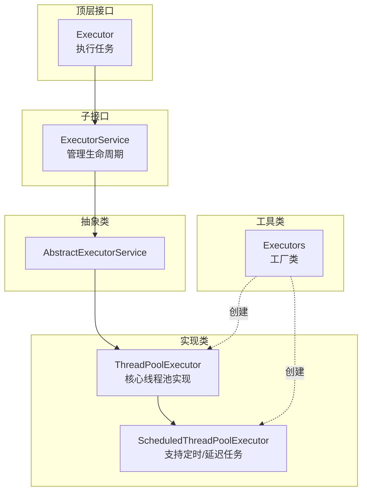
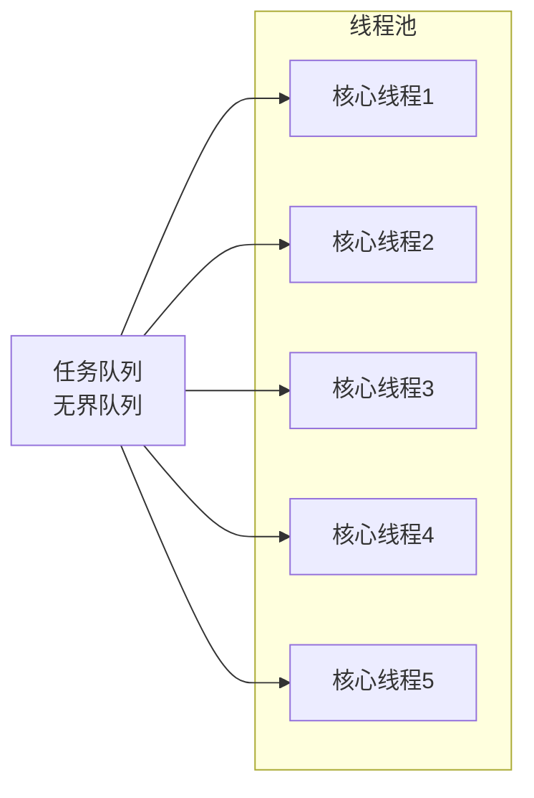
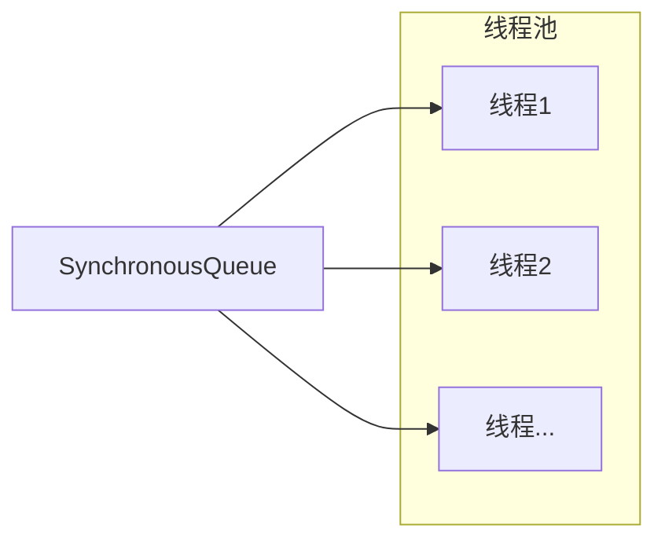
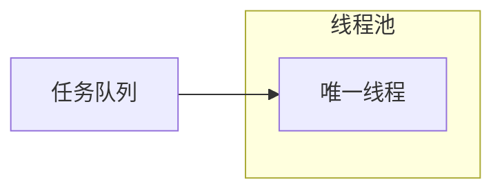
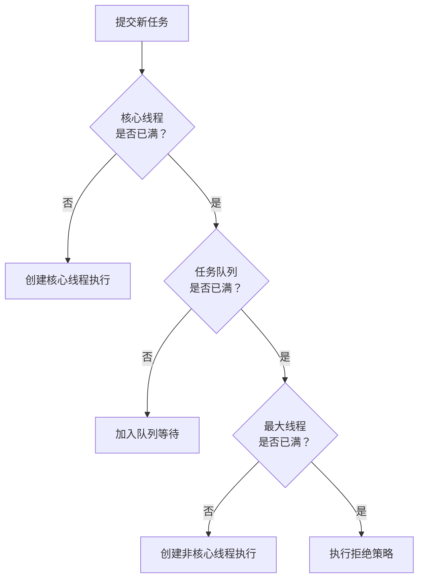

# 线程池与 Executor 框架

## 课程目标

- 理解线程池的设计思想和优势
- 掌握 `ExecutorService` 的创建与使用（四种常用线程池）
- 理解 `ThreadPoolExecutor` 的核心参数及其作用
- 掌握任务的提交方式以及线程池的关闭方法
- 能够使用 `Callable` 和 `Future` 获取异步任务结果


## 生活中的线程池类比

在正式学习之前，我们先通过生活中的例子理解“线程池”。

想象你开了一家**快递公司**，需要处理大量订单。你可以选择：

- **每次来一个订单就临时招一个快递员**：订单少时还行，订单多时招人忙不过来，而且招了又辞，效率极低（类比：每次任务都创建新线程）。
- **提前招聘一批固定数量的快递员**：有人下单就派一个去送，送完回来准备下一单，闲时可以休息。即使订单突然增多，也能从容应对，只是排队等待（类比：线程池）。

| 生活场景             | 编程概念                            |
| -------------------- | ----------------------------------- |
| 快递员               | **线程**                            |
| 快递单               | **任务**（`Runnable` / `Callable`） |
| 固定的快递员团队     | **线程池**（复用线程）              |
| 任务太多快递员都在忙 | **阻塞队列**（任务排队等待）        |
| 订单太少，快递员闲着 | **线程空闲回收**                    |

**线程池的好处：**

- 降低线程创建/销毁的开销
- 提高响应速度（线程已存在，无需等待创建）
- 统一管理线程资源，防止无限制创建导致系统崩溃


## Executor 框架体系



**核心接口说明：**

| 接口/类                       | 说明                                                |
| ----------------------------- | --------------------------------------------------- |
| `Executor`                    | 顶层接口，仅定义 `execute(Runnable command)` 方法   |
| `ExecutorService`             | 继承 `Executor`，扩展了生命周期管理、任务提交等方法 |
| `AbstractExecutorService`     | 提供 `ExecutorService` 的默认实现                   |
| `ThreadPoolExecutor`          | 核心线程池实现类                                    |
| `ScheduledThreadPoolExecutor` | 支持定时和延迟任务的线程池                          |
| `Executors`                   | 线程池工厂类，提供快速创建线程池的静态方法          |


## 四种常用线程池

`Executors` 类提供了四种常用的线程池创建方法。

### 1. `newFixedThreadPool(int nThreads)`

- **特点**：固定大小线程池，核心线程数 = 最大线程数 = nThreads。
- **适用**：负载较重的任务，线程数量固定的场景。

```java
ExecutorService executor = Executors.newFixedThreadPool(5);
```



### 2. `newCachedThreadPool()`

- **特点**：核心线程数为 0，最大线程数无限（`Integer.MAX_VALUE`），空闲线程存活 60 秒。
- **适用**：大量短生命周期的异步任务，任务执行时间短。

```java
ExecutorService executor = Executors.newCachedThreadPool();
```



### 3. `newSingleThreadExecutor()`

- **特点**：单线程线程池，确保任务顺序执行。
- **适用**：需要保证任务按顺序执行的场景（如日志写入）。

```java
ExecutorService executor = Executors.newSingleThreadExecutor();
```



### 4. `newScheduledThreadPool(int corePoolSize)`

- **特点**：支持定时和延迟执行任务。
- **适用**：定时任务、周期性任务。

```java
ScheduledExecutorService executor = Executors.newScheduledThreadPool(3);
```

**常用方法：**

| 方法                                                     | 说明                                           |
| -------------------------------------------------------- | ---------------------------------------------- |
| `schedule(Runnable command, long delay, TimeUnit unit)`  | 延迟执行一次                                   |
| `scheduleAtFixedRate(..., initialDelay, period, unit)`   | 固定频率执行（不受任务执行时间影响）           |
| `scheduleWithFixedDelay(..., initialDelay, delay, unit)` | 固定延迟执行（上一次结束后等待指定时间再执行） |

**示例：**

```java
ScheduledExecutorService scheduler = Executors.newScheduledThreadPool(2);
// 延迟3秒执行一次
scheduler.schedule(() -> System.out.println("延迟执行"), 3, TimeUnit.SECONDS);
// 初始延迟1秒，之后每2秒执行一次
scheduler.scheduleAtFixedRate(() -> System.out.println("周期性任务"), 1, 2, TimeUnit.SECONDS);
```


## `ThreadPoolExecutor` 核心参数

四种常用线程池实际上都是通过 `ThreadPoolExecutor` 构造器创建的。理解其核心参数是定制线程池的关键。

```java
public ThreadPoolExecutor(
    int corePoolSize,
    int maximumPoolSize,
    long keepAliveTime,
    TimeUnit unit,
    BlockingQueue<Runnable> workQueue,
    ThreadFactory threadFactory,
    RejectedExecutionHandler handler
)
```

### 参数详解

| 参数              | 说明                                         |
| ----------------- | -------------------------------------------- |
| `corePoolSize`    | 核心线程数（即使空闲也保留）                 |
| `maximumPoolSize` | 最大线程数（当队列满时，可创建的最大线程数） |
| `keepAliveTime`   | 非核心线程空闲存活时间                       |
| `unit`            | 时间单位                                     |
| `workQueue`       | 任务阻塞队列                                 |
| `threadFactory`   | 线程工厂（用于自定义线程创建）               |
| `handler`         | 拒绝策略（队列满且线程数已达最大时的处理）   |

### 线程池工作流程



### 工作队列（`BlockingQueue`）

| 队列类型                | 说明                                                    |
| ----------------------- | ------------------------------------------------------- |
| `ArrayBlockingQueue`    | 有界队列，必须指定容量                                  |
| `LinkedBlockingQueue`   | 可选择有界或无界（默认 `Integer.MAX_VALUE`）            |
| `SynchronousQueue`      | 容量为0，每个插入必须等待一个取出操作（缓存线程池使用） |
| `PriorityBlockingQueue` | 支持优先级排序的无界队列                                |

### 拒绝策略（`RejectedExecutionHandler`）

| 策略                  | 说明                                      |
| --------------------- | ----------------------------------------- |
| `AbortPolicy`         | 抛出 `RejectedExecutionException`（默认） |
| `CallerRunsPolicy`    | 由提交任务的线程（调用者）执行任务        |
| `DiscardPolicy`       | 静默丢弃无法处理的任务                    |
| `DiscardOldestPolicy` | 丢弃队列中最旧的任务，然后重试提交        |

### **自定义线程池**

```java
import java.util.concurrent.*;

public class CustomThreadPool {
    public static void main(String[] args) {
        ThreadPoolExecutor executor = new ThreadPoolExecutor(
            2,                           // 核心线程数
            5,                           // 最大线程数
            60,                          // 空闲存活时间
            TimeUnit.SECONDS,
            new ArrayBlockingQueue<>(10), // 有界队列
            new ThreadPoolExecutor.AbortPolicy() // 拒绝策略
        );

        // 提交任务
        for (int i = 0; i < 20; i++) {
            final int taskId = i;
            executor.execute(() -> {
                System.out.println(Thread.currentThread().getName() + " 执行任务 " + taskId);
                try { Thread.sleep(100); } catch (InterruptedException e) {}
            });
        }

        executor.shutdown();
    }
}
```


## 提交任务

### `execute(Runnable command)`

- 提交 `Runnable` 任务，没有返回值。
- 由 `Executor` 接口定义。

```java
executor.execute(() -> System.out.println("执行任务"));
```


### `submit(Callable<T> task)` / `submit(Runnable task)`

- 提交 `Runnable` 或 `Callable` 任务，返回 `Future` 对象。
- 由 `ExecutorService` 接口定义。
- 可获取任务结果或取消任务。

```java
Future<Integer> future = executor.submit(() -> {
    Thread.sleep(1000);
    return 42;
});
Integer result = future.get(); // 阻塞等待结果
```


### `execute` vs `submit`

| 方法      | 接口              | 参数                    | 返回值   | 异常处理               |
| --------- | ----------------- | ----------------------- | -------- | ---------------------- |
| `execute` | `Executor`        | `Runnable`              | 无       | 异常直接抛出（线程内） |
| `submit`  | `ExecutorService` | `Runnable` / `Callable` | `Future` | 异常封装在 `Future` 中 |


## `Callable` 与 `Future`

### `Callable` 接口（回顾）

与 `Runnable` 类似，但可以返回值且能抛出受检异常。

| 对比   | `Runnable`       | `Callable`       |
| ------ | ---------------- | ---------------- |
| 方法   | `void run()`     | `V call()`       |
| 返回值 | 无               | 有（泛型 V）     |
| 异常   | 不能抛出受检异常 | 可以抛出任何异常 |

```java
Callable<Integer> task = () -> {
    int sum = 0;
    for (int i = 1; i <= 100; i++) {
        sum += i;
    }
    return sum;
};
```


### `Future` 接口

`Future` 代表异步计算的结果，提供以下方法：

| 方法                                            | 说明                   |
| ----------------------------------------------- | ---------------------- |
| `boolean cancel(boolean mayInterruptIfRunning)` | 取消任务               |
| `boolean isCancelled()`                         | 是否已取消             |
| `boolean isDone()`                              | 是否已完成             |
| `V get()`                                       | 获取结果（阻塞等待）   |
| `V get(long timeout, TimeUnit unit)`            | 限时获取（超时抛异常） |

**完整示例：**

```java
import java.util.concurrent.*;

public class FutureDemo {
    public static void main(String[] args) throws Exception {
        ExecutorService executor = Executors.newFixedThreadPool(3);

        // 提交 Callable 任务
        Future<Integer> future = executor.submit(() -> {
            System.out.println("开始计算...");
            Thread.sleep(2000);
            return 100;
        });

        // 主线程可以同时做其他事情
        System.out.println("主线程继续执行...");

        // 获取结果（阻塞等待）
        System.out.println("结果: " + future.get());

        // 提交多个任务并收集结果
        List<Future<Integer>> futures = new ArrayList<>();
        for (int i = 0; i < 5; i++) {
            final int num = i;
            futures.add(executor.submit(() -> num * num));
        }
        for (Future<Integer> f : futures) {
            System.out.println(f.get());
        }

        executor.shutdown();
    }
}
```


## 关闭线程池

### `shutdown()`

- 平滑关闭：不再接受新任务，等待已提交任务执行完毕。
- 调用后，线程池状态变为 `SHUTDOWN`。

```java
executor.shutdown();
while (!executor.awaitTermination(60, TimeUnit.SECONDS)) {
    // 等待现有任务完成
}
System.out.println("所有任务完成");
```


### `shutdownNow()`

- 立即关闭：尝试停止正在执行的任务，返回未执行的任务列表。
- 调用后，线程池状态变为 `STOP`。

```java
List<Runnable> remaining = executor.shutdownNow();
System.out.println("剩余未执行任务: " + remaining.size());
```


### 关闭方法对比

| 方法            | 接受新任务 | 等待已有任务 | 中断正在执行的任务 |
| --------------- | ---------- | ------------ | ------------------ |
| `shutdown()`    | ❌          | ✅            | ❌                  |
| `shutdownNow()` | ❌          | ❌            | ✅（尝试中断）      |

> [!NOTE]
> 最佳实践：先调用 `shutdown()`，再调用 `awaitTermination()` 等待完成。若超时仍未结束，再调用 `shutdownNow()`。


## 注意事项与最佳实践

> [!CAUTION]
>
> 1. **务必关闭线程池**：不关闭会导致资源泄露（线程永不结束）。使用 `shutdown()` 或 `shutdownNow()`。
> 2. **不要用 `Executors` 创建无界队列线程池**：`newFixedThreadPool` 和 `newSingleThreadExecutor` 使用无界队列，任务过多可能导致内存溢出。建议自定义有界队列。
> 3. **合理设置核心线程数和最大线程数**：
>    - CPU 密集型：核心线程数 = CPU 核心数 + 1
>    - IO 密集型：核心线程数 = CPU 核心数 × 2（或更多）
> 4. **处理拒绝策略**：了解不同策略的后果，根据业务需求选择。
> 5. **避免使用 `newCachedThreadPool` 提交大量任务**：可能创建过多线程导致系统资源耗尽。
> 6. **`Future.get()` 可能永久阻塞**：使用带超时的版本，防止等待死锁。


## 作业

### 作业一：代码阅读——线程池执行顺序

阅读以下代码，写出可能的输出顺序。

```java
import java.util.concurrent.*;

public class ThreadPoolOrder {
    public static void main(String[] args) {
        ExecutorService executor = Executors.newFixedThreadPool(2);

        for (int i = 0; i < 5; i++) {
            final int taskId = i;
            executor.execute(() -> {
                System.out.println(Thread.currentThread().getName() + " 执行任务 " + taskId);
                try { Thread.sleep(100); } catch (InterruptedException e) {}
            });
        }
        executor.shutdown();
    }
}
```

**问题：**

- 线程池中有几个线程？任务如何分配给线程？
- 是否所有任务都会执行完毕？为什么？
- 如果将 `newFixedThreadPool(2)` 改为 `newCachedThreadPool()`，输出会有什么不同？

------

### 作业二：代码阅读——Future 与超时

阅读以下代码，回答下面的问题。

```java
import java.util.concurrent.*;

public class FutureTimeout {
    public static void main(String[] args) throws Exception {
        ExecutorService executor = Executors.newSingleThreadExecutor();

        Future<Integer> future = executor.submit(() -> {
            System.out.println("任务开始");
            Thread.sleep(5000);
            System.out.println("任务完成");
            return 100;
        });

        try {
            Integer result = future.get(2, TimeUnit.SECONDS);
            System.out.println("结果: " + result);
        } catch (TimeoutException e) {
            System.out.println("超时！");
            future.cancel(true);
        }
        executor.shutdown();
    }
}
```

**问题：**

- 程序会输出什么？为什么？
- 调用 `future.cancel(true)` 后，任务线程会怎样？
- 如果不取消任务，线程池关闭后任务会继续执行吗？

------

### 作业三：多任务并发求和

编写一个程序，使用线程池计算多个独立任务。

**要求：**

- 创建固定大小为 5 的线程池。
- 创建 10 个任务，每个任务计算 1 到 100 的随机子区间之和（如 1~100, 101~200, ... 直到 901~1000）。
- 使用 `Callable` 返回每个区间的和。
- 使用 `List<Future<Integer>>` 收集结果。
- 主线程汇总所有结果并打印总和。

**提示：** 区间可设为 `[i*100+1, (i+1)*100]`，`i` 从 0 到 9。

------

### 作业四：自定义线程池与拒绝策略

创建一个自定义线程池，参数如下：

- 核心线程数：2
- 最大线程数：4
- 工作队列：容量为 2 的有界队列
- 拒绝策略：使用 `CallerRunsPolicy`

提交 10 个任务（每个任务打印自身 ID 并休眠 1 秒），观察执行情况。

**输出示例（可能顺序不同，但应体现拒绝策略）：**

```text
pool-1-thread-1 执行任务 0
pool-1-thread-2 执行任务 1
pool-1-thread-3 执行任务 2
pool-1-thread-4 执行任务 3
任务 4 被拒绝，由主线程执行
...
```
