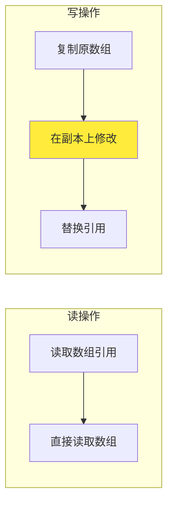
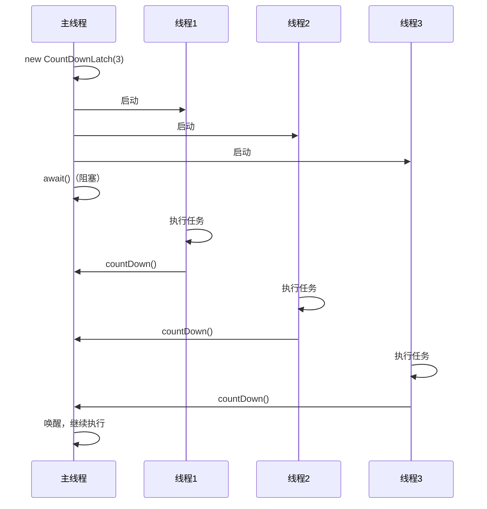
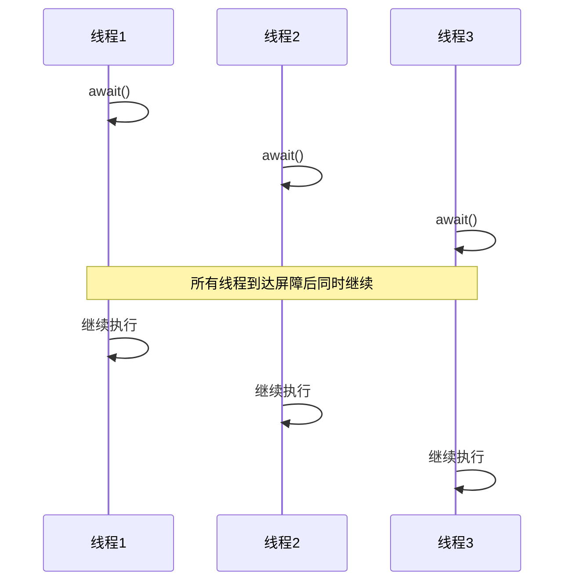
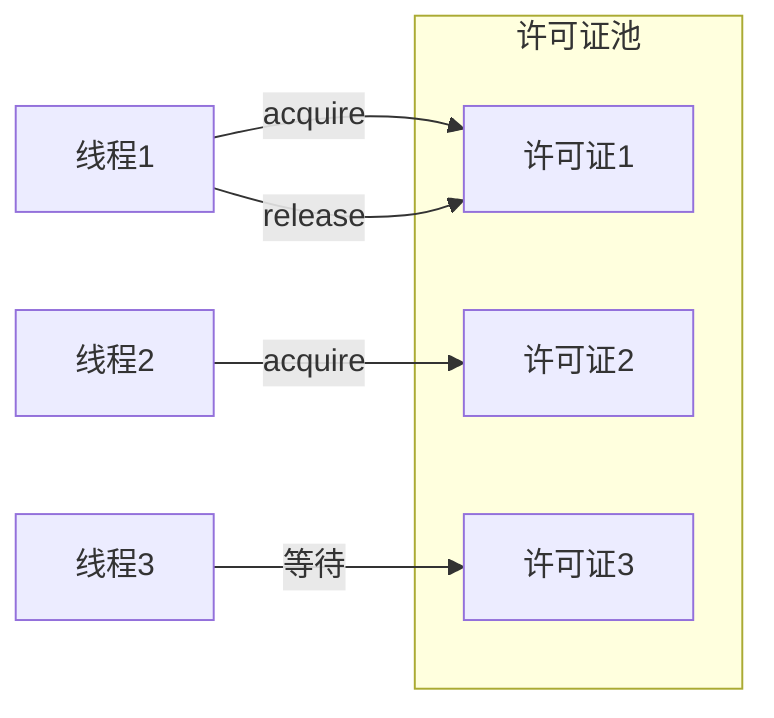

# 并发集合与同步工具类

## 课程目标

- 理解传统集合在多线程环境下的问题
- 掌握 `ConcurrentHashMap` 的原理和使用
- 掌握 `CopyOnWriteArrayList` 的适用场景
- 掌握 `BlockingQueue` 的使用（生产者-消费者模式）
- 掌握 `CountDownLatch`、`CyclicBarrier`、`Semaphore` 的用法
- 能够选择合适的并发工具解决实际并发问题


## 生活中的并发容器与协同工具

在正式学习之前，我们先通过生活中的例子理解这些概念。

| 生活场景                           | 编程概念                           |
| ---------------------------------- | ---------------------------------- |
| 公共停车位，多个入口同时进出       | `ConcurrentHashMap`（高并发访问）  |
| 图书馆的书籍列表，很少改但很多人读 | `CopyOnWriteArrayList`（读多写少） |
| 快递驿站，放入包裹，取出包裹       | `BlockingQueue`（队列阻塞）        |
| 运动会起跑线，等所有选手就绪才开跑 | `CyclicBarrier`（循环屏障）        |
| 团队协作，所有成员到齐才开始       | `CountDownLatch`（等待多个事件）   |
| 停车场限流，有车位才能进入         | `Semaphore`（信号量）              |


## 传统集合的线程安全问题

### 问题示例

```java
public class UnsafeCollection {
    public static void main(String[] args) throws InterruptedException {
        List<Integer> list = new ArrayList<>();
        Runnable task = () -> {
            for (int i = 0; i < 1000; i++) {
                list.add(i);
            }
        };
        Thread t1 = new Thread(task);
        Thread t2 = new Thread(task);
        t1.start();
        t2.start();
        t1.join();
        t2.join();
        System.out.println("列表大小: " + list.size()); // 可能小于 2000
    }
}
```

**问题分析：** `ArrayList` 不是线程安全的，`add` 操作可能导致数组越界、数据丢失或死循环。

### 解决方式对比

| 方式                           | 说明           | 性能                       |
| ------------------------------ | -------------- | -------------------------- |
| `Collections.synchronizedList` | 对整个方法加锁 | 差（全局锁）               |
| `CopyOnWriteArrayList`         | 写时复制       | 读好，写差（适合读多写少） |
| `ConcurrentHashMap`            | 分段/细粒度锁  | 好                         |


## `ConcurrentHashMap`

### 简介

`ConcurrentHashMap` 是 Java 并发包中最常用的并发容器，用于替代 `HashMap`（非线程安全）和 `Hashtable`（全部加锁，性能差）。

**核心设计：**

- **Java 7**：分段锁（Segment 数组），每个 Segment 独立锁。
- **Java 8+**：CAS + synchronized（锁粒度更细，仅锁特定桶）。

### 特点

- 线程安全，允许并发读和一定程度的并发写
- 不支持 `null` 键或值（与 `HashMap` 不同）
- 性能远高于 `Hashtable` 和 `Collections.synchronizedMap`

### 常用方法

| 方法                                       | 说明                       |
| ------------------------------------------ | -------------------------- |
| `put(key, value)`                          | 插入键值对                 |
| `get(key)`                                 | 获取值（无锁读）           |
| `remove(key)`                              | 删除键值对                 |
| `putIfAbsent(key, value)`                  | 只有键不存在时才插入       |
| `compute(key, remappingFunction)`          | 原子计算                   |
| `computeIfAbsent(key, mappingFunction)`    | 只有键不存在时才计算并插入 |
| `computeIfPresent(key, remappingFunction)` | 键存在时计算               |
| `merge(key, value, remappingFunction)`     | 合并值                     |

### 使用示例

```java
import java.util.concurrent.ConcurrentHashMap;

public class ConcurrentHashMapDemo {
    public static void main(String[] args) throws InterruptedException {
        ConcurrentHashMap<String, Integer> map = new ConcurrentHashMap<>();
        map.put("a", 1);
        map.put("b", 2);

        // 原子操作
        map.computeIfAbsent("c", key -> 3); // c=3
        map.merge("d", 4, (oldVal, newVal) -> oldVal + newVal); // d=4
        map.merge("d", 5, (oldVal, newVal) -> oldVal + newVal); // d=9

        System.out.println(map); // {a=1, b=2, c=3, d=9}

        // 多线程并发 put
        Runnable task = () -> {
            for (int i = 0; i < 1000; i++) {
                map.putIfAbsent("key", i); // 只插入一次
            }
        };
        Thread t1 = new Thread(task);
        Thread t2 = new Thread(task);
        t1.start();
        t2.start();
        t1.join();
        t2.join();
        System.out.println("最终 key 的值: " + map.get("key")); // 首次插入的值
    }
}
```


## `CopyOnWriteArrayList`

### 简介

写时复制容器，任何写操作（`add`、`set`、`remove`）都会创建底层数组的副本，然后在副本上修改，最后将引用指向新数组。



### 特点

- 读操作无锁，性能极高
- 写操作需要复制整个数组，开销大
- 保证最终一致性，适用于**读多写少**场景

### 适用场景

- 监听器列表（添加/删除监听器不频繁，读取频繁）
- 缓存配置（偶尔更新，频繁读取）
- 白名单/黑名单（只读为主）

### 使用示例

```java
import java.util.concurrent.CopyOnWriteArrayList;

public class CopyOnWriteArrayListDemo {
    public static void main(String[] args) {
        CopyOnWriteArrayList<String> list = new CopyOnWriteArrayList<>();
        list.add("a");
        list.add("b");
        list.add("c");

        // 迭代过程中允许修改（不会抛异常）
        for (String item : list) {
            System.out.println(item);
            if ("b".equals(item)) {
                list.add("d"); // 不会影响当前迭代
            }
        }
        System.out.println(list); // [a, b, c, d]
    }
}
```

> [!CAUTION]
>
> 写操作频繁的场景不要使用 `CopyOnWriteArrayList`，因为每次写都要复制整个数组，可能导致内存溢出。


## 阻塞队列 `BlockingQueue`

### 简介

`BlockingQueue` 是支持阻塞操作的队列，当队列空时获取元素会阻塞，当队列满时插入元素会阻塞。常用于生产者-消费者模式。

### 核心方法

**插入操作**

- **`add(e)`**：将元素插入队列。**若队列已满**，立即抛出 `IllegalStateException`（非法状态异常），不等待。
- **`offer(e)`**：将元素插入队列。**若队列已满**，立即返回 `false` 表示插入失败，不抛异常。
- **`put(e)`**：将元素插入队列。**若队列已满**，当前线程将无限期阻塞，直到队列腾出空间并被唤醒。
- **`offer(e, time, unit)`**：将元素插入队列。**若队列已满**，则限时阻塞等待；超时前有空位则返回 `true`，否则返回 `false`。

**移除操作（取出并删除队首）**

- **`remove()`**：取出并移除队首元素。**若队列为空**，立即抛出 `NoSuchElementException`（无元素异常）。
- **`poll()`**：取出并移除队首元素。**若队列为空**，立即返回 `null`，不抛异常。
- **`take()`**：取出并移除队首元素。**若队列为空**，当前线程将无限期阻塞，直到队列有元素可取。
- **`poll(time, unit)`**：取出并移除队首元素。**若队列为空**，则限时阻塞等待；超时前取到则返回该元素，否则返回 `null`。

**检查操作（只获取不删除）**

- **`element()`**：获取（不移除）队首元素。**若队列为空**，立即抛出 `NoSuchElementException`。
- **`peek()`**：获取（不移除）队首元素。**若队列为空**，立即返回 `null`，不抛异常。

### 常用实现类

| 实现                    | 说明                                            |
| ----------------------- | ----------------------------------------------- |
| `ArrayBlockingQueue`    | 有界队列，基于数组（必须指定容量）              |
| `LinkedBlockingQueue`   | 可选有界/无界，基于链表（默认无界）             |
| `SynchronousQueue`      | 容量为0，每个插入必须等待取出（缓存线程池使用） |
| `PriorityBlockingQueue` | 支持优先级排序的无界队列                        |
| `DelayQueue`            | 延迟队列，元素实现 `Delayed` 接口               |

### 生产者-消费者示例（基于 `ArrayBlockingQueue`）

```java
import java.util.concurrent.ArrayBlockingQueue;
import java.util.concurrent.BlockingQueue;

public class BlockingQueueDemo {
    private static final int CAPACITY = 5;
    private static final BlockingQueue<Integer> queue = new ArrayBlockingQueue<>(CAPACITY);

    static class Producer implements Runnable {
        @Override
        public void run() {
            int value = 0;
            try {
                while (true) {
                    queue.put(value); // 如果队列满则阻塞
                    System.out.println("生产: " + value + "，队列大小: " + queue.size());
                    value++;
                    Thread.sleep(300);
                }
            } catch (InterruptedException e) {}
        }
    }

    static class Consumer implements Runnable {
        @Override
        public void run() {
            try {
                while (true) {
                    int value = queue.take(); // 如果队列空则阻塞
                    System.out.println(Thread.currentThread().getName() + " 消费: " + value + "，队列大小: " + queue.size());
                    Thread.sleep(500);
                }
            } catch (InterruptedException e) {}
        }
    }

    public static void main(String[] args) {
        new Thread(new Producer()).start();
        new Thread(new Consumer(), "消费者1").start();
        new Thread(new Consumer(), "消费者2").start();
    }
}
```


### 基于 `SynchronousQueue` 的简易传递

```java
BlockingQueue<String> queue = new SynchronousQueue<>();
// 生产者线程
new Thread(() -> {
    try {
        queue.put("数据"); // 必须等待消费者取出
    } catch (InterruptedException e) {}
}).start();
// 消费者线程
new Thread(() -> {
    try {
        String data = queue.take(); // 必须等待生产者放入
        System.out.println("收到: " + data);
    } catch (InterruptedException e) {}
}).start();
```


## 同步工具类

### `CountDownLatch` —— 等待多个事件

**作用：** 使一个或多个线程等待其他线程完成一组操作。



**使用示例：**

```java
import java.util.concurrent.CountDownLatch;

public class CountDownLatchDemo {
    public static void main(String[] args) throws InterruptedException {
        int taskCount = 3;
        CountDownLatch latch = new CountDownLatch(taskCount);

        for (int i = 0; i < taskCount; i++) {
            final int id = i;
            new Thread(() -> {
                try {
                    System.out.println("线程 " + id + " 开始工作");
                    Thread.sleep((long) (Math.random() * 1000));
                    System.out.println("线程 " + id + " 完成");
                } catch (InterruptedException e) {}
                latch.countDown();
            }).start();
        }

        System.out.println("主线程等待所有任务完成...");
        latch.await(); // 阻塞直到计数器归零
        System.out.println("所有任务完成，主线程继续");
    }
}
```


### `CyclicBarrier` —— 循环屏障

**作用：** 让一组线程等待彼此达到某个公共屏障点。与 `CountDownLatch` 区别在于：`CyclicBarrier` 可以重复使用（循环）。



**使用示例：**

```java
import java.util.concurrent.BrokenBarrierException;
import java.util.concurrent.CyclicBarrier;

public class f {
    public static void main(String[] args) {
        int threadCount = 3;
        CyclicBarrier barrier = new CyclicBarrier(threadCount, () -> {
            // 所有线程到达屏障后执行的回调（可选项）
            System.out.println("所有线程到达屏障，执行回调");
        });

        for (int i = 0; i < threadCount; i++) {
            final int id = i;
            new Thread(() -> {
                try {
                    System.out.println("线程 " + id + " 到达屏障");
                    barrier.await(); // 等待其他线程
                    System.out.println("线程 " + id + " 越过屏障，继续执行");
                } catch (InterruptedException | BrokenBarrierException e) {}
            }).start();
        }
    }
}
```

**特点：**

- 可以重置（`reset()`）后重复使用
- 支持回调动作（所有线程到达屏障后执行）


### `Semaphore` —— 信号量

**作用：** 控制同时访问特定资源的线程数量，相当于限流器（令牌桶）。



**常用方法：**

| 方法                   | 说明                  |
| ---------------------- | --------------------- |
| `acquire()`            | 获取1个许可证（阻塞） |
| `acquire(int permits)` | 获取指定数量（阻塞）  |
| `tryAcquire()`         | 尝试获取（立即返回）  |
| `release()`            | 释放1个许可证         |
| `availablePermits()`   | 当前可用许可证数      |

**使用示例：**

```java
import java.util.concurrent.Semaphore;

public class SemaphoreDemo {
    public static void main(String[] args) {
        Semaphore semaphore = new Semaphore(3); // 最多允许3个线程同时访问

        for (int i = 0; i < 10; i++) {
            final int id = i;
            new Thread(() -> {
                try {
                    semaphore.acquire(); // 获取许可证
                    System.out.println("线程 " + id + " 获取许可证，开始工作");
                    Thread.sleep((long) (Math.random() * 2000));
                    System.out.println("线程 " + id + " 释放许可证");
                } catch (InterruptedException e) {}
                semaphore.release(); // 释放许可证
            }).start();
        }
    }
}
```


## 对比总结

### 并发集合对比

| 集合                           | 线程安全 | 性能         | 适用场景   |
| ------------------------------ | -------- | ------------ | ---------- |
| `ArrayList`                    | ❌        | 最高         | 单线程     |
| `Collections.synchronizedList` | ✅        | 低（全局锁） | 简单多线程 |
| `CopyOnWriteArrayList`         | ✅        | 读高，写低   | 读多写少   |
| `ConcurrentHashMap`            | ✅        | 高           | 高并发读写 |

### 同步工具类对比

| 工具             | 作用                 | 主要方法                 | 可重用 |
| ---------------- | -------------------- | ------------------------ | ------ |
| `CountDownLatch` | 等待多个事件完成     | `await()`, `countDown()` | ❌      |
| `CyclicBarrier`  | 等待多个线程到达屏障 | `await()`                | ✅      |
| `Semaphore`      | 控制并发访问数       | `acquire()`, `release()` | ✅      |

### 阻塞队列选择

| 队列                    | 容量             | 特点       |
| ----------------------- | ---------------- | ---------- |
| `ArrayBlockingQueue`    | 有界（指定大小） | 公平锁可配 |
| `LinkedBlockingQueue`   | 有界/无界        | 一般用无界 |
| `SynchronousQueue`      | 0                | 直接传递   |
| `PriorityBlockingQueue` | 无界             | 支持优先级 |
| `DelayQueue`            | 无界             | 延迟元素   |

### 技术选型

选择并发工具时，先理解具体场景（读多写少、生产者-消费者、限流等），再选择合适的工具

1. **并发集合**：
   - `ConcurrentHashMap`：高并发读写，原子操作丰富。
   - `CopyOnWriteArrayList`：读多写少场景，写时复制。
   - `BlockingQueue`：线程安全队列，支持阻塞操作（`put`/`take`）。
2. **同步工具类**：
   - `CountDownLatch`：等待一组任务完成。
   - `CyclicBarrier`：让多个线程等待彼此到达。
   - `Semaphore`：控制并发线程数。
3. **选择原则**：
   - 高并发读写 → `ConcurrentHashMap`。
   - 读多写少 → `CopyOnWriteArrayList`。
   - 生产者-消费者 → `BlockingQueue`。
   - 等待多个事件 → `CountDownLatch`。
   - 线程互相等待 → `CyclicBarrier`。
   - 限流 → `Semaphore`。


## 作业

### 作业一：代码阅读——并发集合使用

阅读以下代码，写出输出结果并说明原因。

```java
import java.util.concurrent.ConcurrentHashMap;

public class ConcurrentMapTest {
    public static void main(String[] args) throws InterruptedException {
        ConcurrentHashMap<String, Integer> map = new ConcurrentHashMap<>();
        map.put("key", 0);

        Runnable task = () -> {
            for (int i = 0; i < 10000; i++) {
                map.merge("key", 1, Integer::sum);
            }
        };

        Thread t1 = new Thread(task);
        Thread t2 = new Thread(task);
        t1.start();
        t2.start();
        t1.join();
        t2.join();
        System.out.println("最终值: " + map.get("key"));
    }
}
```

**问题：**

- 输出结果是多少？为什么？
- 如果使用 `HashMap` 代替 `ConcurrentHashMap`，结果会怎样？
- 如果使用 `map.put("key", map.get("key") + 1)` 代替 `merge`，结果会怎样？

------

### 作业二：代码阅读——同步工具类

阅读以下代码，写出输出顺序（5 行输出）。

```java
import java.util.concurrent.CountDownLatch;

public class CountDownLatchTest {
    public static void main(String[] args) throws InterruptedException {
        CountDownLatch latch = new CountDownLatch(2);
        System.out.println("A: 主线程启动");

        new Thread(() -> {
            System.out.println("B: 线程1 开始");
            try { Thread.sleep(500); } catch (Exception e) {}
            System.out.println("C: 线程1 完成");
            latch.countDown();
        }).start();

        new Thread(() -> {
            System.out.println("D: 线程2 开始");
            try { Thread.sleep(300); } catch (Exception e) {}
            System.out.println("E: 线程2 完成");
            latch.countDown();
        }).start();

        latch.await();
        System.out.println("F: 主线程继续");
    }
}
```

**问题：**

- 写出所有可能的输出顺序（至少 3 种）。
- 如果 `latch.await()` 改为 `latch.await(1, TimeUnit.SECONDS)` 会发生什么？

------

### 作业三：使用 ConcurrentHashMap 实现词频统计

编写一个多线程词频统计程序，使用 `ConcurrentHashMap` 统计文件中单词出现次数（模拟）。

**要求：**

- 创建 5 个线程，每个线程处理一段文本（可硬编码字符串数组）。
- 使用 `ConcurrentHashMap` 存储统计结果。
- 使用 `merge` 或 `compute` 原子更新单词计数。
- 所有线程完成后，打印所有单词及其出现次数。

**示例数据：** 每个线程处理一段包含多个单词的文本（重复单词需要合并统计）。

------

### 作业四：使用 Semaphore 实现资源限流

编写一个模拟数据库连接池的程序，使用 `Semaphore` 限制最大并发连接数为 3。

**要求：**

- 创建 `Semaphore` 许可证数为 3。
- 创建 10 个线程，每个线程模拟获取连接（`acquire`）、执行业务操作（随机休眠 500~2000ms）、释放连接（`release`）。
- 打印每个线程获取连接和释放连接的时间（或日志），观察并发数不会超过 3。
