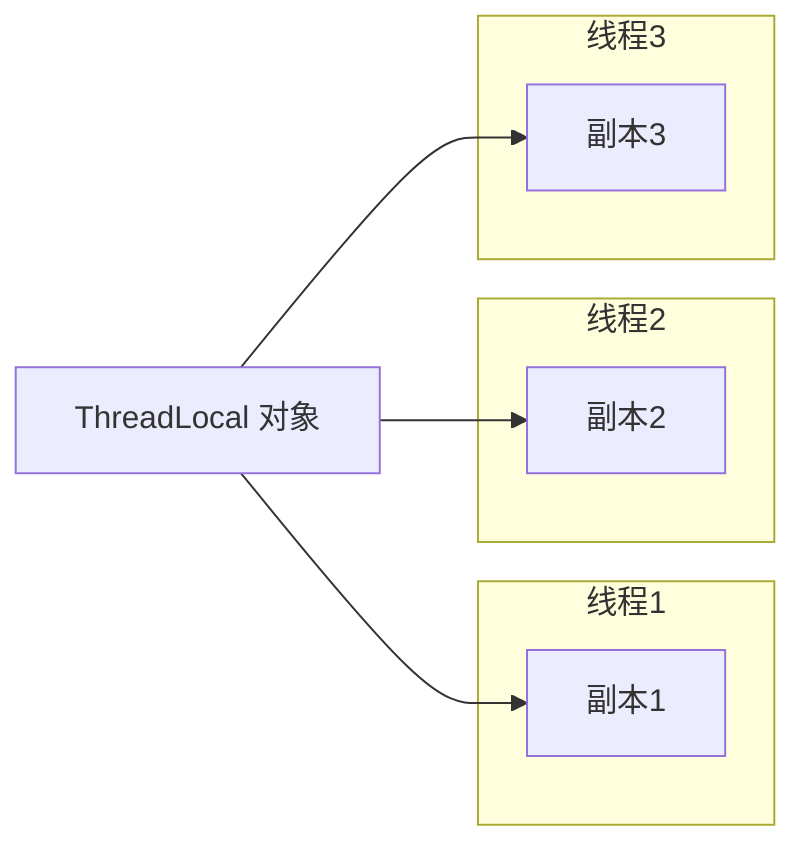
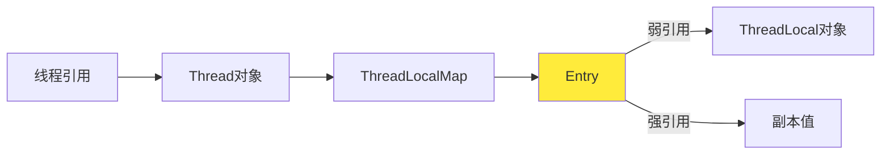
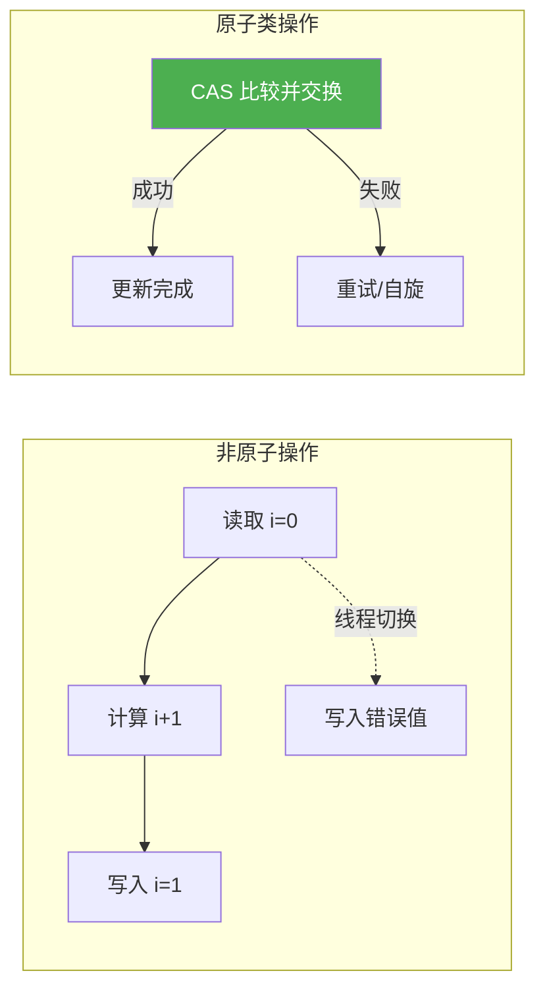

# 高级并发与最佳实践

## 课程目标

- 掌握 `CompletableFuture` 异步编程模型（链式调用、组合、异常处理）
- 掌握 `ThreadLocal` 的使用场景与内存泄漏防范
- 掌握原子类的使用方法
- 掌握并发编程的一组最佳实践

------


## `CompletableFuture` —— 异步编程的利器

### 为什么需要 `CompletableFuture`

回顾：`Future` 代表异步计算的结果，提供以下方法：

| 方法                                            | 说明                   |
| ----------------------------------------------- | ---------------------- |
| `boolean cancel(boolean mayInterruptIfRunning)` | 取消任务               |
| `boolean isCancelled()`                         | 是否已取消             |
| `boolean isDone()`                              | 是否已完成             |
| `V get()`                                       | 获取结果（阻塞等待）   |
| `V get(long timeout, TimeUnit unit)`            | 限时获取（超时抛异常） |

传统 `Future` 的局限性：

- 只能通过阻塞（`get()`）或轮询（`isDone()`）获取结果
- 无法链式组合多个异步任务
- 无法处理异常链
- 无法手动完成（设定结果）

`CompletableFuture` 弥补了这些缺陷，提供了函数式异步编程能力。

### 创建异步任务

| 方法                              | 说明                 |
| --------------------------------- | -------------------- |
| `supplyAsync(Supplier<T>)`        | 异步执行有返回值任务 |
| `runAsync(Runnable)`              | 异步执行无返回值任务 |
| `supplyAsync(Supplier, Executor)` | 指定线程池           |

```java
import java.util.concurrent.CompletableFuture;

public class CompletableFutureCreate {
    public static void main(String[] args) throws Exception {
        // 有返回值（使用 ForkJoinPool.commonPool()）
        CompletableFuture<String> future1 = CompletableFuture.supplyAsync(() -> {
            try { Thread.sleep(1000); } catch (Exception e) {}
            return "Hello";
        });

        // 无返回值
        CompletableFuture<Void> future2 = CompletableFuture.runAsync(() -> {
            System.out.println("异步任务执行");
        });

        // 指定线程池
        ExecutorService executor = Executors.newFixedThreadPool(2);
        CompletableFuture<String> future3 = CompletableFuture.supplyAsync(() -> "Result", executor);

        // 获取结果
        System.out.println(future1.get()); // Hello
        executor.shutdown();
    }
}
```

### 链式组合


| 方法                   | 说明                       |
| ---------------------- | -------------------------- |
| `thenApply(Function)`  | 对结果进行转换（有返回值） |
| `thenAccept(Consumer)` | 消费结果（无返回值）       |
| `thenRun(Runnable)`    | 执行动作（不依赖结果）     |

**示例：**

```java
public class ChainDemo {
    public static void main(String[] args) throws Exception {
        CompletableFuture.supplyAsync(() -> {
                    return "Hello";
                })
                .thenApply(s -> s + " World")          // 转换
                .thenApply(String::toUpperCase)         // 继续转换
                .thenAccept(System.out::println)        // 消费：输出 HELLO WORLD
                .thenRun(() -> System.out.println("完成")) // 执行动作
                .get();
    }
}
```


### 组合多个 `CompletableFuture`

| 方法                                         | 说明                                     |
| -------------------------------------------- | ---------------------------------------- |
| `thenCombine(CompletableFuture, BiFunction)` | 等待两个任务完成，合并结果               |
| `thenCompose(Function)`                      | 扁平映射（一个任务依赖另一个任务的结果） |
| `allOf(CompletableFuture...)`                | 等待所有任务完成（无返回值）             |
| `anyOf(CompletableFuture...)`                | 等待任意一个任务完成                     |

**示例：**

```java
public class CombineDemo {
    public static void main(String[] args) throws Exception {
        CompletableFuture<Integer> future1 = CompletableFuture.supplyAsync(() -> 10);
        CompletableFuture<Integer> future2 = CompletableFuture.supplyAsync(() -> 20);

        // 组合两个结果
        CompletableFuture<Integer> combined = future1.thenCombine(future2, (a, b) -> a + b);
        System.out.println(combined.get()); // 30

        // 依赖关系：future3 依赖 future1 的结果
        CompletableFuture<Integer> future3 = future1.thenCompose(result -> 
                CompletableFuture.supplyAsync(() -> result * 2)
        );
        System.out.println(future3.get()); // 20

        // 等待所有任务完成
        CompletableFuture<Void> all = CompletableFuture.allOf(future1, future2);
        all.get(); // 阻塞直到全部完成
    }
}
```


### 异常处理

| 方法                      | 说明                               |
| ------------------------- | ---------------------------------- |
| `exceptionally(Function)` | 发生异常时提供备用值               |
| `handle(BiFunction)`      | 无论是否异常，都处理结果（可转换） |

```java
public class ExceptionDemo {
    public static void main(String[] args) throws Exception {
        CompletableFuture<Integer> future = CompletableFuture.supplyAsync(() -> {
            if (true) throw new RuntimeException("出错了");
            return 100;
        }).exceptionally(ex -> {
            System.out.println("异常: " + ex.getMessage());
            return 0; // 备用值
        });

        System.out.println(future.get()); // 0

        // 使用 handle
        CompletableFuture<String> future2 = CompletableFuture.supplyAsync(() -> {
            if (true) throw new RuntimeException("错误");
            return "OK";
        }).handle((result, ex) -> {
            if (ex != null) {
                return "发生异常: " + ex.getMessage();
            }
            return result;
        });
        System.out.println(future2.get());
    }
}
```


### 超时与取消

```java
CompletableFuture<Integer> future = CompletableFuture.supplyAsync(() -> {
    try { Thread.sleep(5000); } catch (Exception e) {}
    return 42;
});

// 3秒超时，超时返回默认值
future.completeOnTimeout(-1, 3, TimeUnit.SECONDS);
System.out.println(future.get()); // -1

// 或抛出超时异常
future.orTimeout(3, TimeUnit.SECONDS);
```

> [!NOTE]
> `CompletableFuture` 的链式调用非常强大，但要注意避免过长的链（可读性下降）。合理使用 `thenApply`、`thenAccept` 的组合。


## `ThreadLocal` —— 线程本地变量

### 简介

`ThreadLocal` 为每个线程提供独立的变量副本，线程之间互不干扰。



### 常用方法

| 方法           | 说明                               |
| -------------- | ---------------------------------- |
| `get()`        | 获取当前线程的副本值               |
| `set(T value)` | 设置当前线程的副本值               |
| `remove()`     | 移除当前线程的副本（防止内存泄漏） |

### 使用场景

- 线程上下文（如用户会话信息）
- 数据库连接（每个线程持有自己的连接）
- 事务管理
- 线程安全的日期格式化（`SimpleDateFormat`）

### 示例：线程安全的 `SimpleDateFormat`

```java
import java.text.SimpleDateFormat;
import java.util.Date;

public class ThreadLocalDemo {
    // 每个线程拥有独立的 SimpleDateFormat 实例
    private static final ThreadLocal<SimpleDateFormat> dateFormat =
            ThreadLocal.withInitial(() -> new SimpleDateFormat("yyyy-MM-dd HH:mm:ss"));

    public static String formatDate(Date date) {
        return dateFormat.get().format(date);
    }

    public static void main(String[] args) {
        Runnable task = () -> {
            System.out.println(Thread.currentThread().getName() + ": " +
                    formatDate(new Date()));
        };
        for (int i = 0; i < 3; i++) {
            new Thread(task).start();
        }
    }
}
```

### 内存泄漏问题



**问题：** 如果线程长期存活（如线程池中的线程），且 `ThreadLocal` 对象被 GC 回收，但键为 `null` 的 Entry 仍然存在，导致值无法回收，造成内存泄漏。

**解决方法：** 使用 `try-finally` 确保 `remove()` 被调用。

```java
public void doWork() {
    SimpleDateFormat sdf = dateFormat.get();
    try {
        // 使用 sdf
    } finally {
        dateFormat.remove(); // 必须显式移除
    }
}
```

> [!CAUTION]
> 在线程池中使用 `ThreadLocal` 务必调用 `remove()`，否则可能导致内存泄漏。


## 原子类

### 简介

在多线程环境下，对共享变量进行 `i++` 等操作并非原子性，通常需要 `synchronized` 或 `Lock` 来保证线程安全。`java.util.concurrent.atomic` 包提供了一系列原子类，利用 **CAS（Compare-And-Swap）** 机制，在无锁的情况下实现线程安全的原子操作，性能更高。



### 常用原子类

| 类名                 | 说明                         |
| -------------------- | ---------------------------- |
| `AtomicInteger`      | 原子更新 `int` 类型          |
| `AtomicLong`         | 原子更新 `long` 类型         |
| `AtomicBoolean`      | 原子更新 `boolean` 类型      |
| `AtomicReference<V>` | 原子更新对象引用             |
| `AtomicIntegerArray` | 原子更新数组中的 `int` 元素  |
| `LongAdder`          | 高并发下累加性能更优（分段） |

### 常用方法（以 `AtomicInteger` 为例）

| 方法                                            | 说明                                   |
| ----------------------------------------------- | -------------------------------------- |
| `get()`                                         | 获取当前值                             |
| `set(int newValue)`                             | 设置新值（非原子，但可见）             |
| `getAndSet(int newValue)`                       | 原子设置为新值，并返回旧值             |
| `compareAndSet(int expect, int update)`         | 如果当前值等于预期值，则原子更新为新值 |
| `getAndIncrement()` / `incrementAndGet()`       | 原子自增，返回旧值/新值                |
| `getAndAdd(int delta)` / `addAndGet(int delta)` | 原子增加指定值，返回旧值/新值          |
| `updateAndGet(IntUnaryOperator)`                | 原子更新（基于函数式接口）             |

### 使用场景

- **计数器**（如请求计数、点击量）
- **状态标志**（如开关状态，`AtomicBoolean`）
- **对象引用原子更新**（如单例、配置切换）
- **高性能累加**（`LongAdder` 替代 `AtomicLong`）
- **实现非阻塞算法**（如自旋锁、无界队列）

### 示例：原子计数器

```java
import java.util.concurrent.atomic.AtomicInteger;

public class AtomicDemo {

    // 原子整数，初始值为 0
    private static final AtomicInteger counter = new AtomicInteger(0);

    public static void main(String[] args) throws InterruptedException {
        // 线程数量
        int threadCount = 10;
        // 每个线程执行累加次数
        int incrementsPerThread = 1000;

        // 创建并启动多个线程
        Thread[] threads = new Thread[threadCount];
        for (int i = 0; i < threadCount; i++) {
            threads[i] = new Thread(() -> {
                for (int j = 0; j < incrementsPerThread; j++) {
                    counter.incrementAndGet();  // 原子操作，线程安全
                }
            });
            threads[i].start();
        }

        // 等待所有线程执行完毕
        for (Thread t : threads) {
            t.join();
        }

        // 输出最终结果
        int expected = threadCount * incrementsPerThread;
        System.out.println("实际结果: " + counter.get());
        System.out.println("期望结果: " + expected);
        System.out.println("结果正确? " + (counter.get() == expected));
    }
}
```


## 作业

### 作业一：代码阅读——CompletableFuture 链式调用

阅读以下代码，写出输出结果。

```java
import java.util.concurrent.CompletableFuture;

public class CompletableFutureOrder {
    public static void main(String[] args) throws Exception {
        CompletableFuture.supplyAsync(() -> {
            System.out.println("A");
            return 1;
        }).thenApplyAsync(x -> {
            System.out.println("B");
            return x + 1;
        }).thenApplyAsync(x -> {
            System.out.println("C");
            return x * 2;
        }).thenAccept(x -> {
            System.out.println("结果: " + x);
        }).get();
    }
}
```

**问题：**

- 输出顺序一定是 A, B, C, 结果吗？请说明原因。
- 如果改用 `thenApply` 而非 `thenApplyAsync`，输出顺序会怎样？

------

### 作业二：代码阅读——CompletableFuture 异常处理

阅读以下代码，写出输出结果。

```java
public class CompletableFutureException {
    public static void main(String[] args) throws Exception {
        CompletableFuture<Integer> future = CompletableFuture.supplyAsync(() -> {
            if (true) throw new RuntimeException("错误!");
            return 10;
        }).exceptionally(ex -> {
            System.out.println("处理异常: " + ex.getMessage());
            return -1;
        }).thenApply(x -> x * 2);

        System.out.println(future.get());
    }
}
```

**问题：**

- 输出结果是什么？如果去掉 `exceptionally`，`future.get()` 会怎样？

------

### 作业三：使用 CompletableFuture 并行请求

模拟多个 API 请求，使用 `CompletableFuture` 并行调用并汇总结果。

**要求：**

- 创建 3 个模拟任务，分别延迟 1000ms、2000ms、1500ms，返回各自的“数据”。
- 使用 `allOf` 等待所有任务完成。
- 将所有结果拼接成一个字符串并打印（顺序不重要）。
- 设置总超时 3 秒，超时则打印“超时”。

**提示：** 每个任务可用 `CompletableFuture.supplyAsync(() -> { Thread.sleep(...); return "数据"; })`。

------

### 作业四：ThreadLocal 在 Web 应用中的模拟

模拟一个 Web 应用的请求处理，使用 `ThreadLocal` 存储请求 ID。

**要求：**

- 创建一个 `RequestContext` 类，静态 `ThreadLocal<String>` 存储当前请求 ID。
- 启动 5 个线程模拟并发请求，每个线程生成唯一 ID（如 UUID），存入 `ThreadLocal`，然后执行一个模拟业务方法（打印当前线程名和请求 ID），最后清理 `ThreadLocal`。
- 验证不同线程之间的请求 ID 互不干扰。

