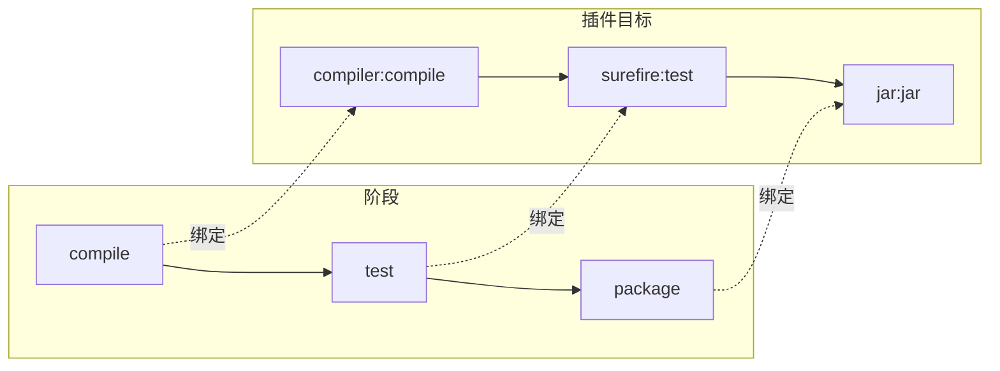

# Maven生命周期与插件体系

课程目标

- 理解 Maven 三大生命周期的概念、阶段及执行顺序
- 掌握 clean、default、site 生命周期的各个阶段及其作用
- 理解生命周期与插件目标的绑定关系
- 熟悉常用的核心插件（编译、测试、打包、源码、文档等）及其配置方法
- 掌握插件配置语法（`<plugins>`、`<pluginManagement>`、`<executions>`）
- 能够根据项目需求组合使用 Maven 命令和插件扩展构建能力

------


## 生活中的类比：从咖啡店到构建工厂

在正式学习之前，先通过两个生活场景理解“生命周期”和“插件”的关系。

### 场景一：咖啡制作流程（生命周期）

| 阶段 | 咖啡制作流程         | Maven 生命周期阶段      |
| ---- | -------------------- | ----------------------- |
| 准备 | 检查设备、准备咖啡豆 | `validate`（验证项目）  |
| 处理 | 研磨咖啡豆、萃取浓缩 | `compile`（编译源码）   |
| 检验 | 品尝、检查品质       | `test`（执行测试）      |
| 包装 | 装入杯/瓶、贴标签    | `package`（打包）       |
| 验收 | 最终质量检查         | `verify`（集成测试）    |
| 上架 | 放到销售台           | `install`（安装到本地） |
| 配送 | 外卖配送             | `deploy`（部署到远程）  |
| 清洁 | 关店前清理设备       | `clean`（清理构建产物） |

Maven 的生命周期就像这个完整流程——每个阶段有固定顺序，执行后面阶段时前面所有阶段自动执行。

### 场景二：万能料理机（插件）

| 生活场景                            | Maven 概念                         |
| ----------------------------------- | ---------------------------------- |
| 料理机主体（电机、底座）            | Maven 核心引擎（生命周期）         |
| 不同的刀头/附件（搅拌、榨汁、研磨） | **插件**（执行具体任务的工具）     |
| 安装刀头后就能执行特定料理操作      | 插件绑定到生命周期阶段执行具体任务 |
| 标配刀头                            | **核心插件**（默认绑定）           |
| 选配附件（冰淇淋机）                | **第三方插件**（按需引入）         |

**核心思想：** 生命周期定义“**什么时候做**”，插件决定“**具体怎么做**”。通过更换或配置插件，可以灵活扩展构建能力。

------


## Maven 生命周期

### 什么是生命周期

Maven 的生命周期定义了项目构建的**标准流程**，它将整个构建过程划分为一系列**阶段（Phase）**。每个阶段按顺序执行，执行后面的阶段时，前面的所有阶段都会自动执行。

```
执行 mvn package 时：
validate → compile → test → package
（test 之前的阶段都会自动执行）
```


### 三大生命周期

Maven定义了**三套独立的生命周期**，每套生命周期包含一组阶段：

| 生命周期    | 说明             | 核心用途               |
| ----------- | ---------------- | ---------------------- |
| **clean**   | 清理构建产物     | 删除target目录         |
| **default** | 构建项目（核心） | 编译、测试、打包、部署 |
| **site**    | 生成项目站点     | 生成文档和报告         |

> [!NOTE]
>
> 这三套生命周期是相互独立的。执行 `mvn clean package` 时，会依次执行clean生命周期的阶段和default生命周期的阶段（从开始到package）。

生命周期特点

- **顺序执行**：阶段之间按固定顺序执行，前面的阶段完成后才执行后续阶段。
- **前置条件**：执行某个阶段时，所有前置阶段都会自动执行（如执行 `package` 会自动执行 `validate` → `compile` → `test` → `package`）。
- **独立性**：不同生命周期的阶段之间没有前置依赖关系。


### clean 生命周期

包含 3 个阶段：

| 阶段         | 说明                                |
| ------------ | ----------------------------------- |
| `pre-clean`  | 清理前执行的操作（如备份）          |
| `clean`      | 删除 `target/` 目录下的所有构建产物 |
| `post-clean` | 清理后执行的操作                    |

```
mvn clean
```

**常用场景：**

- 重新构建前清理旧文件，确保全新构建
- 解决因缓存导致的构建问题

> [!CAUTION]
>
> `mvn clean` 会删除 `target/` 目录下的所有文件，包括编译生成的 `.class` 文件和打包的 JAR/WAR 文件。

------


### default 生命周期（核心）

default 生命周期包含了项目构建的完整流程，以下是主要阶段：

| 阶段       | 说明                                 | 对应命令       | 默认绑定的插件目标                               |
| ---------- | ------------------------------------ | -------------- | ------------------------------------------------ |
| `validate` | 验证项目结构是否正确                 | `mvn validate` | 无默认插件                                       |
| `compile`  | 编译主代码（`src/main/java`）        | `mvn compile`  | `maven-compiler-plugin:compile`                  |
| `test`     | 执行单元测试（不打包）               | `mvn test`     | `maven-surefire-plugin:test`                     |
| `package`  | 打包（JAR/WAR 等）                   | `mvn package`  | `maven-jar-plugin:jar` 或 `maven-war-plugin:war` |
| `verify`   | 验证包是否符合质量标准               | `mvn verify`   | `maven-failsafe-plugin:verify`                   |
| `install`  | 安装到本地仓库（`~/.m2/repository`） | `mvn install`  | `maven-install-plugin:install`                   |
| `deploy`   | 部署到远程仓库（如 Nexus）           | `mvn deploy`   | `maven-deploy-plugin:deploy`                     |

#### validate（验证）

验证项目信息是否正确：POM文件语法正确、必要的配置完整等。

```
mvn validate
```

#### compile（编译）

编译 `src/main/java` 下的Java源代码，将生成的 `.class` 文件输出到 `target/classes`。

```
mvn compile
```

执行后会生成：

```
target/
└── classes/
    └── com/example/
        └── App.class
```

#### test（测试）

执行 `src/test/java` 下的单元测试（使用JUnit等测试框架）。

```
mvn test
```

> [!NOTE]
>
> 测试失败会中断构建过程，阻止后续阶段执行。

#### package（打包）

根据 `<packaging>` 类型生成对应的归档文件：

- `jar` → `target/xxx-version.jar`
- `war` → `target/xxx-version.war`

```
mvn package
```

#### verify（验证）

验证打包后的文件是否符合质量要求（如集成测试、代码覆盖率检查）。

```
mvn verify
```

#### install（安装）

将打包后的 JAR/WAR 安装到本地Maven仓库（`~/.m2/repository`），供本机其他Maven项目使用。

```
mvn install
```

安装后在本地仓库的路径：

```
~/.m2/repository/com/example/my-app/1.0-SNAPSHOT/
├── my-app-1.0-SNAPSHOT.jar
├── my-app-1.0-SNAPSHOT.pom
└── ...
```

#### deploy（部署）

将打包后的文件部署到远程Maven仓库（如Nexus私服），供团队其他成员使用。

```
mvn deploy
```

> [!NOTE]
>
> 虽然阶段很多，但日常开发中最常用的是：`compile`、`test`、`package`、`install`、`deploy`。


### site 生命周期

用于生成项目文档和报告，包含 4 个阶段：

| 阶段          | 说明                 |
| ------------- | -------------------- |
| `pre-site`    | 生成站点前执行的操作 |
| `site`        | 生成项目站点文档     |
| `post-site`   | 生成站点后执行的操作 |
| `site-deploy` | 将站点部署到服务器   |

```
# 生成项目站点
mvn site

# 生成并部署站点
mvn site-deploy
```

站点内容包括：项目信息、开发者列表、依赖列表、Javadoc、测试报告、代码复杂度分析等。

------


## Maven 插件体系

### 插件与目标（Plugin & Goal）

- **插件（Plugin）**：执行具体构建任务的工具包，例如 `maven-compiler-plugin`。
- **目标（Goal）**：插件中具体执行的操作单元，例如 `compile` 目标。

调用格式：`mvn 插件前缀:目标`，如 `mvn compiler:compile`。
也可以直接绑定到生命周期阶段，通过 `mvn 阶段` 触发。


### 插件分类

| 类型           | 说明                               | 示例                                                      |
| -------------- | ---------------------------------- | --------------------------------------------------------- |
| **核心插件**   | Maven 自带，默认绑定到生命周期阶段 | `compiler`、`surefire`、`jar`、`war`、`install`、`deploy` |
| **标准插件**   | Maven 官方维护，但不默认绑定       | `source`、`javadoc`、`dependency`                         |
| **第三方插件** | 社区或企业开发                     | `spring-boot-maven-plugin`、`docker-maven-plugin`         |


### 生命周期与插件目标的绑定关系

生命周期阶段本身不执行任何操作，它们通过绑定**插件目标**来完成实际工作。下表展示了默认绑定关系：

| 生命周期阶段     | 默认绑定的插件目标              |
| ---------------- | ------------------------------- |
| `compile`        | `maven-compiler-plugin:compile` |
| `test`           | `maven-surefire-plugin:test`    |
| `package`（jar） | `maven-jar-plugin:jar`          |
| `package`（war） | `maven-war-plugin:war`          |
| `install`        | `maven-install-plugin:install`  |
| `deploy`         | `maven-deploy-plugin:deploy`    |



### 核心插件详解

#### `maven-compiler-plugin` —— 编译配置

控制 JDK 版本、编码等编译参数。

```xml
<build>
    <plugins>
        <plugin>
            <groupId>org.apache.maven.plugins</groupId>
            <artifactId>maven-compiler-plugin</artifactId>
            <version>3.10.1</version>
            <configuration>
                <source>11</source>
                <target>11</target>
                <encoding>UTF-8</encoding>
            </configuration>
        </plugin>
    </plugins>
</build>
```

**简化方式（推荐）：**

```xml
<properties>
    <maven.compiler.source>11</maven.compiler.source>
    <maven.compiler.target>11</maven.compiler.target>
    <project.build.sourceEncoding>UTF-8</project.build.sourceEncoding>
</properties>
```

#### maven-surefire-plugin` —— 测试执行

绑定到 `test` 阶段，支持 JUnit、TestNG。

```xml
<plugin>
    <groupId>org.apache.maven.plugins</groupId>
    <artifactId>maven-surefire-plugin</artifactId>
    <version>3.0.0-M7</version>
    <configuration>
        <skipTests>false</skipTests>
        <testFailureIgnore>false</testFailureIgnore>
        <includes>
            <include>**/*Test.java</include>
        </includes>
    </configuration>
</plugin>
```

**命令行常用：**

```
# 跳过测试执行
mvn clean package -DskipTests

# 运行特定测试类
mvn test -Dtest=MyTest

# 运行匹配模式的测试
mvn test -Dtest=*ServiceTest
```

| 参数                     | 编译测试代码 | 执行测试 |
| ------------------------ | ------------ | -------- |
| `-DskipTests`            | ✅            | ❌        |
| `-Dmaven.test.skip=true` | ❌            | ❌        |

#### maven-jar-plugin` —— JAR 打包

配置可执行 JAR（包含 `Main-Class`）：

```xml
<plugin>
    <groupId>org.apache.maven.plugins</groupId>
    <artifactId>maven-jar-plugin</artifactId>
    <version>3.2.2</version>
    <configuration>
        <archive>
            <manifest>
                <mainClass>com.example.MainApp</mainClass>
            </manifest>
        </archive>
    </configuration>
</plugin>
```

#### maven-war-plugin` —— WAR 打包

用于将Web项目打包为WAR文件（默认绑定到 `package` 阶段）。

```xml
<plugin>
    <groupId>org.apache.maven.plugins</groupId>
    <artifactId>maven-war-plugin</artifactId>
    <version>3.3.2</version>
    <configuration>
        <failOnMissingWebXml>false</failOnMissingWebXml>
    </configuration>
</plugin>
```

------


### 实用插件介绍

#### `maven-source-plugin` —— 源码打包

便于发布到仓库供他人调试查看。

```xml
<plugin>
    <groupId>org.apache.maven.plugins</groupId>
    <artifactId>maven-source-plugin</artifactId>
    <version>3.2.1</version>
    <executions>
        <execution>
            <id>attach-sources</id>
            <phase>package</phase>
            <goals>
                <goal>jar</goal>
            </goals>
        </execution>
    </executions>
</plugin>
```

#### `maven-javadoc-plugin` —— 文档生成

用于生成Javadoc文档。

```xml
<plugin>
    <groupId>org.apache.maven.plugins</groupId>
    <artifactId>maven-javadoc-plugin</artifactId>
    <version>3.4.1</version>
    <executions>
        <execution>
            <id>attach-javadocs</id>
            <phase>package</phase>
            <goals>
                <goal>jar</goal>
            </goals>
        </execution>
    </executions>
</plugin>
```

#### `maven-dependency-plugin` —— 依赖分析与管理

常用目标：

- `dependency:tree` —— 查看依赖树
- `dependency:analyze` —— 分析未使用的依赖
- `dependency:copy-dependencies` —— 复制依赖到指定目录

示例：在 `package` 阶段将依赖复制到 `target/lib`：

```xml
<plugin>
    <groupId>org.apache.maven.plugins</groupId>
    <artifactId>maven-dependency-plugin</artifactId>
    <version>3.3.0</version>
    <executions>
        <execution>
            <id>copy-dependencies</id>
            <phase>package</phase>
            <goals>
                <goal>copy-dependencies</goal>
            </goals>
            <configuration>
                <outputDirectory>${project.build.directory}/lib</outputDirectory>
            </configuration>
        </execution>
    </executions>
</plugin>
```

#### `spring-boot-maven-plugin` —— Spring Boot 应用打包

用于将Spring Boot应用打包为可执行JAR。

```xml
<plugin>
    <groupId>org.springframework.boot</groupId>
    <artifactId>spring-boot-maven-plugin</artifactId>
    <version>2.7.0</version>
    <executions>
        <execution>
            <goals>
                <goal>repackage</goal>
            </goals>
        </execution>
    </executions>
    <configuration>
        <mainClass>com.example.Application</mainClass>
    </configuration>
</plugin>
```


### 插件配置详解

#### 声明位置

| 位置                        | 说明                                                         |
| --------------------------- | ------------------------------------------------------------ |
| `<build><plugins>`          | 当前项目直接使用，会实际执行                                 |
| `<build><pluginManagement>` | 统一管理插件版本和配置，子模块可继承，但不实际执行（类似依赖管理） |

#### `<executions>` —— 自定义绑定

默认插件目标已绑定到特定阶段，但你可以通过 `<executions>` 重新绑定或添加额外执行：

```xml
<plugin>
    <groupId>org.apache.maven.plugins</groupId>
    <artifactId>maven-source-plugin</artifactId>
    <version>3.2.1</version>
    <executions>
        <execution>
            <id>attach-sources</id>
            <phase>package</phase>          <!-- 绑定到 package 阶段 -->
            <goals>
                <goal>jar</goal>            <!-- 执行 jar 目标 -->
            </goals>
        </execution>
    </executions>
</plugin>
```

#### `<configuration>` —— 参数配置

每个插件都有可配置的参数，通过 `<configuration>` 指定：

```xml
<configuration>
    <source>11</source>
    <target>11</target>
    <compilerArgs>
        <arg>-Xlint:unchecked</arg>
    </compilerArgs>
</configuration>
```

#### 插件版本管理（父 POM 统一）

**父 POM：**

```xml
<build>
    <pluginManagement>
        <plugins>
            <plugin>
                <groupId>org.apache.maven.plugins</groupId>
                <artifactId>maven-compiler-plugin</artifactId>
                <version>3.10.1</version>
            </plugin>
        </plugins>
    </pluginManagement>
</build>
```

**子模块：**

```xml
<build>
    <plugins>
        <plugin>
            <groupId>org.apache.maven.plugins</groupId>
            <artifactId>maven-compiler-plugin</artifactId>
            <!-- 版本从父继承，无需重复指定 -->
        </plugin>
    </plugins>
</build>
```


------

## 常用命令与实战

### 基础命令

| 命令          | 说明           | 等效阶段          |
| ------------- | -------------- | ----------------- |
| `mvn clean`   | 清理构建产物   | `clean:clean`     |
| `mvn compile` | 编译源码       | `default:compile` |
| `mvn test`    | 执行测试       | `default:test`    |
| `mvn package` | 打包项目       | `default:package` |
| `mvn install` | 安装到本地仓库 | `default:install` |
| `mvn deploy`  | 部署到远程仓库 | `default:deploy`  |
| `mvn site`    | 生成项目站点   | `site:site`       |

### 组合命令

| 命令                            | 说明                       |
| ------------------------------- | -------------------------- |
| `mvn clean compile`             | 清理后编译                 |
| `mvn clean test`                | 清理后执行测试             |
| `mvn clean package`             | 清理后打包（最常用）       |
| `mvn clean install`             | 清理后打包并安装到本地仓库 |
| `mvn clean deploy`              | 清理后打包并部署到远程仓库 |
| `mvn clean package -DskipTests` | 清理后打包，跳过测试执行   |

------


## 常见问题与解决方案

| 问题                                     | 解决方案                                                     |
| ---------------------------------------- | ------------------------------------------------------------ |
| 编译时提示 JDK 版本不匹配                | 检查 `maven-compiler-plugin` 的 `source`/`target` 配置       |
| 测试执行失败但不想阻塞构建               | 设置 `<testFailureIgnore>true</testFailureIgnore>`           |
| 打包的 JAR 无法运行（找不到 Main-Class） | 配置 `maven-jar-plugin` 的 `mainClass`                       |
| 插件版本冲突                             | 在父 POM 中用 `<pluginManagement>` 统一管理版本              |
| 插件目标未绑定到生命周期                 | 使用 `<executions>` 配置 `<phase>` 和 `<goals>`              |
| 构建太慢，想跳过某些插件                 | 使用 `-DskipTests` 或 `-Dmaven.test.skip=true`               |
| `target/classes` 下没有 `.class` 文件    | 检查源码目录是否正确、POM 中是否有编译错误、是否执行了 `compile` |
| 执行 `mvn test` 提示 "No tests found"    | 检查测试类命名是否符合 `*Test.java`，Surefire 插件配置是否正确 |
| 多模块构建时只想构建部分模块             | 使用 `-pl` 和 `-am` 参数                                     |

------


## 作业

### 作业一：命令执行顺序分析

阅读以下场景，写出 Maven 实际会执行的阶段序列（包括 clean 和 default 生命周期）。

**场景1：** `mvn test`
写出从 default 生命周期开始到 test 阶段结束，所有会被执行的阶段。

**场景2：** `mvn clean package`
写出 clean 和 default 生命周期中所有会被执行的阶段（按实际执行顺序）。

**场景3：** `mvn clean install -DskipTests`
写出实际执行的阶段，并说明 `-DskipTests` 对执行过程的影响。

------

### 作业二：插件配置阅读

阅读以下 `pom.xml` 片段，回答问题。

```xml
<build>
    <plugins>
        <plugin>
            <groupId>org.apache.maven.plugins</groupId>
            <artifactId>maven-compiler-plugin</artifactId>
            <version>3.10.1</version>
            <configuration>
                <source>11</source>
                <target>11</target>
            </configuration>
        </plugin>
        <plugin>
            <groupId>org.apache.maven.plugins</groupId>
            <artifactId>maven-surefire-plugin</artifactId>
            <version>3.0.0-M7</version>
            <configuration>
                <skipTests>true</skipTests>
            </configuration>
        </plugin>
        <plugin>
            <groupId>org.apache.maven.plugins</groupId>
            <artifactId>maven-jar-plugin</artifactId>
            <version>3.2.2</version>
            <configuration>
                <archive>
                    <manifest>
                        <mainClass>com.example.App</mainClass>
                    </manifest>
                </archive>
            </configuration>
        </plugin>
    </plugins>
</build>
```

**问题：**

1. 该配置中，编译 JDK 的版本是多少？如果项目使用 JDK 8，能编译成功吗？
2. 执行 `mvn test` 时，单元测试会被执行吗？为什么？
3. 执行 `mvn package` 后生成的 JAR 文件，能否直接运行？需要什么条件？
4. 如果希望在执行 `package` 时同时生成源码包，应添加哪个插件？如何配置？

------

### 作业三：插件配置实战

基于一个简单的 Maven 项目（或 `hello-maven` 示例），完成以下操作：

1. 在 `pom.xml` 中添加 `maven-source-plugin` 插件，配置为在 `package` 阶段生成源码包。执行 `mvn clean package`，验证 `target` 目录下是否生成了 `xxx-sources.jar` 文件。

2. 修改配置，使源码包在 `install` 阶段生成（而不是 `package`），重新验证。

   

