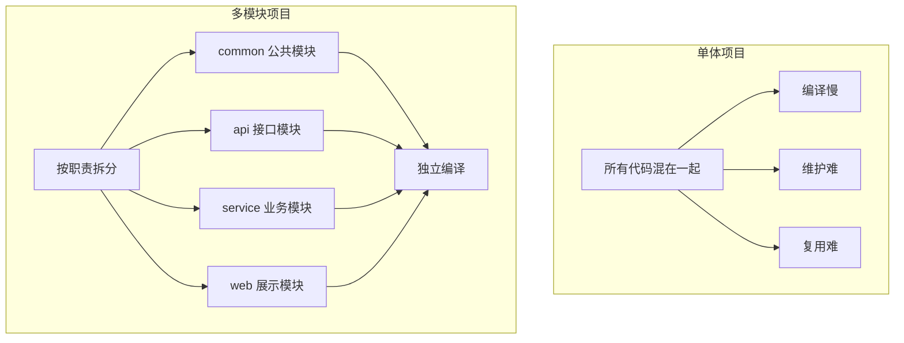
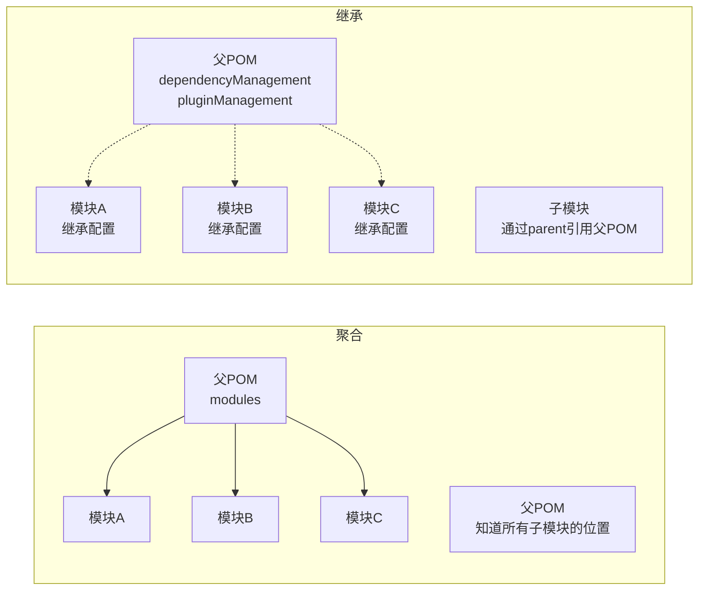
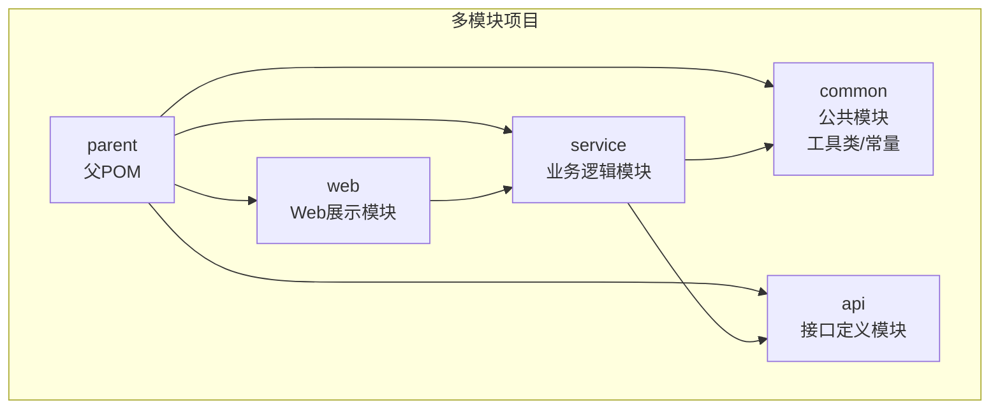

# Maven多模块项目管理

## 课程目标

- 理解多模块项目的应用场景和优势
- 掌握Maven聚合（Aggregation）的配置和使用
- 掌握Maven继承（Inheritance）的配置和使用
- 能够设计合理的多模块项目结构
- 掌握多模块项目的构建命令


## 生活中的多模块类比

在正式学习之前，我们先通过生活中的例子理解“多模块”的概念。

想象一下你经营一家**大型连锁餐厅集团**：

| 生活场景                               | Maven多模块概念                      |
| -------------------------------------- | ------------------------------------ |
| 集团总部，统一品牌形象和运营标准       | **父POM**（统一管理）                |
| 菜单、食材标准、装修风格由总部统一制定 | **dependencyManagement**（统一版本） |
| 各分店只需执行标准，不用自己研究配方   | **继承**（子模块继承父配置）         |
| 顾客点餐时，各分店各自出餐             | **聚合**（统一构建所有模块）         |
| 中央厨房供应半成品                     | **公共模块**（被其他模块复用）       |
| 不同分店有各自的特色菜品               | **模块独立扩展**                     |

**核心思想：** 多模块项目管理就是将一个大项目拆分成多个相互协作的子模块，通过统一的父POM来管理公共配置，实现代码复用、职责分离和统一构建。


## 为什么需要多模块项目

### 单体项目的痛点

随着项目规模扩大，将所有代码放在一个模块中会面临诸多问题：

| 痛点         | 说明                                     |
| ------------ | ---------------------------------------- |
| 代码臃肿     | 所有代码混在一起，难以维护和理解         |
| 编译缓慢     | 每次修改都需要重新编译整个项目           |
| 职责不清     | 业务逻辑、数据访问、工具类等没有清晰边界 |
| 复用困难     | 无法单独提取公共模块供其他项目使用       |
| 团队协作冲突 | 多人修改同一模块容易产生冲突             |
| 测试困难     | 修改一处可能影响整个项目，回归测试范围大 |

### 多模块项目的优势



- **职责分离**：每个模块专注于特定功能领域
- **独立构建**：修改某个模块只需重新构建该模块及其依赖
- **代码复用**：公共模块可被多个模块共享
- **并行开发**：不同团队可同时开发不同模块
- **版本独立**：每个模块可以有自己的版本演进
- **易于测试**：模块边界清晰，单元测试更精准


## 聚合（Aggregation）

### 什么是聚合

**聚合**是将多个子模块组织成一个整体，让父模块可以**统一管理**所有子模块的构建。聚合模块本身不包含业务代码，只是作为一个"容器"来组织子模块。

### 聚合的配置

在父POM中使用 `<modules>` 元素声明子模块：

```xml
<!-- 父POM：pom.xml -->
<project>
    <modelVersion>4.0.0</modelVersion>
    <groupId>com.example</groupId>
    <artifactId>parent-project</artifactId>
    <version>1.0-SNAPSHOT</version>
    <packaging>pom</packaging>   <!-- 必须为 pom -->

    <modules>
        <module>common</module>
        <module>api</module>
        <module>service</module>
        <module>web</module>
    </modules>
</project>
```

> [!CAUTION]
>
> 聚合模块的 `<packaging>` 必须是 `pom`，否则无法声明子模块。

```
parent-project/                    # 父项目目录
├── pom.xml                        # 父POM（packaging=pom）
├── common/
│   └── pom.xml                    # 公共模块
├── api/
│   └── pom.xml                    # API模块
├── service/
│   └── pom.xml                    # 业务模块
└── web/
    └── pom.xml                    # Web模块
```

> [!NOTE]
>
> 子模块目录名通常与 `<module>` 标签中的名称一致，约定优于配置。

### 聚合的构建行为

在父项目根目录执行 `mvn clean compile`：

1. Maven读取父POM中的 `<modules>` 列表
2. 按声明顺序依次进入每个子模块执行 `clean compile`
3. 所有子模块构建完成后，构建过程结束

```
# 在父项目根目录执行，会构建所有子模块
mvn clean install

# 只构建特定模块及其依赖
mvn clean install -pl common,service -am

# 只构建特定模块（不构建依赖模块）
mvn clean install -pl web
```


## 继承（Inheritance）

### 什么是继承

**继承**是让子模块能够**复用父POM中的配置**，避免在每个子模块中重复定义相同的配置（如依赖版本、插件配置、属性等）。

### 父POM配置

父POM中定义公共配置，子模块可以继承：

```xml
<!-- 父POM：pom.xml -->
<project>
    <modelVersion>4.0.0</modelVersion>
    <groupId>com.example</groupId>
    <artifactId>parent-project</artifactId>
    <version>1.0-SNAPSHOT</version>
    <packaging>pom</packaging>

    <!-- 公共属性 -->
    <properties>
        <project.build.sourceEncoding>UTF-8</project.build.sourceEncoding>
        <maven.compiler.source>11</maven.compiler.source>
        <maven.compiler.target>11</maven.compiler.target>
        <jackson.version>2.13.0</jackson.version>
    </properties>

    <!-- 统一依赖管理（子模块可继承） -->
    <dependencyManagement>
        <dependencies>
            <dependency>
                <groupId>com.fasterxml.jackson.core</groupId>
                <artifactId>jackson-databind</artifactId>
                <version>${jackson.version}</version>
            </dependency>
            <dependency>
                <groupId>junit</groupId>
                <artifactId>junit</artifactId>
                <version>4.13.2</version>
                <scope>test</scope>
            </dependency>
        </dependencies>
    </dependencyManagement>

    <!-- 统一插件管理 -->
    <build>
        <pluginManagement>
            <plugins>
                <plugin>
                    <groupId>org.apache.maven.plugins</groupId>
                    <artifactId>maven-compiler-plugin</artifactId>
                    <version>3.10.1</version>
                    <configuration>
                        <source>${maven.compiler.source}</source>
                        <target>${maven.compiler.target}</target>
                    </configuration>
                </plugin>
            </plugins>
        </pluginManagement>
    </build>
</project>
```

### 子模块继承父POM

子模块通过 `<parent>` 声明父POM：

```xml
<!-- 子模块：common/pom.xml -->
<project>
    <modelVersion>4.0.0</modelVersion>

    <!-- 声明父POM -->
    <parent>
        <groupId>com.example</groupId>
        <artifactId>parent-project</artifactId>
        <version>1.0-SNAPSHOT</version>
        <relativePath>../pom.xml</relativePath>
    </parent>

    <!-- 子模块只需要定义 artifactId，groupId 和 version 从父继承 -->
    <artifactId>common</artifactId>
    <packaging>jar</packaging>

    <dependencies>
        <!-- 不需要指定版本，从父POM的 dependencyManagement 继承 -->
        <dependency>
            <groupId>com.fasterxml.jackson.core</groupId>
            <artifactId>jackson-databind</artifactId>
        </dependency>
        <dependency>
            <groupId>junit</groupId>
            <artifactId>junit</artifactId>
            <scope>test</scope>
        </dependency>
    </dependencies>
</project>
```

> [!NOTE]
>
> 子模块的 `groupId` 和 `version` 可以省略（从父继承），但 `artifactId` 必须指定（用于唯一标识子模块）。

### relativePath 说明

`<relativePath>` 告诉Maven父POM的位置：

| 配置                                      | 说明                    |
| ----------------------------------------- | ----------------------- |
| `<relativePath>../pom.xml</relativePath>` | 父POM在上级目录（推荐） |
| `<relativePath/>`                         | 从本地/远程仓库查找     |
| 不设置                                    | 默认值为 `../pom.xml`   |

> [!NOTE]
>
> 在多模块项目中，父POM就在父目录，设置 `../pom.xml` 即可。


## 聚合 vs 继承

### 对比总览

| 对比维度         | 聚合（Aggregation） | 继承（Inheritance） |
| ---------------- | ------------------- | ------------------- |
| 目的             | 统一构建所有子模块  | 统一配置，避免重复  |
| 配置方式         | `<modules>`         | `<parent>`          |
| 子模块定位       | 物理位置（目录）    | 逻辑位置（坐标）    |
| 子模块获取父配置 | ❌                   | ✅                   |
| 父模块包含代码   | ❌（仅组织）         | ❌（仅配置）         |
| packaging类型    | `pom`               | `pom`               |
| 使用场景         | 组织多模块项目      | 复用公共配置        |

### 核心区别



> [!NOTE]
>
> 在多模块项目中，**聚合和继承通常同时使用**——父POM既用 `<modules>` 聚合子模块，子模块也用 `<parent>` 继承父配置。这是最经典的多模块项目模式。

### 同时使用聚合与继承

大多数多模块项目都会同时使用聚合和继承：

```
parent-project/
├── pom.xml                    # 既有 <modules> 聚合，也有公共配置供继承
├── common/
│   └── pom.xml                # 继承父POM，可被其他模块依赖
├── api/
│   └── pom.xml                # 继承父POM
├── service/
│   └── pom.xml                # 继承父POM，依赖common
└── web/
    └── pom.xml                # 继承父POM，依赖service
```


## 多模块项目结构最佳实践

### 典型分层架构



### 按功能拆分 vs 按层次拆分

| 拆分方式   | 说明                                        | 适用场景                 |
| ---------- | ------------------------------------------- | ------------------------ |
| 按层次拆分 | common / dao / service / web                | 分层架构，各层职责清晰   |
| 按功能拆分 | user-module / order-module / product-module | 微服务架构，按业务域划分 |
| 混合拆分   | 先按功能再按层次                            | 大型复杂项目             |

### 模块命名规范

| 类型     | 命名示例          | 说明                    |
| -------- | ----------------- | ----------------------- |
| 父项目   | `project-parent`  | 统一添加 `-parent` 后缀 |
| 公共模块 | `project-common`  | 统一添加 `-common` 后缀 |
| API模块  | `project-api`     | 接口定义模块            |
| 业务模块 | `project-service` | 业务逻辑实现            |
| Web模块  | `project-web`     | Web层                   |


## 版本管理最佳实践

### 使用 properties 统一版本

在父POM中使用 `<properties>` 集中管理依赖版本：

```xml
<properties>
    <java.version>11</java.version>
    <jackson.version>2.13.0</jackson.version>
    <junit.version>4.13.2</junit.version>
    <httpclient.version>4.5.13</httpclient.version>
    <spring.version>5.3.10</spring.version>
</properties>
```

### dependencyManagement 的最佳实践

- **只在父POM中定义**：所有依赖版本在父POM的 `<dependencyManagement>` 中统一管理。
- **子模块只声明不写版本**：子模块只需 `<groupId>` 和 `<artifactId>`，版本从父继承。
- **添加注释**：在 `<dependencyManagement>` 中为每个依赖添加注释说明用途。


## 常见问题与解决方案

### 问题1：循环依赖

**现象：** 模块A依赖模块B，模块B依赖模块A。

**解决方案：**

- 检查模块职责划分是否合理
- 将相互依赖的部分抽取到新的公共模块中

### 问题2：版本不一致

**现象：** 不同子模块使用了同一依赖的不同版本，导致运行时冲突。

**解决方案：**

- 在父POM的 `<dependencyManagement>` 中统一管理所有版本
- 子模块不指定版本，从父继承

### 问题3：构建顺序错误

**现象：** 构建时出现"找不到依赖"的错误。

**解决方案：**

- 确保模块间的依赖关系在POM中正确声明
- 执行 `mvn clean install` 让Maven自动按依赖顺序构建


## 作业

### 作业一：POM配置分析

阅读以下代码，回答问题。

父POM

```xml
<!-- 父POM：parent/pom.xml -->
<project>
    <modelVersion>4.0.0</modelVersion>
    <groupId>com.example</groupId>
    <artifactId>parent</artifactId>
    <version>1.0-SNAPSHOT</version>
    <packaging>pom</packaging>

    <modules>
        <module>common</module>
        <module>service</module>
        <module>web</module>
    </modules>

    <properties>
        <jackson.version>2.13.0</jackson.version>
    </properties>

    <dependencyManagement>
        <dependencies>
            <dependency>
                <groupId>com.fasterxml.jackson.core</groupId>
                <artifactId>jackson-databind</artifactId>
                <version>${jackson.version}</version>
            </dependency>
        </dependencies>
    </dependencyManagement>
</project>
```

子POM

```xml
<!-- 子模块：parent/common/pom.xml -->
<project>
    <modelVersion>4.0.0</modelVersion>
    <parent>
        <groupId>com.example</groupId>
        <artifactId>parent</artifactId>
        <version>1.0-SNAPSHOT</version>
    </parent>

    <artifactId>common</artifactId>
    <packaging>jar</packaging>

    <dependencies>
        <dependency>
            <groupId>com.fasterxml.jackson.core</groupId>
            <artifactId>jackson-databind</artifactId>
        </dependency>
    </dependencies>
</project>
```

**问题：**

1. 父POM中 `<packaging>` 的值是什么？为什么？
2. 子模块 `common` 的 `groupId` 和 `version` 为什么没有声明？
3. 子模块 `common` 中 `jackson-databind` 的版本号从哪里获取？
4. 如果子模块中显式指定 `jackson-databind` 的版本，会发生什么？
5. 为什么父POM使用 `<dependencyManagement>` 而不是直接在 `<dependencies>` 中声明？

------

### 作业二：聚合与继承概念理解

判断以下说法是否正确，并说明理由。

1. 聚合模块的 `<packaging>` 必须是 `jar`。
2. 继承可以让子模块复用父POM中定义的依赖版本。
3. 子模块必须显式声明 `groupId`，不能从父POM继承。
4. 聚合是将多个子模块组织在一起统一构建，子模块之间没有依赖关系也可以聚合。
5. `relativePath` 用于告诉Maven父POM的位置，如果省略则默认值为 `../pom.xml`。

------

### 作业三：创建多模块项目

创建一个多模块Maven项目，结构如下：

```
user-project/
├── pom.xml                    # 父POM（packaging=pom）
├── user-common/               # 公共模块
│   └── pom.xml
├── user-api/                  # API接口定义
│   └── pom.xml
└── user-service/              # 业务实现
    └── pom.xml
```

**要求：**

1. 父POM中定义：
   - 统一 `groupId`：`com.example`
   - 统一 `version`：`1.0-SNAPSHOT`
   - `<modules>` 聚合所有子模块
   - `<properties>` 定义 `java.version = 11`
   - `<dependencyManagement>` 管理 `junit` 版本为 `4.13.2`
2. 子模块 `user-api` 中定义一个接口 `UserService`
3. 子模块 `user-service` 依赖 `user-api`，并实现该接口
4. 子模块 `user-common` 依赖 `user-api`
5. 所有子模块继承父POM

验证：在父项目根目录执行 `mvn clean compile`，所有模块应编译成功。

------

### 作业四：模块依赖与构建顺序分析

假设有以下多模块项目结构：

```
project/
├── pom.xml                    # 父POM，聚合所有模块
├── module-a/
│   └── pom.xml                # 无依赖
├── module-b/
│   └── pom.xml                # 依赖 module-a
├── module-c/
│   └── pom.xml                # 依赖 module-a 和 module-b
└── module-d/
    └── pom.xml                # 依赖 module-c
```

**问题：**

1. 在父项目根目录执行 `mvn compile` 时，模块的构建顺序是什么？
2. 如果想只构建 `module-d` 及其依赖的模块，应使用什么命令？
3. 如果 `module-b` 和 `module-c` 之间出现循环依赖（B依赖C，C依赖B），会有什么问题？如何解决？
