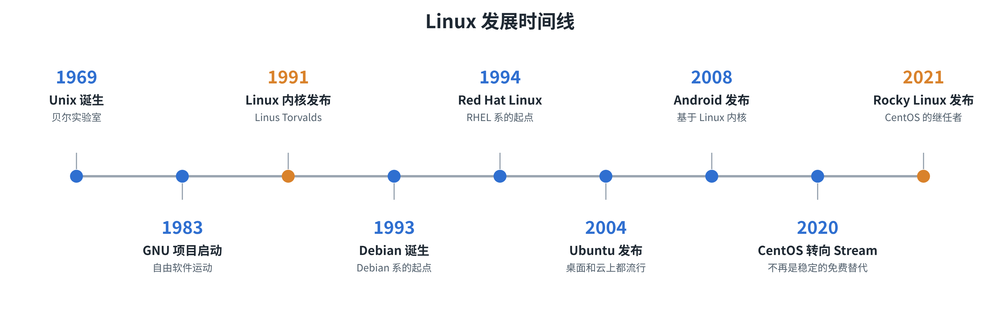
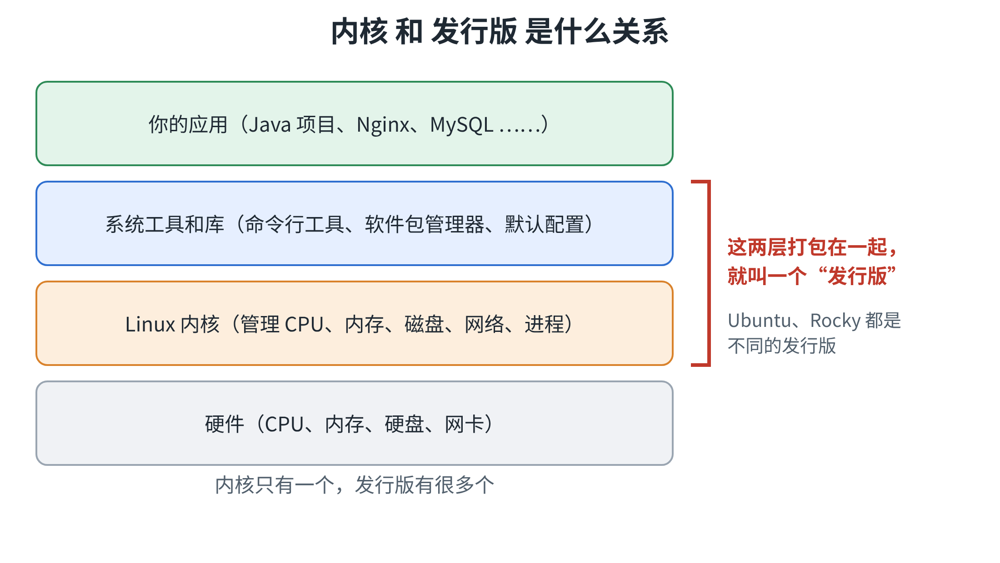
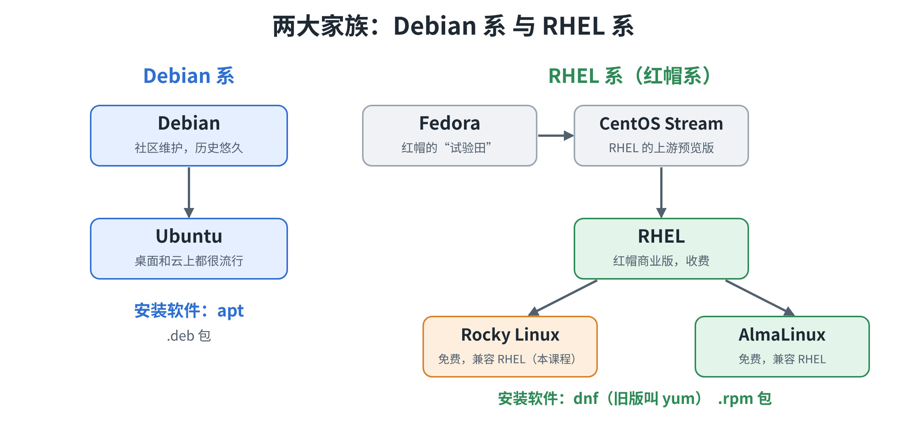
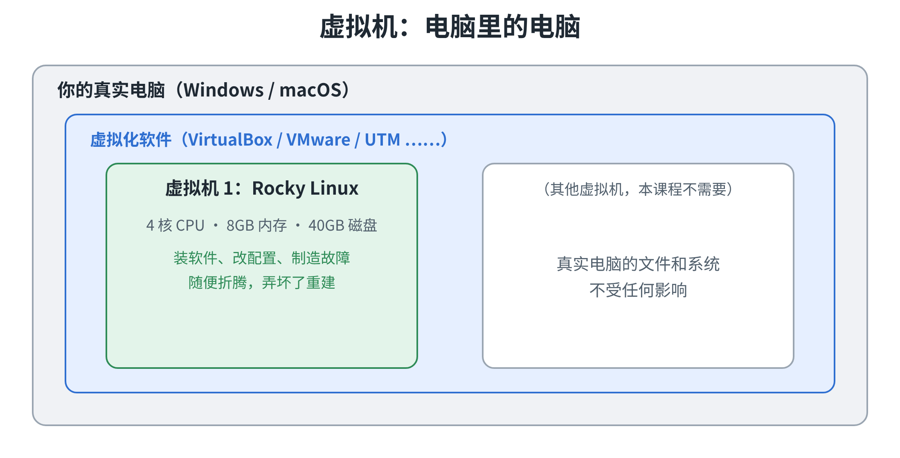
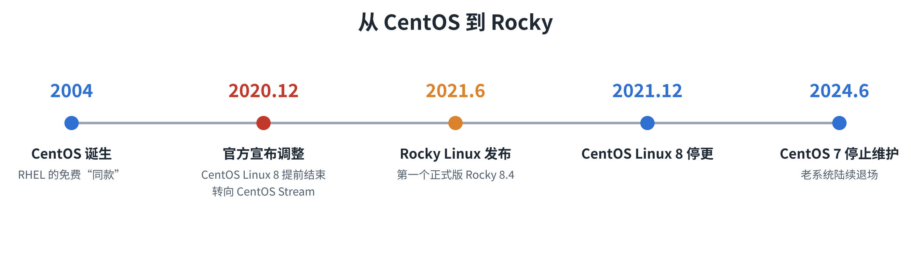
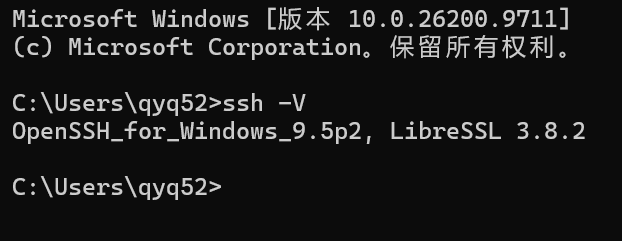
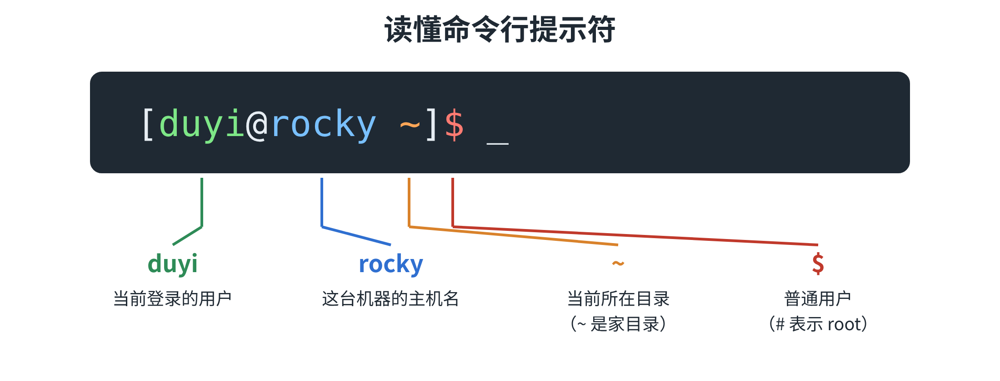

# 一、Linux历史

### 1.1 Linux 诞生之前

**先有 Unix。**

- 1969 年，贝尔实验室的 Ken Thompson、Dennis Ritchie 等人开发了 **Unix**。它稳定、强大，后来成为大型机和工作站上的主流系统。
- 但 Unix **收费、不开源**。1980 年代，Unix 开始商业化授权，价格很贵，原来大学里可以随便研究的源码，也不再公开了。

### 1.2 Linux 的诞生

- **1991 年**，芬兰赫尔辛基大学的学生 **Linus Torvalds**（当时 21 岁）不满意 Minix，利用业余时间，在自己的电脑上写了一个内核，并把消息发到网上，**邀请大家一起来改**。
- 名字来自 **Linus + Unix**。
- 1992 年起，它采用 **GPL 协议**：任何人都可以免费使用、修改、再发布，但改过之后，也必须继续开放源码。
- **GNU 的工具 + Linux 内核 = 一套完整可用、免费开源的操作系统。**

> 一个学生的业余作品，没有被一家公司关起来，而是**开放源码，让全世界的程序员一起改、一起加功能**，就成了今天的 Linux。

### 1.3 从内核到各种发行版

- 内核只是核心，普通人用起来不方便，于是有人把内核、工具和软件包管理器打包起来，做成**发行版**：1993 年的 **Debian**、1994 年前后的 **Red Hat Linux**、2004 年的 **Ubuntu**。
- 2000 年代初，Red Hat 推出面向企业、提供收费技术支持的 **RHEL**，基于它的免费版本 **CentOS** 在服务器上非常流行。
- 2008 年，**Android** 基于 Linux 内核发布，Linux 走进了手机。
- 2020 年 CentOS 调整方向，社区又做出了 **Rocky Linux**，也就是我们课程用的系统




**Linux 用在哪？**

- 网站、App 背后的服务器
- 云服务器（阿里云、腾讯云、AWS ……）
- 手机 Android（底层是 Linux 内核）
- 路由器、智能电视、车载系统
- 超级计算机
- Docker、Kubernetes

**服务器为什么偏爱它？**

| 优点       | 通俗一点说                                   |
| ---------- | -------------------------------------------- |
| 免费、开源 | 不用买授权，出了问题还能看源码               |
| 稳定       | 一台服务器连续跑几个月、几年不重启很正常     |
| 省资源     | 不需要花哨的桌面，内存和 CPU 全留给你的程序  |
| 安全       | 权限管得严，漏洞出来后修补得快               |
| 好远程管理 | 一根网线、一个命令行，就能管理千里之外的机器 |

> **我们写的项目，最后基本都是部署到 Linux 上去跑的。**

# 二、版本解释

- **Linux 只是内核**：管 CPU、内存、硬盘、网络、进程
- **发行版** = 内核 + 命令行工具 + 软件包管理器 + 默认配置，打包给大家用
- 平时说的“Linux 系统”，其实都是指某个发行版



**两大家族**



| 家族      | 代表                           | 装软件 | 常见场景               |
| --------- | ------------------------------ | ------ | ---------------------- |
| Debian 系 | Debian、Ubuntu                 | `apt`  | 个人、开发、互联网公司 |
| RHEL 系   | RHEL、Rocky、AlmaLinux、CentOS | `dnf`  | 银行、电信、传统企业   |

两个家族，核心知识（文件、进程、权限、服务、网络）通用，**区别主要在三处**：

| 区别               | Debian 系（以 Ubuntu 为例） | RHEL 系（以 Rocky 为例）    |
| ------------------ | --------------------------- | --------------------------- |
| 装软件的命令       | `apt`                       | `dnf`                       |
| 默认的安全设置     | AppArmor、ufw 防火墙        | SELinux、firewalld 防火墙   |
| 部分配置文件的位置 | 软件源：`/etc/apt/`         | 软件源：`/etc/yum.repos.d/` |

# 三、Linux安装

## 3.0 资料下载

**Linux环境资料云盘下载地址：  https://pan.baidu.com/s/1mt0kWNnkEdS8sVAE-qj9rQ?pwd=cp96 **

## 3.1 安装虚拟机

> 虚拟机其实是一款软件，它可以虚拟出来一台电脑。这台虚拟出来的电脑，共享着我们自己这台真实电脑的硬件。我们可以在这台虚拟的电脑里面学习命令、安装软件、部署项目等等操作。无论我们如何操作，都不会影响自己真实的物理电脑。这种办法通常是学习 Linux 系统的首选。



| 你的电脑            | 虚拟化软件                           | 网址                       |
| ------------------- | ------------------------------------ | -------------------------- |
| Windows / Intel Mac | VirtualBox（免费）                   | https://www.virtualbox.org |
| Windows             | VMware Workstation（收费、免费30天） | https://www.vmware.com     |
| 苹果 M 系列 Mac     | UTM                                  | https://mac.getutm.app     |
| 苹果 M 系列 Mac     | Parallels Desktop                    | https://www.parallels.com  |

**阶段一的虚拟机配置（一台）**

| 系统        | CPU  | 内存 | 磁盘  |
| ----------- | ---- | ---- | ----- |
| Rocky Linux | 4 核 | 8 GB | 40 GB |

- 8 GB 内存是分给虚拟机的，**你自己的电脑建议有 16 GB 或以上**；内存不够的话，见下面“内存不够怎么办”
- 阶段一、阶段二共用这一台虚拟机；后面的阶段会按需要调整，到时会单独说明
- 做危险操作之前，先**拍快照**（相当于游戏存档，改坏了可以回去）
- 苹果 M 系列芯片要用 **ARM 版**镜像

**新建一台虚拟机**

| 设置项   | 填什么                                                |
| -------- | ----------------------------------------------------- |
| 名称     | `rocky`                                               |
| 系统类型 | Linux，Red Hat Enterprise Linux 9 64 位               |
| 安装镜像 | 选择下载好的 Rocky ISO                                |
| 内存     | 8192 MB                                               |
| CPU      | 4 核                                                  |
| 硬盘     | 40 GB，动态分配（用多少占多少，不会一下子占满 40 GB） |
| 网络     | NAT                                                   |

## 3.2 安装Linux



- 早期服务器系统大多是 **CentOS**
- 2020 年底，CentOS 官方宣布不再维护传统的 CentOS Linux
- 之后社区做出了 **Rocky Linux**：免费、兼容 RHEL、社区维护

**为什么选 Rocky？**

| 原因         | 说明                                    |
| ------------ | --------------------------------------- |
| 企业里用得多 | RHEL 系在银行、电信、传统企业里大量使用 |
| 贴近生产环境 | 默认开着防火墙（firewalld）和 SELinux   |
| 稳定         | 同一个大版本能用好几年                  |

**下载安装镜像（ISO）**

- 官网下载页：https://rockylinux.org/download
- 国内镜像站：
  - 阿里云：https://mirrors.aliyun.com/rockylinux/

| 你的电脑            | 选择的架构     |
| ------------------- | -------------- |
| Windows / Intel Mac | x86_64         |
| 苹果 M 系列 Mac     | aarch64（ARM） |

**ISO 类型**（官网通常有 DVD、Boot、Minimal 几种）

| 类型    | 说明                     | 我们用吗   |
| ------- | ------------------------ | ---------- |
| Minimal | 最小安装，体积小         | **用这个** |
| DVD     | 完整版，包含更多软件     | 不用       |
| Boot    | 只有引导，安装时联网下载 | 不用       |

**安装步骤**

启动虚拟机，选择 **Install Rocky Linux**，进入安装向导。**磁盘不分区**，直接使用整块磁盘。

| 步骤                               | 选什么                                          | 说明                           |
| ---------------------------------- | ----------------------------------------------- | ------------------------------ |
| 1 语言                             | English（United States）                        | 报错信息是英文，方便搜索       |
| 2 时区                             | Asia / Shanghai                                 |                                |
| 3 磁盘（Installation Destination） | 选中这块 40 GB 的磁盘，存储配置选 **Automatic** | 自动使用整块盘，不手动分区     |
| 4 软件（Software Selection）       | **Minimal Install**                             | 没有图形界面，省资源           |
| 5 网络（Network & Host Name）      | 打开网络开关，主机名填 `rocky`                  | 后面装软件、远程连接都要联网   |
| 6 root 密码                        | 设置一个密码                                    | 课程里不用 root 登录，但要设置 |
| 7 创建用户                         | 用户名 `duyi`，勾选“设为管理员”                 | 这样 `duyi` 可以用 `sudo`      |
| 8 开始安装                         | 点击 Begin Installation                         | 等待安装完成                   |
| 9 重启                             | 点击 Reboot System，并**移除安装镜像**          | 否则会再次进入安装界面         |

## 3.3 安装远程连接工具

- 真实服务器没有屏幕，都是**远程连接**
- 远程连接用 **SSH**：本地敲命令 → 服务器执行 → 结果传回来

| 你的电脑        | 怎么用                                            |
| --------------- | ------------------------------------------------- |
| macOS           | 打开“终端”，直接用 `ssh`                          |
| Windows 10 / 11 | 打开 Windows Terminal 或 PowerShell，直接用 `ssh` |

检查：

```bash
ssh -V
```



也可以用图形工具（任选）：

| 工具             | 平台          | 网址                                                |
| ---------------- | ------------- | --------------------------------------------------- |
| Windows Terminal | Windows       | https://learn.microsoft.com/zh-cn/windows/terminal/ |
| Tabby            | Windows / Mac | https://tabby.sh                                    |
| MobaXterm        | Windows       | https://mobaxterm.mobatek.net                       |

## 3.4 第一次连接

先在虚拟机窗口里查看它的 IP：

```bash
ip a
```

找到类似 `192.168.56.10` 的地址（网卡名下 `inet` 那一行）

```bash
ssh 用户名@服务器IP
```

```bash
ssh duyi@192.168.56.10
```

- 第一次连接：输入 `yes`
- 输入密码：**屏幕不显示字符，这是正常的**



> **平时用普通用户，不直接用 root。** 需要管理员权限时，命令前加 `sudo`。

登录后先确认系统：

```bash
cat /etc/os-release
```

看到 `NAME="Rocky Linux"` 就对了。
