# 一、基础命令

先认一下服务器上的“地图”。Linux 里**一切从 `/`（根）开始**，没有 C 盘 D 盘：

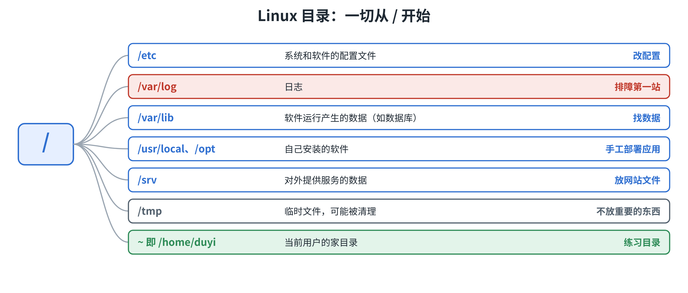

> 以后找配置去 `/etc`，找日志去 `/var/log`，练习都在家目录 `~`。

## 1.1 命令怎么用

所有命令都是同一个格式：

```bash
命令  [选项]  [参数]
ls  -l  /var/log
```

- **命令**：`ls`，要做什么
- **选项**：`-l`，怎么做（短选项一个横线，长选项两个横线，如 `--help`）
- **参数**：`/var/log`，对谁做

忘了怎么用，不用背：

```bash
ls --help       # 最快：输出简短的用法
man ls          # 完整手册：按 q 退出，按 /关键字 搜索
```


## 1.2 查看

### 1.2.0 资料下载

**练习数据脚本下载地址：https://pan.baidu.com/s/1VxQ-3PafKkuJEULu6aw_zw?pwd=5b5n**


**先准备练习数据。** 后面都在 `~/lab` 里做，里面有日志、配置文件和各种大小的文件，用脚本生成：

```bash
bash lab-init.sh
```

练坏了，**再执行一次**就恢复了。

### 1.2.1 pwd  和 cd

```bash
pwd                 # 我在哪
cd /var/log         # 去绝对路径（从 / 开头）
cd lab              # 去相对路径（相对当前位置）
cd ..               # 回上一级
cd -                # 回到上一次所在的位置
cd ~                # 回家目录
```

> 写脚本时尽量用**绝对路径**，因为脚本运行时，“当前位置”不一定是你以为的那里。

### 1.2.2 ls 

```bash
cd ~/lab
ls -lah             # 最常用：详细列表 + 隐藏文件 + 大小易读
ls -lt              # 按修改时间排序，新的在前
ls -lS              # 按大小排序，大的在前
```

```text
total 28K
drwxr-xr-x 7 duyi duyi 4.0K Oct 22 11:00 .
drwx------ 5 duyi duyi 4.0K Oct 22 11:00 ..
drwxr-xr-x 4 duyi duyi 4.0K Oct 22 11:00 app
drwxr-xr-x 2 duyi duyi 4.0K Oct 22 11:00 backup
drwxr-xr-x 3 duyi duyi 4.0K Oct 22 11:00 data
drwxr-xr-x 3 duyi duyi 4.0K Oct 22 11:00 nginx
drwxr-xr-x 2 duyi duyi 4.0K Oct 22 11:00 scripts
```

`ls -l` 每一行，从左到右依次是：

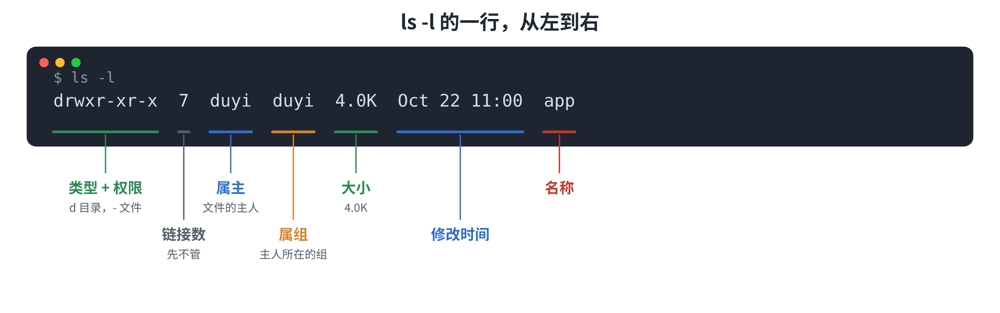

> 权限那一列，2.3 会详细讲；链接数先不用管。

### 1.2.3 cat

```bash
cat app/conf/app.conf
```

```text
# order-service 配置
server.port=8080
db.host=127.0.0.1
db.port=3306
db.user=app
db.password=ChangeMe123
redis.host=127.0.0.1
redis.port=6379
log.level=INFO
```

**`cat` 只适合短文件。** 对几千行的日志用 `cat`，只会刷屏。顺便，`cat /etc/os-release` 可以确认系统版本。

> 顺便注意：配置里有**明文密码**。真实项目里，密码不该这样放，后面的阶段会讲怎么处理。

### 1.2.4 tail

```bash
tail -n 50 app/logs/app.log     # 看最后 50 行（不写 -n 默认 10 行）
tail -F app/logs/app.log        # 持续追踪新增的内容，Ctrl + C 退出
```

> `-F` 和 `-f` 都能追踪，区别是日志被切割、换了文件之后，`-F` 仍然能继续追踪，**生产上推荐用 `-F`**。

```bash
tail -n 3 app/logs/app.log
```

```text
2026-10-21 09:13:19 [INFO] order-service - request handled ok
2026-10-21 09:13:20 [INFO] order-service - request handled ok
2026-10-21 09:59:59 [ERROR] order-service - OutOfMemoryError: Java heap space
```

最后一行报了 `OutOfMemoryError`：Java 堆内存不够了。**日志的最后几行，往往就是答案。**


## 1.3 搜索

日志有几千行，配置文件有几十个，肉眼找不到。让命令来找。

### 1.3.1 grep

> 在文件内容中搜索

```bash
grep "ERROR" 文件              # 显示含 ERROR 的行
grep -c ERROR 文件             # 只统计有多少行
grep -n ERROR 文件             # 带上行号
grep -r "关键字" 目录          # 递归搜索目录下所有文件
```

用 `~/lab` 里的数据试一试（`$` 开头的是你输入的命令，其余是输出）：

```bash
$ grep -c ERROR app/logs/app.log
44

$ grep -n OutOfMemory app/logs/app.log
801:2026-10-21 09:59:59 [ERROR] order-service - OutOfMemoryError: Java heap space

$ grep -r "password" app
app/conf/app.conf:db.password=ChangeMe123
```

> 其他常用选项还有 `-i`（忽略大小写）、`-v`（反向，只留不含关键字的行）。用到时 `grep --help` 查就行。

**`grep` 常和管道 `|` 一起用。** 管道的作用是：把前一个命令的输出，交给后一个命令继续处理。

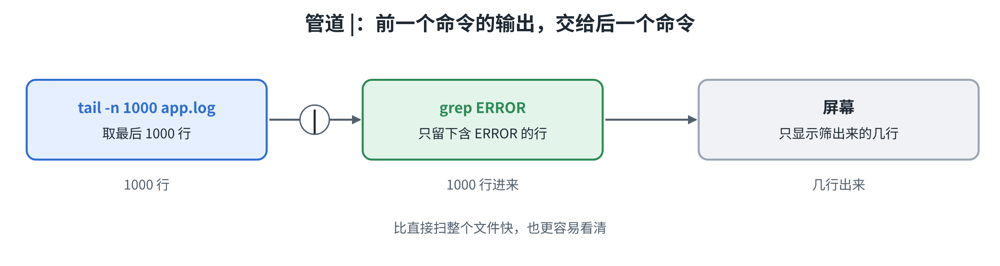

```bash
tail -n 1000 app/logs/app.log | grep ERROR
```

### 1.3.2  find

> 按文件的特征找文件

```bash
find ~/lab -name "*.tmp"            # 按名字找（通配符要加引号）
find ~/lab -type f -size +10M       # 大于 10MB 的文件
find ~/lab -mtime +7                # 7 天前修改的
```

```bash
$ find ~/lab -name "*.tmp"
/home/duyi/lab/data/uploads/cache_1.tmp
/home/duyi/lab/data/uploads/cache_2.tmp
/home/duyi/lab/data/uploads/cache_3.tmp

$ find ~/lab -type f -size +10M
/home/duyi/lab/data/uploads/big.bin
```

**怎么选？** 知道的是文件里的**内容**，想找哪个文件、哪一行 → `grep`；知道的是文件的**名字、大小、时间**，想找文件在哪 → `find`。

这一节**只查不删**。批量删除在下一节，并且要“先查后删”。

## 1.4 文件操作

### 1.4.1 创建、复制、移动

```bash
mkdir -p a/b/c                  # 连父目录一起建，已存在也不报错
touch 文件                      # 新建空文件（已存在则更新时间）
cp 源 目标                      # 复制文件
cp -r 目录 目标                 # 复制目录（目录必须加 -r）
mv 源 目标                      # 移动；移到同目录的新名字，就是重命名
```

```bash
mv data/uploads/"my notes.txt" data/uploads/notes.txt
```

> 文件名里有空格，要加**引号**，不然会被当成两个文件。

### 1.4.2 删除

```bash
rm 文件              # 删除文件
rm -r 目录           # 删除目录及里面所有内容
```

**Linux 没有回收站，删了就没了。**

```bash
find ~/lab/data/uploads -name "*.tmp"          # 先看有哪些
rm ~/lab/data/uploads/*.tmp                    # 确认无误再删
find ~/lab/data/uploads -name "*.tmp"          # 再确认，没有输出
```

### 1.4.3 改文件

安装nano : `sudo dnf install nano`

```bash
nano app/conf/app.conf
```

最少记住两个：**`Ctrl + O` 回车保存，`Ctrl + X` 退出**。

> 服务器上也常见另一个编辑器 `vim`。我们不要求你学，只要知道**误入 vim 时，按 `Esc`，输入 `:q!` 回车，可以放弃修改并退出**。

**改配置的标准动作**

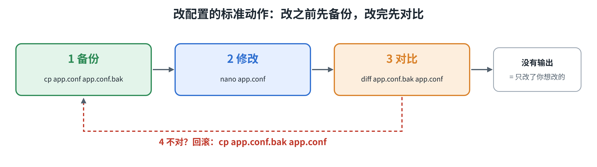

```bash
cp app/conf/app.conf app/conf/app.conf.bak        # 1 备份
nano app/conf/app.conf                            # 2 修改
diff app/conf/app.conf.bak app/conf/app.conf      # 3 对比（没有输出就代表一样）
cp app/conf/app.conf.bak app/conf/app.conf        # 4 不对，回滚
```

## 1.5 打包解压

1. rockyLinux 最小化，没有tar命令， 需要自己安装： `sudo dnf install tar`
2. 选项解释：

```c
c : create 创建
v : verbose 详细信息
z : gzip  压缩算法
f : file  文件
x : extract 展开、解压
```

* 打包：

```c
tar -cvf aa.tar  aa.txt bb.txt cc.txt
```

* 解包

```c
tar -xvf aa.tar    # 在当前目录解包
```

* 压缩

```c
tar -zcvf aa.tar.gz aa.txt bb.txt cc.txt
```

* 解压

```c
tar -zxvf aa.tar.gz    # 在当前目录解压
    
tar -zxvf aa.tar.gz -C 具体的目录   # 解压到指定的目录
```


# 二、核心命令

## 2.1 软件安装

### 2.1.1 dnf

* 安装

```c
sudo dnf install -y nginx       # 安装（-y 表示自动确认）
```

* 卸载

```c
sudo dnf remove nginx           # 卸载
```

* 搜索

```bash
dnf search 关键字               # 搜索
```

* 查看包

```c
dnf provides iostat             # 这个命令是哪个包提供的 .然后去安装这个包即可
```


### 2.1.2 rpm

rpm 也可以用来安装软件，但是它并不会主动去安装依赖，这点就不如dnf 好了（dnf 会主动安装依赖），所以这里大家只要学习rpm的查询功能即可。

* 查询安装了哪些软件

```c
rpm -qa | grep nginx        # 装了哪些包
```

* 查询这个软件安装到哪里了（找配置文件、服务文件）

```bash
rpm -ql nginx               # 这个包把文件装到了哪里（找配置文件、服务文件）
```


## 2.2 进程与服务

一个程序跑起来，就是一个**进程**。把进程交给系统管理，就是**服务**。

### 2.2.1 ps

```bash
ps aux                  # 显示所有进程
ps aux | grep java      # 在所有进程里面找某个程序的进程
```

`ps aux` 的输出有很多列，常看这四列：

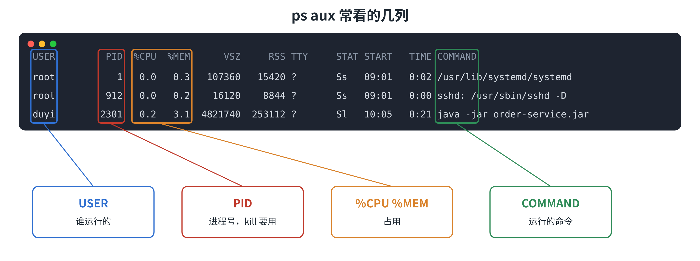

> 用 `grep` 过滤 `ps` 时，`grep` 自己也会出现在结果里。写成 `grep [s]shd` 可以避开它。

### 2.2.2 kill

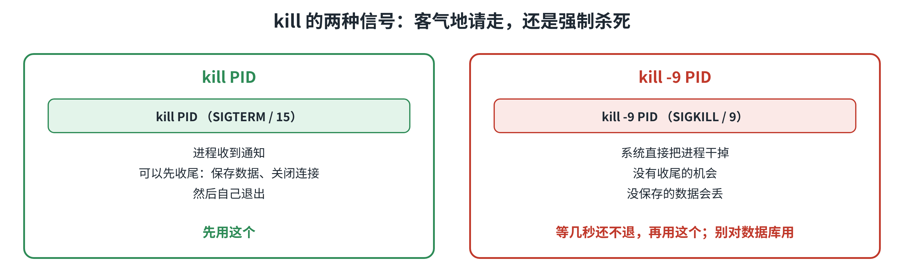

```bash
sleep 1000 &        # 启动一个进程， 暂停1000 秒， & 表示在后台执行。

kill PID            # SIGTERM(15)：客气地请它退出，它可以先收尾
kill -9 PID         # SIGKILL(9)：强制杀死，没有收尾机会
```

**先 `kill`，等几秒还在，再 `kill -9`。不要对数据库用 `kill -9`**：没保存的数据会丢，不能回滚，可能造成数据损坏。

### 2.2.3 systemctl

* 查看服务状态

```c
sudo systemctl status sshd             # 看状态（最常用）
```

* 重启服务

```c
sudo systemctl restart sshd            # 重启（还有 start / stop）
```

* 启动服务

```c
sudo systemctl start sshd  
```

* 停止服务

```c
sudo systemctl stop sshd  
```

`status` 的输出很长，只看三处：

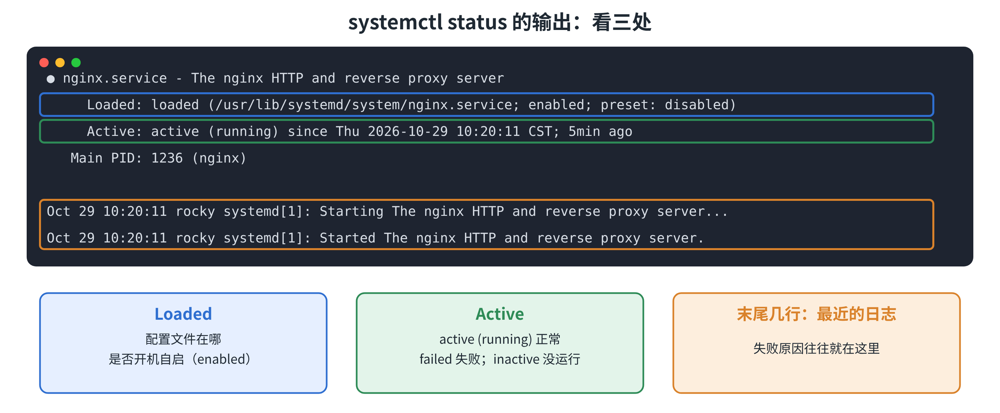

### 2.2.4 journalctl

* 查看服务最近50行日志

```bash
sudo journalctl -u sshd -n 50
```


* 实时追踪服务的日志

```bash
sudo journalctl -u sshd -f
```


* 最近10分钟的日志

```bash
sudo journalctl -u sshd --since "10 min ago"
```


* 只看错误级别的日志

> 这是查看整个系统的错误日志了。带上 -u 就表示查看指定服务的日志

```bash
sudo journalctl -p err
```

**服务出问题，三步查：**

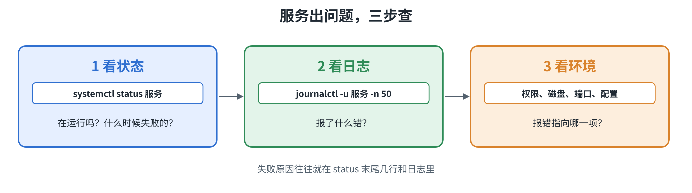

## 2.3 权限与用户

`Permission denied` 是 Linux 里最常见的报错。这一节让你读懂它，并且知道怎么改对。

**读懂权限**

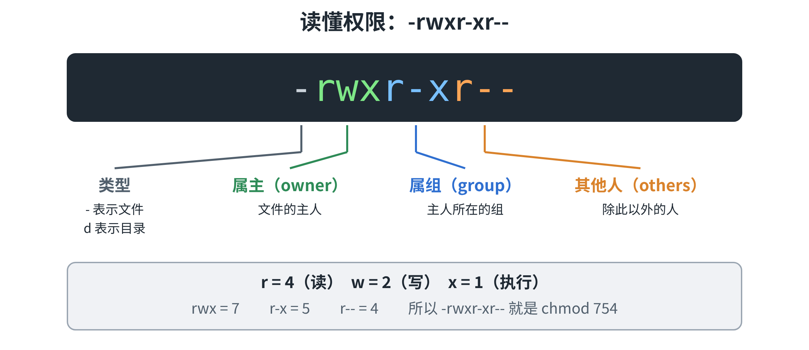

`r`、`w`、`x` 对文件和对目录，意思不一样：

- **`r` 读**：文件能看内容；目录能 `ls` 列出里面的东西
- **`w` 写**：文件能修改；目录能在里面新建、删除文件
- **`x` 执行**：文件能当程序运行；目录能 `cd` 进去

### 2.3.1 chmod

> 修改文件权限

```bash
chmod 755 文件      # 属主 rwx，其他人 r-x（脚本、程序、目录）
chmod 644 文件      # 属主 rw-，其他人 r--（普通配置文件、网页文件）
chmod 600 文件      # 只有属主能读写（私钥、含密码的文件）
chmod +x 文件       # 加上执行权限
```

### 2.3.2 chown

> 修改文件属主和属组

* 创建文件

```bash
 sudo touch aa.txt   # 使用sudo创建，所以该文件属于root:root
```

* 编辑文件

```bash
echo hello > aa.txt  # Permission denied   因为使用duyi 用户来操作，会出现权限被拒绝
```

* 修改属主和属组

```bash
sudo chown duyi:duyi aa.txt
```

* 继续编辑文件

```bash
echo hello > aa.txt   # 成功插入内容到 aa.txt
```


**`sudo`：临时借用管理员权限**

```bash
sudo 命令        # 以管理员身份执行这一条命令
sudo -l          # 看看我能 sudo 做哪些事
```

为什么不直接用 root？**留有记录**（谁在什么时候做了什么）、**更不容易出错**（每次提权都是“我确定要这样做”）、**符合最小权限**。

> 可以执行 `sudo` 的用户，在 Rocky 里属于 `wheel` 组（安装时勾选“设为管理员”就加进去了）。

**遇到 Permission denied，别用 777**

- ✗ `chmod -R 777 目录`：报错是消失了，但整个目录对所有人敞开，原来的权限也丢了，**不可接受**
- ✓ 找到进程的运行用户，把 `chown` 改对：对症
- ✓ 只给需要的权限（`755`、`644`）：最小权限

# 三、网络命令

> 前后端课里你已经学过网络。这一章不讲原理，只讲几个在服务器上排查网络问题时常用的命令。

## 3.1 登录和传输

### 3.1.1 远程登录

* 查询IP地址

```bash
$ ip a

2: ens160: <BROADCAST,MULTICAST,UP,LOWER_UP> mtu 1500 qdisc mq state UP group default qlen 1000
    inet 192.168.56.10/24 brd 192.168.56.255 scope global dynamic noprefixroute ens160
```

`inet` 后面的 `192.168.56.10` 就是虚拟机的 IP。


* 远程登录

```bash
ssh duyi@192.168.56.10                       # 登录
```


### 3.1.2 文件传输

* 上传文件

```bash
scp aa.txt duyi@192.168.56.10:/tmp/          # 把本地的 aa.txt 传到服务器的 /tmp/
```


* 下载文件

```bash
scp duyi@192.168.56.10:/tmp/aa.txt .         # 把服务器上的 aa.txt 下载到当前目录
```


## 3.2 通信测试

### 3.2.1 ping

```bash
-c 4 : count  只发 4 次（不加会一直发，Ctrl + C 停止）
$ ping -c 4 127.0.0.1

PING 127.0.0.1 (127.0.0.1) 56(84) bytes of data.
64 bytes from 127.0.0.1: icmp_seq=1 ttl=64 time=0.040 ms
64 bytes from 127.0.0.1: icmp_seq=2 ttl=64 time=0.052 ms
64 bytes from 127.0.0.1: icmp_seq=3 ttl=64 time=0.048 ms
64 bytes from 127.0.0.1: icmp_seq=4 ttl=64 time=0.051 ms

--- 127.0.0.1 ping statistics ---
4 packets transmitted, 4 received, 0% packet loss, time 3070ms
```

`4 received, 0% packet loss`：发 4 个，收到 4 个，通。


### 3.2.2 curl

```bash
-I : 只看响应头（状态码）
-v : verbose  显示详细过程

curl http://localhost            # 取回页面内容
curl -I http://localhost         # 只看响应头
curl -v http://localhost         # 显示连接、请求、响应的完整过程
$ curl -I http://localhost
HTTP/1.1 200 OK
Server: nginx
Content-Type: text/html
...
```

`200 OK` 说明服务正常，有响应。访问一个没人监听的端口，会报错：

```text
$ curl http://127.0.0.1:9999
curl: (7) Failed to connect to 127.0.0.1 port 9999 after 0 ms: Couldn't connect to server
```


## 3.3 端口监听

> 到底是谁在监听哪个端口

```bash
t : tcp
l : listening  只看在监听的
n : numeric    端口用数字显示
p : process    显示是哪个进程（需要 sudo）

$ sudo ss -tlnp
State   Recv-Q  Send-Q  Local Address:Port  Peer Address:Port  Process
LISTEN  0       128     0.0.0.0:22          0.0.0.0:*          users:(("sshd",pid=912,fd=3))
LISTEN  0       511     0.0.0.0:80          0.0.0.0:*          users:(("nginx",pid=1236,fd=6))
LISTEN  0       5       127.0.0.1:8090      0.0.0.0:*          users:(("python3",pid=2410,fd=3))
```

只看 `Local Address` 这一列：

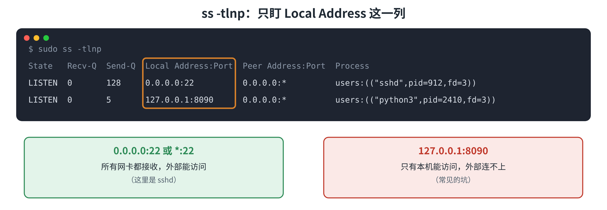


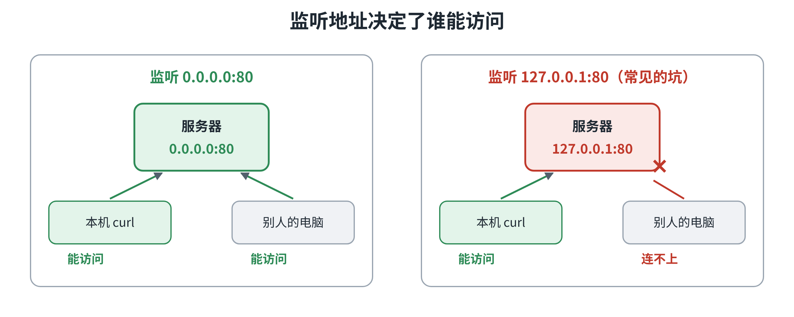

上面的输出里，22 和 80 是 `0.0.0.0`，外面能访问；`8090` 是 `127.0.0.1`，**只有本机能访问**。

## 3.4 防火墙

Rocky 默认开着防火墙 firewalld。它的做法是：**除了明确放行的，其他全部拦住。** 端口是服务器上的“门牌号”（SSH 是 22，网站是 80），放行，就是允许外面的人通过这个门牌号进来。


* 查看防火墙状态

```bash
sudo firewall-cmd --state                              # 防火墙是否在运行
```


* 查看放行了哪些服务和端口

```bash
sudo firewall-cmd --list-all                           # 当前放行了哪些服务和端口
```


* 放行指定的端口

> --permanent : 写进永久配置（要 --reload 才生效）

```bash
sudo firewall-cmd --permanent --add-port=8088/tcp      # 放行 8088 端口
```


* 重新加载防火墙规则，让前面的规则生效

```bash
sudo firewall-cmd --reload                             # 重新加载，让它生效
```


* 取消放行指定端口

```bash
sudo firewall-cmd --permanent --remove-port=8088/tcp   # 取消放行
```


**不要为了省事关掉防火墙（`systemctl stop firewalld`），学习环境可以试，生产环境不要。**


## 3.5 综合示例

启动一个只监听本机的服务，看看会怎样：

```bash
python3 -m http.server 8090 --bind 127.0.0.1 &     # 末尾的 & 表示放到后台运行
$ curl -I http://localhost:8090
HTTP/1.0 200 OK
...
$ sudo ss -tlnp | grep "8090"
LISTEN 0  5  127.0.0.1:8090  0.0.0.0:*  users:(("python3",pid=2410,fd=3))
```

本机能访问，但从**你自己的电脑**访问 `http://虚拟机IP:8090` 不行。原因在 `ss` 里：监听的是 `127.0.0.1`，只有本机能访问。

改成监听所有网卡：

```bash
kill %1                                            # 先停掉后台的服务
python3 -m http.server 8090 --bind 0.0.0.0 &       # 监听所有网卡
```

再从自己的电脑访问，可能**还是不通**，这是防火墙拦住了。放行 8090 端口：

```bash
sudo firewall-cmd --permanent --add-port=8090/tcp
sudo firewall-cmd --reload
```

再访问，成功。练完收尾：

```bash
kill %1                                            # 停掉后台的服务
sudo firewall-cmd --permanent --remove-port=8090/tcp
sudo firewall-cmd --reload
```

**访问失败时，看报错判断原因：**

```text
Connection refused       机器到了，没人接：服务没启动，或没监听这个端口 → 用 ss -tlnp 看
Connection timed out     没有回应：被防火墙拦了 → 用 firewall-cmd --list-all 看
```