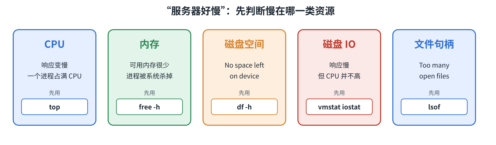
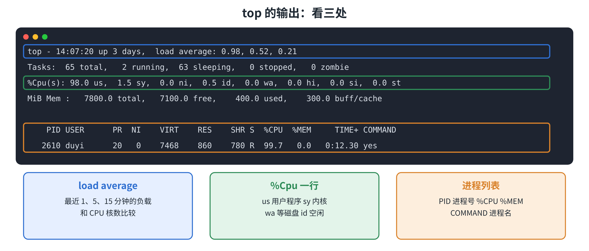
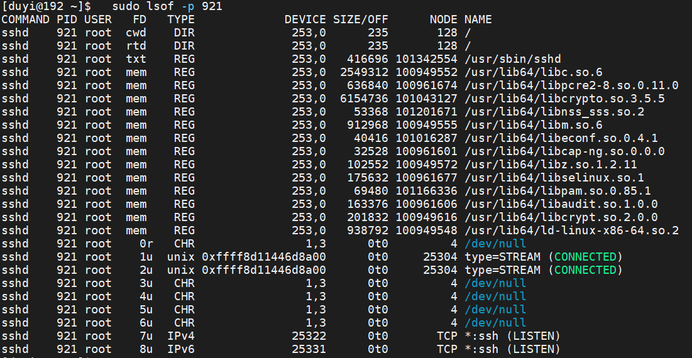

# 一、系统资源

## 1.1 机器慢，慢在哪

线上最常见的一句话：**“服务器好慢！”** 先判断慢在哪一类资源，再找是谁造成的，最后处理。



登录一台出问题的服务器，按这个顺序敲，几十秒内就能判断出方向：

```bash
uptime                  # 负载高不高？
top                     # 谁在占 CPU 和内存？
free -h                 # 内存还剩多少？
df -h                   # 磁盘满了吗？
vmstat 1 5              # 在等 CPU、等磁盘，还是在换页？
sudo dmesg -T | tail    # 内核有没有报错（比如进程被杀）？
```

## 1.2 CPU

### 1.2.1 uptime

```text
$ uptime
 14:07:18 up 3 days,  2:10,  1 user,  load average: 0.52, 0.30, 0.10
```

`load average` 后面三个数字，依次是最近 **1、5、15 分钟**的平均负载，可以理解为“平均有多少个任务在排队等 CPU”。

比如： 1分钟的数值是：0.5 ，就可以简单理解为在前30秒，有1个进程在运行，后30秒，没有进程在运行（空闲）。

```bash
nproc          # 查 CPU 核数
```

和核数比：4 核的机器，负载长期在 4 左右就是满了。1 分钟的数比 15 分钟的大，说明正在变忙。

### 1.2.2  top

```text
在结果页面点击: 
P : 点击P即可， 按 CPU 排序（默认）
M : 点击M即可， 按内存排序
1 : 点击数字1即可 ， 展开每个 CPU 核
q : 点击q即可， 退出
```



`e%Cpu` 那一行：`us` 是用户程序占用，`wa` 是在等磁盘，`id` 是空闲。进程列表里 `%CPU` 在多核机器上可以超过 100%。

用一个会占满 CPU 的命令试一试：

```bash
yes > /dev/null &        # 启动 yes，它会不停输出 y，输出丢进 /dev/null （等价于黑洞）；& 表示放到后台
top                      # 可以看到 yes 的 %CPU 接近 100%，按 q 退出
kill %1                  # 结束它
```

不进入 `top`，也可以直接用 `ps` 按 CPU 排序：

```bash
ps aux --sort=-%cpu | head -5
```

## 1.3 内存

```text
$ free -h
               total        used        free      shared  buff/cache   available
Mem:           7.8Gi       504Mi       7.3Gi        14Mi       301Mi       7.3Gi
Swap:             0B          0B          0B
```


内存不够用时，系统会把一部分内存内容写到磁盘上，这就是 **swap**（交换空间）。磁盘比内存慢得多，swap 被大量使用，机器就会明显变慢。

看内存被谁占了：

```bash
ps aux --sort=-%mem | head -5      # 按内存排序，前 5 个
```

在 `top` 里按 `M` 也一样。

## 1.4 磁盘空间

```text
-h : human-readable  用 G、M 这样的单位显示
-s : summarize       只显示总数
```

### 1.4.1 df

>  看看每个分区还剩多少

```bash
$ df -h
Filesystem           Size  Used Avail Use% Mounted on
/dev/mapper/rl-root   36G  2.9G   33G   9% /
tmpfs                3.9G     0  3.9G   0% /dev/shm
```

`Use%` 是使用率，超过 85% 就该关注。`df -i` 看 inode 的使用，文件数量太多，即使空间没满也会写不进去。

### 1.4.2  du

> `df` 告诉你“满了”，`du` 告诉你“谁占的”：

```bash
sudo du -sh /var/tmp                          # 这个目录一共多大
sudo du -h --max-depth=1 /var | sort -h       # 只看下面一层，按大小从小到大排，最后几行就是“大户”
sudo find /var -type f -size +500M            # 直接找大文件
```

造一个 1G 的文件，模拟磁盘被占：

```bash
# if : input file  /dev/zero 是 Linux 系统里的一个特殊设备文件。你读取它的时候，它会源源不断地吐出二进制的 0（也就是空字符，NUL）。所以，这就是一个无穷无尽的“零”的源泉
# of : output file 表示存放数据的目标文件
# bs : block size 块的大小 1M
# count : 次数     即每次搬运1M的数据，然后搬运1024次。就是1G的大小了
$ dd if=/dev/zero of=/var/tmp/big.bin bs=1M count=1024
1024+0 records in
1024+0 records out
1073741824 bytes (1.1 GB, 1.0 GiB) copied, 1.2 s, 893 MB/s

$ du -sh /var/tmp
1.0G	/var/tmp

$ find /var -type f -size +500M
/var/tmp/big.bin

$ rm /var/tmp/big.bin
```

## 1.5 磁盘 IO

机器很慢，CPU 却不高，常常是**在等磁盘**。

### 1.5.1 vmstat

```text
r  : 等着用 CPU 的进程数，长期大于 CPU 核数，说明 CPU 不够
b  : 被阻塞（通常在等 IO）的进程数，持续大于 0，说明在等磁盘
si : 从 swap 换入        so : 往 swap 换出，持续不为 0，说明内存不够
bo : 往磁盘写的数据量
wa : 等待 IO 的 CPU 时间百分比，高，说明磁盘是瓶颈
```

`vmstat 1 5` 每秒输出一行，共 5 次。一个磁盘忙碌时的输出：

```text
$ vmstat 1 5
procs -----------memory----------    ---swap--  -----io---- -system-- -------cpu-------
 r  b   swpd   free   buff  cache      si   so    bi    bo   in  cs  us sy id wa st
 1  1      0 6763921 105948 1048780    0    0     0 516136 4226 5613  0 15 44 39  1
 0  1      0 6782344 105948 1029900    0    0     0 506856 3445 5071  0 13 47 40  1
```

`id` 还有 44%，但 `wa` 高达 39%，`b` 是 1：**CPU 闲着，是在等磁盘。** 第一行是开机以来的平均值，从第二行开始看。

用一个不停写磁盘的命令试一试：

```bash
dd if=/dev/urandom of=/var/tmp/io.bin bs=1M count=3000 oflag=direct &     # 在后台不停写磁盘
vmstat 1                                                               # 看 bo 和 wa
rm /var/tmp/io.bin                                                     # 写完后删除
```

### 1.5.2 iostat

> 进一步观察哪个**块设备**繁忙（默认输出通常按设备统计，不等同于每个分区的实际业务贡献）

`iostat` 属于 `sysstat` 软件包。如果使用 Rocky Linux / RHEL 系系统，可以安装：

```bash
sudo dnf install -y sysstat

# 每秒采集一次数据 ，采集3次。 -x : 表示显示扩展信息 （延迟和使用率）
iostat -x 1 3

# 可以使用lsblk 查看磁盘的逻辑关系
```

```text
%util  : 磁盘忙碌的时间占比，接近 100% 说明磁盘已经饱和
await  : 一次 IO 平均等待多少毫秒，持续很高说明磁盘响应慢
r/s w/s : 每秒读 / 写次数	
```

# 二、性能排查

## 2.1 文件句柄：lsof

### 2.1.1 什么是文件句柄？

在 Linux 中，程序运行时经常需要访问各种资源，例如：

- 读取配置文件
- 写入日志文件
- 监听网络端口
- 与客户端建立 TCP 连接

Linux 通过**文件描述符（File Descriptor，简称 FD）**，让进程访问这些已经打开的资源。

文件描述符通常是一个非负整数，例如 `0、1、2、3、4`。

其中：

| FD       | 通常对应                 |
| -------- | ------------------------ |
| 0        | 标准输入 stdin           |
| 1        | 标准输出 stdout          |
| 2        | 标准错误 stderr          |
| 3 及以上 | 普通文件、Socket、管道等 |

例如，一台 Web 服务器接受了多个客户端连接，这些连接通常都需要占用文件描述符。

因此，**打开的文件和连接越多，可能占用的文件描述符就越多。**

每个进程能够打开的文件描述符数量存在资源限制。如果达到限制，程序可能出现：

```
Too many open files
```

在 Linux 运维中，我们需要知道哪个进程打开了哪些资源、已经使用多少文件描述符，以及距离限制还有多远。

### 2.1.2 lsof：查看打开的文件

`lsof` 是 List Open Files 的缩写，用于查看进程打开的文件和相关资源，包括普通文件、网络 Socket 等。

Rocky Linux Minimal 环境可能没有预装，需要先安装：

```
sudo dnf install -y lsof
```

**实验一：查看谁在使用 SSH 的 22 端口**

```
sudo lsof -nP -iTCP:22 -sTCP:LISTEN
```

参数说明：

- `-iTCP:22`：查看与 TCP 22 端口有关的网络资源。
- `-sTCP:LISTEN`：只筛选监听状态。
- `-nP`：不进行主机名和端口名称解析。

示例输出：

```
COMMAND PID USER FD  TYPE NAME
sshd    921 root 3u  IPv4 TCP *:22 (LISTEN)
```

说明 PID 为 `921` 的 `sshd` 进程正在监听 TCP 22 端口。

其中：

- `COMMAND`：进程名称
- `PID`：进程编号
- `USER`：进程所属用户
- `FD`：文件描述符
- `TYPE`：资源类型
- `NAME`：资源的具体信息

`3u` 表示文件描述符编号为 3，以读写方式打开。

**实验二：查看指定进程打开了哪些资源**

通过上面的命令，我们已经知道 `sshd` 的 PID 为 921。

接下来执行：

```
    sudo lsof -p 921
```




可以查看该进程打开的文件和相关资源。

注意：921 是示例 PID，实际操作时应替换为查询得到的进程编号。

`lsof` 的输出中除了数字文件描述符，还可能有 `cwd`、`txt`、`mem` 等条目，因此不能直接把输出总行数当作文件描述符数量。

### 2.1.3 查看文件描述符数量及限制

**第一步：统计进程打开的文件描述符数量**

```
sudo ls -1 /proc/921/fd | wc -l
```

其中：

- `/proc/921/fd`：PID 921 当前打开的文件描述符目录。
- `wc -l`：统计输出行数。

假设输出：

```
25
```

表示该进程在统计时大约打开了 25 个文件描述符。

**第二步：查看文件描述符数量限制**

```
ulimit -n
```

假设输出：

```
1024
```

表示当前 Shell 的文件描述符软限制为 1024。

需要注意：该命令查看的是当前 Shell，而不是任意进程的限制。

如果要查看 PID 921 的限制，应执行：

```
cat /proc/921/limits
```

在输出中找到：

```
Max open files
```

其中包含该进程的软限制（Soft Limit）和硬限制（Hard Limit）。

### 2.1.4 运维场景：Too many open files

假设某个 JavaWeb 服务运行一段时间后，出现：

```
java.io.IOException: Too many open files
```

这说明程序尝试打开文件或创建相关资源时，遇到了文件描述符限制问题。

可以按照以下顺序排查。

**第一步：定位 Java 进程**

```
pgrep -af java
```

假设查到 PID 为 921。

**第二步：查看当前打开的 FD 数量**

```
sudo ls -1 /proc/921/fd | wc -l
```

**第三步：查看进程的 FD 限制**

```
cat /proc/921/limits
```

**第四步：检查具体打开了哪些资源**

```
sudo lsof -p 921
```

例如，检查是否打开了大量日志文件，或者存在大量网络连接。

如果发现文件描述符数量持续异常增长，并且接近上限，可能存在文件或 Socket 没有正确关闭的问题，这种情况通常称为**文件描述符泄漏（FD Leak）**。

但要注意：文件描述符数量增长不一定就是泄漏，高并发服务也可能正常维护大量连接。

此外，提高文件描述符上限只能缓解部分资源限制问题。如果根本原因是程序没有及时关闭资源，仍然需要修复程序。

运维工程师遇到 `Too many open files` 时，重点不是立即提高限制，而是先确认**哪个进程、打开了多少 FD、限制是多少、是否存在异常增长**。


## 2.2 内核日志：dmesg

### 2.2.1 什么是内核日志？

Linux 系统运行过程中，不仅应用程序会产生日志，**Linux 内核本身也会记录重要的系统事件**。

例如：

- 系统启动时识别到了哪些硬件设备
- 磁盘读写过程中是否出现错误
- 内存不足时是否触发 OOM（Out Of Memory）
- 某些驱动程序是否出现异常
- 系统是否发生硬件或内核相关错误

这些信息对运维工程师非常重要。

例如：某个 Java 服务原本运行正常，却突然消失了。应用日志中可能没有发现明显错误，但内核日志里却记录了：

```
Out of memory: Killed process 1234 (java)
```

这就表明系统曾经发生内存不足，内核终止了一个 Java 进程。

**dmesg（Display Message）** 是 Linux 用来查看内核消息的命令，主要读取内核的消息缓冲区（Kernel Ring Buffer）。

注意：`dmesg` 主要查看内核消息，不是用来查看所有应用程序日志的。

### 2.2.2 dmesg：查看内核日志

**实验一：查看内核消息**

```
sudo dmesg
```

这条命令会输出当前内核消息缓冲区中的内容。

由于信息可能比较多，可以结合 `tail`：

```
sudo dmesg | tail -20
```

表示只显示最后 20 行。

但是，默认的 `dmesg` 输出中，时间通常是系统启动以来经过的时间，例如：

```
[    0.000000] Linux version 5.14.0...
[    1.235678] nvme nvme0: pci function 0000:03:00.0
[   12.567890] EXT4-fs (sda1): mounted filesystem
```

方括号中的数值表示内核时间戳，通常以系统启动后的秒数表示。

对于运维人员来说，这种时间格式不方便直接与故障发生的时刻对应。

可以添加 `-T` 参数：

```
sudo dmesg -T | tail -20
```

`-T`（Human-readable timestamps）：将时间转换为人类容易阅读的日期时间形式。

示例：

```
[Mon Nov  2 10:15:32 2026] nvme nvme0: I/O error
```

这有助于判断错误大约发生在什么时间。

注意：`dmesg -T` 的时间转换可能受到系统时间调整、休眠等因素影响，不一定完全精确。实际运维中需要结合其他日志确认时间。

**实验二：筛选包含错误信息的日志**

内核日志可能有几百行甚至上千行，不可能逐行检查。

因此，运维工程师通常会使用 `grep` 过滤关键字。

```
sudo dmesg -T | grep -i error
```

参数说明：

- `grep`：查找包含指定内容的文本行
- `-i`：忽略大小写
- `error`：查找包含 error 的日志

如果需要同时查找多个关键字：

```
sudo dmesg -T | grep -iE "error|fail|oom"
```

其中：

- `-E`：使用扩展正则表达式
- `|`：在正则表达式中表示“或者”
- `error`：错误
- `fail`：失败
- `oom`：内存不足相关信息

注意：这种筛选只能帮助快速查找可疑消息，不能保证所有故障日志一定包含这些关键字。

### 2.2.3 常见内核日志分析

运维工程师不需要记住所有内核日志，但应该能够识别几类常见错误。

**场景一：内存不足（OOM）**

例如：

```
Out of memory: Killed process 1234 (java)
```

这里：

- `Out of memory`：系统或相关内存控制范围出现内存不足
- `Killed process`：某个进程被内核终止
- `1234`：被终止进程的 PID
- `(java)`：进程名称

这类信息通常与 Linux 的 OOM Killer 机制有关。

当系统无法满足某些内存分配需求时，内核可能选择终止一个或多个进程，以缓解内存压力。

可以执行：

```
sudo dmesg -T | grep -iE "out of memory|oom|killed process"
```

用于查找 OOM 相关记录。

需要注意：不是所有程序异常退出都由 OOM 引起，出现 OOM 日志也需要结合时间、进程名称和内存使用情况判断。

**场景二：磁盘 I/O 错误**

例如，内核日志可能出现：

```
I/O error, dev sda, sector 123456
```

这里：

- `I/O error`：发生输入输出错误
- `dev sda`：涉及的块设备
- `sector 123456`：涉及的扇区位置

这种错误可能与磁盘、虚拟存储设备、驱动或底层存储环境有关。

可以使用：

```
sudo dmesg -T | grep -iE "I/O error|blk_update_request|nvme"
```

查找相关记录。

如果发现大量 I/O 错误，应进一步检查块设备状态及存储系统，而不能简单地认为一定是物理硬盘损坏。

**场景三：驱动或设备初始化异常**

例如：

```
device initialization failed
```

说明某个设备或驱动在初始化时出现失败。

可以进一步通过：

```
sudo dmesg -T | grep -iE "failed|timeout|reset"
```

筛选可能的异常记录。

这些信息在服务器识别不到磁盘、网卡或其他硬件设备时，可能具有参考价值。

上述日志均为教学示例，不代表每个 Linux 发行版都会输出完全相同的内容。

### 2.2.4 运维实战：Java 服务突然消失

假设线上运行着一个 JavaWeb 服务，原本可以正常访问，但运行一段时间后，用户发现服务无法访问。

运维人员检查后发现，Java 进程已经不存在了。

此时应该如何排查？

**第一步：确认进程是否存在**

```
pgrep -af java
```

如果没有找到目标 Java 进程，说明该服务的进程可能已经退出。

但不能直接判断是内存不足，也可能是程序自身崩溃、人工停止、服务管理器终止等原因。

**第二步：查看内核日志**

```
sudo dmesg -T | tail -50
```

检查近期是否出现异常信息。

如果怀疑 OOM，可以进一步筛选：

```
sudo dmesg -T | grep -iE "oom|out of memory|killed process"
```

假设看到：

```
Out of memory: Killed process 1234 (java)
```

说明系统发生过 OOM 事件，并且内核终止了 PID 为 1234 的 Java 进程。

这时还要结合日志发生时间，确认是否与本次服务故障对应。

**第三步：查看当前内存情况**

```
free -h
```

重点观察：

- `available`：当前估算还能使用的内存
- `Swap`：交换空间使用情况

还可以执行：

```
vmstat 1 5
```

观察是否存在明显的内存交换活动，重点关注：

- `si`：Swap 换入
- `so`：Swap 换出

注意：如果 OOM 已经发生，相关进程已经被终止，当前内存可能恢复正常。因此不能只根据故障发生后的 `free -h` 判断故障发生时是否内存不足。

**第四步：分析可能原因**

如果确认是 OOM，进一步排查：

- Java 服务是否占用了过多内存
- 虚拟机分配的物理内存是否不足
- 是否还有其他进程大量消耗内存
- 是否存在内存泄漏或程序配置不合理
- 是否受到容器或 systemd 服务的内存限制

对于 Java 服务，还需要结合 JVM 堆内存配置和应用日志进一步分析。

不能简单通过增加 Swap 或重启程序，就认为故障已经彻底解决。

**补充：使用 journalctl 查看内核日志**

在 Rocky Linux 9 等使用 systemd 的系统中，还可以执行：

```
sudo journalctl -k -b
```

参数说明：

- `-k`：只查看内核消息
- `-b`：查看本次启动的日志

查看上一次启动的内核日志，可以尝试：

```
sudo journalctl -k -b -1
```

这在服务器重启后排查之前发生的内核错误时很有用。

但前提是系统保留了上一次启动的 journal 日志。如果日志没有持久化保存，就可能无法查询。