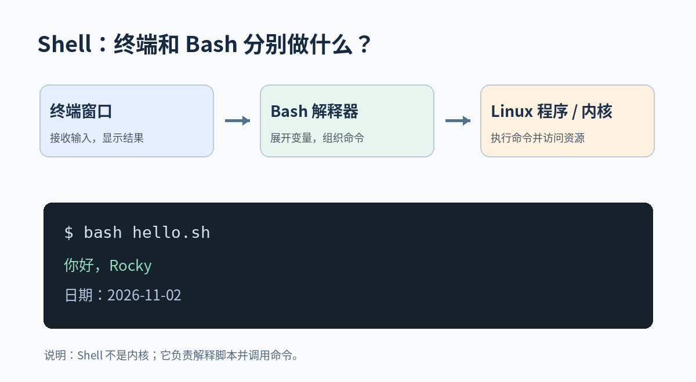
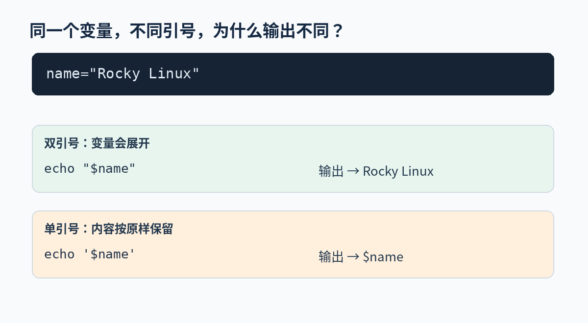
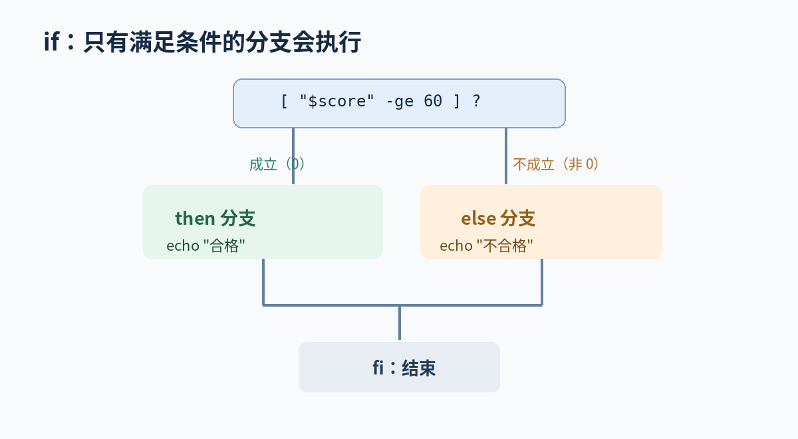

# 一、Shell 入门

## 1.1 介绍

我们已经在 Linux 终端里执行过 `ls`、`pwd`、`df -h` 等命令。**那么是谁接收这些命令，并让它们执行的呢？** 常见答案就是 Shell。

- **终端（Terminal）**：供我们输入命令、查看输出的界面。
- **Shell**：命令解释器，负责解析命令、展开变量、执行内置命令或启动外部程序。
- **Bash**：一种常见的 Shell，Rocky Linux 中经常使用。
- **Shell 脚本**：把一组命令和判断、循环等逻辑写在文件里，交给 Shell 执行。



**为什么运维人员要学？** 假设每天都要检查磁盘空间、确认 SSH 服务是否正常、执行备份。每次手动输入多个命令容易遗漏；把它们写成脚本，就可以重复运行，还能交给定时任务或 CI/CD 流水线调用。

**先在终端中观察：**

```bash
pwd              # 查看当前目录
whoami           # 查看当前用户名
echo "$SHELL"    # 查看环境变量中记录的登录 Shell  如果释出/bin/bash 则说明当前用户配置使用的 Shell 是 Bash。
bash --version   # 查看 Bash 版本（输出可能较长）
```


## 1.2 第一个脚本

**目标**：让脚本自动输出问候语和当天日期。

使用编辑器创建 `hello.sh`（例如 `nano hello.sh` 或 `vi hello.sh`），输入：

```bash
#!/usr/bin/env bash   
# 第一个 Shell 脚本
name="Rocky"
echo "你好，$name"
echo "今天是：$(date +%F)"
```

**代码怎么读？**

1. `#!/usr/bin/env bash`：称为 **Shebang**。直接执行文件时，系统根据它选择 Bash 解释器。
   1. 除了上面这种写法，还有其他两种写法： `#!/usr/bin/bash`   和  `#!/bin/bash `
2. `# 第一个 Shell 脚本`：注释，帮助人理解代码；第一行 Shebang 是特殊用法。
3. `name="Rocky"`：给变量 `name` 赋值。注意：**等号两侧不能有空格**。
4. `echo "你好，$name"`：输出文字，并把 `$name` 替换为变量值。
5. `$(date +%F)`：先执行 `date +%F`，再把它输出的日期插入这行文字。这叫**命令替换**。

**先用 Bash 运行：**

```bash
bash hello.sh
```

输出示例：

```text
你好，Rocky
今天是：2026-11-02
```

也可以给脚本添加执行权限，直接运行：

```bash
chmod +x hello.sh
./hello.sh
```

- `chmod +x`：为脚本添加执行权限。
- `./`：明确指出要运行**当前目录**下的文件，而不是从 `PATH` 中查找同名命令。
- `bash hello.sh`：由 Bash 读取脚本，通常不要求脚本自身具有执行权限；`./hello.sh` 则需要相应权限与可用解释器。

**常见错误**：如果写成 `name = "Rocky"`，Bash 会把 `name` 当作命令尝试执行，而不是变量赋值。遇到 `Permission denied`，先检查文件权限，不要直接用 `sudo` 掩盖问题。

## 1.3 变量与引号

> ：为什么要写 `"$name"`？

变量就是用一个名字保存数据。比如：

```bash
name="Rocky Linux"
echo "$name"
echo '$name'
```

输出：

```text
Rocky Linux
$name
```



**区别在于**：

- **双引号**：允许 `$name` 等变量展开，输出变量值。
- **单引号**：其中的 `$name` 按原样输出，不进行变量展开。

为什么强调双引号？看这个变量：

```bash
file="/var/tmp/my report.txt"
printf '%s\n' "$file"
```

`file` 的值包含空格。`"$file"` 通常能让它作为一个完整参数传给命令；不加引号，很多情况下会被拆成多个参数。日后操作路径时，**优先写 `"$变量"`**。

## 1.4 脚本参数

如果每次要问候的人不同，没必要反复修改 `hello.sh`，可以让运行脚本的人传入参数。

创建 `args.sh`：

```bash
#!/usr/bin/env bash
echo "脚本名称：$0"
echo "第一个参数：${1:-未提供}"
echo "参数个数：$#"
```

运行：

```bash
bash args.sh Alice
```

输出示例：

```text
脚本名称：args.sh
第一个参数：Alice
参数个数：1
```

- `$0`：脚本的调用名称；用 `bash args.sh` 运行时通常显示 `args.sh`。
- `$1`：第一个位置参数；`$2` 是第二个，以此类推。
- `$#`：传入的位置参数数量。
- `${1:-未提供}`：如果第一个参数未设置或者为空，就使用“未提供”作为默认显示内容。

再运行 `bash args.sh`，观察第一个参数的输出变为“未提供”、参数个数变为 0。**这就是同一个脚本根据外部输入完成不同工作的基本思路。**

## 1.5 环境变量

前面定义的 `name="Rocky"` 是当前 Shell 的普通变量。**但如果这个 Shell 启动了另一个程序，那个程序能读取它吗？** 默认情况下，未导出的普通变量不会自动进入子进程的环境。

先执行：

```bash
APP_ENV="test"
echo "$APP_ENV"
```

输出 `test`，说明当前 Shell 可以读到这个变量。

现在试着启动一个新的 Bash（在未预先导出 APP_ENV 的环境下）：

```bash
bash -c 'echo "$APP_ENV"'
```

它通常只输出空行。`bash -c '命令'` 的意思是**启动一个新的 Bash 进程来执行引号里的命令**。新进程不会自动继承父 Shell 中未导出的变量。

我们再执行：

```bash
export APP_ENV
bash -c 'echo "$APP_ENV"'
```

这次会输出：

```text
test
```

**过程解释：**

1. `APP_ENV=test`：在当前 Shell 中赋值。
2. `export APP_ENV`：将变量标记为导出。
3. `bash -c ...`：创建子 Bash，子进程继承导出的环境变量。

也可以一步写成 `export APP_ENV=test`。

## 1.6 退出码

有些命令会打印大量内容，有些命令却什么都不打印。**判断是否成功，不能只看终端有没有文字。** Shell 命令执行结束时有退出状态码（Exit Status）：通常 `0` 表示成功，非零表示失败或其他非成功状态。

先看熟悉的 `ls`：

```bash
ls /tmp
echo "$?"
```

如果 `ls` 执行成功，`echo "$?"` 输出 `0`。这里的 `$?` 是特殊参数，表示**上一条命令的退出状态**。

再试：

```bash
ls /not_exist_for_demo
echo "$?"
```

目录不存在时，`ls` 会报错，并返回非零状态（GNU `ls` 常见为 `2`）。

为了方便测试，还可以用两个专门的命令：

```bash
true
echo "$?"   # 0：成功
false
echo "$?"   # 1：失败
```

`true` 与 `false` 通常不输出文字，只通过退出码表达成功和失败。

**为什么强调“上一条”？**

```bash
false
echo "Hello"
echo "$?"     # 这里通常是 0，而不是 1
```

因为 `echo "Hello"` 已成功执行，它覆盖了 `$?` 的上一次值。需要保留某个退出码，就应立即保存：

```bash
false
status=$?               # 使用变量status 来保存上一条命令的结果
echo "退出码：$status"   # 1
```

**在运维中的意义**：后面 `if` 可以根据命令退出状态选择分支；CI/CD 流水线也通常根据执行步骤的退出状态决定成功或失败。


# 二、判断、循环、函数

## 2.1 if

假设成绩达到 60 分才算合格，程序就需要根据条件执行不同的命令。

```bash
#!/bin/bash
score=85
if [ "$score" -ge 60 ]; then
    echo "合格"
else
    echo "不合格"
fi
```



**逐步解释：**

1. `score=85`：定义一个数字变量。
2. `[ "$score" -ge 60 ]`：判断 `score` 是否大于等于 60，条件成立时返回状态 0。
3. `then`：执行条件成立时的代码。
4. `else`：执行条件不成立时的代码。
5. `fi`：结束整个 if 结构。

输出 `合格`。把 `score` 改成 `50` 再运行，应输出 `不合格`。

**特别注意**：`[` 本质上是一个命令，`[`、`]` 周围要留空格；`-ge` 是整数比较，不是普通字符串比较。

常用条件无需全背，但要知道用途：

| 写法 | 作用 |
|---|---|
| `-eq` / `-ne` | 整数相等 / 不相等 |
| `-gt` / `-ge` | 大于 / 大于等于 |
| `-lt` / `-le` | 小于 / 小于等于 |
| `-f "文件"` | 判断普通文件是否存在 |
| `-d "目录"` | 判断目录是否存在 |
| `-z "字符串"` | 判断字符串是否为空 |

例如：

```bash
if [ -d /var/log ]; then
    echo "日志目录存在"
fi
```

如果目录存在才打印结果。**很多运维脚本先判断路径是否存在，再进行后续操作。**

## 2.2 for

先看最简单的循环：

```bash
for item in A B C; do
    echo "当前：$item"
done
```

输出：

```text
当前：A
当前：B
当前：C
```

- `for item in A B C`：依次把 A、B、C 赋给变量 `item`。
- `do` 到 `done`：每次需要重复执行的内容。

**运维案例：检查两个服务是否处于 active 状态。**

```bash
#!/bin/bash
for service in sshd crond; do
    if systemctl is-active --quiet "$service"; then
        echo "[OK] $service"
    else
        echo "[WARN] $service"
    fi
done
```

**这段代码要让学生跟着看懂：**

1. 第一次循环：`service=sshd`；第二次循环：`service=crond`。
2. `systemctl is-active --quiet "$service"`：查询当前服务是否为 active；`--quiet` 不打印普通状态，主要用**退出码**表达结果。
3. `if` 根据退出码判断：成功则显示 `[OK]`，非成功则显示 `[WARN]`。
4. `done` 结束循环。`if` 的结束标志是 `fi`，两者不要弄混。

输出示例（取决于系统实际状态）：

```text
[OK] sshd
[WARN] crond
```

`[WARN]` 只表示**当前不是 active**，还可能是服务未安装、服务名称不同等情况，不能立即断言故障。

可以使用命令来查看这两个服务的状态

```bash
sudo systemctl status sshd
sudo systemctl status crond

```

## 2.3 while

当不知道要重复多少次，而是要根据某个条件决定是否继续时，可以使用 `while`。

```bash
#!/bin/bash
n=1
while [ "$n" -le 3 ]; do
    echo "第 $n 次"
    n=$((n + 1))
done
```

输出：

```text
第 1 次
第 2 次
第 3 次
```

- 初始 `n=1`。
- `[ "$n" -le 3 ]`：只要 `n` 小于等于 3，就继续执行循环体。
- `n=$((n + 1))`：让 `n` 每次加 1，否则可能一直满足条件而形成死循环。

**如何区分 `for` 和 `while`？** 知道有一组对象要逐个处理，常用 `for`；要一直等待条件变化，例如服务启动，常用 `while`。本节先掌握循环机制，暂不引入复杂的网络健康检查代码。

## 2.4 函数

假设脚本很多地方需要输出“当前时间 + 消息”，每次都复制同一段代码不方便。**函数就是给一段可重复使用的代码起一个名字。**

### 2.4.1 函数入门

```bash
#!/bin/bash
log() {
    echo "[$(date +%t)] $1"
}

log "开始检查"
log "检查结束"
```


输出示例：

```text
[14:20:01] 开始检查
[14:20:02] 检查结束
```

- `log() { ... }`：定义函数，函数体放在 `{}` 内。
- `log "开始检查"`：调用函数，并传入一个参数。
- 函数内部的 `$1`：表示本次函数调用的第一个参数；与函数外脚本参数区分开。
- `$(date +%T)`：取出当前时分秒。

### 2.4.2 return 返回状态码

> return 只适合返回状态码

```bash
#!/bin/bash
check_dir() {
    if [ -d "$1" ]; then
        return 0
    else
        return 1
    fi
}

if check_dir /tmp; then
    echo "目录存在"
else
    echo "目录不存在"
fi
```

通常输出 `目录存在`。

- `check_dir /tmp`：把 `/tmp` 传给函数，函数里的 `$1` 就是 `/tmp`。
- -d  是一个判断命令，也就是判断传递进来的参数是否是目录 directory
- `return 0`：表示函数执行成功；`return 1`：表示失败。
- `if check_dir /tmp`：直接依据函数的返回状态决定执行哪个分支。

**不要混淆**：`return` 结束当前函数，而 `exit` 会结束当前脚本或 Shell 进程。Shell 的 `return 30` 表示状态码 30，不等于 C 语言中把普通整数 30 返回给调用者。

### 2.4.3 local 本地变量

> 防止覆盖函数外的同名变量

```bash
#!/bin/bash
name="Rocky"
hello() {
    local name="Linux"
    echo "$name"
}
hello
echo "$name"
```

输出：

```text
Linux
Rocky
```

`local name="Linux"` 声明函数内部使用的局部变量，因此函数内部打印 `Linux`，外面保留原来的 `Rocky`。函数比较多时，使用 `local` 有助于减少变量相互影响。

### 2.4.4 echo 返回数据

```bash
#!/bin/bash
add() {
    local a="$1"
    local b="$2"
    echo $((a + b))
}

result=$(add 10 20)
echo "计算结果：$result"
```

输出：

```text
计算结果：30
```

解释：

* 函数内部：
  * $(())  叫做：**算术展开（arithmetic expansion）**，作用是：**把括号里的内容当作数学表达式求值，然后把结果替换到原位置**。
  * echo $((a+b)) 会等价于  echo 30 

* 函数外部
  * 这里的 `$(...)` 叫**命令替换**：它执行 `add 10 20`，把该命令**打印到 stdout 的所有内容**捕获下来，赋给 `result`。
  * 所以 `echo $((a+b))` 确实是在"打印"，但因为调用方用 `$(...)` 把打印的内容**接住了**，效果就等同于"返回了值"。换句话
  * **`echo` 负责"生产数据"到 stdout**
  * *`$(...)` 负责"消费数据"，把 stdout 变成变量值**


# 三、命令组合

## 3.1 标准输入输出

Linux 命令不仅能打印文字，还能把结果交给其他命令或者写入文件。理解这一点，才能读懂后面的管道与重定向。

| 编号 | 名称 | 通俗解释 |
|---|---|---|
| `0` | stdin，标准输入 | 程序通常从这里读取输入 |
| `1` | stdout，标准输出 | 程序通常把正常结果写到这里 |
| `2` | stderr，标准错误 | 程序通常把错误信息写到这里 |

## 3.2 重定向

让输出写进文件

```bash
echo "第一次" > /var/tmp/demo.txt
echo "第二次" >> /var/tmp/demo.txt
cat /var/tmp/demo.txt
```

输出：

```text
第一次
第二次
```

- `>`：把标准输出写入文件，若文件原本有内容通常会被**覆盖**。
- `>>`：把标准输出**追加**到文件末尾。
- `cat`：读取并显示文件内容。

再看错误输出：

```bash
ls /this_path_does_not_exist 2> /var/tmp/error.log
cat /var/tmp/error.log
```

这里 `2>` 的 `2` 指标准错误。`ls` 报错信息没有显示在原命令的终端输出位置，而是被写入了 `error.log`。


## 3.3 awk

>  按列处理文本

### 3.3.1 准备文件

> 这段命令的作用是创建 `/var/tmp/app-demo.log`，并写入 5 行模拟日志。
>
> `cat > ... <<'EOF'` 使用了 Here Document 语法，不需要专门了解它

```bash
cat > /var/tmp/app-demo.log <<'EOF'
2026-11-02 09:00:01 INFO nginx started
2026-11-02 09:01:15 ERROR mysql connection_failed
2026-11-02 09:02:30 WARN disk_usage_high
2026-11-02 09:03:45 INFO nginx running
2026-11-02 09:04:20 ERROR redis timeout
EOF
```

### 3.3.2 提取指定字段

```
awk '{print $3}' /var/tmp/app-demo.log
```

输出：

```
INFO
ERROR
WARN
INFO
ERROR
```

解释：

- `awk` 默认逐行读取文本。
- 默认按照空白字符分隔字段。
- `$3` 表示每一行的第 3 个字段。
- `print $3` 表示输出第 3 个字段。

### 3.3.3 筛选 ERROR 日志

```
awk '$3=="ERROR" {print $0}' /var/tmp/app-demo.log
```

输出：

```
2026-11-02 09:01:15 ERROR mysql connection_failed
2026-11-02 09:04:20 ERROR redis timeout
```

解释：

- `$3=="ERROR"`：判断第三个字段是否等于 `ERROR`。
- `{print $0}`：如果满足条件，就输出整行。
- `$0`：表示当前读取的整行文本。

### 3.3.4 统计 ERROR 出现的次数

```
awk '$3=="ERROR" {count++} END {print count+0}' /var/tmp/app-demo.log
```

输出：

```
2
```

解释：

- `$3=="ERROR"`：找到错误日志。
- `count++`：每找到一条，计数加 1。
- `END`：全部日志读取完成后执行。
- `print count+0`：输出统计结果，即使没有匹配记录也输出 `0`。

#### 3.3.5 综合一个小例子：提取根分区使用率

先看原始信息：

```bash
df -P /
```

示例输出：

```text
Filesystem  1024-blocks  Used  Available Capacity Mounted on
/dev/mapper/rl-root  ...  ...  ...  31% /
```

我们只想得到数字 `31`，以便后续判断是否超过阈值。执行：

```bash
df -P / | awk 'NR==2 {gsub(/%/, "", $5); print $5}'
```

**把它拆成四步：**

1. `df -P /`：查询根文件系统的磁盘使用情况，采用便于按列处理的输出格式。
2. `|`：把 `df` 的标准输出交给 `awk`。
3. `NR==2`：只处理第 2 行（第一行是表头）。
4. `gsub(/%/, "", $5); print $5`：去掉第 5 列的 `%`，输出剩余数字。

因此，原来 `31%` 会变成 `31`

## 3.4 调试

创建或修改脚本后，不建议直接在生产服务器上执行，先做基础检查：

```bash
bash -n hello.sh   # 只检查 Bash 语法，不执行脚本
bash -x hello.sh   # 真正执行脚本，并打印执行过程
```

- `bash -n`：发现常见的括号、引号、关键字结构等语法错误；但不能证明逻辑一定正确。
- `bash -x`：观察命令执行顺序以及变量展开结果；**可能暴露密码或令牌**，不要在包含敏感数据的日志中直接保存跟踪输出。
