# 一、计算机网络基础

## 1.1 访问过程

你在浏览器里敲下网址，到页面出来，中间其实走了四站。

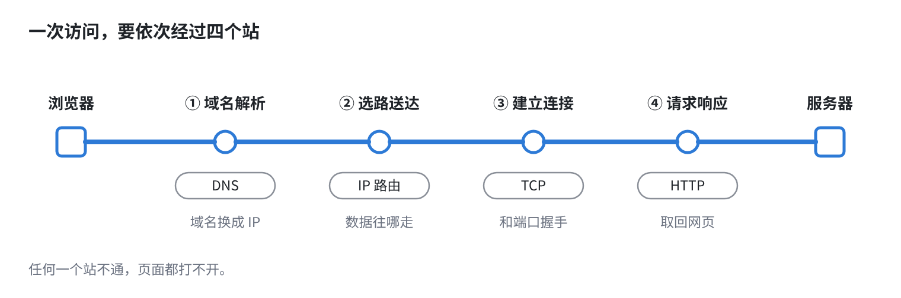

每一站各管一件事。出了问题，我们就能一站一站地排除。

> 记住这一句，它是整套课的主线：
>
> **网络能到达服务器，不代表网页一定能打开。** 服务器上还得有程序在运行，监听正确的地址和端口，并且允许请求进来。

## 1.2 四个基本词

后面每一章都会用到四个词。先看两个和地址有关的：


再认两个和“角色”有关的：

| 名词 | 意思 |
| --- | --- |
| 客户端 | 主动发起请求的一方，比如浏览器、SSH 客户端 |
| 服务器 | 提供服务的一方，一台服务器上可以同时跑好几个程序 |

> **把 IP 想成小区地址，端口就是门牌号。** 只知道小区不行，还得知道敲哪一扇门。

## 1.3 常见的网络设备

数据在网络里走，会经过三类设备。它们在一张网里的位置是这样的：

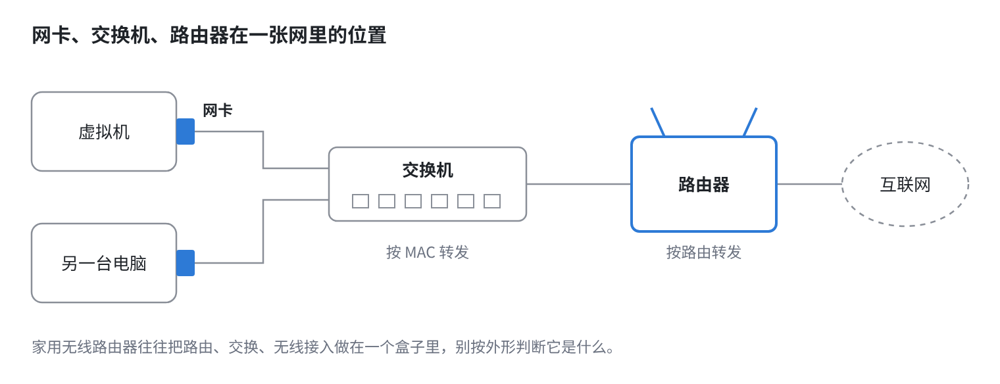

| 设备 | 作用 |
| --- | --- |
| 网卡 | 计算机连接网络的接口，虚拟机里有虚拟网卡 |
| 交换机 | 主要在局域网内，根据 MAC 地址转发以太网帧 |
| 路由器 | 连接不同的 IP 网络，根据路由转发数据包 |

## 1.4 网络协议

协议就是通信双方共同遵守的规则。一份数据要发出去，会被一层一层地“包起来”：

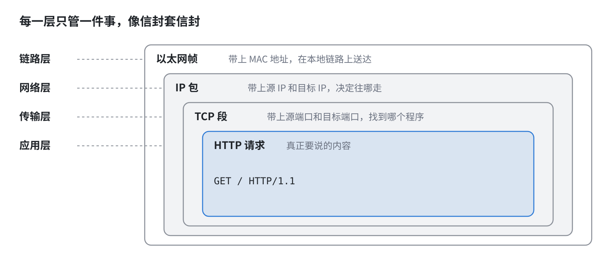

先记住下面四个，其他的以后用到再学：

| 协议 | 主要负责什么 |
| --- | --- |
| IP | 地址，以及在不同网络之间转发 |
| TCP / UDP | 应用程序之间的数据传输 |
| DNS | 域名解析 |
| HTTP | 浏览器和 Web 服务之间交换请求和响应 |


## 1.5 用 curl -v 亲眼看一遍

光看图不够直观。我们让 curl 把每一步都打印出来：

```bash
curl -v http://example.com
```

输出很长，只盯着这几行看：

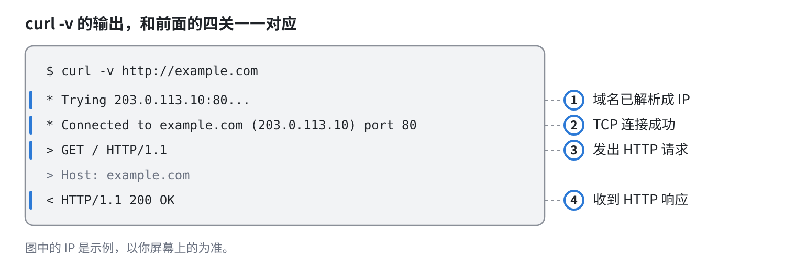


# 二、IP和子网

## 2.1 IP地址

IPv4 地址由 **32 个二进制位**组成。32 位太长，所以我们把它每 8 位分成一组，每组写成一个十进制数，中间用点隔开：

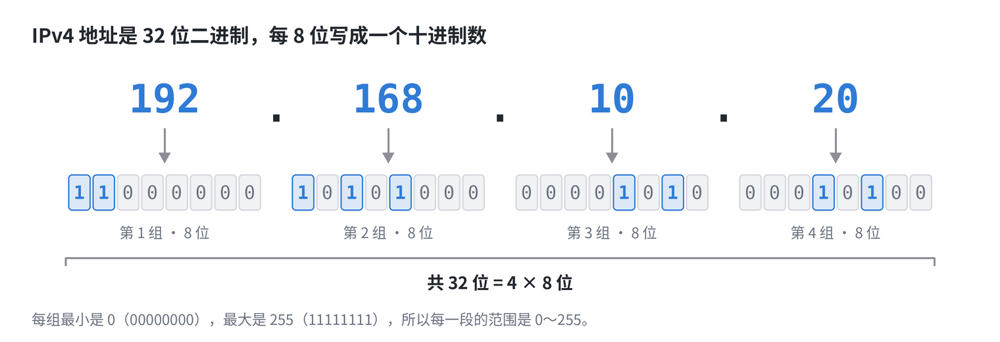

8 位最多表示 256 个值，所以每一组的范围是 `0～255`。

### 私有地址

它们不能直接在互联网上使用，可以在不同的内网里重复使用。

| 地址范围                       | 前缀写法         | 常见场景                  |
| ------------------------------ | ---------------- | ------------------------- |
| 10.0.0.0 ～ 10.255.255.255     | `10.0.0.0/8`     | 大型企业内网、云上网络    |
| 172.16.0.0 ～ 172.31.255.255   | `172.16.0.0/12`  | Docker 默认网段所在范围   |
| 192.168.0.0 ～ 192.168.255.255 | `192.168.0.0/16` | 家庭网络、VMware 虚拟网络 |

### 几个要认识的特殊地址

| 地址          | 含义                                                         |
| ------------- | ------------------------------------------------------------ |
| `127.0.0.1`   | 回环地址，只代表本机自己。                                   |
| `0.0.0.0`     | 在服务端监听时，通常表示本机所有 IPv4 地址，不是让别人访问的目标 |
| `169.254.x.x` | 链路本地地址，Windows 上 DHCP 获取失败时常见                 |

> 本课程以 IPv4 为主。IPv6 地址更长、写法不同，思路是一致的，以后用到再学。0

## 2.2 子网掩码

一个 IP 地址其实包含两部分信息：

- **网络部分**：我在哪个网络里 ， 可以理解为就是小区
- **主机部分**：我是这个网络里的哪一台，可以理解为就是小区里面的某一户人家

那么，从第几位开始算主机部分呢？这就是**子网掩码**的作用。

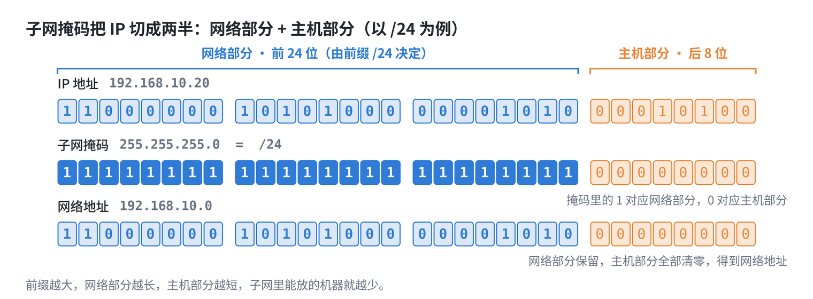

```text
IP 地址：     192.168.10.20
子网掩码：    255.255.255.0
简写（CIDR）：192.168.10.20/24
所属子网：    192.168.10.0/24
```

`/24` 的意思是：**前 24 位是网络部分**，剩下的 `32 - 24 = 8` 位是主机部分。

```text
11000000.10101000.00001010 .00010100    ← 192.168.10.20
|------ 网络部分（24 位）---| |主机部分|
11111111.11111111.11111111 .00000000    ← 255.255.255.0 （/24）
```

掩码里的 `1` 对应网络部分，`0` 对应主机部分。把 IP 和掩码对齐，网络部分保留，主机部分全部清零，就得到这台机器所在的**网络地址**：`192.168.10.0`。

### 常见前缀速查

| 前缀  | 子网掩码        | 地址总数 | 可用主机数 |
| ----- | --------------- | -------- | ---------- |
| `/16` | 255.255.0.0     | 65536    | 65534      |
| `/24` | 255.255.255.0   | 256      | 254        |
| `/25` | 255.255.255.128 | 128      | 126        |
| `/26` | 255.255.255.192 | 64       | 62         |
| `/27` | 255.255.255.224 | 32       | 30         |
| `/28` | 255.255.255.240 | 16       | 14         |
| `/29` | 255.255.255.248 | 8        | 6          |
| `/30` | 255.255.255.252 | 4        | 2          |

> **前缀越大，网络越小。** 每加 1 位，地址数就减半。
>
> 可用主机数比地址总数少 2，因为每个子网的第一个地址是**网络地址**，最后一个是**广播地址**，都不分配给普通主机。

## 2.3 子网判断

方法只有一条：

> **各自用自己的掩码，算出自己所在的网络地址。网络地址相同，就是同一个子网。**

**例 1：都是 /24**

```text
A：192.168.10.10/24   → 网络地址 192.168.10.0/24
B：192.168.10.200/24  → 网络地址 192.168.10.0/24
```

网络地址相同，属于同一子网。

**例 2：只把掩码改成 /25，这就是 2.1 的答案**

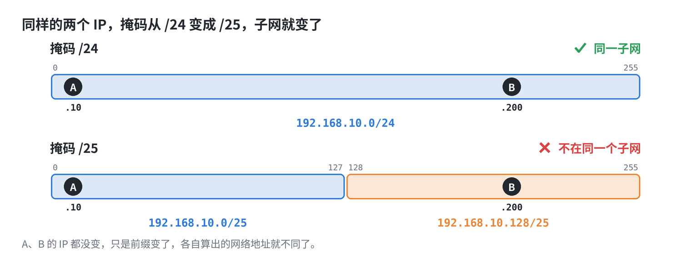

```text
A：192.168.10.10/25   → 网络地址 192.168.10.0/25
B：192.168.10.200/25  → 网络地址 192.168.10.128/25
```

`/25` 把一个 256 的地址段切成了两半：`0～127` 和 `128～255`。A 的最后一段是 `10`，落在前一半；B 的最后一段是 `200`，落在后一半。它们不在同一个子网。

A 判断 B 不在自己的网络里，就不会直接去找 B，而是想把数据交给**网关**；如果这台机器没有配置网关，系统就会报 `Network is unreachable`。网关怎么工作，是下一章的内容。

> **不能只看前三段数字是否相同。** 要看掩码，要算网络地址。
>
> 还要记住：同一子网只说明“配置上属于同一个网络”。能不能真正通信，还要看网线、虚拟网络、防火墙。

# 三、MAC和网关

## 3.1 MAC 地址

每块网卡出厂时都有一个 **MAC 地址**，长度 48 位，写成 6 组十六进制数：

```text
00:0c:29:11:22:33
```

虚拟机里的虚拟网卡也有 MAC 地址，由虚拟化软件生成。

在 Linux 里查看：

```bash
ip -br link
```

```text
lo      UNKNOWN   00:00:00:00:00:00 <LOOPBACK,UP,LOWER_UP>
ens160  UP        00:0c:29:11:22:33 <BROADCAST,MULTICAST,UP,LOWER_UP>
```

网卡名和 MAC 因环境而异，找到你自己的那一行就行。

IP 和 MAC 各管一段：

|              | IP 地址                  | MAC 地址                             |
| ------------ | ------------------------ | ------------------------------------ |
| 作用         | 决定数据最终去哪里       | 决定数据在**当前这一段链路**上交给谁 |
| 谁来分配     | 管理员配置，或 DHCP 分配 | 网卡自带                             |
| 管辖范围     | 整个网络，可以跨网段     | 只在同一个局域网内有效               |
| 经过路由器时 | 不变                     | 重新封装，会变                       |

> 上一章的“信封套信封”里，最外面那一层以太网帧，用的就是 MAC 地址。交换机转发数据，看的也是 MAC 地址。

## 3.2 ARP：用 IP 问出 MAC

你要给同一子网里的 `192.168.10.2` 发数据。IP 地址有了，可是以太网帧里要填的是**对方的 MAC 地址**，你不知道。

办法是问。这就是 **ARP**（地址解析协议）：

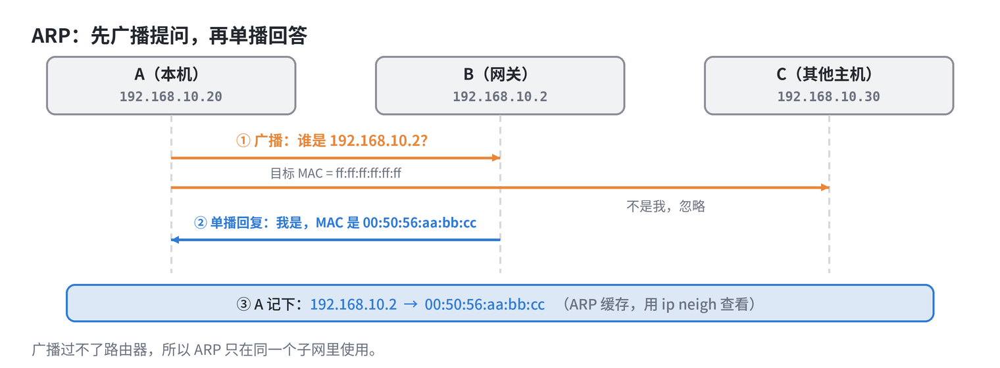

1. **广播提问**：“谁是 `192.168.10.2`？请告诉 `192.168.10.20`。”这个问题发给整个局域网里的所有人。
2. **单播回答**：只有 `192.168.10.2` 回应：“我是，我的 MAC 是 `00:50:56:aa:bb:cc`。”
3. **记进缓存**：问到的结果会暂时记在本机的 **ARP 缓存**里，下次直接用，不用重复问。

> 广播只能在同一个局域网里传播，**过不了路由器**。所以 ARP 只用在同一子网内部。

查看 ARP 缓存：

```bash
ip neigh
```

```text
192.168.10.2 dev ens160 lladdr 00:50:56:aa:bb:cc REACHABLE
```

几种常见状态：

| 状态                    | 意思                                                   |
| ----------------------- | ------------------------------------------------------ |
| `REACHABLE`             | 刚刚确认过，可以直接用                                 |
| `STALE`                 | 有记录，但有一阵子没确认了，下次用到时会重新确认       |
| `FAILED` / `INCOMPLETE` | 问了没人回答，说明对方不在线、不在同一网络，或被隔离了 |

## 3.3 网关

如果目标**不在同一个子网**，主机不会去 ARP 它，因为广播根本到不了对方。主机会把数据**交给网关**。

> **网关**就是本子网里，负责把数据转发到其他网络的那台设备的 IP 地址，通常是一台路由器。

关键的一点：数据交给网关时，

- **目标 IP** 仍然是最终要访问的那台服务器；
- **目标 MAC** 换成了网关的 MAC。

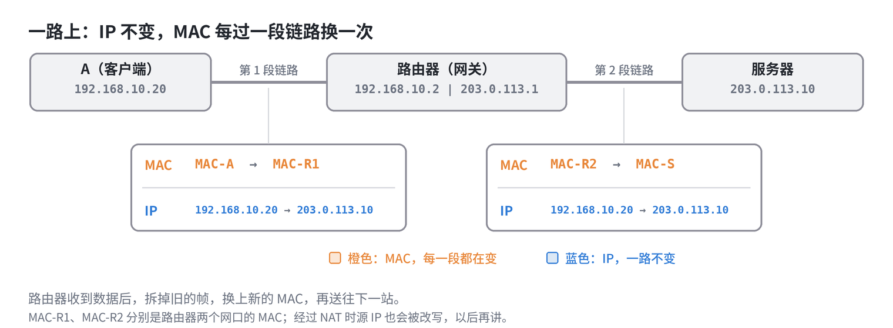

路由器收到数据后，会拆掉旧的以太网帧，看目标 IP，查自己的路由表，决定下一站，再套上新的以太网帧送出去。

## 3.4 路由表

主机的“下一站该交给谁”，写在**路由表**里。

```bash
ip route
```

```text
default via 192.168.10.2 dev ens160 proto dhcp metric 100
192.168.10.0/24 dev ens160 proto kernel scope link src 192.168.10.20 metric 100
```

读法：

| 这一行                                | 意思                                                         |
| ------------------------------------- | ------------------------------------------------------------ |
| `192.168.10.0/24 dev ens160 ...`      | 目标在这个网段里，直接从 `ens160` 送出去。这一行是系统根据 IP 和前缀自动生成的 |
| `default via 192.168.10.2 dev ens160` | **默认路由**。其他所有目标，都交给 `192.168.10.2`            |

## 3.5 发送数据前，主机做的判断

把前面几节串起来，主机每发一个数据包，都要做这几步：

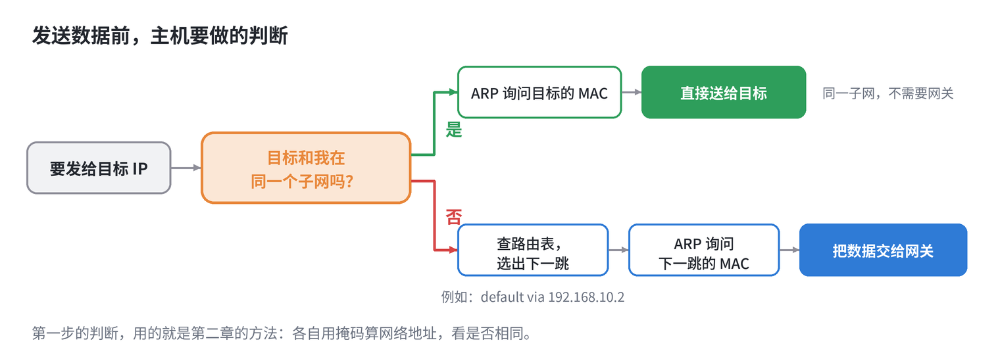

> 第一步的判断，用的就是第二章的方法：各自用掩码算网络地址，看是否相同。


# 四、DNS和域名解析

## 4.1 域名 

平常我们在浏览器、`ping`、`curl` 用的是**域名**，网络上真正通信用的是 **IP 地址**。把名字换成 IP 的这套系统，就是 **DNS**  = **Domain Name System**（域名系统）。

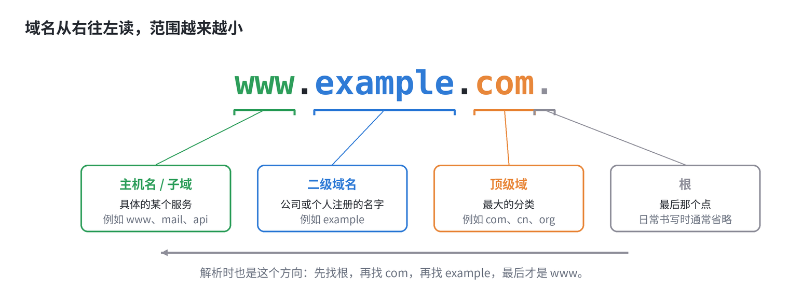

| 部分          | 例子               | 说明                                          |
| ------------- | ------------------ | --------------------------------------------- |
| 根            | 最后那个 `.`       | 整个 DNS 的最顶层，日常书写时通常省略         |
| 顶级域        | `com`、`cn`、`org` | 最大的分类                                    |
| 二级域名      | `example`          | 公司或个人注册的名字                          |
| 子域 / 主机名 | `www`              | 域名所有者自己划分，例如 `www`、`mail`、`api` |

完整写法 `www.example.com.`（末尾带点）叫 **FQDN**（完全限定域名）。平时敲命令时，末尾的点可以省略。

## 4.2 域名解析

你的虚拟机自己并不知道所有域名的 IP，它是去**问**的：

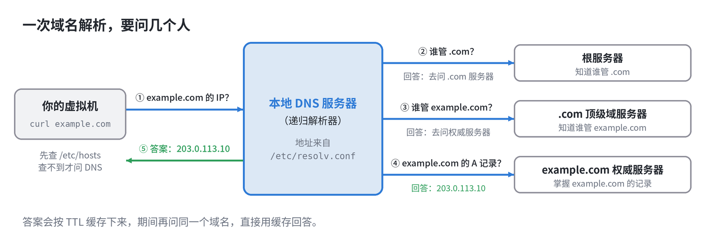

1. 虚拟机先问**本地 DNS 服务器**：`example.com` 的 IP 是多少？这台服务器的地址，写在 `/etc/resolv.conf` 里。
2. 本地 DNS 服务器自己不一定知道，它替你去**一级一级地问**：先问根服务器，根服务器说去问 `.com`；再问 `.com` 服务器，它说去问 `example.com` 的权威服务器；最后问权威服务器，拿到答案。
3. 本地 DNS 服务器把答案返回给你，并**缓存**起来。缓存的时间，由记录里的 **TTL**（秒）决定。

> 你的机器只需要知道“本地 DNS 服务器在哪”，剩下的一级一级去问，是它的事。所以 DNS 服务器的地址配错了，整个解析就瘫了。

TTL 的影响：域名的解析记录改了，但各处缓存还没到期，有人看到新 IP，有人还看到旧 IP。这是“改了 DNS 但还没生效”的原因之一。

## 4.3 本机自查

在去问 DNS 服务器之前，系统会先看本机自己有没有答案。先后顺序是这样的：

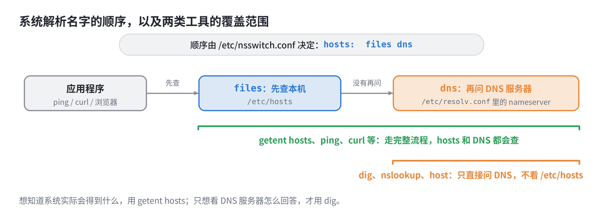

三个文件，各管一件事：

| 文件                 | 作用                                                         |
| -------------------- | ------------------------------------------------------------ |
| `/etc/hosts`         | 本机的静态“通讯录”，格式是 `IP  主机名`。优先于 DNS          |
| `/etc/resolv.conf`   | 告诉系统去问哪台 DNS 服务器，也就是 `nameserver`             |
| `/etc/nsswitch.conf` | 规定查找顺序。其中 `hosts:` 那一行写着先查 `files`（即 hosts 文件），再查 `dns` |

分别看一下：

```bash
cat /etc/hosts

127.0.0.1   localhost localhost.localdomain
::1         localhost localhost.localdomain


cat /etc/resolv.conf

# Generated by NetworkManager
search localdomain
nameserver 192.168.10.2


grep '^hosts' /etc/nsswitch.conf
hosts:      files dns myhostname
```

## 4.4 DNS类型

**既然 hosts 文件也能实现域名和 IP 地址的映射，为什么 DNS 还要设计 A、AAAA、CNAME 等不同类型的记录？**

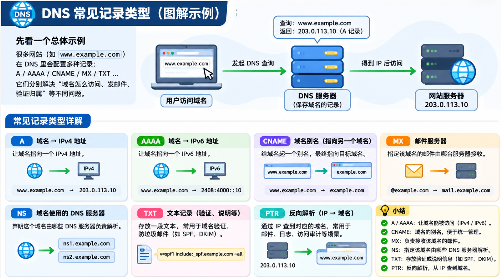

### 4.5.1 先看 hosts 文件

在 Linux 中，我们可以编辑 `/etc/hosts`：

```bash
127.0.0.1       localhost
192.168.1.100   www.test.com
192.168.1.101   www.demo.com
```

这里没有 A、AAAA 等记录类型。因为 hosts 文件的功能非常单一，就是建立 IP 地址与主机名之间的静态映射关系。

系统读取时可以直接识别：

- `192.168.1.100` 是 IPv4 地址。
- `www.test.com` 是主机名。

既然通过地址格式就能判断是 IPv4 还是 IPv6，自然不需要再写一个 A 或 AAAA。


### 4.5.2  为什么 DNS 需要记录类型？

因为 DNS 的功能远远不只是把域名转换成 IP 地址。

假设现在我们有一个域名：

```
example.com
```

这个域名可能同时需要完成以下工作：

1. 用户访问网站，需要知道网站服务器的 IP。
2. 用户发送邮件，需要知道邮件由哪台服务器接收。
3. 配置了多个子域名，需要通过别名统一管理。
4. 需要验证域名所有权。
5. 需要指定哪些 DNS 服务器负责这个域名。

那么问题来了：

如果 DNS 里面只有域名和 IP 的映射关系，怎么区分这些不同用途的信息呢？

因此，DNS 引入了记录类型。

```bash
example.com    A      192.168.1.100
example.com    MX     mail.example.com
example.com    TXT    "verification=abc123"
www.example.com CNAME example.com
```


## 4.5 dig 命令

`ping` 只告诉你通不通，`dig` 才能让你看清解析的细节。

如果提示找不到命令，先安装（需要联网）：

```bash
sudo dnf install -y bind-utils
```

先来一次最基本的查询：

```bash
dig example.com
```

输出很长，只盯着这几行：

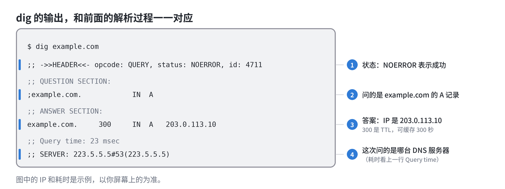

`status` 是最先要看的一项：

| 状态       | 意思                                                         |
| ---------- | ------------------------------------------------------------ |
| `NOERROR`  | 解析成功。如果 ANSWER 里没有内容，说明这个名字存在，但没有你查的这种记录 |
| `NXDOMAIN` | 这个域名不存在，多半是拼写错了，或者还没注册、没配置         |
| `SERVFAIL` | DNS 服务器自己解析失败了，问题通常在服务器那一侧             |

如果压根没有返回，而是提示超时，那就说明**连 DNS 服务器都没联系上**，要回头查网络和防火墙。DNS 默认使用 UDP 53 端口，数据较大时会改用 TCP 53，防火墙两个都要放行。

# 五、TCP和UDP

## 5.1 端口

IP 地址只能找到是哪台机器。一台机器上同时跑着 SSH、Web、数据库好几个程序，要靠**端口**区分。

端口是一个 **16 位二进制的整数**，范围是 `0～65535`。

| 范围           | 说明                                                         |
| -------------- | ------------------------------------------------------------ |
| `0～1023`      | 知名端口，留给常见服务。在 Linux 上，监听这个范围需要 root 权限 |
| `1024～49151`  | 注册端口，各类软件常用，比如 MySQL 的 `3306`                 |
| `32768～60999` | Linux 默认的**临时端口**范围，客户端发起连接时，系统从这里随机挑一个 |

先认识几个最常见的：

| 端口         | 服务                |
| ------------ | ------------------- |
| `22`         | SSH                 |
| `53`         | DNS                 |
| `80` / `443` | HTTP / HTTPS        |
| `3306`       | MySQL               |
| `5432`       | PostgreSQL          |
| `6379`       | Redis               |
| `8080`       | 常见的备用 Web 端口 |

一条连接，到底由什么确定？答案是**四个值**：

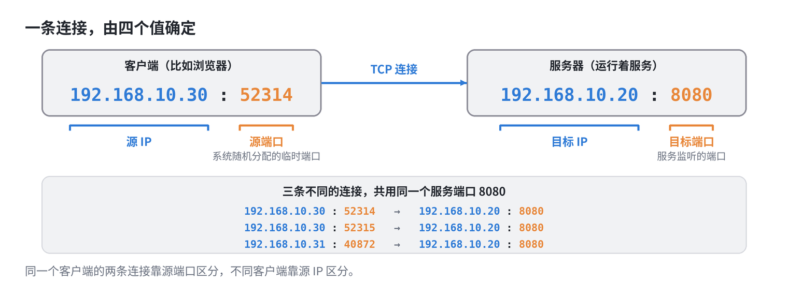

客户端的源端口是系统随机分配的临时端口，服务器的目标端口是服务监听的端口。因为每条连接的源端口不同，所以**同一个服务端口，可以同时接受成千上万条连接**。

可以看一下自己系统的临时端口范围：

```bash
cat /proc/sys/net/ipv4/ip_local_port_range
```

## 5.2 TCP 和 UDP 

端口属于传输层。传输层最主要的两个协议是 **TCP** 和 **UDP**：

|                | TCP                              | UDP                            |
| -------------- | -------------------------------- | ------------------------------ |
| 是否先建立连接 | 是，要先握手                     | 否，直接发                     |
| 数据是否可靠   | 可靠，丢了会重传，保证按顺序到达 | 不保证，丢了就丢了             |
| 速度和开销     | 相对慢，开销大                   | 快，开销小                     |
| 典型用途       | HTTP、SSH、MySQL                 | DNS 查询、音视频、部分实时游戏 |

> 第四章讲过，DNS 默认用的是 **UDP 53**，数据较大时才改用 TCP 53。端口号相同，TCP 和 UDP 是两套互不干扰的端口。

本章后面讲的，都以 **TCP** 为主。

## 5.3 三次握手

TCP 在传数据之前，双方要先“打个招呼”，确认彼此都在，也都准备好了。这叫**三次握手**：

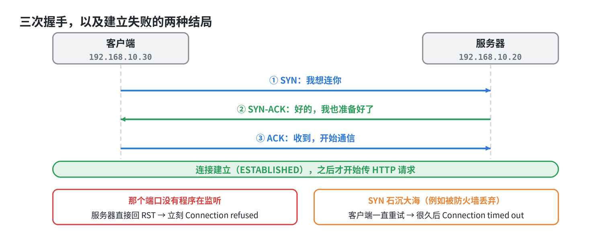

1. **SYN**：客户端说，我想连你。
2. **SYN-ACK**：服务器说，好的，我也准备好了。
3. **ACK**：客户端说，收到，开始通信吧。

握手完成，连接进入 `ESTABLISHED` 状态，才开始传 HTTP 请求。这就是“四关”里的第三关。

握手失败，有两种典型的结局，**表现完全不同**，要认得出来：

| 现象                                    | 发生了什么                                                   |
| --------------------------------------- | ------------------------------------------------------------ |
| **立刻**报 `Connection refused`         | SYN 到达了服务器，但那个地址和端口上**没有程序在监听**，服务器直接回了拒绝（RST） |
| **卡住很久**后报 `Connection timed out` | SYN 发出去，**石沉大海**，没有任何回应，常见于防火墙直接丢弃 |

> 立刻拒绝，说明对方在线，只是那扇门没开。
>
> 一直没动静，说明数据包半路被拦了，或者对方根本不在线。

## 5.4 监听

服务启动后，会在某个**地址和端口**上等待连接，这叫**监听**（`LISTEN`）。

关键是：监听的时候，程序要指定**绑定在哪个地址上**。

| 监听写法                | 含义                                 |
| ----------------------- | ------------------------------------ |
| `127.0.0.1:8080`        | 只接受本机自己发来的连接             |
| `192.168.10.20:8080`    | 只接受发往这个 IP 的连接             |
| `0.0.0.0:8080`          | 接受发往本机**所有 IPv4 地址**的连接 |
| `*:8080` 或 `[::]:8080` | 所有地址，包括 IPv6                  |

不同的绑定方式，决定了谁能访问：

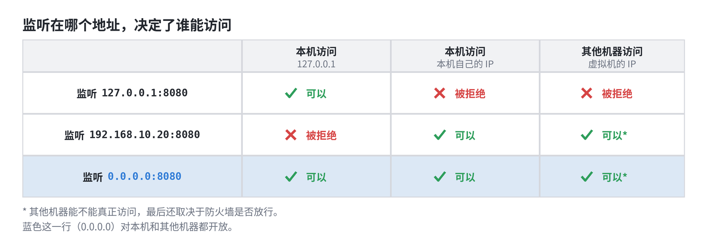

> 现在回头看第一章的故障：服务只监听了 `127.0.0.1`，本机访问自然成功，其他机器发来的连接，目标是 `192.168.10.20:8080`，没有程序在那里等，于是被拒绝。
>
> 解决办法：让服务监听 `0.0.0.0`，或者监听正确的网卡 IP。

> `0.0.0.0` 是服务**监听**时的写法，表示“所有地址”。它不是让别人去访问的目标地址，客户端要访问的，是机器真实的 IP。

## 5.5 用 ss 看清监听和连接

`ss` 是查看端口和连接状态最常用的命令。

```bash
sudo ss -tlnp
```

参数的意思：

| 参数 | 含义                                       |
| ---- | ------------------------------------------ |
| `-t` | 只看 TCP（看 UDP 用 `-u`）                 |
| `-l` | 只看**正在监听**的                         |
| `-n` | 不要把端口号和 IP 翻译成名字，直接显示数字 |
| `-p` | 显示是哪个进程，需要 `sudo` 才能看全       |

输出很长，只盯着三个位置：

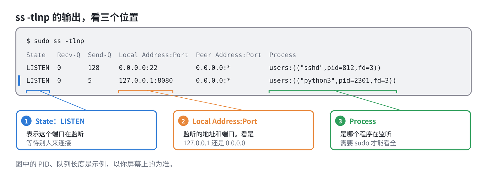

**找出是谁占用了端口：** 启动服务时看到 `Address already in use`，说明这个端口已经被别的程序占用了：

```bash
sudo ss -tlnp | grep ':8080'
```

**看已经建立的连接：**

```bash
ss -tn
```

连接的常见状态：

| 状态         | 意思                                                         |
| ------------ | ------------------------------------------------------------ |
| `LISTEN`     | 在监听，等待别人来连                                         |
| `ESTAB`      | 连接已建立，正在通信                                         |
| `TIME-WAIT`  | 连接刚关闭，在等待收尾。大量出现通常正常                     |
| `CLOSE-WAIT` | 对方已经关闭，本机程序还没关。大量堆积，往往是程序没有及时关闭连接 |
| `SYN-SENT`   | 本机发出了 SYN，还在等对方回应。大量出现，说明对方没有响应   |

# 六、网络模式

## 6.1  虚拟网络

安装 VMware 时，它会在宿主机上“造”出一套网络设备：

| 虚拟设备           | 作用                                                         |
| ------------------ | ------------------------------------------------------------ |
| 虚拟网卡           | 虚拟机里的网卡（比如 `ens160`），对虚拟机来说，和真网卡没有区别 |
| 虚拟交换机         | 把虚拟机连在一起，编号是 `VMnet0`、`VMnet1`、`VMnet8`        |
| 宿主机上的虚拟网卡 | 在 Windows 的网络连接里能看到 `VMware Network Adapter VMnet1` 和 `VMnet8`，让宿主机也接入虚拟交换机 |
| 虚拟 NAT 设备      | 让虚拟机借宿主机的网络上网                                   |
| 虚拟 DHCP 服务     | 自动给虚拟机分配 IP                                          |

三个虚拟交换机，对应三种网络模式：

| 虚拟交换机 | 网络模式   |
| ---------- | ---------- |
| `VMnet0`   | 桥接模式   |
| `VMnet1`   | 仅主机模式 |
| `VMnet8`   | NAT 模式   |

## 6.2 三种网络模式

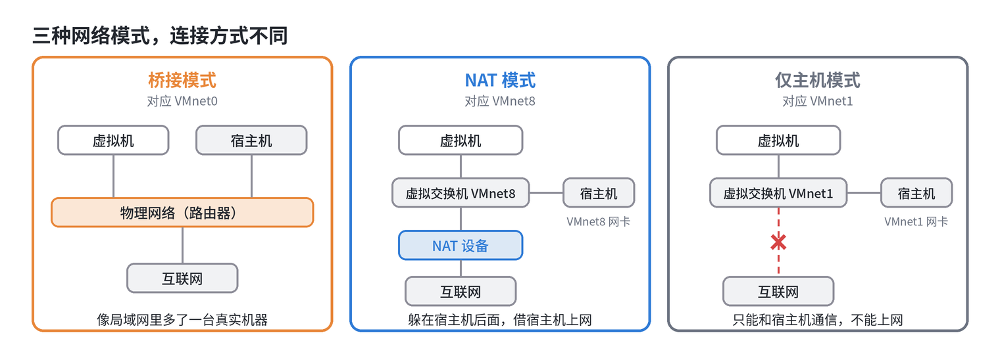

一句话概括：

- **桥接**：虚拟机像局域网里多出来的一台真实机器，和宿主机是平等的。
- **NAT**：虚拟机躲在宿主机后面，借宿主机的网络上网。
- **仅主机**：虚拟机只能和宿主机通信，不能上网。

## 6.3 谁能访问谁

把三种模式放在一起比较：

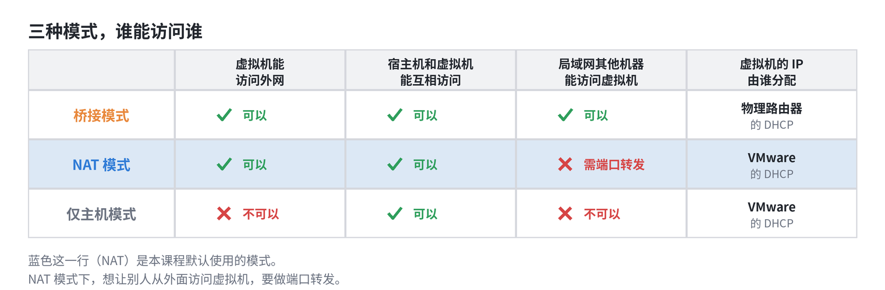

怎么选：

| 模式   | 适合什么时候用                                     | 需要注意                                                     |
| ------ | -------------------------------------------------- | ------------------------------------------------------------ |
| 桥接   | 想让虚拟机像真机一样，被局域网里的其他机器直接访问 | 要占用局域网的 IP；有的公司、学校网络不允许；部分无线网卡桥接不稳定 |
| NAT    | 个人学习，最省心                                   | 局域网里的其他机器访问不了，需要端口转发                     |
| 仅主机 | 隔离实验，不想让虚拟机上网                         | 上不了外网                                                   |

## 6.4 NAT 是怎么工作的

虚拟机的 IP，是第二章讲过的**私有地址**，不能直接在互联网上使用。那它是怎么上网的？靠 **NAT**（网络地址转换）：

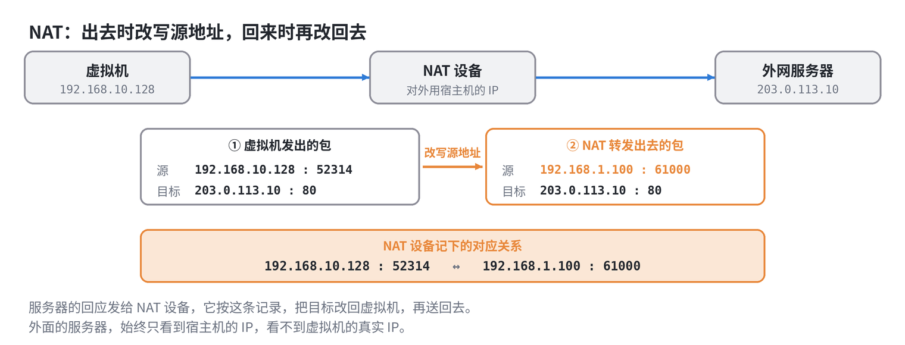

1. 虚拟机发出的包，源地址是私有 IP。
2. NAT 设备把**源地址改成宿主机的 IP**，换一个端口，同时**记下一条对应关系**。
3. 服务器的回应，发给 NAT 设备。NAT 设备按记录，把目标改回虚拟机，再送回去。

这样，外面的服务器只看到宿主机的 IP，看不到虚拟机。

# 七、动态 IP 与静态 IP

## 7.1 动态 IP

大多数时候，虚拟机的 IP 是**自动获得**的，这就是**动态 IP**。分配它的服务叫 **DHCP**。

一台刚启动的机器，还没有 IP，它是这样“要”到一个的：

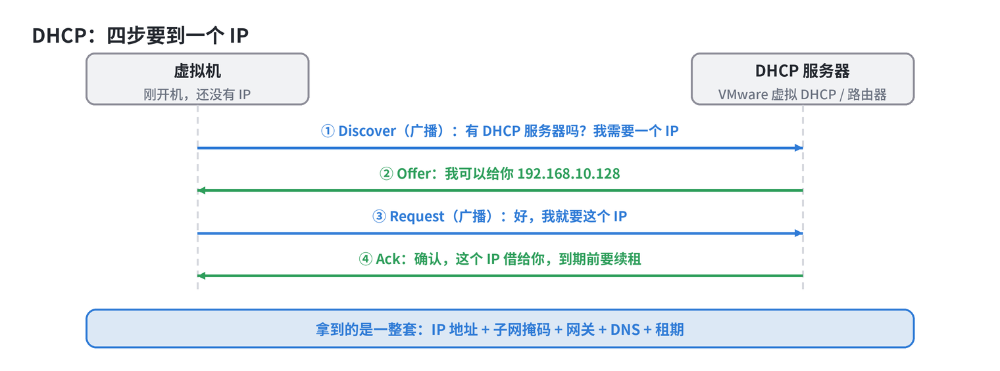

1. **Discover**：虚拟机还没有 IP，只能用**广播**喊：有 DHCP 服务器吗？我需要一个 IP。
2. **Offer**：DHCP 服务器回应：我可以给你 `192.168.10.128`。
3. **Request**：虚拟机再广播：好，我就要这个。
4. **Ack**：服务器确认，这个 IP 借给你了。

注意，借来的 IP 是有**租期**的，到期前要续租。DHCP 给的也不只是 IP，而是**一整套**：IP 地址、子网掩码、网关、DNS、租期。

看看自己虚拟机的 IP 是不是动态获得的：

```bash
ip -br addr
nmcli connection show "ens160" | grep ipv4.method
```

`ipv4.method: auto` 就是动态获取。连接名以 `nmcli connection show` 的结果为准，通常和网卡名一样。

动态 IP 和静态 IP 的对比：

|          | 动态 IP（DHCP）        | 静态 IP                        |
| -------- | ---------------------- | ------------------------------ |
| 谁决定   | DHCP 服务器分配        | 管理员手动指定                 |
| 重启之后 | 可能会变               | 不变                           |
| 配置工作 | 不用配                 | 要自己配齐                     |
| 适合     | 个人电脑、临时用的机器 | 服务器，别人要用固定地址访问它 |
| 风险     | 地址变了，别人连不上   | 配错了，或者和别人冲突         |

## 7.2 静态 IP

自己指定 IP，要遵守三条规则：

| 规则                   | 原因                                     |
| ---------------------- | ---------------------------------------- |
| 必须在**同一个子网**里 | 第二章：和网关不在同一个子网，就出不了网 |
| 不能和别的机器**冲突** | 两台机器用同一个 IP，会时通时不通        |
| 要**避开 DHCP 池**     | 否则 DHCP 可能把同一个 IP 分给别的机器   |

结合第六章的 VMware NAT 网段规划：

- `.2` 是网关，不能占用
- `.128 ～ .254` 是 DHCP 池，要避开
- `.3 ～ .127` 空闲，可以选

本章用 `192.168.10.50` 作为例子，你的网段以自己的为准。

## 7.3 静态 IP 要配三样

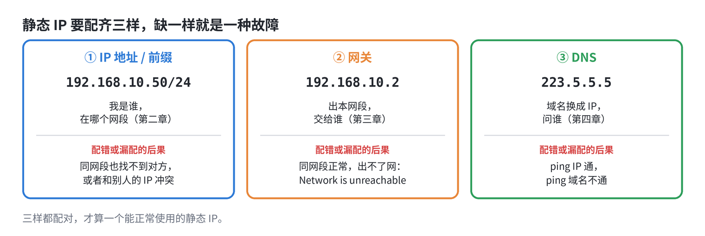

DNS 的作用，是把域名换成 IP。常用的公共 DNS 有 `223.5.5.5`、`8.8.8.8`。在 VMware 的 NAT 网络里，网关 `.2` 通常也能充当 DNS。动态 IP 时，这三样都是 DHCP 帮你配好的，改成静态，就要**自己配齐**。

> 配置好之后，用第三章的 `ping` 逐步检查：网关、公网 IP、域名，哪一步不通，就缺了哪一样。

## 7.4 在 Rocky Linux 上配置

Rocky Linux 用 **NetworkManager** 管理网络，用 `nmcli` 命令配置，这是最推荐的方式。

**先看一下现状，记下来：**

```bash
nmcli connection show                     # 连接名
ip -br addr                               # 当前 IP
ip route show default                     # 网关
cat /etc/resolv.conf                      # DNS
```

**改成静态 IP：**

```bash
sudo nmcli connection modify "ens160" \
  ipv4.method manual \
  ipv4.addresses 192.168.10.50/24 \
  ipv4.gateway 192.168.10.2 \
  ipv4.dns "223.5.5.5 8.8.8.8"

sudo nmcli connection up "ens160"
```

| 参数                 | 含义                               |
| -------------------- | ---------------------------------- |
| `ipv4.method manual` | 改成手动配置，不再用 DHCP          |
| `ipv4.addresses`     | IP 地址和前缀，对应第二章的 `/24`  |
| `ipv4.gateway`       | 网关，对应第三章                   |
| `ipv4.dns`           | DNS 服务器，对应上一个“要配的三样” |

**改回动态 IP：**

```bash
sudo nmcli connection modify "ens160" \
  ipv4.method auto \
  ipv4.addresses "" ipv4.gateway "" ipv4.dns ""

sudo nmcli connection up "ens160"
```

> **请在 VMware 的虚拟机控制台里操作，不要用 SSH。** 改了 IP 之后，原来的 SSH 连接一定会断，需要用新的 IP 重新连接。

网络配置其实是保存在文件里的，不同版本位置不同：

| 系统版本      | 位置                                                         |
| ------------- | ------------------------------------------------------------ |
| Rocky Linux 8 | `/etc/sysconfig/network-scripts/ifcfg-ens160`                |
| Rocky Linux 9 | `/etc/NetworkManager/system-connections/ens160.nmconnection` |

了解位置即可，不建议手改，用 `nmcli` 更稳。如果习惯图形化的文本界面，也可以用 `nmtui`。

## 7.5 动手：配置并验证静态 IP

请在虚拟机的控制台里操作。

**第一步：记下现状**

```bash
nmcli connection show
ip -br addr
ip route show default
cat /etc/resolv.conf
```

**第二步：配置静态 IP**

按 7.5 的命令，改成你选好的静态 IP。

**第三步：验证**

```bash
ip -br addr                    # IP 是不是你设置的
ip route show default          # 网关是不是对的
cat /etc/resolv.conf           # DNS 是不是对的

ping -c 2 192.168.10.2         # 网关
ping -c 2 223.5.5.5            # 公网 IP
ping -c 2 example.com          # 域名
```

三个 `ping` 都通，说明三样都配对了。重启虚拟机，再看 `ip -br addr`，IP 不会变。

**选做：故意缺一样，看现象**

先清掉网关：

```bash
sudo nmcli connection modify "ens160" ipv4.gateway ""
sudo nmcli connection up "ens160"
ping -c 2 192.168.10.2         # 通
ping -c 2 223.5.5.5            # Network is unreachable
```

再补回网关，清掉 DNS：

```bash
sudo nmcli connection modify "ens160" ipv4.gateway 192.168.10.2 ipv4.dns ""
sudo nmcli connection up "ens160"
ping -c 2 223.5.5.5            # 通
ping -c 2 example.com          # 域名解析失败
```

对照 7.4 的图，是不是正好一一对应？最后记得把 DNS 补回去。

**第四步：恢复动态 IP**

用 7.5 里“改回动态 IP”的命令恢复，再确认 `ip -br addr` 里的 IP 回到了 DHCP 池里。

**动手试试：**

- [ ] 确认自己虚拟机现在用的是动态 IP，还是静态 IP
- [ ] 选一个落在 `.3 ～ .127` 范围内的 IP，配置成静态 IP
- [ ] 用三个 `ping`，验证网关、公网、域名
- [ ] 重启虚拟机，确认 IP 没有变
- [ ] （选做）故意去掉网关、DNS，对比现象
