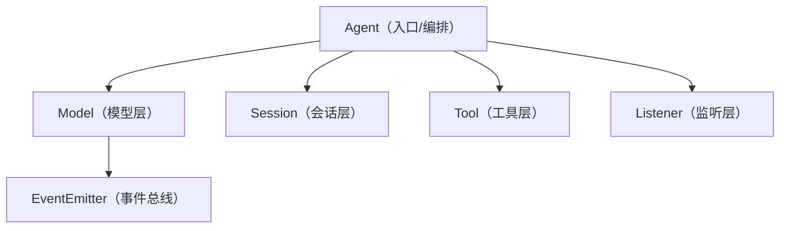

[[【实战】ReAct 循环]] 已经让 Agent 能自主完成多步任务，但当时还只是一个手写的 `query` 函数，而且每一处细节都要调用方自己操心。这一篇把整套能力收进一个 **`Agent` 类**：对外只暴露一句 `agent.invoke("...")`，内部自己跑循环、自己决策、自己调工具。

## 1. 目标：一句话启动

期望的最终用法是这样：

```python
from agent.agent import Agent
from agent.printer import ModelPrinterListener

listener = ModelPrinterListener()
agent = Agent(model_listener=listener)

agent.invoke("请帮我分析./agent目录中的核心实现逻辑，将结果放到当前目录的 分析.md 中")
agent.session.print_friendly()
```

调用方再也不用关心 ReAct 循环、工具注册、系统提示词——这些都被 `Agent` 与 `Session` 吞掉了。

## 2. 把 ReAct 循环封进 invoke

`Agent` 的职责就是"编排"：把 [[【实战】ReAct 循环]] 里的 `while True` 循环挪进 `invoke` 方法。

```python
class Agent:

    def __init__(
        self,
        *,
        session: Session | None = None,
        model: Model | None = None,
        model_listener: ModelListener | None = None,
    ) -> None:
        self.session = session or Session()
        self.model = model or Model()
        self.listener = model_listener
        if self.listener:
            self.listener.listen(self.model)

    def invoke(self, q: str):
        self.session.add_message({"role": "user", "content": q})
        responses = []
        # ReAct Loop
        while True:
            resp = self.model.invoke_stream(self.session)
            call_msg = registry.invoke(self.session.messages[-1])
            if call_msg is None:
                responses.append(resp)
                break
            else:
                self.session.messages += call_msg
                responses.append(resp)
        return responses
```

逐点拆解：

- **依赖注入**：`session`、`model`、`model_listener` 都是可选参数，不传就用默认实现。这样测试时能塞入假对象，生产时用默认组件，互不干扰。
- **构造即接线**：`__init__` 里如果传了监听器，立即调用 `listener.listen(self.model)`，把监听器挂到模型的全部事件上。
- **invoke 的返回**：把每一轮模型响应都收进 `responses` 列表返回，方便调用方查看中间过程。
- **终止条件仍是那句**：`registry.invoke` 返回 `None` 表示模型这次没有调用工具，任务完成，跳出循环。

用一张图看整体结构：



`Agent` 站在最上层，向下调度模型、会话、工具，监听层则通过事件总线旁路观察推理过程。

## 3. 抽象监听器，让打印与推理解耦

之前的打印器是直接写死在流程里的。这一版抽出抽象基类 `ModelListener`：

```python
class ModelListener(ABC):

    def __init__(self) -> None:
        self.listening = True

    def listen(self, model):
        events = [v for k, v in Event.__dict__.items() if not k.startswith("__")]
        for e in events:
            model.on(event=e, callback=self._model_print_callback)

    def _model_print_callback(self, e: str, **args):
        if not self.listening:
            return
        self._handler(e, **args)

    @abstractmethod
    def _handler(self, e: str, **args):
        pass
```

- `listen(model)`：反射取出 `Event` 里定义的所有事件名，一次性把 `_model_print_callback` 注册到每个事件上。
- `_model_print_callback`：统一的入口，负责 `listening` 开关的控制，再转发给子类。
- `_handler`：抽象方法，交给子类决定每种事件怎么处理。

谁来实现它？控制台打印机 `ModelPrinterListener`：

```python
class ModelPrinterListener(ModelListener):

    def _handler(self, e: str, **args):
        if e == Event.REASONING_START:
            print("思考中...")
        elif e == Event.REASONING_END:
            print()
        elif e == Event.CONTENT_START:
            print()
            print("内容：")
        elif e == Event.CONTENT_END:
            print()
        elif e == Event.TOOL_CALL_END:
            tool_calls = args["value"]["tool_calls"]
            for call in tool_calls:
                print(f"\033[36m调用工具：{call['function']['name']}\033[0m")
        elif e == "content":
            print(f"\033[32m{args['chunk_value']}\033[0m", end="")
        sys.stdout.flush()
```

`_handler` 只做一件事：把事件翻译成终端输出——思考提示、绿色正文、青色工具名。**模型推理本身完全不关心有没有人在打印**，这就是解耦的价值：以后想加日志、加进度条、加 TUI，都只需再写一个 `ModelListener` 子类。

## 4. Session 自动装配

`Session` 这一版做了两件贴心的事，让调用方少写胶水代码：

```python
class Session:
    def __init__(self, *, system_prompt="", tools=[]):
        self.id = str(uuid.uuid4())
        self.messages: list[dict] = []
        if not system_prompt:
            system_prompt = render_prompt("system")
        self.add_message({"role": "system", "content": render_prompt("system")})
        self.tools = tools or registry.schemas()
```

1. **自动注入系统提示词**：创建 `Session` 时自动 `render_prompt("system")`，把当前工作目录、操作系统、是否 Git 仓库渲染进系统消息，省去手动添加。
2. **自动装配工具**：不传 `tools` 就取 `registry.schemas()`，也就是把注册表里的全部工具一次性挂上。`Session()` 一创建就是个"能干活"的会话。

> 实现细节：源码里 `system_prompt` 参数最终没被使用，而是每次重新 `render_prompt("system")`，属实现上的小冗余；按设计意图应改为使用传入值。功能上无差别。

## 5. print_friendly：给人看的会话

`Session.print()` 会把整个会话原样 JSON 打印，工具调用、参数、结果混在一起，很难读。新增 `print_friendly()` 按角色分段：

```python
def print_friendly(self):
    lines = []
    n = 1
    for msg in self.messages:
        role = msg.get("role")
        if role == "system":
            lines.append(f"====={n}. 系统消息======")
            lines.append(msg.get("content", ""))
            n += 1
        elif role == "assistant":
            tool_calls = msg.get("tool_calls")
            if tool_calls:
                lines.append(f"====={n}. 工具调用======")
                for i, tc in enumerate(tool_calls):
                    func = tc.get("function", {})
                    lines.append(f"工具名{i + 1}: {func.get('name', '未知')}")
                    # ...解析并截断参数...
                n += 1
            else:
                lines.append(f"====={n}. AI消息======")
                lines.append(msg.get("content") or "")
                n += 1
        elif role == "tool":
            lines.append(f"====={n}. 调用结果======")
            lines.append(f"工具名: {msg.get('name', '未知')}")
            # ...截断结果...
            n += 1
        lines.append("")
    print("\n".join(lines))
```

它把 system / user / assistant / tool 四类消息分块编号，工具参数和结果还会截断到固定长度。调试 ReAct 循环时，一眼就能看出"第几步调了哪个工具、传了什么、拿到什么"。

`save()` / `load()` 也保留下来，支持把会话持久化为 JSON 再恢复。

## 6. 精简系统提示词

这一版把系统提示词收敛到最小：只讲清楚"我是谁、能做什么、处在什么环境"。

```markdown
你是一个编程助手，你可以：

- 用简洁、准确的语言回答用户问题
- 调用工具完成用户交付的任务

# 环境

理解所处的环境，有助于你完成工作:

- 工作目录（cwd）: `{{ cwd }}`
- 操作系统: `{{ os }}`
- 当前工作目录是否处于git仓库管理: `{{ is_git }}`
```

对比 [[【基础】系统提示词]] 里"精简、自洽、全局约束、保持静态、结构化"五条原则：这里去掉了冗长的行为条款，把"具体怎么做"交给工具与模型自己的判断，反而更稳、更省 token。

## 7. 总结

- **`Agent` 类**：把 ReAct 循环、消息分发、工具调用统一收进 `invoke`，对外只留一句调用。
- **依赖注入**：session / model / listener 皆可替换，便于测试。
- **监听器抽象**：`ModelListener` + `ModelPrinterListener` 让"推理"与"展示"彻底解耦。
- **Session 自动装配**：创建即带系统提示词与全部工具。
- **`print_friendly`**：把冗长的 JSON 会话变成分块可读的调试视图。
- **提示词减法**：只保留身份 + 环境，其余交给上下文与工具。

现在 Agent 已经是个能独立工作的对象了。但它只会读文件、写文件、执行命令——下一步，给它接上一双"看世界"的眼睛：[[【实战】Agent 接入搜索引擎]]。
