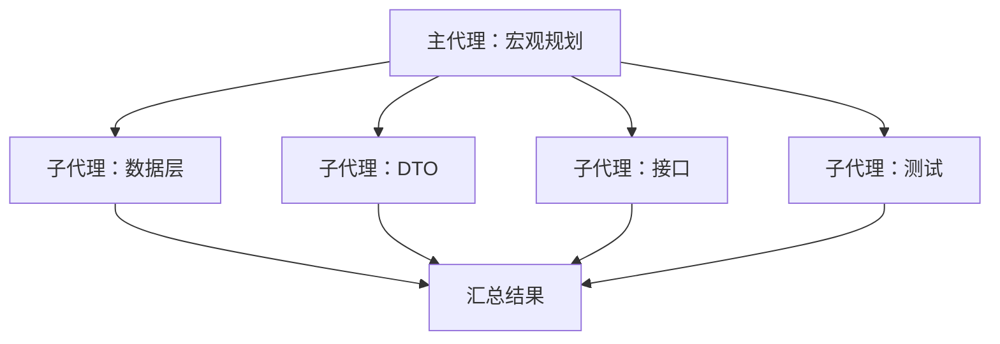

## 1. 一个 Agent 会被上下文压垮

设想一个任务：**开发一个业务功能，并把它暴露成 FastAPI 接口**。如果交给单个 Agent 在**一个轮次**里完成，它会经历：

- **reasoning**：需求分析、方案设计
- **一个超级庞大的 ReAct 循环**：
  - 建立 ORM 数据层
  - 实现数据迁移
  - 执行迁移命令
  - 创建 DTO
  - 创建 Service
  - 创建接口
  - 创建多个测试脚本
  - 运行测试脚本
  - 解决错误（循环）

每一步的工具输入输出都累积进同一个 `messages`。最终你得到的是一个**超级庞大的上下文**，随之而来的是：

- token 成本飙升；
- 关键信息被海量中间结果淹没，模型容易"忘掉"最初的目标；
- 一旦出错，很难定位是哪一步污染了上下文。

## 2. 子代理：化整为零

更好的设计是**把任务拆开，交给多个独立的 Agent 并行做**，主代理只负责宏观规划与汇总：

- **reasoning**：仅做宏观需求分析、方案设计
- **ReAct 循环**：
  - 子代理：实现数据层
  - 子代理：实现 DTO
  - 子代理：实现接口
  - 子代理：完成测试
  - 等待所有子代理完成，汇总结果

每个子代理拥有**自己独立的会话与上下文**，干完活只把最终结果回给主代理。主代理的上下文里因此只有"任务 + 各子任务的结论"，不会被打工过程污染。



## 3. create_agent：一个开启子代理的工具

子代理本质上就是"再起一个 `Agent` 跑一段 query"。把它包装成工具，让主代理能自主决定"开几个、各干什么"：

```python
from agent.tool.core import tool
import threading
import json


@tool(
    agent_config="每个子代理的配置。每个子代理要配置名称、用户提示词，子代理会根据提示词启动任务，然后根据提示词的要求返回任务执行结果"
)
def create_agent(agent_config: list[dict[str, str]]) -> str:
    """
    创建并启动多个子代理，每个子代理在独立线程中运行，完成任务后合并返回结果
    参数示例：
    [
        {"name": "sub-agent1", "query": "初始的用户提示词"},
        {"name": "sub-agent2", "query": "初始的用户提示词"}
    ]
    返回结果示例：
    [
        {"name": "sub-agent1", "result": "子代理1的完成结果"},
        {"name": "sub-agent2", "result": "子代理2的完成结果"}
    ]
    """
    from agent.agent import Agent

    results: list[dict[str, str]] = []
    results_lock = threading.Lock()
    threads: list[threading.Thread] = []

    def run_sub_agent(name: str, query: str) -> None:
        agent = Agent()
        responses = agent.invoke(query)
        final_resp = responses[-1]
        content = final_resp.message.get("content", "")
        agent.session.save(f"{name}-")
        with results_lock:
            results.append({"name": name, "result": content})

    for config in agent_config:
        name = config.get("name", "unnamed")
        query = config.get("query", "")
        thread = threading.Thread(target=run_sub_agent, args=(name, query))
        threads.append(thread)
        thread.start()

    for thread in threads:
        thread.join()

    return json.dumps(results, indent=2, ensure_ascii=False)
```

逐点拆解：

- **入参是一份清单**：每个子代理只带 `name` 和 `query`，主代理负责决定拆几个、各拆什么。
- **每个子代理一个线程**：`threading.Thread` 让多个子代理**并行**工作，而不是排队串行。
- **`results_lock` 保护共享列表**：多线程同时 `append` 会竞争，用锁保证写入安全。
- **只回传最终结果**：`responses[-1].message.content` 是子代理的收尾回答，中间的工具调用全部留在子代理自己的会话里。
- **`thread.join()`**：主线程等待全部子代理结束后才返回，保证结果完整。

在 `tool/__init__.py` 里注册它，Agent 就获得了"开子代理"的能力。

## 4. 使用

```python
from agent.agent import Agent
from agent.printer import ModelPrinterListener

listener = ModelPrinterListener()
agent = Agent(model_listener=listener)

agent.invoke("请开启多个子代理，创建两个页面，分别画小猪佩奇和海绵宝宝。")
agent.session.save()
```

主代理会先想好"需要两个子代理，各画一个页面"，调用 `create_agent` 传入两份配置，两个子代理并行开工，最后把结果汇总回来。

## 5. 注意事项

- **线程不是万能的**：Python 有 GIL，纯计算任务无法真正并行；但子代理的耗时主要在等模型与网络 IO，线程依然能显著提速。
- **共享资源要加锁**：多个子代理若同时写同一文件，需要更细粒度的协调，不能只靠 `results_lock`。
- **结果要聚合**：子代理的产出是原始素材，主代理必须再做一轮综合，才能给用户完整答案。
- **上下文隔离是核心价值**：子代理最大的意义不是"快"，而是**把庞大的中间过程挡在主代理上下文之外**。

## 6. 总结

- **痛点**：单代理处理多阶段任务，上下文会无限膨胀，成本高且容易跑偏。
- **子代理**：把任务拆给多个独立 Agent 并行执行，各自独立上下文，只回传结论。
- **实现**：`create_agent` 工具接收配置清单，用多线程并行运行，加锁收集结果，`join` 后汇总返回。
- **收益**：主代理上下文保持干净，任务可并行、可分工、可扩展。

子代理是"多个 Agent 协作"的雏形，也是更大规模编排的基础。接下来换个视角，看 Agent 之上的几层工程方法论——先从 [[【概念】提示词工程]] 讲起。
