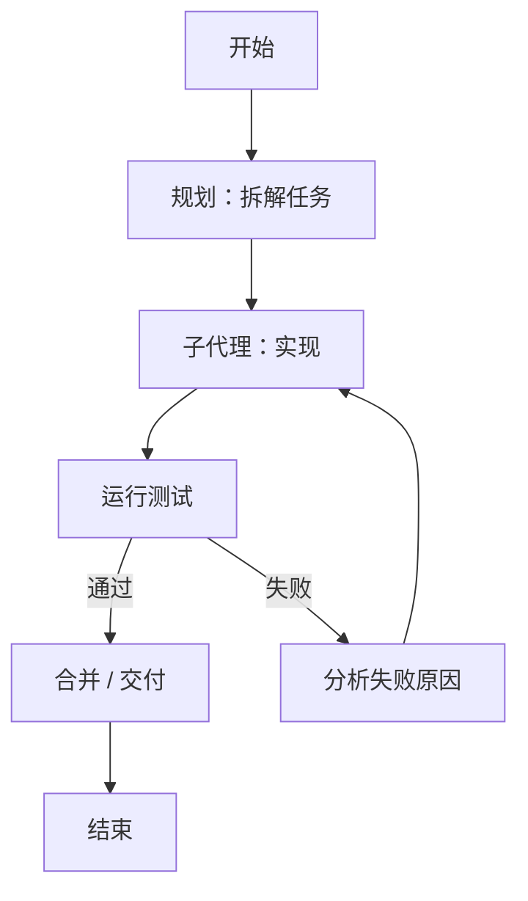

## 1. 什么是图工程

[[【概念】循环工程]] 让 Agent 在一个大循环里自我推动，但当任务的**依赖关系、分支与合并**变得复杂时，只用"一个循环"描述就不够精确了——哪些步骤必须先后、哪些能并行、失败后回退到哪，都需要被显式表达。

**图工程（Graph Engineering）就是用"图"来编排 Agent 的工作流**：把流程画成一张有向图，让每一步的位置与走向清清楚楚。

## 2. 图的基本构成

| 元素                          | 含义                   | 例子                                                 |
| ----------------------------- | ---------------------- | ---------------------------------------------------- |
| 节点（Node）                  | 一个执行单元           | 一次模型调用、一个子代理、一次工具调用、一次人工审批 |
| 边（Edge）                    | 节点之间的控制流       | A 完成后进入 B                                       |
| 状态（State）                 | 在节点间传递的共享数据 | 当前任务上下文、中间产物、已完成的清单               |
| 条件边（Conditional Edge）    | 按条件选择走哪条路     | 测试通过→合并；不通过→回到修复节点                   |
| 循环边（Cycle）               | 回到之前的节点         | 反复"修错→测试"直到通过                              |
| 人工节点（Human-in-the-loop） | 需要人介入的检查点     | 关键操作前的审批                                     |

## 3. 一个典型图长什么样

以"实现功能并测试"为例：

- **规划 → 实现 → 测试**是主干；
- **测试失败 → 分析 → 回到实现**构成循环边；
- **测试通过 → 合并 → 结束**是终止路径。

这张图把"什么时候能结束""出错往哪退"都写死了，比一个只靠模型临场判断的 `while True` 循环**确定得多**。

## 4. 图相比循环的优势

- **依赖显式**：哪些步骤能并行、哪些必须串行，一眼可见。
- **可并行**：没有依赖的分支可以同时推进（对应 [[【实战】子代理 Sub Agent]]）。
- **可回退**：失败路径被显式定义，不会让模型"卡在错的地方打转"。
- **可插入人工节点**：在关键节点要求审批，落实 [[【概念】驾驭工程]] 的护栏。
- **可观测**：当前走到哪个节点、状态如何，全局可查，天然满足可观测性要求。

## 5. 与相邻概念的关系

- **循环工程**：图是循环的"升级形态"——用节点和边精确描述流程，而不是一个大回环。
- **子代理**：图中的一个节点往往就是一个子代理。
- **驾驭工程**：图的状态与人工节点正是状态管理、护栏、可观测的落地方式。
- **上下文工程**：每个节点只注入完成该节点所需的上下文，天然限制单点长度。

## 6. 适用边界

- 流程**相对固定、依赖清晰**时，图最合适。
- 流程**高度探索、无法预先画清**时，强行画图反而僵化，此时更宜用循环工程让 Agent 自主探索。
- 实践中两者常结合：**外层用图管控主干与关键检查点，节点内部用循环自由发挥。**

## 7. 延伸阅读

- [关于图工程的讨论](https://x.com/steipete/status/2078277297791189132)

## 8. 总结

- **定义**：用有向图显式编排 Agent 工作流。
- **构成**：节点、边、状态、条件边、循环边、人工节点。
- **优势**：依赖显式、可并行、可回退、可插入人工审批、全局可观测。
- **取舍**：流程稳定时用图，探索性强时用循环，二者常分层结合。

至此，从单次工具调用、ReAct 循环、子代理，到提示词/上下文/驾驭/循环/图五层工程方法论，一条完整的 Agent 能力与工程化路径就串起来了。
