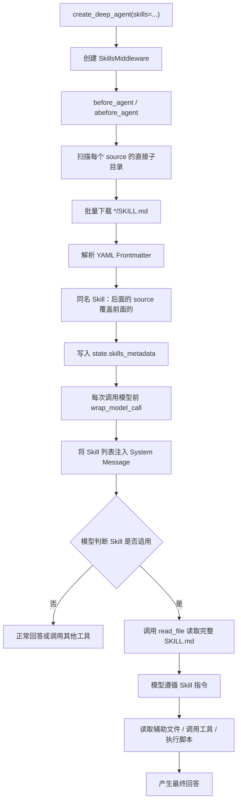

如果每个技能的使用说明都全文塞进系统提示词，几十个技能下来上下文就爆了。Skills 中间件用的是**渐进式披露**：平时只把每个技能的"名字 + 一句话描述"常驻在提示词里，模型判断要用某个技能时，再通过 `read_file` 把完整的 `SKILL.md` 读进来。

这和 [[【实战】Skill 技能系统]] 讲的是同一个思想，这里看的是 Deep Agent 里的具体实现。

## 1. 技能文件结构

规范见 `https://agentskills.io/specification`，目录长这样：

```text
skills
└── skill-1/
      ├── SKILL.md          # 必须：metadata + instructions
      ├── scripts/          # 可选：可执行的代码
      ├── references/       # 可选：额外文档，Agent 需要时再读
      ├── assets/           # 可选：图片、schema 等
      └── ...               # 其他任意文件
└── skill-2/
      ├── SKILL.md
      └── ...
```

`SKILL.md` 是入口：前面的 metadata 提供名字和描述（常驻部分），后面的 instructions 是详细步骤（命中后才加载）。`scripts/` 和 `references/` 是第二层、第三层，等真正执行时按需取。

## 2. 后端选型

技能文件放在哪，决定了能用多少能力：

| 存储方案 | 功能                     |
| -------- | ------------------------ |
| 沙箱     | 拥有全部功能             |
| 其他     | 除执行之外的其他所有功能 |

差别在"执行"：技能里若带 `scripts/` 脚本，需要有能跑命令的环境（沙箱）才执行得了。只用文档型技能、靠模型读文件照着做的话，普通文件后端就够。沙箱部分见 [[【沙箱】技术选型与 E2B 实战]]。

## 3. 执行逻辑



按时间顺序拆成大白话：

1. 创建 Agent 时传入 `skills=...`，自动生成 `SkillsMiddleware`。
2. 在 Agent 开始前（`before_agent`），扫描每个来源下的直接子目录，把每个技能的 `SKILL.md` 批量取回来。
3. 解析文件开头的 YAML frontmatter，拿到名字和描述。
4. 不同来源有同名技能时，**后出现的覆盖先出现的**——这给了你覆盖默认技能的办法。
5. 元数据写进 `state.skills_metadata`。
6. 每次调模型前（`wrap_model_call`），只把"技能清单"注入系统消息，不是全文。
7. 模型看清单判断：用不上就照常回答或调别的工具；用得上就调 `read_file` 读完整 `SKILL.md`。
8. 读完按里面的步骤走，必要时再读 `references/`、调工具、跑 `scripts/`。

关键点在第 6 步：**常驻的只是目录，不是全文**。这正是省上下文的地方，也和 [[【概念】上下文工程]] 里"编排：何时放入何内容"的原则一致。

## 4. 和 MCP 怎么分工

简单记：**技能告诉模型"怎么做"（灵活流程），MCP 告诉模型"谁来做"（确定性工具）**。两者不是替代关系，选型细节见 [[【对比】Skill 与 MCP 的区别与选型]]。
