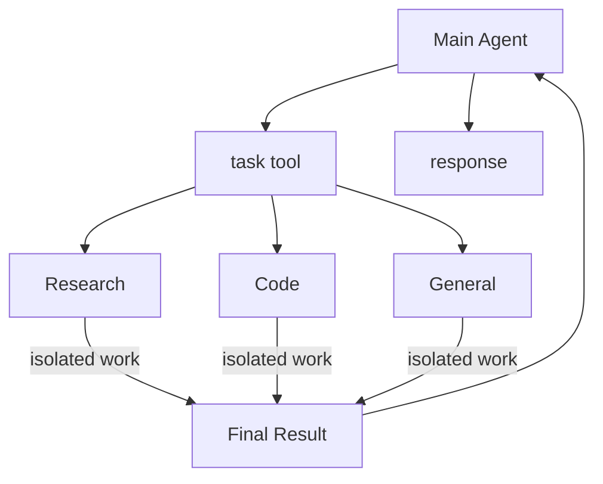

单个 Agent 处理多阶段任务时，每一步的工具调用和结果都堆在同一个上下文里，很快就满了。子代理的思路是：**把任务拆给几个独立的 Agent 各干各的，每个都有自己的上下文，最后只把结论回传给主 Agent**。这和 [[【实战】子代理 Sub Agent]] 讲的是同一件事，这里看的是 Deep Agent 里的内置支持。

## 1. 结构

`SubAgentMiddleware` 会注入一个 `task` 工具，主 Agent 用它启动子代理。图中的三条分支代表不同角色的子代理：负责调研的、负责写代码的、通用的。它们各自"isolated work"（隔离工作），只把最终结果送回来。

## 2. 为什么能省上下文

打个比方：主 Agent 是项目经理，子代理是三个专项小组。项目经理不需要知道每组翻了多少资料、试错了几次，只要各组交上来的结论。中间过程留在各组的上下文里，不进项目经理的视野。

| 对比项   | 主 Agent 自己做            | 交给子代理                   |
| -------- | -------------------------- | ---------------------------- |
| 上下文   | 所有步骤堆在一起，越来越长 | 各组独立，主上下文只收结论   |
| 执行     | 串行推进                   | 多个子代理可并行             |
| 适合任务 | 步骤少、上下文关联强       | 阶段清晰、可独立交付的子任务 |

这和 [[【基础】上下文压缩]] 是两种不同的省上下文策略：压缩是"事后精简"，子代理是"从一开始就不让它进来"。[[【概念】循环工程]] 里让子代理并行干活、用工作树隔离，用的也是这个思想。

## 3. 尚未展开的相关主题

源材料里还有几个与多代理相关的条目，但没有实质内容，这里只做标记，不单独建页：

| 主题         | 源材料现状                                            |
| ------------ | ----------------------------------------------------- |
| 多智能体     | 只有一条官方文档入口 `langchain` multi-agent 文档链接 |
| 路由模式     | 只有一条"入职领电脑、开账号、申请工位门禁"的测试输入  |
| 异步子代理   | 仅占位                                                |
| handoff 模式 | 仅占位                                                |

等内容补齐后再展开，避免凭空编造。
