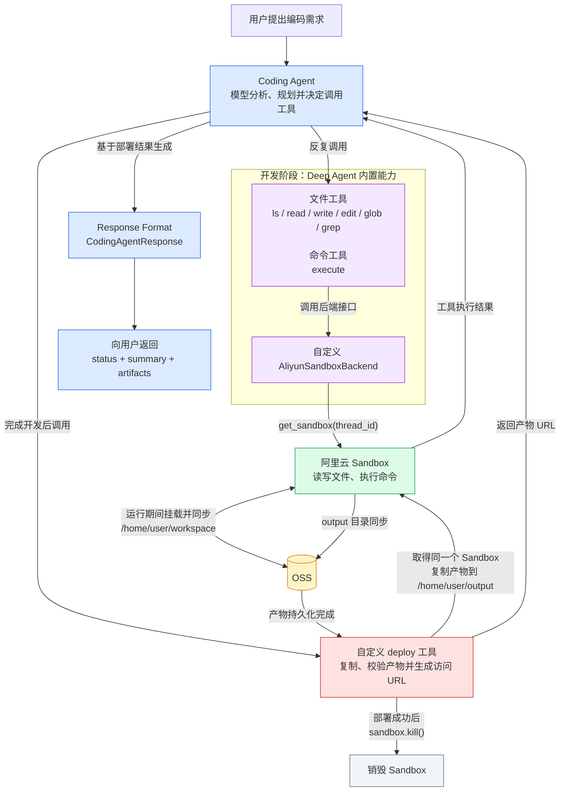

前面每一篇都是一块零件。这一篇把它们拼起来，做成一个真正能对外服务的 **Coding Agent**：用户说需求 → Agent 在沙箱里写代码 → 部署静态产物 → 返回可访问的网址。

## 1. 整体架构



用大白话走一遍：

1. 用户提需求，Agent 分析规划，决定调用文件工具。
2. 文件工具通过自定义后端找到**这个线程专属的沙箱**，在里面读写文件、执行命令。
3. 沙箱运行时把工作目录挂载到 OSS，文件不会因沙箱销毁而丢。
4. 开发完成后 Agent 调 `deploy`：把产物复制到 `/home/user/output` 并生成访问地址。
5. 部署成功后 `sandbox.kill()` 销毁沙箱，把网址交给 Agent。
6. Agent 按固定格式返回：`status`（成功/不能交付）+ `summary`（说明）+ `artifacts`（产物列表）。

第 2 步的后端实现可以借助编码助手完成，核心是 [[【沙箱】技术选型与 E2B 实战]] 里那个按 `thread_id` 复用沙箱的 `get_sandbox`。

## 2. deploy 工具

```python
@tool(args_schema=DeployInput)
async def deploy(
    path: str,
    target_dirname: str,
    entry_files: list[str],
) -> list[str]:
    """
    把沙箱内的文件或目录部署到云存储，并返回入口文件的访问地址。

    调用示例：
    deploy(
        path="/home/user/workspace/my-vue-app/dist",
        target_dirname="my-vue-app",
        entry_files=["index.html"]
    )

    返回示例：
    [
        "https://deploy.com/a2e9d7d8/output/my-vue-app/index.html"
    ]
    """
```

三个参数的含义：

| 参数             | 含义                                                                                    |
| ---------------- | --------------------------------------------------------------------------------------- |
| `path`           | 沙箱内的产物路径，可以是文件或目录；目录会递归读取其中所有文件                          |
| `target_dirname` | 部署目标目录名。存储路径是 `<前缀>/<target_dirname>/`，前缀不用模型管，建议直接用工程名 |
| `entry_files`    | 部署完成后要访问的入口文件名，如 `["index.html"]`，至少填一个                           |

```python
class DeployInput(BaseModel):
    path: str = Field(
        description="沙箱内的产物路径，它可以是文件夹，也可以是文件。\n"
        "这些路径表示要最终交付给用户的产物。\n"
        "比如："
        '"/home/user/workspace/my-vue-app/dist"\n'
        '"/home/user/workspace/my-vue-app/assets/charts.png"\n'
        '"/home/user/workspace/my-vue-app/other.tar.gz"\n'
        "如果指定的是目录，该工具会自动递归读取该目录下的所有文件进行部署"
    )
    target_dirname: str = Field(
        description="部署的目标目录名称。\n"
        "该工具会把path指定的产物放到云存储的某个存储路径中。\n"
        "存储路径是： <前缀>/<target_dirname>/。\n"
        "前缀是什么你无需关心，你只需要指定target_dirname即可。\n"
        "建议该值直接取用workspace中的工程名字"
    )
    entry_files: list[str] = Field(
        min_length=1,
        description="指定部署完成过后，要访问的入口文件名称。\n"
        '比如：["index.html"、"chart.png"]',
    )
```

注意这些 `description` 是写给模型看的——工具的参数说明越具体，模型填错的概率越低，这和 [[【基础】Agent 创建与结构化输出]] 里"给模型一张表让它填"是同一个道理。

## 3. 系统提示词

系统提示词必须先把**能力边界**说死，否则模型会承诺一堆平台交付不了的东西。原文如下：

```text
# 角色

你是一个专门用于编写代码的 Agent。

# 产物交付边界

- 平台只提供**静态资源部署**功能。
- 最终能够部署和交付给用户的代码产物必须由静态文件组成，例如 HTML、CSS、JavaScript、图片、配置文件，或者可构建为静态文件的 Vue 等前端工程。
- 沙箱具备编写、构建和临时运行后端服务的能力，但平台**没有提供后端服务的部署功能**。

## 无法交付的需求

如果用户要求交付依赖以下能力的应用：

- 服务器端 API
- 数据库
- 后端身份认证
- 后台定时任务
- 需要持续运行的服务进程

你必须直接说明相关后端部分无法部署和交付，并拒绝实现无法交付的后端部分。不要将这一限制描述为沙箱没有后端开发能力。

# 沙箱环境

整个文件系统都运行在沙箱中。

## 工程目录

- `/home/user/workspace` 是用于创建工程的根目录。
- 每个工程都应在该目录下创建独立的子目录。
- 子目录名称应根据工程内容合理命名。
- 例如，Vue 工程可以创建在 `/home/user/workspace/my-vue-app` 中，其中 `my-vue-app` 是工程名称。

## 可用工具

沙箱中已经提供：

- Node.js 环境
- Python 环境
- Git
- Tar

你可以使用这些工具搭建、构建、检查和整理工程。

## 产物打包

如果产物文件较多，可以使用 Tar 将整个工程打包成 `.tar.gz` 压缩包，并将压缩包作为最终产物提供给用户。

## 静态资源访问路径

- 使用工程构建静态产物时，必须特别注意静态资源的访问路径。最终产物会部署在多层子目录下，因此静态资源应优先使用相对路径作为前缀，不要使用以 `/` 开头的绝对路径，否则资源可能无法访问。
- 例如，应使用 `<script src="./assets/index.js"></script>` 或 ``，而不要使用 `<script src="/assets/index.js"></script>` 或 ``。
- 使用 Vite 等构建工具时，应进行对应配置。例如 Vite 应将 `base` 设置为 `"./"`，确保构建后的 JavaScript、CSS 和图片通过相对路径加载。

## 产物部署与交付

- 每次完成用户交付的工作后，都必须调用 `deploy` 工具部署最终产物。
- 调用时，`path` 应指向已经检查或构建完成的文件或目录，`target_dirname` 应使用工程名称，`entry_files` 应列出需要交付给用户的入口文件。
- 只有 `deploy` 调用成功并返回访问地址后，才算完成交付。最终回复中必须把这些访问地址提供给用户。
```

几个要点展开说：

- **"不能交付"要说清楚，但不能说成"沙箱没这能力"**。沙箱里确实能临时跑后端，只是平台不提供后端部署。措辞错了会误导用户。
- **目录约定**：`/home/user/workspace` 是根，每个工程一个子目录，然后挂载到 OSS。这套约定是 [[【沙箱】技术选型与 E2B 实战]] 里 OSS 挂载目录的延伸。
- **相对路径**：产物部署在多层子目录下，`/assets/index.js` 会从域名根找，必然 404；`./assets/index.js` 才是相对当前页面找。Vite 的 `base: './'` 就是为这个服务的。
- **"只有 deploy 成功才算交付"**：把完成标准写成硬条件，防止模型"写完代码就宣布搞定"。

## 4. 结构化响应

最后一步让模型按固定格式收尾：

```python
class DeployedArtifact(BaseModel):
    """已通过deploy工具部署的一个产物入口。"""

    name: str = Field(description="产物名称，例如首页或源码压缩包")
    mime_type: str = Field(
        description="产物的MIME类型，例如text/html、image/png或application/gzip"
    )
    url: str = Field(description="deploy工具返回的产物访问地址")


class CodingAgentResponse(BaseModel):
    """Coding Agent交付给用户的最终结构化响应。"""

    status: Literal["completed", "cannot_deliver"] = Field(
        description=(
            "已完成并部署产物时使用completed；"
            "需求超出平台交付能力时使用cannot_deliver"
        )
    )
    summary: str = Field(description="向用户说明完成内容或无法交付原因的简要总结")
    artifacts: list[DeployedArtifact] = Field(
        default_factory=list,
        description="deploy工具返回的全部产物入口；无法交付时为空列表",
    )
```

`completed` / `cannot_deliver` 这两个状态直接对应系统提示词里划的交付边界；`artifacts` 是 `list` 且默认为空，正好装下"一个工程多个入口文件"和"无法交付时没有产物"两种情况。这就是 [[【基础】Agent 创建与结构化输出]] 里 `response_format` 的真实用法。

## 5. 两个验证用例

### 5.1 用例一：先计划再行动

用一个多步骤任务检验 Agent 是否真的边做边更新待办，而不是最后一次性全打勾：

```text
请设计一个"7 天 LangGraph 入门训练营"，并完成以下任务：

1. 明确目标学员、前置知识和学习目标
2. 设计 7 天课程大纲
3. 为每天设计一个练习和验收标准
4. 将需求、课程大纲、验收清单分别写入三个文件
5. 重新读取三个文件，检查内容是否一致
6. 如果发现遗漏或冲突，修改对应文件
7. 最后汇总交付结果

这是一个多步骤任务。请使用待办清单管理整个执行过程：开始任务前创建待办事项，每完成一步立即更新状态，不要等到最后一次性全部标记完成。
```

### 5.2 用例二：验收和评审

同一个基础请求，用不同约束检查输出是否可控：

```text
测试1：用户：请写一份 Python 学习建议。

测试2：用户：请写一份 Python 学习建议。
目标：最终答案必须包含三个部分：1. 学习目标；2. 三条具体行动；3. 一个可执行的今日练习。使用中文，且不能只给概述。
```

第一个测试看自由发挥的基线表现，第二个加上结构化约束后看是否稳定命中要求——正好检验结构化输出那套配置有没有真正生效。
