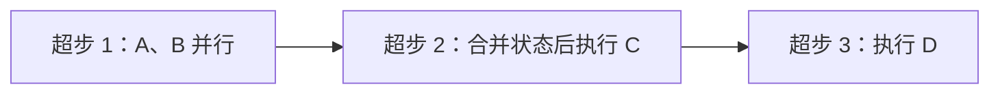

LangGraph 的核心只有三样东西：**节点、边、图状态**。把这三样定义好，编译成可执行对象，再传入初始状态运行，就完成了一次 Agent 流程。


## 1. 三个阶段：定义、编译、运行

1. **定义**：声明节点、边和图状态结构。这时它只是一份描述，还不能运行。
2. **编译**：把描述固化成一个可执行对象。编译后的节点和边固定下来，不能再动态增删。
3. **运行**：传入初始状态执行图。

```python
from langgraph.graph import StateGraph, START, END

builder = StateGraph(MyState)
builder.add_node(node_a)
builder.add_node(node_b)
builder.add_edge(START, "node_a")
builder.add_edge("node_a", "node_b")
builder.add_edge("node_b", END)

graph = builder.compile()
result = graph.invoke({"messages": []})
```

编译结果本身是一个 `Runnable`，所以它天然拥有 `invoke`、`ainvoke`、`stream`、`astream`、`batch`、`abatch` 这套执行接口，可以像调用模型一样调用整张图。

## 2. 节点：能"被调用"即可

节点不要求是普通函数，只要满足下面两类之一：

- **可调用对象**：实现了 `__call__` 的类实例。
- **Runnable 对象**：`langchain_core` 中定义的可执行对象，例如模型、绑定过工具的运行链、工具本身。

因为 `@tool` 装饰器会把函数转换成 `Runnable`，所以工具可以直接当节点用。详见 [[【基础】工具与工具节点]]。

## 3. 图状态：所有节点共享的白板

图状态是整张图共享的数据空间。每个节点执行时都能拿到**完整的当前状态**，也可以返回一个局部更新。


几个关键点：

- 图状态本质上是一个字典，每个字段称为一个 **channel（通道）**。
- 节点返回的字典会按字段合并回图状态，而不是整包替换。
- 每个字段的合并方式由 `Reducer` 决定，默认是"新值覆盖旧值"。
- 一次运行结束后，得到的结果就是最新的完整图状态。

```python
class MyState(TypedDict):
    messages: Annotated[list, add_messages]
    step_count: int

def node_a(state: MyState):
    return {"step_count": state["step_count"] + 1}
```

Reducer 的细节见 [[【基础】状态与 Reducer]]。

## 4. 执行模型：Pregel 与超步

LangGraph 底层使用 **Pregel** 系统运行图，Pregel 来自 2010 年 Google 的图计算论文。它采用 **BSP（Bulk Synchronous Parallel，整体同步并行）** 模型。

在 BSP 里，一次完整计算由一系列 **超步（superstep）** 串行组成：

1. 当前所有可运行的节点**并行执行**。
2. 等这一轮全部完成后，统一把结果合并进图状态。
3. 再根据边决定下一轮有哪些节点可运行。

因此，超步是一个**运行时概念**，不是编译时概念。同一条边上的节点不一定在同一个超步里执行，取决于它们是否同时就绪。



理解超步后，下面这些行为就顺理成章了：

- 检查点出现在**起始节点前后**和**每个超步之后**，见 [[【实战】Agent Server 与线程检查点]]。
- `recursion_limit` 限制的是一次运行最多允许多少个超步，默认 1000。
- 并行分支的返回值会在超步边界统一合并，因此 Reducer 必须能处理"并发追加"。
