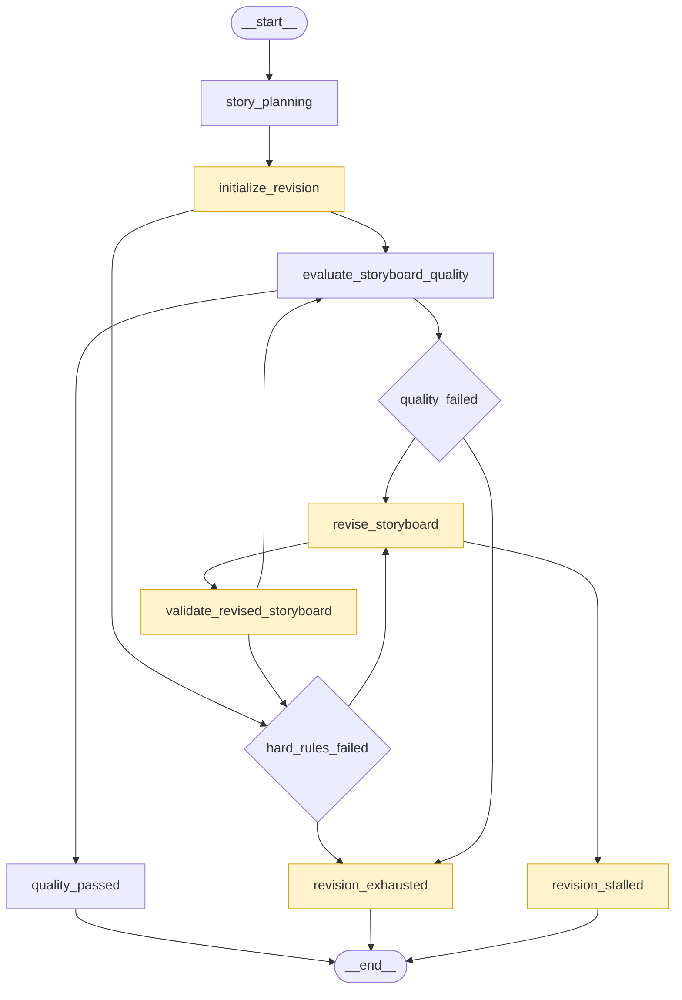
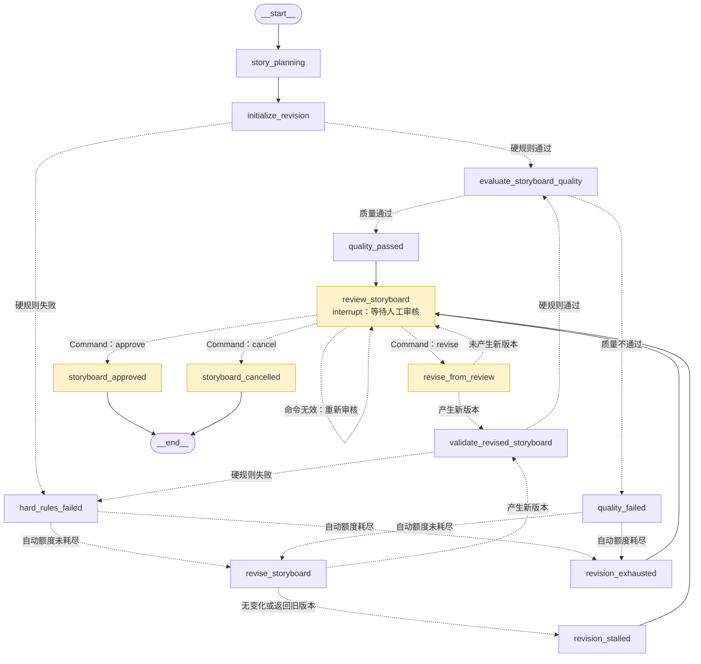

## 1. 人工审核分镜

> 关于 langgraph 里面的中断，可以阅读扩展阅读《langgraph中断》

### 1.1 图的变化

**之前的工作流**



**现在的工作流**

多了一个人工审核的步骤：

1. 人工审核通过：storyboard_approved
2. 人工审核取消：storyboard_cancelled
3. 人工审核重做：revise_from_review



### 1.2 schema

新增 `storyboard_review.py` 文件：

```py
from typing import Literal

from pydantic import BaseModel, ConfigDict, Field, model_validator


class StoryboardReview(BaseModel):
    """恢复审核时提交的决定，绑定用户实际看到的版本。"""

    model_config = ConfigDict(extra="forbid", str_strip_whitespace=True)
    action: Literal["approve", "revise", "cancel"]
    version: int = Field(ge=0, strict=True)
    comment: str = Field(default="", max_length=500)
    shot_ids: list[str] = Field(default_factory=list)

    @model_validator(mode="after")
    def validate_action_fields(self):
        if self.action == "revise" and (not self.comment or not self.shot_ids):
            raise ValueError("退回修改必须填写意见和 shot_ids")
        if self.action != "revise" and self.shot_ids:
            raise ValueError("只有退回修改可以携带 shot_ids")
        if self.action == "cancel" and not self.comment:
            raise ValueError("取消作品必须填写原因")
        if len(self.shot_ids) != len(set(self.shot_ids)):
            raise ValueError("shot_ids 不能重复")
        return self

```

- `action`：审核决定，只能是三个值之一。
  - `approve`：当前分镜通过
  - `cancel`：取消这部作品
  - `revise`：按意见重写指定镜头
- `version`：用户实际看到的分镜版本号
- `comment`：文字意见
- `shot_ids`：要修改的镜头 ID 列表，只有 `revise` 可以带，而且必须至少有一个。
- `validate_action_fields` 是 Pydantic 的模型级校验：单个字段都合法之后才运行，用来检查 `action`、`comment`、`shot_ids` 三者是否配套。

更新 schema 入口文件：

```py
...
from .storyboard_review import StoryboardReview

__all__ = [
    ...
    "StoryboardReview",
]
```

### 1.3 state

```py
automatic_revision_count: NotRequired[int]
human_revision_count: NotRequired[int]
review_result: NotRequired[StoryboardReview | None]
review_error: NotRequired[str | None]
approved_version: NotRequired[int | None]
```

**automatic_revision_count**

需要注意 `revision_count` 和 `automatic_revision_count` 区别：

- `revision_count` 是当前分镜的内容版本号。
  - 初版是 v0，无论系统自动改还是用户退回后改出新稿，成功一次就加 1。
  - 人工审核时看到的 `version`、批准时记下的 `approved_version`，用的都是这个数。
- `automatic_revision_count` 只统计质量没过关时系统自动重写的次数。
  - 它和 `max_revisions` 比较，用来决定还能不能继续自动改。
  - 用户退回产生的新版本不加这个数。

所以两个字段都从 0 开始，但记的是两件不同的事。只有全程都是自动修订时，两个数才会一样。

一旦中间有一次人工退回，`revision_count` 会往前走，`automatic_revision_count` 停在原地。

例如自动改过 1 次、人工又退回改出 1 版：内容版本是 v2，自动修订次数仍是 1。

**human_revision_count**

记录人工审核时修订的次数，并且是真正改出新分镜的次数。

- 同样从 0 开始，只有人工修订产出新分镜才加 1。
- 如果模型改完内容和旧版完全一样，这次不算。
- 调用模型时会把这个数传进去，用来区分这是第几次按人工意见改。

**其他字段**

- `review_result`：存储人工审核的决定，类型是 `StoryboardReview`。
- `review_error`：人工审核时候，提交的内容有问题，报错信息会写入该字段。
- `approved_version`：用户点通过时对应的内容版本。

### 1.4 更新 revision 相关节点

因为图的状态新增了和审核相关的状态值，因此 revision 相关的节点涉及到一部分改动。

`initialize_revision.py`

```py
return {
    ...
    "automatic_revision_count": 0,
    "human_revision_count": 0,
    "review_result": None,
    "review_error": None,
    "approved_version": None,
    ...
}
```

`make_revise_storyboard.py`

将原本的：

```py
if state["revision_count"] >= state["max_revisions"]:
  	raise ValueError("修订次数已达上线")
```

修改为：

```py
if state.get("automatic_revision_count", state["revision_count"]) >= state["max_revisions"]:
    raise ValueError("修订次数已达上限")
```

另外最后返回新的状态的时候，新增 `automatic_revision_count` 和 `approved_version` 这两项：

```py
# 返回新的状态
return {
    ...
    "automatic_revision_count": state.get("automatic_revision_count", state["revision_count"]) + 1,
    "approved_version": None,
    ...
}
```

`route_after_failure.py`

将原本的：

```py
return (
    "revise_storyboard"
		if state["revision_count"] < state["max_revisions"]
    else "revision_exhausted"
)
```

修改为：

```py
return (
    "revise_storyboard"
    if state.get("automatic_revision_count", state["revision_count"]) < state["max_revisions"]
    else "revision_exhausted"
)
```

### 1.5 新增人工审核相关节点

#### 1.5.1 review_storyboard

`review_storyboard.py`

```py
from typing import Literal

from langgraph.types import Command, interrupt
from pydantic import ValidationError

from server.schema import StoryboardReview
from server.states import ComicDramaState


def review_storyboard(
    state: ComicDramaState,
) -> Command[
    Literal[
        "storyboard_approved",
        "revise_from_review",
        "storyboard_cancelled",
        "review_storyboard",
    ]
]:
    # 恢复时从节点开头重放；interrupt 前只整理材料，不调用模型。
    report = state.get("quality_report")
    raw = interrupt(
        {
            "title": state["requirement"].title,
            "story_summary": state["story_outline"].theme,
            "version": state["revision_count"],
            "review_reason": state["current_stage"],
            "stop_reason": state.get("stop_reason"),
            "storyboard": [
                shot.model_dump(mode="json") for shot in state["storyboard"]
            ],
            "quality_report": report.model_dump(mode="json") if report else None,
            "allowed_actions": ["approve", "revise", "cancel"],
            "error": state.get("review_error"),
        }
    )
    try:
        review = StoryboardReview.model_validate(raw)
        if review.version != state["revision_count"]:
            raise ValueError(
                f"审核版本已过期：当前 v{state['revision_count']}，收到 v{review.version}"
            )
        known_ids = {shot.shot_id for shot in state["storyboard"]}
        unknown = set(review.shot_ids) - known_ids
        if unknown:
            raise ValueError(f"审核意见引用了未知分镜：{sorted(unknown)}")
    except (ValidationError, ValueError) as exc:
        return Command(goto="review_storyboard", update={"review_error": str(exc)})
    target = {
        "approve": "storyboard_approved",
        "revise": "revise_from_review",
        "cancel": "storyboard_cancelled",
    }[review.action]
    return Command(
        goto=target,
        update={
            "review_result": review,
            "review_error": None,
            "events": [f"已收到人工审核命令：{review.action}"],
        },
    )
```

这里用到了中断：

- 第一次会在 `interrupt` 中断，等待用户输入。
- 第二次恢复时，该节点会从头再跑一遍，仍然会执行到 `interrupt`，只是这一次它不再等待，而是把用户提交的内容当作返回值交给后面的代码。

#### 1.5.2 storyboard_approved

`storyboard_approved.py`

```py
from server.states import ComicDramaState


def storyboard_approved(state: ComicDramaState) -> dict[str, object]:
    return {
        "approved_version": state["revision_count"],
        "current_stage": "storyboard_approved",
        "stop_reason": None,
        "events": [f"人工已批准 v{state['revision_count']} 分镜"],
    }

```

#### 1.5.3 storyboard_cancelled

`storyboard_cancelled.py`

```py
from server.states import ComicDramaState


def storyboard_cancelled(state: ComicDramaState) -> dict[str, object]:
    return {
        "current_stage": "storyboard_cancelled",
        "stop_reason": "cancelled_by_user",
        "approved_version": None,
        "events": ["用户已取消作品"],
    }

```

#### 1.5.4 make_revise_from_review

`make_revise_from_review.py`

```py
from server.model import TextModel
from server.nodes.revision import shot_fingerprint
from server.schema import (
    QualityIssue,
    RevisionRecord,
    StoryBoard,
    StoryboardQualityReport,
)
from server.states import ComicDramaState


def make_revise_from_review(text_model: TextModel):
    def revise_from_review(state: ComicDramaState) -> dict[str, object]:
        review = state["review_result"]
        if review is None or review.action != "revise":
            raise ValueError("没有可执行的人工修订意见")
        report = StoryboardQualityReport(
            is_passed=False,
            summary="用户退回分镜",
            issues=[
                QualityIssue(
                    code="visual_unclear",
                    severity="error",
                    shot_id=shot_id,
                    description=review.comment,
                    suggestion=review.comment,
                )
                for shot_id in review.shot_ids
            ],
            affected_shot_ids=review.shot_ids,
        )
        old = state["storyboard"]
        candidate = [
            StoryBoard.model_validate(item)
            for item in text_model.revise_storyboard(
                state["requirement"],
                state["story_outline"],
                state["characters"],
                state["scenes"],
                old,
                report,
                revision_count=state["human_revision_count"],
            )
        ]
        if len(candidate) != state["requirement"].shot_count:
            raise ValueError("人工修订不得改变镜头数量")
        if [s.shot_id for s in candidate] != [s.shot_id for s in old]:
            raise ValueError("人工修订必须保留全部稳定 shot_id 和排列")
        if [s.order for s in candidate] != [s.order for s in old]:
            raise ValueError("人工修订不得改变镜头顺序号")
        if (
            sum(s.duration_seconds for s in candidate)
            != state["requirement"].duration_seconds
        ):
            raise ValueError("人工修订不得改变目标总时长")
        if any(
            before != after and before.shot_id not in review.shot_ids
            for before, after in zip(old, candidate)
        ):
            raise ValueError("人工修订改动了未指定镜头")
        signature = shot_fingerprint(candidate)
        if signature in {record.fingerprint for record in state["revision_history"]}:
            return {
                "review_result": None,
                "approved_version": None,
                "current_stage": "revision_stalled",
                "stop_reason": "human_revision_no_new_version",
                "events": ["人工修订未产生新版本，返回人工审核"],
            }
        version = state["revision_count"] + 1
        previous = state.get("quality_report") or report
        return {
            "storyboard": candidate,
            "revision_count": version,
            "human_revision_count": state["human_revision_count"] + 1,
            "revision_history": [
                *state["revision_history"],
                RevisionRecord(
                    version=version,
                    fingerprint=signature,
                    source_codes=["human_review"],
                    target_shot_ids=review.shot_ids,
                ),
            ],
            "previous_quality_report": previous.model_dump(mode="json"),
            "quality_report": None,
            "storyboard_validation": None,
            "review_result": None,
            "approved_version": None,
            "stop_reason": None,
            "current_stage": "storyboard_revised_by_user",
            "events": [f"已按人工意见生成 v{version} 分镜，等待重新校验"],
        }

    return revise_from_review

```

新增 `review` 的入口文件：

```py
from .make_revise_from_review import make_revise_from_review
from .review_storyboard import review_storyboard
from .storyboard_approved import storyboard_approved
from .storyboard_cancelled import storyboard_cancelled

__all__ = [
    "make_revise_from_review",
    "review_storyboard",
    "storyboard_approved",
    "storyboard_cancelled",
]

```

更新 `nodes` 的入口文件：

```py
from .review import (
    make_revise_from_review,
    review_storyboard,
    storyboard_approved,
    storyboard_cancelled,
)

__all__ = [
  	...
    "make_revise_from_review",
	  "review_storyboard",
  	"storyboard_approved",
    "storyboard_cancelled",
  	...
]
```

### 1.6 更新图的编排

更新 `build_graph` 方法：

```py
def build_graph(text_model: TextModel):
# 更新为
def build_graph(text_model: TextModel, *, checkpointer=None):
```

新增节点：

```py
builder.add_node("review_storyboard", review_storyboard)
builder.add_node("revise_from_review", make_revise_from_review(text_model))
builder.add_node("storyboard_approved", storyboard_approved)
builder.add_node("storyboard_cancelled", storyboard_cancelled)
```

将原来的：

```py
builder.add_edge("quality_passed", END)
```

更新为：

```py
builder.add_edge("quality_passed", "review_storyboard")
```

修改边的连接，将原本的：

```py
builder.add_edge("revision_exhausted", END)
builder.add_edge("revision_stalled", END)

return builder.compile()
```

更新为：

```py
builder.add_edge("revision_exhausted", "review_storyboard")
builder.add_edge("revision_stalled", "review_storyboard")

# review_storyboard 由 Command 选择唯一业务路径，不再添加静态出口。
builder.add_conditional_edges(
    "revise_from_review",
    lambda state: "review_storyboard" if state["current_stage"] == "revision_stalled" else "validate_revised_storyboard",
    path_map=["review_storyboard", "validate_revised_storyboard"],
)
builder.add_edge("storyboard_approved", END)
builder.add_edge("storyboard_cancelled", END)

return builder.compile(checkpointer=checkpointer)
```

注意点：


### 1.7 收尾工作

1. 测试

2. 提交

   ```bash
   git add .
   git commit -m "feat: pause workflow for storyboard review with human"
   ```

## 2. 相关页面

- [[01 目录]]：返回项目目录
- [[LangGraph中断]]
