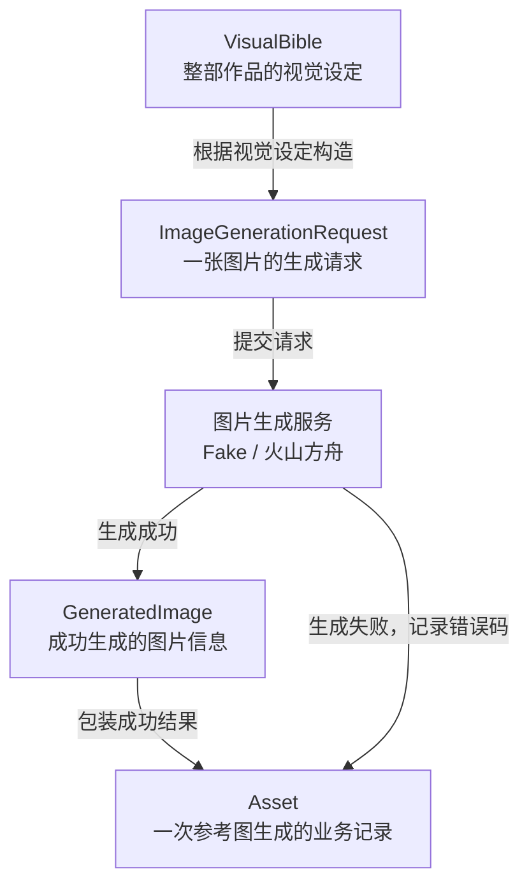
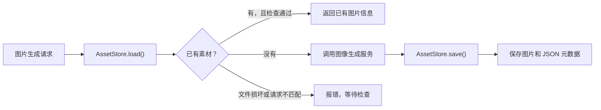

## 1. 生成角色和场景图

文生图、图生视频

目前的工作流：


要实现的工作流：


### 1.1 配置图像模型

```py
# 图像生成服务
IMAGE_MODEL_PROVIDER=ark
ARK_IMAGE_MODEL=doubao-seedream-5-0-260128
IMAGE_TIMEOUT_SECONDS=120
# none / rate_limit / content_rejected / service_error
FAKE_IMAGE_FAILURE=none
FAKE_IMAGE_FAIL_OWNER_IDS=
```

- IMAGE_TIMEOUT_SECONDS：图片服务的超时秒数，默认 120 秒

- FAKE_IMAGE_FAILURE：fake 图片模拟不同结果
  - none：正常生成占位图
  - rate_limit：模拟接口限流
  - content_rejected：模拟内容被拒绝
  - service_error：模拟服务异常

- FAKE_IMAGE_FAIL_OWNER_IDS：指定哪些角色或场景触发上面的 Fake 故障
  - 例如，下面只让阿沐的参考图模拟限流，其他角色和场景正常生成：

    ```py
    FAKE_IMAGE_FAILURE=rate_limit
    FAKE_IMAGE_FAIL_OWNER_IDS=char_amu
    ```

  - 多个 ID 用英文逗号分隔，例如 `char_amu,scene_office`

  - 留空时，故障模式作用于所有对象

  - 如果 `FAKE_IMAGE_FAILURE=none`，则不会触发故障

### 1.2 schema

什么是 schema ？

在本项目中，schema 指项目内部自定义的数据结构。

这一次和之前功能模块**不同的地方**在于，这一次涉及到 4 个 schema 文件：



`visual_bible.py`

```py
from typing import Literal

from pydantic import BaseModel, ConfigDict, Field

from .character_profile import CharacterProfile
from .scene_profile import SceneProfile


class VisualBible(BaseModel):
    """审核后的视觉快照；保存基础类型，方便服务检查点序列化。"""

    model_config = ConfigDict(extra="forbid", frozen=True)
    project_id: str = Field(pattern=r"^project_[a-z0-9_]+$")
    version: int = Field(ge=0)
    visual_style: str
    palette: str
    aspect_ratio: Literal["9:16", "16:9", "1:1"]
    reference_size: str = "2048x2048"
    negative_prompt: str
    characters: tuple[CharacterProfile, ...]
    scenes: tuple[SceneProfile, ...]
    generation_profile: str
```

`image_generation_request.py`

```py
from typing import Literal

from pydantic import BaseModel, ConfigDict, Field


class ImageGenerationRequest(BaseModel):
    """项目自己的图像生成请求，不暴露火山方舟 SDK 类型。"""

    model_config = ConfigDict(extra="forbid", str_strip_whitespace=True)
    request_id: str = Field(pattern=r"^img_[a-z0-9_]+$")
    purpose: Literal[
        "character_reference",
        "scene_reference",
        "shot_start",
        "shot_end",
    ]
    owner_id: str = Field(pattern=r"^(project|char|scene|shot)_[a-z0-9_]+$")
    version: int = Field(ge=0)
    prompt: str = Field(min_length=1, max_length=4000)
    negative_prompt: str = Field(default="", max_length=2000)
    size: str = Field(default="2048x2048", pattern=r"^(\d{3,4}x\d{3,4}|[124]K)$")
```

`generated_image.py`

```py
from typing import Literal

from pydantic import BaseModel, ConfigDict, Field


class GeneratedImage(BaseModel):
    """已规范化的素材结果；State 不需要理解平台原始响应。"""

    model_config = ConfigDict(extra="forbid", str_strip_whitespace=True)

    asset_id: str = Field(pattern=r"^asset_img_[a-z0-9_]+$")
    request_id: str = Field(pattern=r"^img_[a-z0-9_]+$")
    purpose: Literal[
        "character_reference",
        "scene_reference",
        "shot_start",
        "shot_end",
    ]
    owner_id: str = Field(pattern=r"^(project|char|scene|shot)_[a-z0-9_]+$")
    version: int = Field(ge=0)
    status: Literal["succeeded"] = "succeeded"
    local_path: str = Field(min_length=1)
    remote_url: str | None = None
    provider_request_id: str | None = None
    provider_model: str
    prompt: str
    negative_prompt: str = ""
    size: str
    prompt_digest: str = Field(pattern=r"^[a-f0-9]{16}$")
    request_digest: str = Field(pattern=r"^[a-f0-9]{16}$")
    reused: bool = False
```

`asset.py`

```py
from typing import Literal

from pydantic import BaseModel, ConfigDict, Field, model_validator

from .generated_image import GeneratedImage


class Asset(BaseModel):
    """一项参考图资源：成功保存 GeneratedImage，失败保存结构化错误。"""

    model_config = ConfigDict(extra="forbid")
    purpose: Literal["character_reference", "scene_reference"]
    owner_id: str = Field(pattern=r"^(char|scene)_[a-z0-9_]+$")
    version: int = Field(ge=0)
    request_id: str = Field(pattern=r"^img_[a-z0-9_]+$")
    status: Literal["succeeded", "failed"]
    prompt: str
    negative_prompt: str
    size: str
    image: GeneratedImage | None = None
    error_code: str | None = None

    @model_validator(mode="after")
    def check_result(self):
        if self.status == "succeeded":
            if self.image is None or self.error_code is not None:
                raise ValueError("成功素材必须有 image，且不能有 error_code")
            if (
                self.image.request_id,
                self.image.purpose,
                self.image.owner_id,
                self.image.version,
                self.image.prompt,
                self.image.negative_prompt,
                self.image.size,
            ) != (
                self.request_id,
                self.purpose,
                self.owner_id,
                self.version,
                self.prompt,
                self.negative_prompt,
                self.size,
            ):
                raise ValueError("成功图片必须与素材请求完全对应")
        elif self.image is not None or not self.error_code:
            raise ValueError("失败素材必须有 error_code，且不能有成功 image")
        return self

```

### 1.3 prompt

`reference_prompts.py`

```py
import hashlib

from server.schema import (
    CharacterProfile,
    ImageGenerationRequest,
    SceneProfile,
    VisualBible,
)


def visual_digest(bible: VisualBible) -> str:
    return hashlib.sha256(bible.model_dump_json().encode()).hexdigest()[:16]


def _request(bible: VisualBible, owner_id: str, purpose, prompt: str):
    # ID 同时编码作品、内容版本、视觉快照和平台配置，避免跨作品/模型复用。
    return ImageGenerationRequest(
        request_id=f"img_{bible.project_id}_{purpose}_{owner_id}_v{bible.version}_{visual_digest(bible)}",
        purpose=purpose,
        owner_id=owner_id,
        version=bible.version,
        prompt=prompt,
        negative_prompt=bible.negative_prompt,
        size=bible.reference_size,
    )


def character_reference_request(bible: VisualBible, character: CharacterProfile):
    return _request(
        bible, character.character_id, "character_reference",
        f"角色视觉参考图；统一画风：{bible.visual_style}；统一色彩：{bible.palette}。\n"
        f"角色：{character.name}；身份：{character.identity}；性格气质：{character.personality}。\n"
        f"稳定外观：{character.appearance}；固定服装：{character.clothing}。\n"
        f"辨识关键词：{'、'.join(character.visual_keywords)}。\n"
        "单一角色，全身站姿，简洁中性背景，清晰展示脸部、发型与服装；无文字标签。",
    )


def scene_reference_request(bible: VisualBible, scene: SceneProfile):
    return _request(
        bible, scene.scene_id, "scene_reference",
        f"场景视觉参考图；统一画风：{bible.visual_style}；统一色彩：{bible.palette}。\n"
        f"场景：{scene.name}；时间：{scene.time}；空间布局：{scene.location}。\n"
        f"光线：{scene.lighting}；场景主色：{scene.colors}。\n"
        f"环境关键词：{'、'.join(scene.visual_keywords)}。\n"
        "空镜头，无人物，不加入分镜动作，展示环境布局与固定元素；无文字标签。",
    )

```

### 1.4 state

`states/state.py`

```py
project_id: NotRequired[str]
visual_bible: NotRequired[dict]
visual_digest: NotRequired[str]
assets: Annotated[dict[str, dict], merge_assets]
reference_report: NotRequired[dict]
```

`asset_reducer.py`


```py
from server.schema import Asset


def merge_assets(current: dict, update: dict) -> dict:
    merged = dict(current)
    for key, payload in update.items():
        asset = Asset.model_validate(payload)
        if key != asset.request_id:
            raise ValueError("素材索引键必须等于 request_id")
        if key in merged:
            previous = Asset.model_validate(merged[key])
            identity = ("purpose", "owner_id", "version", "prompt", "negative_prompt", "size")
            if any(getattr(previous, name) != getattr(asset, name) for name in identity):
                raise ValueError("同一素材键出现不同请求")
        merged[key] = asset.model_dump(mode="json")
    return merged
```

### 1.5 storage

负责存储生成的图片以及图片的元数据信息。

比如角色图片生成后，磁盘上会保存类似这样的一组文件：

```
outputs/
└── images/
    └── character_reference/
        └── char_xiaolin/
            └── v0/
                ├── img_请求ID.png
                └── img_请求ID.json
```

- `.png` 是实际图片。
- `.json` 是图片的元数据，记录请求 ID、所属角色、版本、提示词、模型、文件路径和请求摘要等信息。

```py
class AssetStore:
    """管理本地图片素材：确定路径、保存文件、检查并复用已有素材。"""

    # ==================== 实例方法 ====================

    def __init__(self, project_root, output_dir="outputs"):
        """初始化项目根目录和素材输出目录，并检查输出目录是否越界。"""

    def _stem(self, request):
        """根据用途、对象 ID、版本和请求 ID，构造不带后缀的素材路径。"""

    def load(self, request):
        """读取并检查已有图片和元数据；检查通过则返回可复用的图片信息。"""

    def save(self, request, content, *, provider_model, prompt_digest, ...):
        """保存图片及其 JSON 元数据，并返回图片信息。"""

    # ==================== 静态方法 ====================

    @staticmethod
    def _request_digest(request):
        """根据完整的图片生成请求计算摘要，用于检查请求是否一致。"""

    @staticmethod
    def _atomic_write(target, content):
        """先写临时文件，再替换目标文件，避免留下只写了一部分的文件。"""

    @staticmethod
    def _looks_like_image(content):
        """检查内容是否具有 PNG、JPEG 或 WebP 的文件格式标记。"""

    @staticmethod
    def _detect_suffix(content):
        """根据图片内容判断格式，返回对应的文件后缀。"""
        ...
```

#### 1.5.1 `__init__`方法

```py
def __init__(self, project_root: Path, output_dir: str = "outputs") -> None:
    self.project_root = project_root.resolve()
    self.output_root = (self.project_root / output_dir).resolve()
    if not self.output_root.is_relative_to(self.project_root):
        raise ValueError("output_dir 不能越过项目根目录")
```

#### 1.5.2 `_stem`方法

该方法给这一次出图请求算出一个不带扩展名的绝对路径，并确认它仍然在 `outputs` 里面。

> `load` 和 `save` 都靠它定位同一张图的图片文件和元数据文件。

它用请求里的四个字段，在 `output_root` 下面按固定层次拼路径：

```text
{项目}/outputs/images/{用途}/{归属}/v{版本}/{request_id}
```

这里故意不写 `.png` 或 `.json`。

- `save` 看图片内容再补 `.png`、`.jpg` 或 `.webp`，同时用同一个主干写一份 `.json`；
- `load` 则先找这个主干加上 `.json`。

同一套设定永远落到同一条路径，所以下次才能按 `request_id` 找到旧图

```py
def _stem(self, request: ImageGenerationRequest) -> Path:
    stem = (
        self.output_root
        / "images"
        / request.purpose
        / request.owner_id
        / f"v{request.version}"
        / request.request_id
    ).resolve()
    if not stem.is_relative_to(self.output_root):
        raise ValueError("素材路径越过 outputs 目录")
    return stem
```

#### 1.5.3 `load`方法

```py
def load(self, request: ImageGenerationRequest) -> GeneratedImage | None:
    """同一 request_id 已有完整图片与元数据时，直接复用。"""
    metadata_path = self._stem(request).with_suffix(".json")
    if not metadata_path.is_file():
        if any(
            self._stem(request).with_suffix(suffix).exists()
            for suffix in (".png", ".jpg", ".webp")
        ):
            raise ValueError("已有图片但缺少元数据，请先人工检查，不自动重复生成")
        return None
    try:
        image = GeneratedImage.model_validate_json(metadata_path.read_text())
        local_path = (self.project_root / image.local_path).resolve()
        if not local_path.is_relative_to(self.output_root):
            raise ValueError("元数据中的图片路径越界")
        if not local_path.is_file() or not self._looks_like_image(
            local_path.read_bytes()
        ):
            raise ValueError("已有素材文件缺失或损坏")
        if (
            image.request_id != request.request_id
            or image.owner_id != request.owner_id
            or image.version != request.version
            or image.purpose != request.purpose
            or image.request_digest != self._request_digest(request)
        ):
            raise ValueError("同一 request_id 不能用于不同的图像请求")
        return image.model_copy(update={"reused": True})
    except (OSError, ValueError) as exc:
        raise ValueError(f"无法安全复用已有素材：{exc}") from exc
```



#### 1.5.4 `save`方法

```py
def save(
    self,
    request: ImageGenerationRequest,
    content: bytes,
    *,
    provider_model: str,
    prompt_digest: str,
    remote_url: str | None = None,
    provider_request_id: str | None = None,
) -> GeneratedImage:
    suffix = self._detect_suffix(content)
    stem = self._stem(request)
    stem.parent.mkdir(parents=True, exist_ok=True)
    image_path = stem.with_suffix(suffix)
    metadata_path = stem.with_suffix(".json")

    # 【重要】先写同目录临时文件，成功后再原子替换；
    # 中途崩溃时不会把半张图当成可复用素材。
    self._atomic_write(image_path, content)
    result = GeneratedImage(
        asset_id=f"asset_{request.request_id}",
        request_id=request.request_id,
        purpose=request.purpose,
        owner_id=request.owner_id,
        version=request.version,
        local_path=image_path.relative_to(self.project_root).as_posix(),
        remote_url=remote_url,
        provider_request_id=provider_request_id,
        provider_model=provider_model,
        prompt=request.prompt,
        negative_prompt=request.negative_prompt,
        size=request.size,
        prompt_digest=prompt_digest,
        request_digest=self._request_digest(request),
    )
    self._atomic_write(
        metadata_path,
        result.model_dump_json(indent=2).encode("utf-8"),
    )
    return result
```

#### 1.5.5 `_request_digest` 方法

```py
@staticmethod
def _request_digest(request: ImageGenerationRequest) -> str:
	  """根据完整的图片生成请求计算摘要，用于检查请求是否一致。"""
    return hashlib.sha256(request.model_dump_json().encode("utf-8")).hexdigest()[
        :16
    ]
```

#### 1.5.6 `_atomic_write`方法

```py
@staticmethod
def _atomic_write(target: Path, content: bytes) -> None:
  	"""先写临时文件，再替换目标文件，避免留下只写了一部分的文件。"""
    temporary: str | None = None
    try:
        with NamedTemporaryFile(dir=target.parent, delete=False) as file:
            temporary = file.name
            file.write(content)
            file.flush()
            os.fsync(file.fileno())
        os.replace(temporary, target)
    finally:
        if temporary and os.path.exists(temporary):
            os.unlink(temporary)
```

#### 1.5.7 `_looks_like_image`方法

```py
@staticmethod
def _looks_like_image(content: bytes) -> bool:
	  """检查内容是否具有 PNG、JPEG 或 WebP 的文件格式标记。"""
    return (
        content.startswith((b"\x89PNG\r\n\x1a\n", b"\xff\xd8\xff"))
        or (content.startswith(b"RIFF") and content[8:12] == b"WEBP")
    )
```

#### 1.5.8 `_detect_suffix`方法

```py
@staticmethod
def _detect_suffix(content: bytes) -> str:
	  """根据图片内容判断格式，返回对应的文件后缀。"""
    if content.startswith(b"\x89PNG\r\n\x1a\n"):
        return ".png"
    if content.startswith(b"\xff\xd8\xff"):
        return ".jpg"
    if content.startswith(b"RIFF") and content[8:12] == b"WEBP":
        return ".webp"
    raise ValueError("下载结果不是受支持的 PNG、JPEG 或 WebP 图片")
```

### 1.6 services

该目录主要用于提供图片与视频生成的服务，本质其实和 `model` 目录比较相似。

`image_generator.py`

```py
import hashlib
from typing import Protocol

from server.schema import GeneratedImage, ImageGenerationRequest


class ImageGenerationError(RuntimeError):
    """稳定错误类型：工作流不需要分析不同平台的异常文本。"""
    def __init__(self, code: str, message: str, *, request_id: str) -> None:
        super().__init__(message)
        self.code = code
        self.request_id = request_id


class ImageGenerator(Protocol):
    def generate(self, request: ImageGenerationRequest) -> GeneratedImage:
        """生成并持久化一张图，返回项目自己的结果对象。"""


def prompt_digest(request: ImageGenerationRequest) -> str:
    payload = f"{request.prompt}\n{request.negative_prompt}".encode()
    return hashlib.sha256(payload).hexdigest()[:16]
```

`fake_image_generator.py`

```py
import base64

from server.schema import GeneratedImage, ImageGenerationRequest
from server.storage import AssetStore

from .image_generator import ImageGenerationError, prompt_digest

FAKE_PNG = base64.b64decode(
    "iVBORw0KGgoAAAANSUhEUgAAAAEAAAABCAQAAAC1HAwCAAAAC0lEQVR42mNk+A8AAQUBAScY42YAAAAASUVORK5CYII="
)


class FakeImageGenerator:
    """可预测替身：可稳定复现成功、限流和内容拒绝。"""

    def __init__(
        self, store: AssetStore, *, failure: str = "none",
        fail_owner_ids: frozenset[str] | None = None,
    ) -> None:
        self.store = store
        self.failure = failure
        # None 表示所有对象；指定集合则只让这些 owner 失败。
        self.fail_owner_ids = fail_owner_ids
        self.generation_calls = 0

    def generate(self, request: ImageGenerationRequest) -> GeneratedImage:
        existing = self.store.load(request)
        if existing is not None:
            if existing.provider_model != "fake-image-v1":
                raise ValueError("request_id 已属于其他模型，请使用新 ID")
            return existing

        # 只有真正需要生成时才计数，用它证明幂等命中跳过了第二次调用。
        self.generation_calls += 1
        if self.failure != "none" and (
            self.fail_owner_ids is None or request.owner_id in self.fail_owner_ids
        ):
            messages = {
                "rate_limit": ("rate_limited", "Fake 图像服务限流"),
                "content_rejected": ("content_rejected", "Fake 内容安全拒绝"),
                "service_error": ("provider_unavailable", "Fake 图像服务异常"),
            }
            code, message = messages.get(
                self.failure, ("invalid_fake_mode", f"未知 Fake 模式：{self.failure}")
            )
            raise ImageGenerationError(code, message, request_id=request.request_id)

        return self.store.save(
            request,
            FAKE_PNG,
            provider_model="fake-image-v1",
            prompt_digest=prompt_digest(request),
            provider_request_id=f"fake_{request.request_id}",
        )

```

`ark_image_generator.py`

```py
from __future__ import annotations

from urllib.parse import urlparse
from urllib.request import Request, urlopen

from arkruntime import Ark
from arkruntime._exceptions import (
    ArkAPIConnectionError,
    ArkAPIStatusError,
    ArkAPITimeoutError,
    ArkAuthenticationError,
    ArkBadRequestError,
    ArkPermissionDeniedError,
    ArkRateLimitError,
)

from server.schema import GeneratedImage, ImageGenerationRequest
from server.storage import AssetStore

from .image_generator import ImageGenerationError, prompt_digest


class ArkImageGenerator:
    """火山方舟适配器：它是项目中唯一认识 SDK 响应的地方。"""

    def __init__(
        self,
        store: AssetStore,
        *,
        api_key: str,
        model: str,
        timeout_seconds: float = 120.0,
        client: Ark | None = None,
    ) -> None:
        if not api_key:
            raise ValueError("缺少 ARK_API_KEY")
        if not model:
            raise ValueError("缺少 ARK_IMAGE_MODEL")
        self.store = store
        self.model = model
        self.timeout_seconds = timeout_seconds
        self.client = client or Ark.volc(api_key=api_key, max_retries=0)

    def generate(self, request: ImageGenerationRequest) -> GeneratedImage:
        existing = self.store.load(request)
        if existing is not None:
            if existing.provider_model != self.model:
                raise ValueError("request_id 已属于其他模型，请使用新 ID")
            return existing

        try:
            provider_prompt = request.prompt
            if request.negative_prompt:
                provider_prompt += f"\n请避免：{request.negative_prompt}"
            response = self.client.images.generate(
                model=self.model,
                prompt=provider_prompt,
                size=request.size,
                response_format="url",
                watermark=False,
                sequential_image_generation="disabled",
                timeout=self.timeout_seconds,
            )
        except ArkAuthenticationError as exc:
            raise self._error("authentication_failed", exc, request) from exc
        except ArkPermissionDeniedError as exc:
            raise self._error("permission_denied", exc, request) from exc
        except ArkRateLimitError as exc:
            raise self._error("rate_limited", exc, request) from exc
        except ArkBadRequestError as exc:
            raise self._error("request_rejected", exc, request) from exc
        except ArkAPITimeoutError as exc:
            raise self._error("generation_timeout", exc, request) from exc
        except ArkAPIConnectionError as exc:
            raise self._error("provider_unavailable", exc, request) from exc
        except ArkAPIStatusError as exc:
            raise self._error("provider_error", exc, request) from exc

        data = getattr(response, "data", None)
        remote_url = getattr(data[0], "url", None) if data else None
        if not remote_url:
            raise ImageGenerationError(
                "invalid_response",
                "火山方舟未返回可下载的图片 URL",
                request_id=request.request_id,
            )
        content = self._download(remote_url, request)
        try:
            return self.store.save(
                request,
                content,
                provider_model=self.model,
                prompt_digest=prompt_digest(request),
                remote_url=remote_url,
            )
        except (OSError, ValueError) as exc:
            raise ImageGenerationError(
                "invalid_image_data",
                "图片内容或落盘结果无效",
                request_id=request.request_id,
            ) from exc

    def _download(self, remote_url: str, request: ImageGenerationRequest) -> bytes:
        parsed = urlparse(remote_url)
        if parsed.scheme != "https" or not parsed.hostname:
            raise ImageGenerationError(
                "invalid_image_url",
                "平台返回的图片地址不是有效 HTTPS URL",
                request_id=request.request_id,
            )
        try:
            http_request = Request(
                remote_url, headers={"User-Agent": "ai-comic-drama/0.1"}
            )
            with urlopen(http_request, timeout=self.timeout_seconds) as response:
                # 限制单张图下载上限，避免异常响应占满内存。
                content = response.read(20 * 1024 * 1024 + 1)
        except OSError as exc:
            raise ImageGenerationError(
                "download_failed", "生成图片下载失败", request_id=request.request_id
            ) from exc
        if len(content) > 20 * 1024 * 1024:
            raise ImageGenerationError(
                "image_too_large",
                "生成图片超过 20 MiB 上限",
                request_id=request.request_id,
            )
        return content

    @staticmethod
    def _error(code: str, exc: Exception, request: ImageGenerationRequest):
        # 不把密钥、请求头或平台完整响应混入业务错误。
        messages = {
            "authentication_failed": "图像服务鉴权失败",
            "permission_denied": "没有目标图像模型的调用权限",
            "rate_limited": "图像服务限流",
            "request_rejected": "图像请求被平台拒绝，请检查参数与内容",
            "generation_timeout": "图像生成请求超时，平台结果未知",
            "provider_unavailable": "无法连接图像服务",
            "provider_error": "图像服务返回错误",
        }
        return ImageGenerationError(code, messages[code], request_id=request.request_id)

```

`build_image_generator.py`

```py
from __future__ import annotations

import math
import os
from dataclasses import dataclass
from pathlib import Path

from server.storage import AssetStore

from .ark_image_generator import ArkImageGenerator
from .fake_image_generator import FakeImageGenerator
from .image_generator import ImageGenerator


@dataclass(frozen=True)
class ImageRuntimeConfig:
    """这次出图的运行配置。读出来之后字段不能再改。"""
    provider: str
    model: str
    timeout_seconds: float
    project_root: Path

    @classmethod
    def from_env(cls) -> ImageRuntimeConfig:
        return cls(
            provider=os.getenv("IMAGE_MODEL_PROVIDER", "fake").strip().lower(),
            model=os.getenv("ARK_IMAGE_MODEL", "").strip(),
            timeout_seconds=float(os.getenv("IMAGE_TIMEOUT_SECONDS", "120")),
            project_root=Path(__file__).resolve().parents[3],
        )


def build_image_generator_from_env() -> ImageGenerator:
    config = ImageRuntimeConfig.from_env()
    if not math.isfinite(config.timeout_seconds) or config.timeout_seconds <= 0:
        raise ValueError("IMAGE_TIMEOUT_SECONDS 必须是有限正数")
    store = AssetStore(project_root=config.project_root)
    if config.provider == "fake":
        owners = os.getenv("FAKE_IMAGE_FAIL_OWNER_IDS", "").strip()
        return FakeImageGenerator(
            store,
            failure=os.getenv("FAKE_IMAGE_FAILURE", "none").strip().lower(),
            fail_owner_ids=frozenset(x.strip() for x in owners.split(",") if x.strip()) if owners else None,
        )
    if config.provider == "ark":
        return ArkImageGenerator(
            store,
            api_key=os.getenv("ARK_API_KEY", ""),
            model=config.model,
            timeout_seconds=config.timeout_seconds,
        )
    raise ValueError("IMAGE_MODEL_PROVIDER 只能是 fake 或 ark")

```

`__init__.py`

```py
from .ark_image_generator import ArkImageGenerator
from .build_image_generator import ImageRuntimeConfig, build_image_generator_from_env
from .fake_image_generator import FakeImageGenerator
from .image_generator import ImageGenerationError, ImageGenerator

__all__ = [
    "ArkImageGenerator", "FakeImageGenerator", "ImageGenerationError",
    "ImageGenerator", "ImageRuntimeConfig", "build_image_generator_from_env",
]
```

### 1.7 nodes

`visual_bible.py`

```py
"""构建并校验参考素材共用的视觉快照。"""

import hashlib

from server.prompts.reference_prompts import visual_digest
from server.schema import (
    CharacterProfile,
    CreativeRequirement,
    SceneProfile,
    StoryBoard,
    VisualBible,
)
from server.states import ComicDramaState


def _bible(state: ComicDramaState, generation_profile: str) -> VisualBible:
    version = state.get("approved_version")
    if version is None or version != state.get("revision_count"):
        raise ValueError("批准版本与当前分镜版本不一致")
    requirement = CreativeRequirement.model_validate(state["requirement"])
    characters = tuple(CharacterProfile.model_validate(x) for x in state["characters"])
    scenes = tuple(SceneProfile.model_validate(x) for x in state["scenes"])
    char_ids = {x.character_id for x in characters}
    scene_ids = {x.scene_id for x in scenes}
    if (
        not characters
        or not scenes
        or len(char_ids) != len(characters)
        or len(scene_ids) != len(scenes)
    ):
        raise ValueError("角色和场景不能为空，ID 也不能重复")
    shots = [StoryBoard.model_validate(x) for x in state["storyboard"]]
    if not shots or any(
        x.scene_id not in scene_ids or not set(x.character_ids) <= char_ids
        for x in shots
    ):
        raise ValueError("分镜缺失或引用了未登记的角色/场景")
    default_id = (
        "project_" + hashlib.sha256(requirement.core_idea.encode()).hexdigest()[:12]
    )
    return VisualBible(
        project_id=state.get("project_id", default_id),
        version=version,
        visual_style=requirement.visual_style,
        palette="统一低饱和暖色基础，环境局部颜色服从已登记场景",
        aspect_ratio=requirement.aspect_ratio,
        negative_prompt="文字标签、水印、额外人物、角色外观与固定服装漂移",
        characters=characters,
        scenes=scenes,
        generation_profile=generation_profile,
    )


def _checked_bible(state: ComicDramaState) -> VisualBible:
    if state["current_stage"] != "reference_assets_generating":
        raise ValueError("参考素材节点只能读取已准备好的生成阶段")
    bible = VisualBible.model_validate(state["visual_bible"])
    if (
        bible != _bible(state, bible.generation_profile)
        or visual_digest(bible) != state["visual_digest"]
    ):
        raise ValueError("审核设定与视觉快照不一致")
    return bible

```

`make_prepare_visual_bible.py`

```py
from server.prompts.reference_prompts import visual_digest
from server.states import ComicDramaState

from .visual_bible import _bible


def make_prepare_visual_bible(generation_profile: str):
    def prepare_visual_bible(state: ComicDramaState) -> dict:
        if state["current_stage"] != "storyboard_approved":
            raise ValueError("只有分镜审核通过后才能准备参考素材")
        bible = _bible(state, generation_profile)
        digest = visual_digest(bible)
        if state.get("visual_bible") is not None and (
            state["visual_bible"] != bible.model_dump(mode="json")
            or state.get("visual_digest") != digest
        ):
            raise ValueError("冻结视觉设定已变化，请检查上游，不能静默重用旧素材")
        return {
            "visual_bible": bible.model_dump(mode="json"),
            "visual_digest": digest,
            "current_stage": "reference_assets_generating",
            "events": ["已冻结审核版视觉设定"],
        }

    return prepare_visual_bible

```

`make_reference_node.py`

```py
from server.prompts.reference_prompts import (
    character_reference_request,
    scene_reference_request,
)
from server.schema import Asset
from server.services.image import ImageGenerationError, ImageGenerator
from server.states import ComicDramaState

from .visual_bible import _checked_bible


def make_reference_node(generator: ImageGenerator, *, purpose: str):
    def generate_references(state: ComicDramaState) -> dict:
        bible = _checked_bible(state)
        if purpose == "character_reference":
            requests = [character_reference_request(bible, x) for x in bible.characters]
        else:
            requests = [scene_reference_request(bible, x) for x in bible.scenes]
        updates = {}
        for request in requests:
            common = {
                "purpose": request.purpose,
                "owner_id": request.owner_id,
                "version": request.version,
                "request_id": request.request_id,
                "prompt": request.prompt,
                "negative_prompt": request.negative_prompt,
                "size": request.size,
            }
            try:
                image = generator.generate(request)
            except ImageGenerationError as exc:
                asset = Asset(**common, status="failed", error_code=exc.code)
            except (OSError, ValueError):
                asset = Asset(
                    **common, status="failed", error_code="asset_storage_invalid"
                )
            else:
                asset = Asset(**common, status="succeeded", image=image)
            updates[request.request_id] = asset.model_dump(mode="json")
        return {
            "assets": updates,
            "events": [f"{purpose} 分支完成，共 {len(updates)} 项"],
        }

    return generate_references

```

`collect_reference_assets.py`

```py
from server.prompts.reference_prompts import (
    character_reference_request,
    scene_reference_request,
)
from server.schema import Asset
from server.states import ComicDramaState

from .visual_bible import _checked_bible


def collect_reference_assets(state: ComicDramaState) -> dict:
    bible = _checked_bible(state)
    requests = [character_reference_request(bible, x) for x in bible.characters]
    requests += [scene_reference_request(bible, x) for x in bible.scenes]
    succeeded, failed = [], []
    for request in requests:
        payload = state.get("assets", {}).get(request.request_id)
        asset = Asset.model_validate(payload) if payload else None
        matches = asset is not None and (
            asset.request_id,
            asset.purpose,
            asset.owner_id,
            asset.version,
            asset.prompt,
            asset.negative_prompt,
            asset.size,
        ) == (
            request.request_id,
            request.purpose,
            request.owner_id,
            request.version,
            request.prompt,
            request.negative_prompt,
            request.size,
        )
        if matches and asset.status == "succeeded":
            succeeded.append(request.request_id)
        else:
            failed.append(
                {
                    "request_id": request.request_id,
                    "owner_id": request.owner_id,
                    "purpose": request.purpose,
                    "error_code": (
                        asset.error_code if matches else "asset_request_mismatch"
                    )
                    if asset
                    else "missing_asset",
                }
            )
    return {
        "reference_report": {
            "version": bible.version,
            "visual_digest": state["visual_digest"],
            "expected_count": len(requests),
            "succeeded_ids": succeeded,
            "failed": failed,
            "is_complete": not failed,
        },
        "current_stage": "reference_assets_failed"
        if failed
        else "reference_assets_ready",
        "events": [f"参考素材汇总：成功 {len(succeeded)}，失败 {len(failed)}"],
    }

```

`__init__.py`

```py
from .collect_reference_assets import collect_reference_assets
from .make_prepare_visual_bible import make_prepare_visual_bible
from .make_reference_node import make_reference_node

__all__ = [
    "collect_reference_assets",
    "make_prepare_visual_bible",
    "make_reference_node",
]

```

### 1.8 图的编排

导入**节点**和**生图服务**：

`graph.py`

```py
from server.nodes import (
    collect_reference_assets,
    initialize_revision,
    make_prepare_visual_bible,
    make_reference_node,
    make_revise_from_review,
    review_storyboard,
    storyboard_approved,
    storyboard_cancelled,
)
from server.services import (
    ImageGenerator,
    ImageRuntimeConfig,
    build_image_generator_from_env,
)
```

更新 `build_graph` 方法，从之前的：

```py
def build_graph(text_model: TextModel, *, checkpointer=None):
  ...
```

更新为：

```py
def build_graph(
    text_model: TextModel,
    *,
    image_generator: ImageGenerator | None = None,
    generation_profile: str | None = None,
    checkpointer=None,
):
    if image_generator is None:
        config = ImageRuntimeConfig.from_env()
        image_generator = build_image_generator_from_env()
        generation_profile = f"{config.provider}:{config.model if config.provider == 'ark' else 'fake-image-v1'}"
    elif generation_profile is None:
        raise ValueError("注入图像生成器时必须明确 generation_profile")

    ...
```

加点：

```py
builder.add_node(
    "prepare_visual_bible", make_prepare_visual_bible(generation_profile)
)
builder.add_node(
    "generate_character_references",
    make_reference_node(image_generator, purpose="character_reference"),
)
builder.add_node(
    "generate_scene_references",
    make_reference_node(image_generator, purpose="scene_reference"),
)
builder.add_node("collect_reference_assets", collect_reference_assets)
```

连边

```py
builder.add_edge("storyboard_approved", "prepare_visual_bible")
builder.add_edge("prepare_visual_bible", "generate_character_references")
builder.add_edge("prepare_visual_bible", "generate_scene_references")
builder.add_edge(
    ["generate_character_references", "generate_scene_references"],
    "collect_reference_assets",
)
builder.add_edge("collect_reference_assets", END)
```

### 1.9 收尾

1. 测试

   ```json
   {
     "raw_requirement": "深夜的办公室里，程序员小林正在修改一款漫画应用。零点到来时，他设计的漫画角色阿沐突然从屏幕中走了出来。",
     "current_stage": "submitted",
     "events": []
   }
   ```

   ```json
   {
       "action": "approve",
       "version": 实际的版本号,
       "comment": "可以进入图片阶段",
       "shot_ids": []
   }
   ```

2. 仓库提交

   ```bash
   git add .
   git commit -m "feat: generate character and scene references"
   ```

## 2. 相关页面

- [[01 目录]]：返回项目目录
- [[原子写入]]
- [[is_relative_to方法]]
