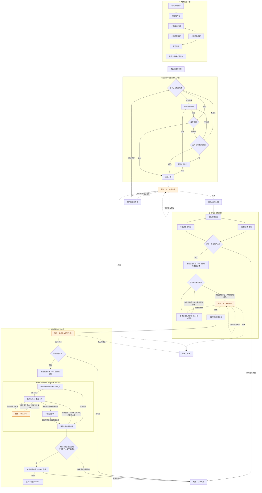

## 1. 项目收官

### 1.1 项目工作流回顾

整体功能模块的实现：

```
原始需求 → 结构化需求 → 故事大纲与设定 → 分镜
  → 模型评审、修订与人工审核 → 角色和场景参考图
  → 首尾帧生成与审核 → 并发生成分镜视频 → FFmpeg 合成
```

整个项目的工作流，如下图所示：



通过这个项目，练习 LangGraph 的使用

例如：

1. 为什么要设计 State？

   后续节点可以直接读取结构化的分镜、角色和场景，知道每个镜头需要哪些素材。

2. 为什么审核时要暂停？

   分镜或画面生成后，用 `interrupt()` 等待人工决定，再恢复同一个 Thread，继续处理已经保存的状态。

3. 为什么生成时并发，合成时还要排序？

   用 `Send` 按分镜派发任务，各镜头可以先后完成。汇总后按分镜的 `order` 排列，保证成片顺序。

4. 为什么要使用子图？

   把一组共同完成某项任务的节点组织成一个子图，主图就可以把它当作一步来编排。

   比如，单个分镜的「提交任务 → 查询 → 暂停等待 → 下载」放在同一个子图里，再用 `Send` 给每个分镜运行一份。这样主图只需要关心何时派发任务、何时汇总结果。

5. 为什么要设计 Schema

   给关键数据约定字段、类型和取值要求，方便节点之间传递和校验数据。

   State 管工作流要记住哪些数据，Schema 规定这些数据长什么样。

### 1.2 视频生成阶段

最后一个视频生成与合成阶段，这里做了一些简化：

1. 视频相关的协议（Schema）
2. 视频生成器
   1. 公共接口
   2. fake实现
   3. ark 真实接口
   4. build（读取环境变量，决定是使用 fake 还是 ark）
3. 按环境变量切换供应商

### 1.3 可以优化的点

1. 实际上每一个关键的节点，都应该暂停，让用户审核

2. 生成分镜视频后，用户审核，用户对某一个分镜不满意，重做部分分镜视频

3. 使用事件流观察漫剧生成进度

4. 丰富成片：用已有的分镜台词加字幕或配音

### 1.4 项目经历

> 见《AI 漫剧生成项目经历》

## 2. 相关页面

- [[01 目录]]：返回项目目录
