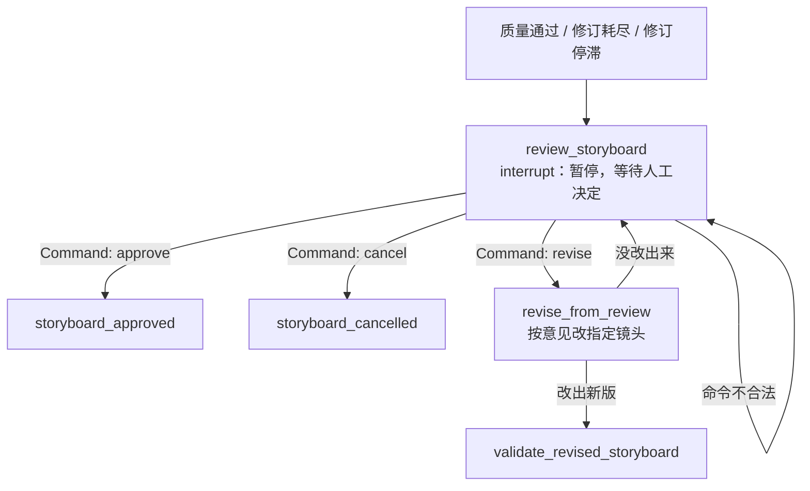
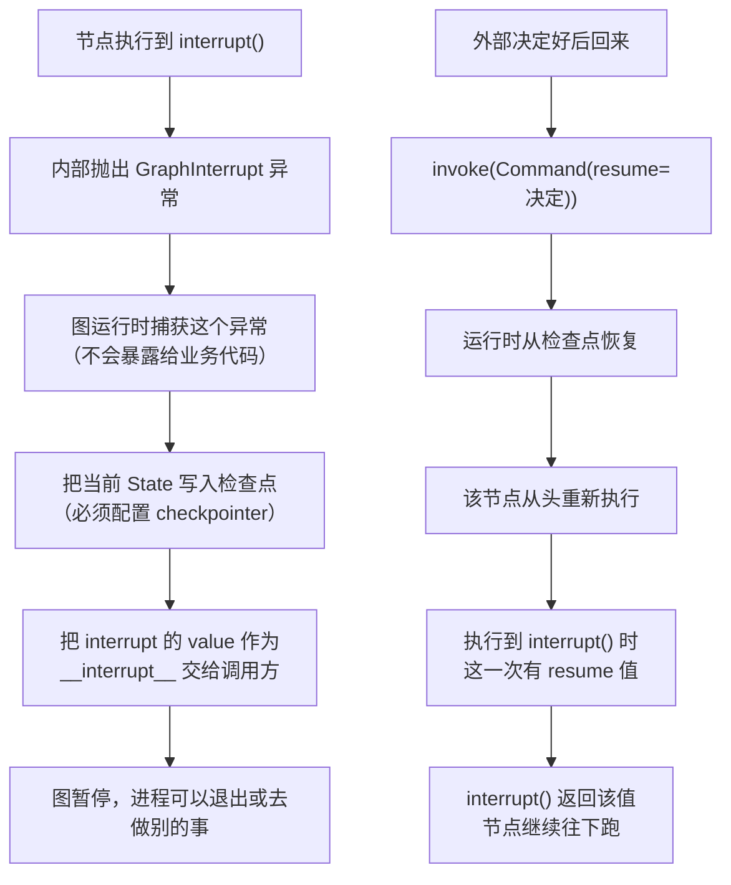
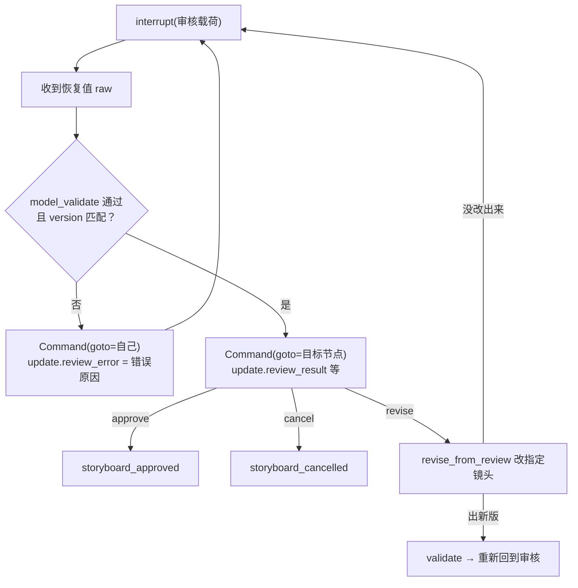

## 1. langgraph中断

在 `review_storyboard` 节点中有这样一段代码：

```python
from langgraph.types import Command, interrupt

def review_storyboard(state: ComicDramaState) -> Command[...]:
    raw = interrupt(
        {
            "title": state["requirement"].title,
            "version": state["revision_count"],
            "review_reason": state["current_stage"],
            "shots": [...],
            "allowed_actions": ["approve", "revise", "cancel"],
            "error": state.get("review_error"),
        }
    )
    ...
```

这个 `interrupt()` 就是 LangGraph 的**中断（interrupt）**机制：图执行到这里会**暂停下来，把控制权交还给外部，等人来决定下一步**。

整个 AI 漫剧工作流里，"人工审核分镜"这一步就是靠它实现的。本文把中断讲清楚：为什么需要它、底层怎么实现、项目中怎么用。

### 1.1 为什么需要中断

先看一个真实的矛盾。

之前的分镜工作流是全自动的：硬规则检查、AI 质量评估、自动修订，一路跑到"质量通过"或者"修订耗尽"为止。**但"这版分镜能不能进入下一环节"，AI 自己说了不算**——分镜是要给人看的作品，最终必须有人来做决定。

而这个"等"字，恰恰是普通函数做不到的。设想一下不用中断的写法：

```python
# ❌ 错误示范：在节点里原地等待用户输入
def review_storyboard(state):
    decision = input("请输入 approve / revise / cancel：")  # 卡死在这里
    ...
```

这段代码有两个致命问题：

1. **`input()` 会阻塞整个进程**。Web 服务里一个用户没回复，其他所有请求都跟着卡住。
2. **进程一重启，等待中的状态全丢**。用户隔了两个小时才回来，图根本不知道自己停在哪。

所以需求本质上是：**图执行到某个节点时，要能够"暂停并离场"，把现场完整保存下来；外部世界（人、前端页面、另一个服务）随时可以回来，带着一个决定让图从断点继续。**

这就是中断要解决的问题，这类模式有个专门的名字——**human-in-the-loop（人机回环）**：AI 负责跑流程，人负责在关键节点做决策。

放到本章的工作流里，中断发生在分镜审核节点，人从三种决定里选一个：

- **approve**：当前分镜通过，进入 `storyboard_approved`。
- **revise**：带着意见退回指定镜头，进入 `revise_from_review` 改出新版，改完重新送审。
- **cancel**：取消这部作品，进入 `storyboard_cancelled`。



注意最后两条回边：**命令不合法会回到自己重新等人输入，revise 没改出新版本也会回到审核**。中断不是"一次性问答"，而是一个可以反复等待的循环入口，这一点在第 3 节看代码时会再次确认。

### 1.2 中断的底层原理：一次"计划内的抛错"

初次接触中断的底层实现时容易意外：**`interrupt()` 内部其实就是抛出了一个异常**。

查看 LangGraph 源码中 `interrupt` 函数的关键部分（`langgraph/types.py`）：

```python
def interrupt(value: Any) -> Any:
    """Interrupt the graph with a resumable exception from within a node."""
    conf = get_config()["configurable"]
    scratchpad = conf[CONFIG_KEY_SCRATCHPAD]
    idx = scratchpad.interrupt_counter()  # 当前节点内第几个 interrupt
    # ① 如果有恢复值，直接返回，不抛异常
    if scratchpad.resume:
        if idx < len(scratchpad.resume):
            return scratchpad.resume[idx]
    # ② 没有恢复值：抛出 GraphInterrupt 异常
    raise GraphInterrupt((Interrupt.from_ns(value=value, ...),))
```

`GraphInterrupt` 是 `GraphBubbleUp` 的子类（定义在 `langgraph/errors.py`），它的类注释写得很直白：

```python
class GraphInterrupt(GraphBubbleUp):
    """Raised when a subgraph is interrupted, suppressed by the root graph.
    Never raised directly, or surfaced to the user."""
```

也就是说，完整的故事是这样的：



"抛出异常"这个实现带来一个**非常重要的推论，也是最容易踩的坑**：

> **恢复时，整个节点会从头重新执行一遍，而不只是从 `interrupt()` 那一行继续。**

这一点在官方文档字符串里写得也很明确：_"The graph resumes from the start of the node, re-executing all logic."_ 上面的源码也能看出来：恢复后节点重新跑，`interrupt()` 发现 scratchpad 里有恢复值，就直接 `return` 而不是 `raise`。

推论的含义是：节点里写在 `interrupt()` **之前**的代码，每次恢复都会再跑一次。所以：

- 这段代码必须是**幂等的**——重复执行不产生错误副作用（比如重复扣费、重复发消息）。
- 这也正是项目中 `review_storyboard` 把"给用户看的载荷"整个塞进 `interrupt(value=...)` 的原因：每次重新执行时，载荷都能根据最新 State 重新构造，保证用户看到的永远是最新版。

> **核心认知：中断 = 抛异常被运行时接住 + 状态落盘 + 节点整体重放。它不是线程挂起，也不是阻塞等待。**

### 1.3 项目中的 review_storyboard 是怎么用中断的

`review_storyboard` 的完整流程可以拆成四步，逐步看（代码做了精简，保留关键逻辑）：

**第 ① 步：抛出载荷，暂停等待**

```python
raw = interrupt(
    {
        "title": state["requirement"].title,
        "version": state["revision_count"],          # 用户看到的是第几版
        "review_reason": state["current_stage"],     # 为什么送审：质量通过 / 修订耗尽 / ...
        "shots": [...],                              # 当前分镜内容摘要
        "allowed_actions": ["approve", "revise", "cancel"],
        "error": state.get("review_error"),          # 上一次输入错在哪
    }
)
```

`interrupt` 的参数 `value` 就是**抛给外部世界的载荷**——相当于给用户看的"审核页面数据"。恢复之后，`raw` 收到的就是用户提交的决定。

**第 ② 步：校验决定，挡下过期命令**

```python
try:
    review = StoryboardReview.model_validate(raw)
    # 【重要】页面审核 v0 时，后台可能已经出现 v1；旧决定不能覆盖新稿。
    if review.version != state["revision_count"]:
        raise ValueError(
            f"审核版本已过期：当前 v{state['revision_count']}，收到 v{review.version}"
        )
except (ValidationError, ValueError) as exc:
    # 可预期的人工输入错误先写入检查点，再回到自身产生新中断。
    return Command(goto="review_storyboard", update={"review_error": str(exc)})
```

这里有一个真实场景：用户打开审核页面时看到的是 v0，磨蹭了十分钟才点"通过"，这期间后台自动修订可能已经产出 v1。**如果不做版本校验，用户对着 v0 做的决定就会错误地盖到 v1 头上**。所以 `StoryboardReview` 里要求提交 `version`，不匹配就直接拒绝。

输入不合法时，节点返回 `Command(goto="review_storyboard", update={"review_error": ...})`——**跳回自己**，配合第 ① 步里的 `"error": state.get("review_error")`，用户会在下一次中断载荷里看到错误原因，重新填写。这就是第 1 节流程图里"命令不合法 → 回到自己"那条回边的实现。

**第 ③ 步：合法决定，一次性完成"更新状态 + 跳转"**

```python
target = {
    "approve": "storyboard_approved",
    "revise": "revise_from_review",
    "cancel": "storyboard_cancelled",
}[review.action]
# update 保存审核事实，goto 决定路径；无需另一套路由函数重复解析。
return Command(
    goto=target,
    update={
        "review_error": None,
        "review_result": review,
        "events": [f"已收到人工审核命令：{review.action}"],
    },
)
```

`Command` 的 `update` 和 `goto` 两个字段分工明确：`update` 负责**写什么进 State**，`goto` 负责**下一步去哪个节点**。一个 return 同时完成状态更新和业务跳转，不需要再写单独的路由函数。

**第 ④ 步：revise 决定进入修订，改完回到审核**

`revise_from_review` 把人的意见包装成质量报告，调用模型改指定镜头，产出新分镜后 `revision_count + 1`，再送回校验和审核。如果改完的内容和旧版一样（没改出来），直接回到 `review_storyboard` 重新等——因为第 2 节说过，节点每次恢复都会整体重放，所以回到中断点时载荷会带上新版本号，用户对着新稿重新决定即可。

四步串起来：



### 1.4 动手验证

下面这段代码不依赖本项目，任何装了 `langgraph` 的环境都能直接运行，完整复现"暂停 → 非法输入重问 → 合法输入通过"的全过程。

```python
from typing import TypedDict
from langgraph.graph import StateGraph, START, END
from langgraph.types import interrupt, Command
from langgraph.checkpoint.memory import InMemorySaver


class State(TypedDict):
    draft: str
    review_error: str | None


def write_draft(state: State):
    return {"draft": "第一版分镜"}


run_count = 0  # 统计 review 节点被执行了几次，用于验证"节点整体重放"


def review(state: State):
    global run_count
    run_count += 1
    print(f"  [review 节点第 {run_count} 次执行]")
    raw = interrupt({"draft": state["draft"], "error": state["review_error"]})
    if raw["action"] not in ("approve", "revise"):
        return Command(goto="review", update={"review_error": "action 必须是 approve 或 revise"})
    return Command(goto="approve", update={"review_error": None})


def approve(state: State):
    print("  [approve 节点执行]")
    return {}


builder = StateGraph(State)
builder.add_node("write_draft", write_draft)
builder.add_node("review", review)
builder.add_node("approve", approve)
builder.add_edge(START, "write_draft")
builder.add_edge("write_draft", "review")
builder.add_edge("approve", END)

# 必须配 checkpointer，否则 interrupt 无法工作
graph = builder.compile(checkpointer=InMemorySaver())
config = {"configurable": {"thread_id": "demo-1"}}

# ① 第一次执行，停在 interrupt
result = graph.invoke({"draft": "", "review_error": None}, config)
print("invoke 返回的 __interrupt__：", result["__interrupt__"][0].value)

# ② 查看暂停位置
state = graph.get_state(config)
print("next =", state.next, " values =", state.values)

# ③ 传非法命令恢复：预期重新中断，error 带回原因
result = graph.invoke(Command(resume={"action": "delete"}), config)
print("error =", result["__interrupt__"][0].value["error"])

# ④ 传合法命令恢复：预期走到 approve 并结束
final = graph.invoke(Command(resume={"action": "approve"}), config)
print("最终 next =", graph.get_state(config).next)
print("review 节点总共执行次数：", run_count)
```

实际运行输出：

```text
—— 第 1 次 invoke，预期停在 interrupt ——
  [review 节点第 1 次执行]
invoke 返回的 __interrupt__： {'draft': '第一版分镜', 'error': None}

—— 查询状态：next 显示停在哪个节点 ——
next = ('review',)  values = {'draft': '第一版分镜', 'review_error': None}

—— 传一个非法 action 恢复，预期重新中断并带回错误 ——
  [review 节点第 2 次执行]
  [review 节点第 3 次执行]
error = action 必须是 approve 或 revise

—— 传合法 action 恢复 ——
  [review 节点第 4 次执行]
  [approve 节点执行]
最终 next = ()
review 节点总共执行次数：4
```

对照输出验证四个关键行为：

1. **暂停**：第 1 次 `invoke` 没有跑完，返回值里带着 `__interrupt__`，载荷正是传给 `interrupt()` 的那个字典；`get_state` 的 `next` 显示图停在 `review` 节点。
2. **整体重放**：总共只"恢复"了两次，但 `review` 节点却执行了 4 次——每次恢复都把节点从头重跑一遍。非法命令那次还叠加了"跳回自己"的一次执行（第 2、3 次）。
3. **重问**：非法输入后，新的 `__interrupt__` 载荷里 `error` 字段带回了错误原因，等待下一次提交。
4. **结束**：合法命令恢复后，`approve` 执行完毕，最终 `next = ()` 表示图已无待执行节点，正常结束。

### 1.5 常见误解与注意点

**中断不是异常处理失败**

`GraphInterrupt` 会被图运行时**捕获并消化**，不会冒泡到业务代码里。不需要（也不能）用 `try/except` 包住 `interrupt()` 来"恢复"——恢复的唯一方式是从图外部带着 `Command(resume=...)` 重新 `invoke`。

**必须配置 checkpointer**

官方文档原话：_"To use an interrupt, you must enable a checkpointer, as the feature relies on persisting the graph state."_ 没有检查器，图暂停后就无处可存现场，恢复也无从谈起。本项目的服务端和测试分别使用了持久化检查点和 `InMemorySaver`。

**恢复会让整个节点重跑**

第 2 节已详述。工程上的结论：`interrupt()` 之前的代码要么保持幂等，要么把不可重复的操作挪到中断之后的分支里，并用 State 字段记住"已经做过了"。

**多个 interrupt 按顺序匹配恢复值**

如果一个节点里有多次 `interrupt()` 调用，恢复时 LangGraph **按 interrupt 在节点中出现的顺序**依次配对 resume 值。一个节点保持单一 interrupt 是最不容易出错的做法——项目中正是如此。

**通过 langgraph 服务 + SDK 远程恢复时，别只看 `next`**

项目中的客户端代码（`frame_review_client.py`）留了一条真实踩坑注释：

```python
# 【重要】重新提问后服务可能返回 next=[]，但 tasks 仍有有效中断。
# 恢复入口依据真正的 review_frames interrupt，不能只看 next。
```

也就是说：节点"跳回自己重新中断"之后，服务返回的状态里 `next` 可能是空的，但 `tasks` 里仍然挂着有效的中断。判断"是否还在等人审核"，要检查 `tasks[*].interrupts`，而不是只看 `next`。

### 1.6 写在最后

回到开头的 `review_storyboard`，现在整段代码可以顺畅地读下来了：

- `interrupt(载荷)`：抛出审核页面数据，**暂停**图执行，等人做决定。
- `Command(goto=..., update=...)`：收到决定后，一次 return 同时完成**状态写入**和**路径跳转**。
- `Command(goto="review_storyboard")`：输入不合法或修订没产出新版时，**跳回自己**，重新中断等人。

整个中断机制的判断链路总结为一句话：

> **把"等人"从阻塞进程中解放出来：用一次计划内的异常暂停图、用检查点保存现场、用 Command(resume=...) 让节点整体重放并带着人的决定继续。**

最后澄清两个边界：

- **中断 ≠ 异常错误**。它借用异常机制实现，但语义是"计划内的暂停"，运行时保证状态不丢、可以精确恢复。
- **中断 ≠ 自由等待**。它要求检查点兜底，并且恢复时节点整体重放——写节点代码时要把这两件事记在心上，否则副作用和版本错位会悄悄出现。

## 2. 相关章节

- [[01 目录]]：返回项目目录
- [[【实战】Command、中断与人在回路]]：LangGraph 通用机制
- [[10 人工审核]]
