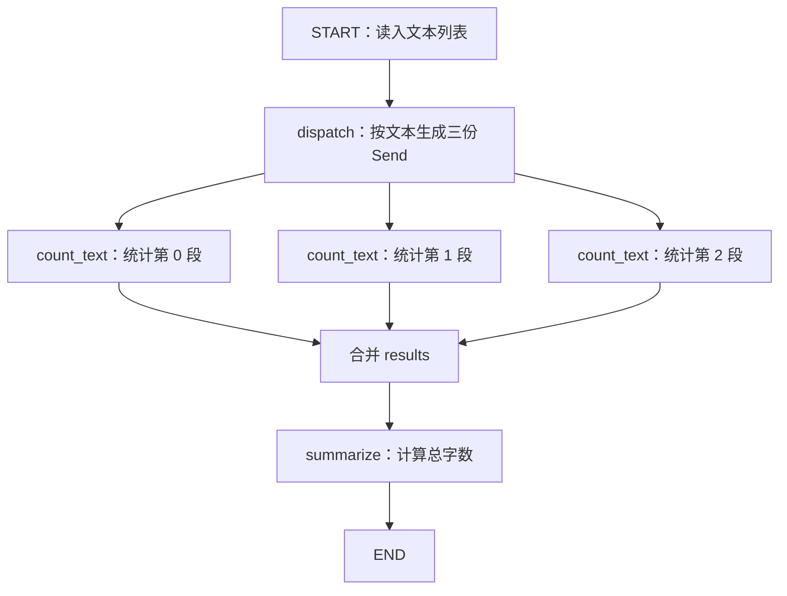

假设要统计一批文本的字数。第一次输入三段，第二次输入十段。每段文本都能独立处理，最后再把各段字数加起来。用 LangGraph 编排时，可以注册一个统计节点，等运行时拿到文本列表，再用 `Send` 为每段文本派发一份任务。

## 1. 一个节点怎样处理多份输入？

普通边 `add_edge("prepare", "count_text")` 可以安排执行 `count_text`，节点会从图的状态读取输入。要让同一个节点分别处理三段文本，可以在条件路由函数里返回三个 `Send` 对象，每个对象携带一段文本。

```python
from langgraph.types import Send

task = Send("count_text", {"index": 0, "text": "你好世界"})
```

- 第一个参数 `"count_text"` 是已经注册的目标节点名称。
- 第二个参数是这次调用收到的数据。这里传了文本和它在原列表中的下标，统计节点可以直接读取这两个字段。

创建 `Send` 对象只是描述一份待执行任务。条件路由函数把它返回给 LangGraph，图才会安排目标节点执行。如果目标节点还需要其他信息，也要在派发时把相应字段放进任务输入。

## 2. 用 Python 跑一次动态派发

在练习目录的 Python 环境中安装 LangGraph。本例使用 Python 3.12 和 LangGraph 1.2.11。

```bash
python -m pip install "langgraph==1.2.11"
```

创建 `send_demo.py`，写入以下代码。字数用 Python 的 `len(text)` 计算，示例中的标点和空格也会计入。

```python
from operator import add
from typing import Annotated, TypedDict

from langgraph.graph import END, START, StateGraph
from langgraph.types import Send


class CountResult(TypedDict):
    index: int
    count: int


class State(TypedDict):
    texts: list[str]
    results: Annotated[list[CountResult], add]
    total: int


class CountTask(TypedDict):
    index: int
    text: str


def dispatch(state: State) -> list[Send] | str:
    if not state["texts"]:
        return "summarize"

    return [
        Send("count_text", {"index": index, "text": text})
        for index, text in enumerate(state["texts"])
    ]


def count_text(task: CountTask) -> dict:
    return {"results": [{"index": task["index"], "count": len(task["text"])}]}


def summarize(state: State) -> dict:
    return {"total": sum(item["count"] for item in state["results"])}


builder = StateGraph(State)
builder.add_node("count_text", count_text)
builder.add_node("summarize", summarize)
builder.add_conditional_edges(START, dispatch, ["count_text", "summarize"])
builder.add_edge("count_text", "summarize")
builder.add_edge("summarize", END)
graph = builder.compile()

result = graph.invoke({"texts": ["你好世界", "LangGraph", "Send"], "results": []})
ordered = sorted(result["results"], key=lambda item: item["index"])
print([item["count"] for item in ordered])
print(result["total"])
```

在文件所在目录运行 `python send_demo.py`，预期输出如下。

```text
[4, 9, 4]
17
```

删掉列表中的 `"Send"` 再运行，会得到 `[4, 9]` 和 `13`。任务数量从三份变成两份，注册节点的代码可以照旧。

## 3. 三份任务怎样变成一个结果？

下图展示一次输入三段文本时的实际执行过程。三个统计框对应同一个 `count_text` 节点的三次调用。



**派发。** `dispatch` 读取整份图状态，通过 `enumerate()` 给每段文本带上下标。每个统计任务收到的输入形如 `{"index": 0, "text": "你好世界"}`。同一批任务可以并行执行。

**合并。** 每次统计只返回自己的结果，例如 `{"results": [{"index": 0, "count": 4}]}`。图状态里的 `Annotated[list[CountResult], add]` 指定了一个 **Reducer（合并规则）**。列表的 `add` 会把各任务返回的列表拼起来。去掉这个合并规则，多份任务在同一执行步写入 `results` 时，LangGraph 会报告并发更新冲突。

**汇总。** 在这个图里，整批统计任务完成并合并结果后，`summarize` 读取汇总后的列表，执行一次求和。并行任务的结果顺序不应当作为业务依据，所以示例保留原下标，展示时按下标排序。

## 4. 空列表应该走哪条路？

如果 `texts` 为空，就没有统计任务可派发。示例在 `dispatch` 里直接返回节点名 `"summarize"`，让汇总节点对空列表求和，得到 `0`。这个分支说明条件路由可以按输入选择返回节点名，或者返回一批带各自输入的 `Send`。

传给 `add_conditional_edges()` 的第三个参数列出可能到达的节点，方便绘图。实际派发几份任务仍取决于 `dispatch` 返回的内容。

## 5. 练习

将 `texts` 改为 `["猫", "猫", "狗"]`。两段内容相同的文本会被派发几次？程序会打印什么？

> 参考答案
>
> 两个 `"猫"` 分别位于下标 `0` 和 `1`，会各自派发一份任务。三个任务分别产生一个长度为 `1` 的结果，因此依次打印 `[1, 1, 1]` 和 `3`。

## 6. 写在最后

当任务数量要等输入到手才知道，而且每份任务需要独立的数据时，可以用 `Send` 把一份列表拆成多次节点调用。派发时保留能识别每份任务的字段，合并时为共享结果字段配置 Reducer，后续节点就能在整批结果上继续处理。

延伸阅读可参见 [LangGraph 官方文档中的 Send](https://docs.langchain.com/oss/python/langgraph/graph-api#send) 和 [Reducers](https://docs.langchain.com/oss/python/langgraph/graph-api#reducers)。

## 7. 相关章节

- [[01 目录]]：返回项目目录
- [[【实战】动态扇出与运行控制]]：LangGraph 通用机制
- [[12 首尾帧生成]]
