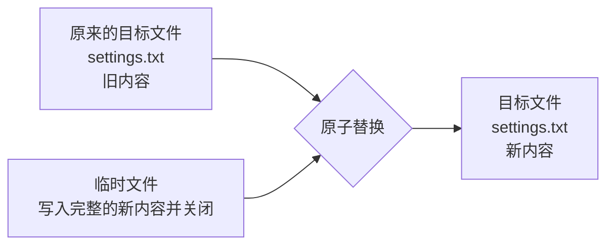

假设有一个 `settings.txt`，里面保存着程序的配置。现在要把旧配置替换成新配置，最直接的写法是：

```python
from pathlib import Path

Path("settings.txt").write_text("新配置", encoding="utf-8")
```

这段代码通常能正常工作。但如果程序在写入过程中崩溃，或者另一个程序恰好在写入过程中读取这个文件，会发生什么？目标文件可能已经被清空，或者只写入了一部分新内容。

为了让目标路径上的内容从旧版本切换到完整的新版本，可以采用**原子写入**的方式。

## 1. 什么是原子写入？

这里的“原子”，可以先理解为：从观察目标文件的角度看，**切换要么还没发生，要么已经完成，不会看到切换到一半的目标文件**。

一种常见做法是：先把完整的新内容写入临时文件，然后用一次原子替换操作，让目标路径指向新文件。



写临时文件本身仍然需要时间，也可能失败。原子性体现在**最后替换目标路径**这个步骤：在替换操作受支持且成功时，按目标路径打开文件的读者看到的是旧文件或新文件，而不是目标文件中只写了一半的新内容。已经打开旧文件的读者可能继续读取旧文件。

如果目标文件原本不存在，成功替换前目标路径可能不存在；替换后才出现新文件。

## 2. 为什么不直接覆盖目标文件？

使用写入模式打开已有文件时，文件可能先被截断，然后才陆续写入新内容：

```text
旧内容完整
   ↓ 打开并截断
目标文件为空
   ↓ 开始写入
目标文件只有部分新内容
   ↓ 写入完成
新内容完整
```

如果中途发生错误，目标文件可能停留在空文件或不完整的状态。另一个读取者也可能正好读到这些中间状态。

采用临时文件的方式，则先在旁边准备新内容。只要还没有执行替换，原来的目标文件就不需要被这次写入覆盖。

## 3. 用 Python 实现一个例子

创建一个 `atomic_demo.py` 文件，写入以下代码：

```python
import os
from pathlib import Path
from tempfile import NamedTemporaryFile


def atomic_write(target: Path, content: bytes) -> None:
    """先写临时文件，再替换目标文件。目标目录必须已经存在。"""
    temporary = None

    try:
        # 在目标目录创建临时文件，退出 with 时关闭文件。
        with NamedTemporaryFile(dir=target.parent, delete=False) as file:
            temporary = Path(file.name)
            file.write(content)
            file.flush()
            os.fsync(file.fileno())

        # 文件已经关闭，再将临时文件替换到目标路径。
        os.replace(temporary, target)
    finally:
        # 普通异常发生时，尽量清理尚未被替换的临时文件。
        if temporary is not None:
            temporary.unlink(missing_ok=True)


target = Path("settings.txt")
target.write_text("旧配置", encoding="utf-8")

atomic_write(target, "新配置".encode("utf-8"))
print(target.read_text(encoding="utf-8"))
```

在该文件所在目录运行：

```bash
python atomic_demo.py
```

预期输出：

```text
新配置
```

运行后，当前目录中会有 `settings.txt`，内容是 `新配置`。示例每次运行都会先把该文件写成 `旧配置`，因此请在练习目录执行。

这里先将文字编码为 `bytes`，是因为 `NamedTemporaryFile` 默认以二进制模式打开。保存图片等二进制内容时，也可以直接传入字节数据。

## 4. 每一步分别做了什么？

### 4.1 创建临时文件

```python
with NamedTemporaryFile(dir=target.parent, delete=False) as file:
```

`dir=target.parent` 表示在目标文件所在目录创建临时文件。这样做有助于让临时文件与目标文件位于同一文件系统；跨文件系统的替换可能失败。

`delete=False` 表示关闭文件后不自动删除，因为关闭后还需要通过文件名调用 `os.replace()`。`with` 结束后再替换，也避免在某些平台上因为文件仍然打开而无法操作。

### 4.2 写入并同步文件内容

```python
file.write(content)
file.flush()
os.fsync(file.fileno())
```

`write()` 写入数据；`flush()` 将 Python 文件对象缓冲区中的数据交给操作系统；`os.fsync()` 请求操作系统将该文件的数据同步到存储设备。对缓冲文件调用 `fsync()` 前，先调用 `flush()`。

这些步骤与后面的替换解决不同问题：写入和同步是准备新文件，`os.replace()` 是把目标路径切换到新文件。

### 4.3 替换目标文件

```python
os.replace(temporary, target)
```

`os.replace()` 使用临时文件替换目标路径；如果目标是已有文件且操作得到允许，它会被替换。Python 官方文档说明，在 POSIX 上，成功的替换是原子操作；实际行为和限制还取决于操作系统、文件系统以及替换是否成功。

例如，权限不足、目标被某些程序占用，或者源和目标跨文件系统，都可能导致操作失败并抛出异常。因此不能假设所有平台和文件系统都有完全相同的行为。

### 4.4 清理临时文件

```python
finally:
    if temporary is not None:
        temporary.unlink(missing_ok=True)
```

如果发生普通异常，`finally` 会尝试删除临时文件。替换成功后，原临时路径已不存在，`missing_ok=True` 让这种情况不会报错。

如果进程被强制终止或机器断电，`finally` 可能没有机会执行，临时文件仍可能留在磁盘上。清理操作本身也可能因为权限等问题失败。

## 5. 原子性不等于所有事情都安全

原子替换解决的是**单个目标路径在切换时可见的中间状态**，还有几个边界需要区分：

- **不等于永久保存成功**：原子切换与断电后的持久性是两个问题。示例对新文件调用了 `fsync()`，但没有同步父目录；要满足严格的断电恢复要求，还需考虑目录同步、操作系统、文件系统和存储设备的具体保证。
- **不等于多个文件一起更新**：分别替换两个文件时，程序可能在两次替换之间中断，留下一个新文件和一个旧文件。需要一起提交时，应考虑事务等其他机制。
- **不等于并发写入不会冲突**：两个写入者都可能成功替换同一个目标，后一次替换会覆盖前一次。需要协调时，应另外设计锁或版本检查。
- **不保证保留原文件属性**：替换后目标路径对应新文件；原文件的权限等元数据不一定自动保留，需要时应明确处理。

## 6. 练习

假设目标文件原来包含 `旧内容`。程序先把 `新内容` 写入临时文件，但在调用 `os.replace()` 之前发生异常。使用上面的实现时，目标文件会变成什么？临时文件又会怎样？

> 参考答案
>
> 目标文件仍然是 `旧内容`，因为替换还没有发生。对于普通异常，`finally` 会尝试删除临时文件。若进程被强制终止，清理代码可能无法执行，临时文件可能残留。

## 7. 写在最后

原子写入的一种常见实现是：**先在目标目录写完整的临时文件，再用原子替换操作切换目标路径**。它能避免读者通过目标路径看到正在写入的新文件，但持久性、多个文件的一致性和并发写入协调仍需另行考虑。

可以参考 Python 官方文档中的 [`os.replace()`](https://docs.python.org/3/library/os.html#os.replace)、[`os.fsync()`](https://docs.python.org/3/library/os.html#os.fsync) 和 [`tempfile`](https://docs.python.org/3/library/tempfile.html)。

## 8. 相关章节

- [[01 目录]]：返回项目目录
- [[11 角色与场景参考图]]
