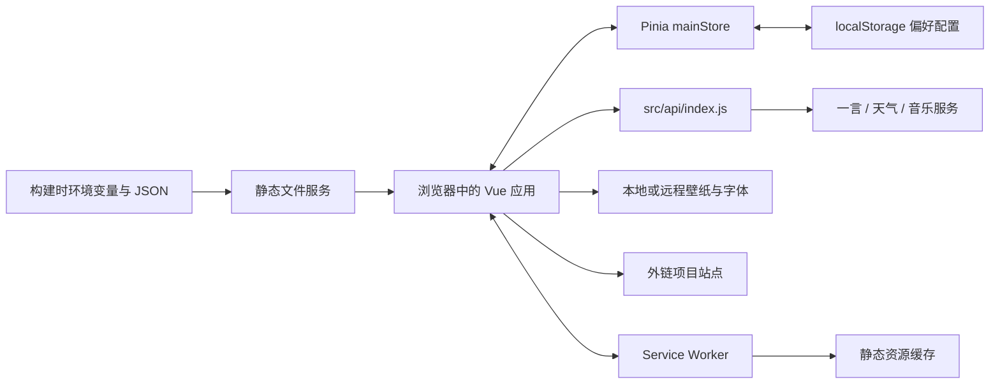

## 1. nest：现有架构与运行链路

> 文档内容遵循 [md-output 规范](C:/Users/admin/.codex/skills/md-output/SKILL.md)；标题层级与编号以知识库 AGENTS.md 及其格式化脚本为准。

[TOC]

---

### 1.1 修订记录

| 编号 | 版本 |  修订人  | 修订内容                           | 日期       |
| :--: | :--- | :------: | :--------------------------------- | :--------- |
| 001  | 1.0  | jie.chen | 整理组件、状态、数据与主要运行链路 | 2026-11-03 |

---

### 1.2 架构结论

当前是 **Vue 3 + JavaScript + Vite 的浏览器端单页应用**。发布产物为静态文件，页面直接调用第三方接口。仓库没有业务后端、数据库、用户认证、服务端渲染或 Vue Router。

`views/` 表示较大的页面区域，不代表独立路由。设置、扩展面板和移动端视图靠 Pinia 中的布尔状态以及 `v-if`、`v-show` 切换。



项目站点是外部跳转目的地，本仓库未加载这些站点的业务模块。产品定位见 [[【nest】00-项目定位与阅读地图]]。

---

### 1.3 技术栈与工程结构

下表版本是 `package.json` 的声明范围，不等同于本机已安装版本；锁定解析结果在 `pnpm-lock.yaml` 中。

| 层次       | 技术                                 | 实际职责                         |
| :--------- | :----------------------------------- | :------------------------------- |
| 视图       | Vue `^3.4.24`                        | 单文件组件和 Composition API     |
| 开发与构建 | Vite `^4.5.3`                        | 开发服务、资源处理和生产打包     |
| 状态       | Pinia `^2.1.7`                       | UI 开关、播放器状态、窗口宽度    |
| 偏好持久化 | pinia-plugin-persistedstate `^3.2.1` | 保存选定字段到 localStorage      |
| UI         | Element Plus `^2.7.1`                | 栅格、消息、开关、折叠面板和滑块 |
| 链接分页   | Swiper `^11.1.1`                     | 卡片分页、鼠标滚轮切页           |
| 音乐       | @worstone/vue-aplayer、aplayer       | 音频与歌词播放器                 |
| 样式与图标 | SCSS、IconPark、@vicons/fa           | 全局样式、响应式与图标映射       |
| 请求       | 原生 fetch、fetch-jsonp              | HTTP 请求及特殊音乐地址解析      |
| 其他       | dayjs、lodash-es                     | 日期处理、自定义鼠标中的数据比较 |

`axios` 在依赖中声明，但 `src/api/index.js` 的引入被注释，当前请求实现是 `fetch`。`auto-imports.d.ts`、`components.d.ts` 是自动导入插件的声明文件，不能据此判断项目已使用 TypeScript；业务源码为 `.js` 和不带 `lang="ts"` 的 Vue 脚本。

```text
home/
├── index.html                 HTML 壳、SEO 与图标占位符
├── .env.example               构建配置模板
├── vite.config.js             Vue、自动导入、PWA、压缩、SCSS 配置
├── src/
│   ├── main.js                应用与 Pinia 初始化
│   ├── App.vue                主界面编排、窗口事件与全局交互
│   ├── views/                 Main 左右区、Func、Box、MoreSet
│   ├── components/            具体功能组件
│   ├── store/index.js         唯一的 mainStore
│   ├── api/index.js           一言、天气、音乐请求
│   ├── assets/                网站及社交链接 JSON
│   ├── utils/                 日期、防抖、自定义鼠标
│   └── style/                 公共样式与响应式规则
├── public/                    壁纸、图标、字体
├── Dockerfile                 构建与静态文件服务镜像
├── docker-compose.yml         容器端口映射
└── .github/workflows/build.yml 构建并上传 dist 产物
```

Vue API 和 Element Plus 组件/消息通过 Vite 插件自动导入，读源码时会看到没有显式 `import` 的 `ref`、`computed`、`ElMessage`。路径别名 `@` 指向 `src`。公共 SCSS 由 `additionalData` 注入，基础样式由 `main.js` 引入。

---

### 1.4 页面组件树

```text
App
├── Loading
├── Background
└── main（imgLoadStatus 为 true 后挂载）
    ├── MainLeft
    │   ├── Message
    │   └── SocialLinks
    ├── MainRight（与 Box 切换显示）
    │   ├── Func
    │   │   ├── Hitokoto
    │   │   ├── Music → Player（配置歌单 ID 时挂载）
    │   │   └── 时间显示 + Weather
    │   └── Links
    ├── Box → TimeCapsule + MoreContent
    ├── MoreSet → Set
    ├── 移动端菜单按钮
    └── Footer
```

`MoreContent` 当前只是“您可在此编写任意内容”的占位。`Set` 是访客个性化设置，不提供项目增删改或内容管理功能。

大部分面板使用 `v-show`：隐藏不会卸载组件，因此隐藏的计时器和播放器初始化仍可能继续运行。不能把“没显示”理解为“没加载”。

---

### 1.5 启动与项目访问链路

#### 1.5.1 从 HTML 到主界面

1. `index.html` 加载 `/src/main.js`。
2. `main.js` 创建 Vue 应用，安装 Pinia 与持久化插件，挂载到 `#app`。
3. `App.vue` 先渲染加载层和背景，按用户保存的壁纸类型选图。
4. `Background.vue` 收到图片 `load` 事件后等待随机 300～600 毫秒，把 `imgLoadStatus` 设为 `true`。
5. 主界面挂载，时间、天气、一言和可选播放器开始初始化。
6. 背景动画结束后发出 `loadComplete`，`App.vue` 调用问候语与纪念日逻辑。

主内容依赖壁纸加载成功。远程图片失败时会尝试回退本地图片；本地图片也失败的情况下，未看到独立于壁纸的主界面放行路径。相关风险见 [[【nest】03-改造边界与演进方向]]。

#### 1.5.2 从项目数据到外部站点

```mermaid
sequenceDiagram
  participant JSON as siteLinks.json
  participant Links as Links.vue
  participant User as 访问者
  participant Target as 外部项目
  JSON->>Links: 构建时导入静态数组
  Links->>Links: 每 6 个分组，映射图标
  Links-->>User: Swiper 卡片列表
  User->>Links: 点击卡片
  Links->>Target: window.open(link, _blank)
```

例外：名称恰好为“音乐”且 `musicClick` 开启时，调用全局 `$openList` 打开本站音乐面板，不执行普通跳转。这使项目的显示名称承担了行为判断职责。

#### 1.5.3 响应式切换

`App.vue` 监听窗口宽度并写入 store。宽度小于 721 时关闭扩展与设置面板；主要 CSS 以 720/721 为桌面与移动端分界。移动端菜单在左右区域之间切换，点击移动端标识可切换功能区。源码还为小于 391px 的屏幕保留固定宽度处理，不能据此承诺所有窄屏均无横向滚动。

---

### 1.6 状态、数据与持久化

| 数据种类             | 位置                           | 生命周期                     |
| :------------------- | :----------------------------- | :--------------------------- |
| 品牌、域名、接口配置 | `.env` 中 `VITE_*`             | 构建时注入，变更后需重新构建 |
| 项目与社交链接       | `src/assets/*.json`            | 构建时打入前端产物           |
| UI 开关与播放信息    | `mainStore`                    | 当前页面运行期间             |
| 用户偏好             | localStorage 的 `data` 键      | 同源浏览器持久化             |
| 天气、一言、歌单     | 各组件的 ref/reactive          | 组件请求后持有               |
| 静态文件缓存         | Service Worker / Cache Storage | 按 PWA 缓存策略保留          |

持久化字段共 9 个：`coverType`、`musicVolume`、`siteStartShow`、`musicClick`、`playerLrcShow`、`footerBlur`、`playerAutoplay`、`playerLoop`、`playerOrder`。页面开关、当前曲目、加载状态没有持久化。

组件既调用 store actions，也直接赋值 store 字段，尚未建立严格的状态变更边界。音乐还通过组件 ref、`defineExpose` 和 `window.$openList` 跨组件通信。

---

### 1.7 外部请求与异常行为

| 能力 | 入口与链路                                                      | 当前异常处理                                    |
| :--- | :-------------------------------------------------------------- | :---------------------------------------------- |
| 一言 | `getHitokoto` → `v1.hitokoto.cn`                                | catch 后显示默认文本并提示                      |
| 天气 | 有 Key 时 `getAdcode → getWeather`；无 Key 时 `getOtherWeather` | 出错提示；有 Key 分支失败后不会自动切换备用服务 |
| 音乐 | `getPlayerList` → 配置的 Meting 兼容接口 → 可选 JSONP           | 映射字段后交给播放器；异步失败捕获存在缺口      |
| 壁纸 | `Background.vue` 直接设置 img 地址                              | 首次 error 时切换本地图片                       |
| 字体 | `index.html` 的外部 CSS，加本地字体                             | 不经过 `src/api/index.js`                       |

请求层直接解析 JSON，未统一检查 HTTP 状态、业务响应结构、超时或取消。天气未就绪时模板直接显示“天气数据获取失败”，加载和失败未区分。音乐返回值直接访问 `data[0].url`，空歌单会触发异常。

播放器通过事件把曲名、歌手、播放状态、歌词写回 store，Footer 读取歌词显示。当前 Footer 用 `v-html` 输出歌词，这是第三方文本进入 DOM 的位置。

---

### 1.8 参考资料

- 架构入口：`src/main.js`、`src/App.vue`、`src/store/index.js`。
- 功能链路：`src/components/Links.vue`、`Background.vue`、`Weather.vue`、`Music.vue`、`Player.vue`、`Footer.vue`。
- 配置与发布详见 [[【nest】02-配置构建与部署]]。
