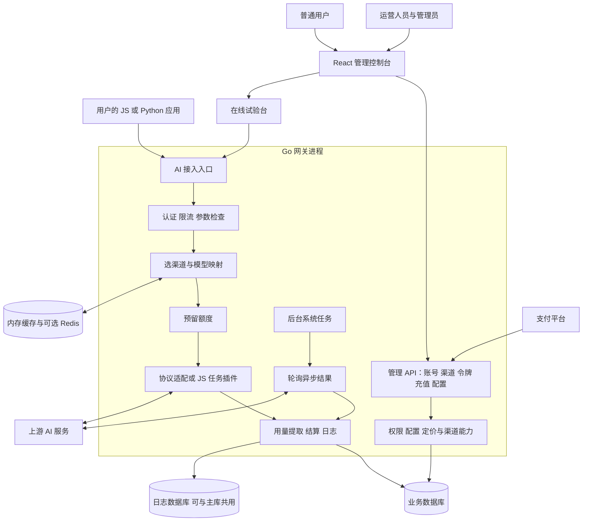

## 1. 【new-api】00-总览与阅读地图

> 文档遵循 md-output 规范；标题层级与编号以知识库规则和格式化脚本为准。离线资料的使用方法见 [[【new-api】14-离线参考入口与完整性审计]]。
> 源码快照：`9b473a3fe4fed8d18980fd8d3c6a8908847a5f25`。仅做静态代码导读，未执行线上业务验证。

> **跨电脑参考补充：** [[【new-api】14-离线参考入口与完整性审计]]、[[【new-api】15-数据库关系约束与建模说明]]、[[【new-api】17-接口契约与协议边界]]、[[【new-api】18-后端业务规则与失败处理]]、[[【new-api】19-前端页面与视觉规范]]、[[【new-api】20-ModelDock实现交接与验收清单]]、[[【new-api】21-离线证据与附件索引]]。ModelDock 已确定另建 Python 后端；参考事实与新设计建议分开记录。

[TOC]

---

### 1.1 修订记录

| 编号 | 版本 |  修订人  | 修订内容                           | 日期       |
| :--: | :--- | :------: | :--------------------------------- | :--------- |
| 001  | 1.0  | jie.chen | 基于源码创建架构与产品链路导读     | 2026-11-03 |
| 002  | 1.1  | jie.chen | 补充离线入口并移除本机源码链接依赖 | 2026-11-03 |

---

### 1.2 先用一分钟理解项目

**new-api 是一个把多家 AI 服务接成统一入口，并提供用户、额度、计费和运营管理的网关平台。** 项目身份为 new-api，组织为 QuantumNous。

假设你用 Python 写了一个问答应用。原来你要分别处理不同厂商的地址、密钥、请求格式、费用和故障。接入这个项目后，你的应用主要面对网关地址与网关发给你的 API Key。网关再选择可用供应渠道，转换协议，调用上游 AI，并记录用量、结算额度。

它负责“把 AI 能力稳定地交付给用户并记清账”。模型推理通常发生在上游厂商或你连接的自建模型服务，网关本身不负责训练模型。仓库存在外部模型部署管理接口，但这不意味着网关进程内运行 GPU 推理。

---

### 1.3 一张产品与架构总图

图中的方框多数是同一个 Go 程序内的职责，不是分别部署的微服务。“管理面”和“调用面”是阅读代码时的划分，仓库并未因此拆成两套后端。

---

### 1.4 用一个故事串起整个产品

1. 管理员先完成初始化，配置一条能访问上游的渠道，填入支持的模型、可用分组和价格。
2. 用户注册登录，充值钱包或购买订阅，取得调用资格。
3. 用户在控制台创建 API Key，指定预算、可用模型、有效期等限制。
4. 用户的 Python 应用向网关发送模型请求。网关确认用户、令牌和分组，并选择满足条件的渠道。
5. 网关计算预计用量并预留额度，再用渠道的上游凭据发起 AI 请求。
6. 普通文本直接返回；流式文本逐块返回；视频等任务可能先返回任务编号，后台继续查询。
7. 网关用最终用量结算，与预扣做差额调整，并写消费日志。
8. 用户查看余额与记录；管理员查看渠道故障、调用成功率和运营情况，再调整供应与价格。

这条故事同时有三条账：**用户在网关的额度、网关记录的消费、运营方在上游供应商的费用**。前两者由本项目管理，第三者并不是自动由网关钱包替你支付。

---

### 1.5 按什么顺序读

| 阅读阶段         | 笔记                                                                       | 读完能回答的问题                                    |
| :--------------- | :------------------------------------------------------------------------- | :-------------------------------------------------- |
| 先懂产品         | [[【new-api】01-产品全景与用户旅程]]                                       | 谁用它、管理员要配置什么、用户如何完成一次消费      |
| 再懂架构         | [[【new-api】02-系统架构与Go阅读入门]]                                     | Go 目录各做什么，如何类比 Express、FastAPI          |
| 身份基础         | [[【new-api】03-账号登录与三种凭据]]                                       | 登录凭据、个人访问令牌、AI API Key 有什么区别       |
| 供应基础         | [[【new-api】04-渠道模型分组与故障重试]]                                   | 请求为什么进入这条渠道，故障怎样切换                |
| 核心主线         | [[【new-api】05-一次AI调用的完整生命周期]]                                 | 一次文本请求从进入到扣费，实际经过哪些函数          |
| 横向展开         | [[【new-api】06-多模态与协议分支]]                                         | 图片、音频、向量、Responses、WebSocket 哪些地方不同 |
| 看清账务         | [[【new-api】07-计费预扣结算与退款]]、[[【new-api】08-计费数学与完整算例]] | 预扣与结算如何衔接，数字怎样算出来                  |
| 看清收入与权益   | [[【new-api】09-充值订阅与运营闭环]]                                       | 支付回调、钱包、订阅和运营活动怎样闭环              |
| 看清长任务       | [[【new-api】10-异步任务与JavaScript插件]]                                 | 任务为何能跨请求存活，JS 插件负责什么               |
| 从熟悉的前端出发 | [[【new-api】11-React前端到Go后端]]                                        | React 页面如何触发后端业务                          |
| 看清运行环境     | [[【new-api】12-数据存储启动部署与运维]]                                   | 数据放哪里，程序启动后还在做什么                    |
| 查漏与实践       | [[【new-api】13-全链路索引与源码阅读练习]]                                 | 某个功能对应哪条链路，从哪段代码开始看              |

第一次只读 00、01、02、05，就可以讲清整体；第二次再补计费、任务与管理链路。不必先掌握全部 Go 语法。

---

### 1.6 五组最容易混淆的词

| 名词         | 本项目中的含义                                          | 别混淆成                          |
| :----------- | :------------------------------------------------------ | :-------------------------------- |
| model 模型   | 对外请求的模型标识、模型元数据，或 Go 的数据库 model 包 | `model/` 目录不是 AI 权重目录     |
| channel 渠道 | 一份上游连接与供应配置                                  | Go 语言的 `chan` 并发通信类型     |
| token 令牌   | 用户创建的 API Key 及其预算对象                         | 文本分词得到的 token 数量         |
| group 分组   | 可用渠道集合、可用范围与定价规则的相关维度              | 管理员角色或独立租户的充分实现    |
| quota 额度   | 内部账务计量单位                                        | 原始人民币、美元或模型 token 数量 |

---

### 1.7 这套笔记的证据与边界

- 依据本机源码快照 `9b473a3fe4fed8d18980fd8d3c6a8908847a5f25`，整理日期 2026-11-03。结论针对该快照，不宣称是互联网最新发布版。
- 核心请求、账务、任务和启动链路读取了实现；外围管理功能按路由与模块归类。每篇末尾提供源码文件与定位行，便于继续核对。
- “全链路”指产品功能族、跨层执行路径与关键失败分支；不逐行展开每个厂商适配器，也不承诺所有厂商支持所有协议。
- 未启动应用、未调用上游或支付平台；这是代码导读，不是线上行为验证、兼容性认证或安全审计。
- 图是为理解而抽象的执行关系，具体先后和例外在各链路正文中说明。
- 笔记包含可维护元数据、专题内双链、与既有知识页的语义链接。原本机源码链接已替换为随知识库保存的离线源码附件；迁移时须同时携带专题笔记与附件目录。

---

### 1.8 参考资料

- [[new-api-ref--main.go.txt]]:49，定位 `func main()`。
- [[new-api-ref--router--main.go.txt]]:15，定位 `func SetRouter`。
- [[new-api-ref--router--api-router.go.txt]]:17，定位 `func SetApiRouter`。
- [[new-api-ref--router--relay-router.go.txt]]:15，定位 `func SetRelayRouter`。
