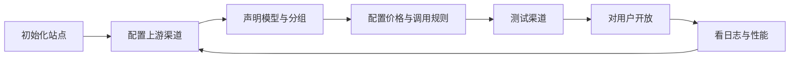

## 1. 【new-api】01-产品全景与用户旅程

> 文档遵循 md-output 规范；标题层级与编号以知识库规则和格式化脚本为准。离线资料的使用方法见 [[【new-api】14-离线参考入口与完整性审计]]。
> 源码快照：`9b473a3fe4fed8d18980fd8d3c6a8908847a5f25`。仅做静态代码导读，未执行线上业务验证。

专题入口：[[【new-api】00-总览与阅读地图]]

[TOC]

---

### 1.1 修订记录

| 编号 | 版本 |  修订人  | 修订内容                           | 日期       |
| :--: | :--- | :------: | :--------------------------------- | :--------- |
| 001  | 1.0  | jie.chen | 基于源码创建架构与产品链路导读     | 2026-11-03 |
| 002  | 1.1  | jie.chen | 补充离线入口并移除本机源码链接依赖 | 2026-11-03 |

---

### 1.2 它解决谁的问题

| 角色                 | 主要诉求                                 | 产品入口                                         |
| :------------------- | :--------------------------------------- | :----------------------------------------------- |
| 普通用户或应用开发者 | 一个地址调用多家模型，管理预算，查看用量 | 模型价格、API Key、钱包、试验台、日志            |
| 管理员               | 接入供应渠道，管理用户与运营记录         | 渠道、模型元数据、用户、兑换码、统计             |
| 站点拥有者或 Root    | 管理全局规则与敏感系统配置               | 系统设置、定价、插件、自定义登录提供方、系统任务 |
| AI 上游供应商        | 接收网关发来的模型请求                   | HTTP、SSE、WebSocket 或任务查询接口              |
| 支付平台             | 处理付款并发送支付结果                   | 支付下单与回调接口                               |

角色只是第一层。渠道等管理能力还结合 `service/authz/` 的授权规则；页面能否显示与后端是否允许操作是两件事。

---

### 1.3 管理员把供应能力变成产品

渠道是实际供应线路；模型元数据负责名称、描述、厂商等展示信息；定价规则决定怎么收费。三者相关，却不是同一个配置。创建模型介绍，并不会自动生成可用渠道；填好渠道密钥，也不代表该模型已具备完整定价。

管理员还会设置支付方式、注册策略、公告、用户协议、模型可见性与功能模块。代码中有对应配置能力，但你的站点是否启用，取决于实际配置。

详细供应链见 [[【new-api】04-渠道模型分组与故障重试]]；系统运行见 [[【new-api】12-数据存储启动部署与运维]]。

---

### 1.4 普通用户从注册走到第一次调用

| 阶段         | 用户动作                 | 后端发生什么                             | 常见卡点                     |
| :----------- | :----------------------- | :--------------------------------------- | :--------------------------- |
| 了解服务     | 看首页、价格、可用模型   | 读取公开状态和定价数据                   | 页面访问策略或模型未配置     |
| 建立账号     | 注册或第三方登录         | 建立 User，完成验证并创建登录会话        | 注册关闭、验证失败           |
| 取得预算     | 充值、兑换或买订阅       | 增加钱包额度或创建订阅权益               | 回调未完成、订单状态不对     |
| 建立调用凭据 | 创建 API Key             | 写 Token，保存模型、IP、额度与有效期限制 | 预算误设、分组不匹配         |
| 接入应用     | 设置网关 Base URL 和 Key | 请求走 AI relay 路由                     | 使用了上游 Key 或控制台凭据  |
| 获得结果     | 普通响应、流或任务查询   | 适配上游并返回结果                       | 上游错误、限流、任务尚未结束 |
| 对账         | 看消费日志和余额         | 查询日志、聚合统计、任务状态             | 把预扣误认为最终费用         |

登录详见 [[【new-api】03-账号登录与三种凭据]]，收付款详见 [[【new-api】09-充值订阅与运营闭环]]，主请求详见 [[【new-api】05-一次AI调用的完整生命周期]]。

---

### 1.5 功能地图

| 功能族       | 能做什么                                                 | 对应代码                                                   |
| :----------- | :------------------------------------------------------- | :--------------------------------------------------------- |
| 门户         | 首页、公告、价格、排行榜、关于、协议                     | `web/src/features/home`、`pricing`、`rankings`、`legal`    |
| 身份与安全   | 登录、注册、验证、密码恢复、MFA、Passkey、会话、账号绑定 | `controller/user.go`、认证相关控制器                       |
| AI 调用      | 文本、图片、音频、向量、重排、多种兼容协议               | `router/relay-router.go`、`relay/`                         |
| 在线体验     | 试验台；跳转或对接配置的聊天工具                         | `features/playground`、`features/chat`                     |
| 个人资产     | API Key、钱包、订阅、邀请码、签到                        | `features/keys`、`wallet`、`subscriptions`                 |
| 供应管理     | 渠道、批量管理、上游模型同步、分组、模型映射、测试       | `router/channel-router.go`、`controller/channel*.go`       |
| 模型运营     | 厂商信息、模型介绍、价格、定价预览                       | `/api/vendors`、`/api/models`、`/api/option/model_pricing` |
| 任务扩展     | 上传、启用、切换任务插件；长任务状态与产物               | `pkg/jsplugin`、`controller/task_plugin*.go`               |
| 经营分析     | 消费与错误记录、充值记录、用户统计、性能指标             | `/api/log`、`/api/data`、`/api/perf-metrics`               |
| 系统管理     | 授权、配置、系统任务、实例状态、日志清理                 | `service/authz`、`service/system_task.go`                  |
| 外部模型部署 | 通过外部服务创建、查询、扩展和删除部署                   | `/api/deployments`                                         |
| 桌面形态     | 启动本地 Go 服务并用桌面窗口打开网页                     | `electron/main.js`                                         |

后端存在某个接口，不等于当前前端有同名入口。尤其部署等外围能力，以实际路由、页面及配置为准。完整功能族索引见 [[【new-api】13-全链路索引与源码阅读练习]]。

---

### 1.6 两条不同的反馈闭环

**用户闭环：** 选模型 → 充值或订阅 → 创建 Key → 调用 → 看结果与账单 → 补充预算。

**运营闭环：** 接入渠道 → 定价 → 获得流量 → 观察质量与消耗 → 调整渠道优先级、价格和权限。

定价页面是“卖什么、怎么计价”的表达；消费日志是“这次实际算了多少”的记录；上游账单是供应商的结算。对比这三者，才可能理解经营成本，不能把 `Channel.UsedQuota` 直接当作已核实的采购成本。

---

### 1.7 产品边界

统一 API 的目标是减少接入差异，而非保证所有厂商功能完全等价。仓库里有明确返回未实现的文件管理、微调、图片变体等兼容路由。也不能仅凭项目含有对话试验台，就把它当成一个完整的知识库、工作流或 RAG 产品。

---

### 1.8 参考资料

- [[new-api-ref--router--api-router.go.txt]]:17，定位 `func SetApiRouter`。
- [[new-api-ref--router--channel-router.go.txt]]:40，定位 `func registerChannelRoutes`。
- [[new-api-ref--router--authz-router.go.txt]]:13，定位 `func registerAuthzRoutes`。
- [[new-api-ref--controller--playground.go.txt]]:17，定位 `func Playground`。
- [[new-api-ref--electron--main.js.txt]]:2，定位 `const { spawn }`。
