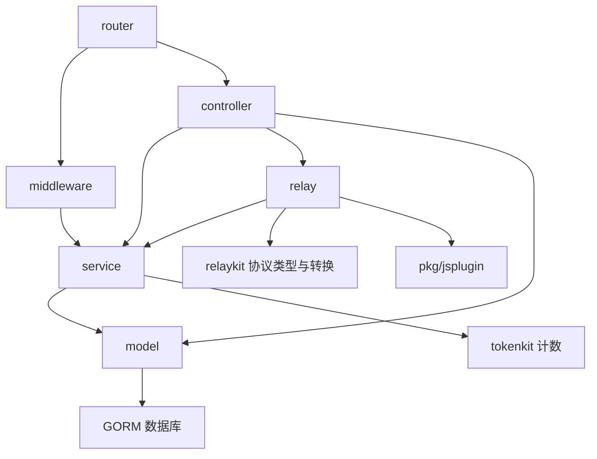

## 1. 【new-api】02-系统架构与Go阅读入门

> 文档遵循 md-output 规范；标题层级与编号以知识库规则和格式化脚本为准。离线资料的使用方法见 [[【new-api】14-离线参考入口与完整性审计]]。
> 源码快照：`9b473a3fe4fed8d18980fd8d3c6a8908847a5f25`。仅做静态代码导读，未执行线上业务验证。

专题入口：[[【new-api】00-总览与阅读地图]]

[TOC]

---

### 1.1 修订记录

| 编号 | 版本 |  修订人  | 修订内容                           | 日期       |
| :--: | :--- | :------: | :--------------------------------- | :--------- |
| 001  | 1.0  | jie.chen | 基于源码创建架构与产品链路导读     | 2026-11-03 |
| 002  | 1.1  | jie.chen | 补充离线入口并移除本机源码链接依赖 | 2026-11-03 |

---

### 1.2 架构形态：模块化单体

主要业务运行在一个 Go 网关进程中，React 是它的管理界面。`relaykit/`、`tokenkit/` 虽然各有 `go.mod`，但属于可独立构建的库模块，不是独立网络服务。JS 插件也运行在宿主提供的引擎里。

这种组织方式让请求、鉴权、选渠道与结算可以直接调用函数协作。代价是单进程承担多类职责，模块边界、并发状态和数据库一致性尤其重要。

---

### 1.3 目录怎么对应你熟悉的后端

| 目录                  | 职责                                   | JS / Python 类比                      | 阅读重点                       |
| :-------------------- | :------------------------------------- | :------------------------------------ | :----------------------------- |
| `main.go`             | 初始化资源、注册路由、启动后台工作     | Express 的启动文件 / FastAPI 应用工厂 | 服务启动顺序                   |
| `router/`             | 路径、HTTP 方法、中间件与控制器绑定    | `app.post()` / APIRouter              | 从 URL 找到函数                |
| `middleware/`         | 认证、限流、分发、请求体管理           | Express middleware / ASGI 中间件      | 请求在业务前被谁检查           |
| `controller/`         | 接收 HTTP，组织业务流程，写响应        | route handler                         | 一个业务动作的入口             |
| `service/`            | 选渠道、结算、权限、任务等业务能力     | service 层                            | 可复用的业务规则               |
| `model/`              | 数据结构与数据库操作，也含部分业务约束 | SQLAlchemy / Prisma 模型与 repository | 数据如何真正改变               |
| `relay/`              | AI 协议处理、适配器调用、响应处理      | 专用 API 客户端与转换层               | 请求如何到达厂商               |
| `relaykit/`           | 协议 DTO、格式转换、通用协议类型       | 独立的 Python wheel / npm package     | 不依赖宿主 DB、鉴权、账务      |
| `tokenkit/`           | 文本与图片的 token 计数或估算          | 纯计算库                              | 不负责扣钱、不负责读取请求文件 |
| `pkg/jsplugin/`       | 插件加载、JS 执行与路由元数据          | 嵌入式脚本运行时                      | JS 和 Go 的职责边界            |
| `plugins/tasks/`      | 内置厂商任务插件                       | 每个供应商一个 JS 驱动                | 请求构造与结果解析             |
| `setting/`、`common/` | 设置、共享工具、缓存与基础支持         | config / shared utilities             | 被多层调用的公共能力           |
| `web/`                | React 前端                             | 你熟悉的前端项目                      | 页面与接口衔接                 |

可以关联既有 [[三层架构]] 理解分工，但不要强行把本项目当成完全严格的三层：控制器会直接使用 model，model 里也有事务与业务规则。

---

### 1.4 依赖关系和两个独立库



这是主要依赖示意，不是完整包依赖图。`relaykit` 和 `tokenkit` 不能反向导入根项目，`tokenkit` 也不依赖 `relaykit`。这样它们才能单独构建与复用。

一个很有代表性的解耦点：任务轮询在 `service`，任务适配器工厂在 `relay`。直接互相导入会形成循环，Go 不允许包循环依赖，因此 `main.go` 把工厂函数赋给 `service.GetTaskAdaptorFunc`。可类比 Python/JS 把一个回调或依赖对象注入 service。

---

### 1.5 只学这些 Go 语法，就能开始读主链路

| Go 写法                                | 大白话                              | 类比及区别                                   |
| :------------------------------------- | :---------------------------------- | :------------------------------------------- |
| `package service`                      | 当前文件属于 service 包             | 同一目录的多个文件共同组成模块               |
| `func Relay(...)`                      | 定义函数                            | 大写开头通常表示可被其他包使用               |
| `type Channel struct {...}`            | 定义有类型的记录                    | 类似 dataclass，但没有 Python 的动态字段行为 |
| `func (s *BillingSession) Settle(...)` | 给类型定义方法                      | 类似类的实例方法，接收者写在函数名前         |
| `*T`、`&x`                             | 指针与取得地址                      | 可间接修改对象，也可用 `nil` 表示缺失        |
| `value, err := f()`                    | 返回业务值和错误                    | 类似返回 tuple；很多错误不走异常机制         |
| `if err != nil { return err }`         | 当前步骤失败，停止或交给上层        | 与逐层传递异常类似，但显式出现               |
| `defer close()`                        | 当前函数退出时执行清理              | 接近 `try/finally`，不是后台任务             |
| `go f()`                               | 并发启动一个 goroutine              | 不是简单等于 `await`；多个执行流可真正并行   |
| `context.Context`                      | 取消、截止时间及请求生命周期        | 类似 AbortSignal 加上请求上下文              |
| `*gin.Context`                         | HTTP 请求、响应、状态与中间件上下文 | 类似 Express 的 req/res 加 locals            |
| `interface`                            | 描述“对象必须具备哪些方法”          | 类似 TypeScript 的结构化接口                 |
| `chan T`                               | goroutine 之间传消息                | 与业务 Channel 渠道完全不同                  |
| `sync.Mutex`                           | 多个执行流访问共享数据时加锁        | 不要套用 JS 单线程下的直觉                   |

#### 1.5.1 看懂接口就能看懂适配器

`relay/channel/adapter.go` 的 `Adaptor` 规定请求转换、HTTP 调用、响应解析等方法。不同厂商实现这些方法，就可以被统一流程调用。Go 不要求写 `implements Adaptor`，方法集合满足接口即可。

#### 1.5.2 看懂结构体标签

```go
type ExampleRequest struct {
    Model       string `json:"model"`
    Temperature *float64 `json:"temperature,omitempty"`
}
```

这是解释语法的示例。反引号中的标签告诉 JSON 编码器字段名和省略规则。指针字段为 `nil` 表示客户端没传；指向 `0` 则表示明确传零。这里和 JS 的“属性缺失”与“属性值为 0”很像，不能都用真假判断抹掉。

---

### 1.6 阅读代码的操作方式

先从 URL 找 router，再进入 controller；遇到 `service.X()` 看业务规则，遇到 `model.X()` 看数据变化，遇到 `adaptor.X()` 看厂商边界。不必从所有工具函数开始读。

建议沿 [[【new-api】05-一次AI调用的完整生命周期]] 的单条文本主线练习，再阅读 [[【new-api】10-异步任务与JavaScript插件]] 的异步任务，最后看 [[【new-api】07-计费预扣结算与退款]] 的账务边界。源码当前声明：根模块 Go 1.26.10、relaykit Go 1.25.1、tokenkit Go 1.26；这是仓库声明，不是对本机工具版本的检测结果。

---

### 1.7 参考资料

- [[new-api-ref--go.mod.txt]]:4，定位 `go 1.`。
- [[new-api-ref--relaykit--go.mod.txt]]:3，定位 `go 1.`。
- [[new-api-ref--tokenkit--go.mod.txt]]:3，定位 `go 1.`。
- [[new-api-ref--relay--channel--adapter.go.txt]]:18，定位 `type Adaptor interface`。
- [[new-api-ref--service--task_polling.go.txt]]:66，定位 `var GetTaskAdaptorFunc`。
- [[new-api-ref--main.go.txt]]:144，定位 `service.GetTaskAdaptorFunc =`。
