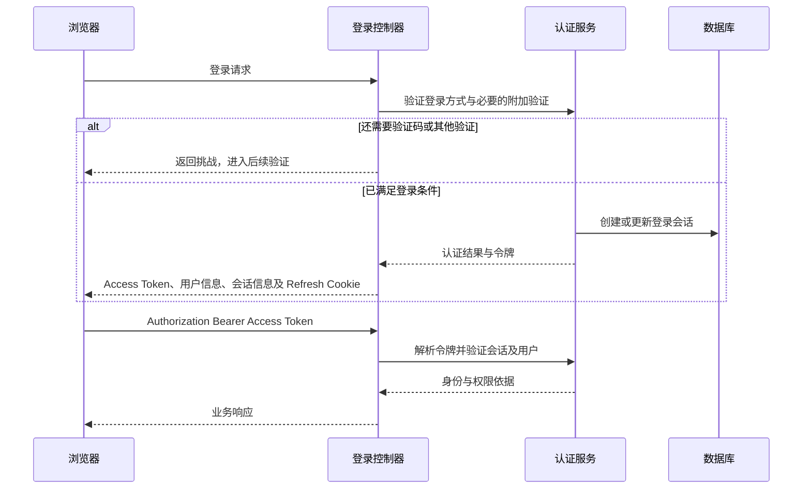

## 1. 【new-api】03-账号登录与三种凭据

> 文档遵循 md-output 规范；标题层级与编号以知识库规则和格式化脚本为准。离线资料的使用方法见 [[【new-api】14-离线参考入口与完整性审计]]。
> 源码快照：`9b473a3fe4fed8d18980fd8d3c6a8908847a5f25`。仅做静态代码导读，未执行线上业务验证。

专题入口：[[【new-api】00-总览与阅读地图]]

[TOC]

---

### 1.1 修订记录

| 编号 | 版本 |  修订人  | 修订内容                           | 日期       |
| :--: | :--- | :------: | :--------------------------------- | :--------- |
| 001  | 1.0  | jie.chen | 基于源码创建架构与产品链路导读     | 2026-11-03 |
| 002  | 1.1  | jie.chen | 补充离线入口并移除本机源码链接依赖 | 2026-11-03 |

---

### 1.2 先区分三种凭据，再看登录

| 凭据                                     | 使用者                | 主要入口                    | 承担的职责                          |
| :--------------------------------------- | :-------------------- | :-------------------------- | :---------------------------------- |
| 控制台短期 Access Token + Refresh Cookie | 浏览器里的 React 应用 | `/api/*`，以及会话型试验台  | 代表已登录用户和登录会话            |
| Personal Access Token，简称 PAT          | 自动化管理脚本        | 被允许的管理 API            | 管理接口的 scope 授权与审计         |
| AI API Key，对应 `model.Token`           | 你的 Python / JS 应用 | `/v1/*`、相关模型与任务协议 | 模型调用权限、预算、分组、IP 等限制 |

还有第四类“上游凭据”：管理员保存在 Channel 里的供应商 Key、OAuth 信息等。用户带网关 Key 进来，网关用上游凭据出去；二者不能互换。产品中的文本 token 计数则完全不是凭据。

---

### 1.3 注册与登录主线

注册从 `POST /api/user/register` 进入，经过限流、请求体约束及按配置启用的验证检查，再建立用户。登录不是注册的必然附带动作，应看登录成功响应与前端流程。

不同登录方式负责提供身份依据，最终进入会话体系。仓库支持密码、OAuth/OIDC、Passkey，以及登录附加验证等分支。不能把“OAuth 成功拿到第三方身份”直接等同于“已经完成所有本站登录条件”。

---

### 1.4 浏览器刷新后为什么仍可登录

当前前端 `auth-store.ts` 把 Access Token 保存在 Zustand 内存状态，不能按旧版“直接从 localStorage 读取登录 token”的经验理解。

`http-client.ts` 给请求附加 Bearer Token；遇到适用的 401，会调用刷新流程，成功后重试一次。Refresh Token 由 HttpOnly Cookie 携带，后端 `RefreshAuth` 处理刷新并重新写 Cookie。页面启动也需要恢复认证状态。

Cookie 的 Secure 行为受配置控制，Refresh Cookie 使用 SameSite Strict。本文只描述代码机制，不推导任何生产部署已经正确配置，也不对安全合规作认证。

对一次性安全凭据，前端不会普通地“401 后原样重放”：带一次性授权或安全证明的请求先刷新认证，再提交敏感动作。这个分支解释了为何某些操作与普通列表刷新表现不同。

---

### 1.5 三条鉴权执行路径

#### 1.5.1 控制台路径

`UserAuth / AdminAuth / RootAuth` → 解析控制台凭据 → 校验会话和用户 → 必要时再检查具体权限 → 控制器。角色、状态、分组不完全依靠 JWT 内一份固定数据，当前代码还读取用户与会话状态。

#### 1.5.2 PAT 路径

控制台鉴权识别非内部登录 token 时，会尝试个人访问令牌查询，并检查路由与 scope、记录审计。PAT 是管理自动化凭据；`/pg/chat/completions` 的 Playground 控制器明确拒绝这类访问令牌。

#### 1.5.3 AI Key 路径

`TokenAuth` → `model.ValidateUserToken` → IP 限制 → 用户是否启用 → 用户组与令牌组可用性 → 写请求上下文 → 后续限流、分发。

模型白名单检查主要在分发阶段完成，余额及预扣在计费阶段完成。这是多层协作，不能把所有拒绝都理解成“Key 无效”。

---

### 1.6 账号生命周期中的其他链路

| 场景           | 入口和后续动作                                                      |
| :------------- | :------------------------------------------------------------------ |
| 退出登录       | `/api/user/auth/logout` → 撤销对应会话 / 清理 Cookie → 前端清空状态 |
| 管理已登录设备 | `/api/user/sessions` → 查看、删除单个会话或撤销其他会话             |
| 找回密码       | 请求重置邮件 → 提交重置凭据与新密码 → 后端更新账号状态              |
| 开启 MFA       | setup → 验证并 enable → 后续登录使用附加验证；另有恢复码管理        |
| 使用 Passkey   | begin 下发 challenge → 浏览器凭据 API → finish 验证结果             |
| 绑定第三方账号 | 已登录身份 → 发起绑定状态 → 回调 / 验证 → 保存绑定                  |
| 敏感操作       | 取得可用验证方式 → `/api/verify` 等安全验证 → 携带证明完成指定动作  |
| 管理授权       | 管理角色与具体权限绑定 → 策略同步 → 服务端检查                      |

这些是产品分支导览，具体挑战过期、一次性消费、恢复策略需进入对应实现和测试阅读，本文不替代专项安全审计。

与 [[【new-api】04-渠道模型分组与故障重试]] 联读可以理解“有身份为什么仍然用不了模型”；与 [[【new-api】11-React前端到Go后端]] 联读可以理解页面刷新和登录跳转。

---

### 1.7 参考资料

- [[new-api-ref--middleware--auth.go.txt]]:205，定位 `func classifyDashboardCredential`。
- [[new-api-ref--middleware--auth.go.txt]]:528，定位 `func TokenAuth()`。
- [[new-api-ref--controller--auth_session.go.txt]]:17，定位 `func RefreshAuth`。
- [[new-api-ref--service--auth_session.go.txt]]:325，定位 `func WriteRefreshCookie`。
- [[new-api-ref--service--auth_token.go.txt]]:107，定位 `func ParseDashboardAccessToken`。
- [[new-api-ref--web--src--stores--auth-store.ts.txt]]:104，定位 `export const useAuthStore`。
- [[new-api-ref--web--src--lib--http-client.ts.txt]]:86，定位 `api.interceptors.response.use`。
- [[new-api-ref--router--api-router.go.txt]]:17，定位 `func SetApiRouter`。
- [[new-api-ref--controller--playground.go.txt]]:28，定位 `useAccessToken :=`。
