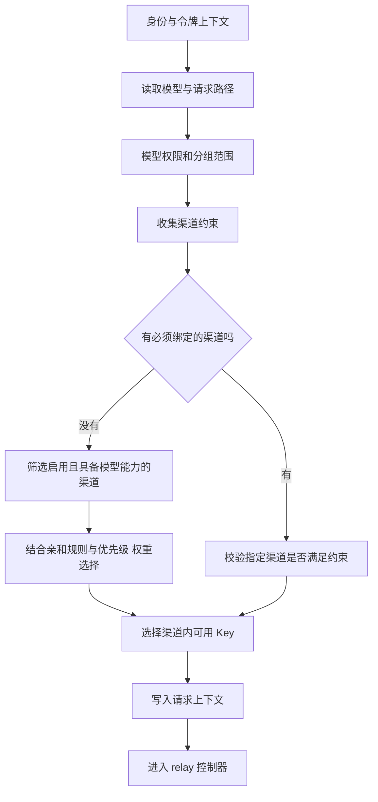

## 1. 【new-api】04-渠道模型分组与故障重试

> 文档遵循 md-output 规范；标题层级与编号以知识库规则和格式化脚本为准。离线资料的使用方法见 [[【new-api】14-离线参考入口与完整性审计]]。
> 源码快照：`9b473a3fe4fed8d18980fd8d3c6a8908847a5f25`。仅做静态代码导读，未执行线上业务验证。

专题入口：[[【new-api】00-总览与阅读地图]]

[TOC]

---

### 1.1 修订记录

| 编号 | 版本 |  修订人  | 修订内容                           | 日期       |
| :--: | :--- | :------: | :--------------------------------- | :--------- |
| 001  | 1.0  | jie.chen | 基于源码创建架构与产品链路导读     | 2026-11-03 |
| 002  | 1.1  | jie.chen | 补充离线入口并移除本机源码链接依赖 | 2026-11-03 |

---

### 1.2 五个配置对象如何配合

| 对象         | 用例                           | 作用                           |
| :----------- | :----------------------------- | :----------------------------- |
| 对外模型名   | `demo-chat`                    | 用户请求的产品标识             |
| 模型元数据   | 名称、介绍、厂商               | 目录与展示信息                 |
| 渠道 Channel | 某供应商的地址、凭据、支持模型 | 实际向上游发送请求的线路       |
| 分组 Group   | `default` 或运营配置的其他组   | 限定可用渠道与定价相关规则     |
| 能力 Ability | 某组的某模型可以走某渠道       | 用于高效寻找候选渠道的派生索引 |

例如两个渠道都提供 `demo-chat`，但一个只对某分组开放。普通用户看到模型名字，并不意味着能选到第二个渠道。模型目录与真实可路由供应不是同一张表。

---

### 1.3 管理员保存渠道后发生什么

管理员填写类型、地址、凭据、模型列表、分组、优先级和权重等配置 → 渠道接口校验并持久化 → 更新渠道能力关系 → 缓存刷新或周期同步 → 后续请求使用新配置。

`Channel` 还可包含模型映射、状态码映射、请求参数覆盖、请求头覆盖、代理相关设置和多 Key 状态。测试渠道是验证具体连接的一条管理链路，并不替代真实业务的模型权限和计费检查。

---

### 1.4 请求如何选到一条渠道

普通路径的首次分发发生在 `middleware.Distribute`，早于控制器的完整请求校验与预扣。控制器重试时再走 `getChannel` 与选择服务。

“优先级”用于区分优先使用的层级；“权重”用于合格候选中的分配，不是给费用乘倍数。亲和性表示尽量复用与会话相关的渠道，固定渠道约束则更强。具体行为还受请求路径、插件身份和故障策略影响，不应概括成“永远随机挑一个”。

`auto` 分组可以按配置遍历用户可用分组，跨组重试也需要对应开关。它不是让调用者绕过分组权限。

---

### 1.5 模型映射为何保留两个名字

用户请求 `demo-chat`，渠道可以把它映射成厂商接受的另一个标识。这样运营方能保持稳定的对外名字。

- 原始模型名：用户购买、查看日志和计价识别的重要依据。
- 上游模型名：实际发送给供应商的机器标识。

普通文本在 `TextHelper` 调用 `ModelMappedHelper`。任务插件在上下文中分别拿到 `ctx.model` 与 `ctx.upstreamModel`，后台轮询也要保留这两个身份。改了映射并不自动创造新模型能力，也不能假定所有供应商能力完全等价。

---

### 1.6 失败后不是一律重试

一次尝试失败 → 规范化错误 → `DecideRelayRetry` 决定继续或停止 → 记录失败与决策 → 按规则处理渠道或渠道 Key 的健康状态 → 若允许，重新选择下一次候选。

| 情形                             | 应如何理解                                               |
| :------------------------------- | :------------------------------------------------------- |
| 参数错误、没有模型权限、额度不足 | 多数发生在上游调用前，换供应商通常不能解决               |
| 上游状态码或网络错误             | 根据策略、错误分类与剩余次数决定重试                     |
| 会话严格绑定、延续原任务         | 不能假定可以换任意渠道                                   |
| 已经输出流式内容                 | 重放可能重复内容或产生二次费用，不能套用普通请求重试逻辑 |
| 渠道内某个 Key 失败              | 可能只处理该 Key，而非禁用整条渠道                       |
| 无合格渠道                       | 返回无可用渠道；不等于模型名称从全站消失                 |

账务会话在普通请求的多次尝试间复用，失败回收由外层统一处理，见 [[【new-api】07-计费预扣结算与退款]]。异步任务一旦提交成功，再次查询不是再次生成，见 [[【new-api】10-异步任务与JavaScript插件]]。

---

### 1.7 排查“我明明配了渠道却不能调用”

按顺序检查：请求模型名 → 用户及令牌分组 → 模型限制 → 渠道启用状态 → 渠道模型和 Ability → 路径或插件约束 → 可用 Key → 定价 → 上游请求。消费与错误日志中的请求 ID、使用渠道和策略事件可以把这些步骤连接起来，详见 [[【new-api】12-数据存储启动部署与运维]]。

---

### 1.8 参考资料

- [[new-api-ref--model--channel.go.txt]]:23，定位 `type Channel struct`。
- [[new-api-ref--model--ability.go.txt]]:18，定位 `type Ability struct`。
- [[new-api-ref--model--ability.go.txt]]:225，定位 `func (channel *Channel) AddAbilities`。
- [[new-api-ref--middleware--distributor.go.txt]]:34，定位 `func Distribute()`。
- [[new-api-ref--service--channel_select.go.txt]]:114，定位 `func CacheGetRandomSatisfiedChannel`。
- [[new-api-ref--controller--relay.go.txt]]:298，定位 `func getChannel`。
- [[new-api-ref--relay--compatible_handler.go.txt]]:42，定位 `helper.ModelMappedHelper`。
- [[new-api-ref--service--request_policy.go.txt]]:100，定位 `func RecordPolicyFailure`。
- [[new-api-ref--service--relay_error.go.txt]]:20，定位 `func DecideRelayRetry`。
