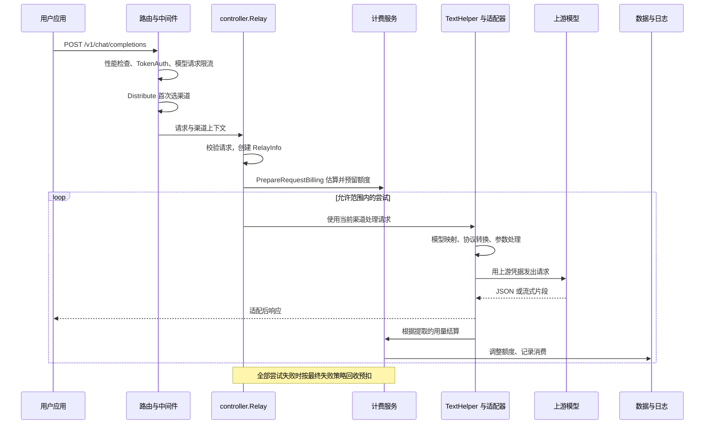

## 1. 【new-api】05-一次AI调用的完整生命周期

> 文档遵循 md-output 规范；标题层级与编号以知识库规则和格式化脚本为准。离线资料的使用方法见 [[【new-api】14-离线参考入口与完整性审计]]。
> 源码快照：`9b473a3fe4fed8d18980fd8d3c6a8908847a5f25`。仅做静态代码导读，未执行线上业务验证。

专题入口：[[【new-api】00-总览与阅读地图]]

[TOC]

---

### 1.1 修订记录

| 编号 | 版本 |  修订人  | 修订内容                           | 日期       |
| :--: | :--- | :------: | :--------------------------------- | :--------- |
| 001  | 1.0  | jie.chen | 基于源码创建架构与产品链路导读     | 2026-11-03 |
| 002  | 1.1  | jie.chen | 补充离线入口并移除本机源码链接依赖 | 2026-11-03 |

---

### 1.2 从一个你熟悉的 Python 请求开始

下面是结构示例，不会在整理文档时执行；示例模型名需换成站点实际开放的模型。

```python
import os
import requests

response = requests.post(
    os.environ['NEW_API_BASE_URL'].rstrip('/') + '/v1/chat/completions',
    headers={'Authorization': 'Bearer ' + os.environ['NEW_API_KEY']},
    json={
        'model': 'demo-chat',
        'messages': [{'role': 'user', 'content': '解释什么是 API 网关'}],
        'stream': False,
    },
    timeout=120,
)
response.raise_for_status()
print(response.json())
```

这里 `NEW_API_BASE_URL` 指站点根地址，不带重复的 `/v1`；Key 来自本网关的 API Key 页面。`requests` 仅是阅读示例，没有安装依赖。

---

### 1.3 准确的主流程



循环图为了展示重试范围；成功后立刻结束，不会继续请求其他渠道。中间件已完成第一次选择；控制器的第一次 `getChannel` 使用这份上下文，后续尝试才重新选择。

---

### 1.4 把每一步落到函数

| 步骤         | 源码入口                              | 关键输入与输出                             |
| :----------- | :------------------------------------ | :----------------------------------------- |
| 绑定入口     | `SetRelayRouter`                      | URL → OpenAI relay format                  |
| 识别调用者   | `middleware.TokenAuth`                | API Key → 用户、令牌、分组上下文           |
| 限制流量     | `ModelRequestRateLimit`               | 请求维度信息 → 放行或拒绝                  |
| 初选供应     | `middleware.Distribute`               | 模型和约束 → 渠道上下文                    |
| 完整校验     | `helper.GetAndValidateRequest`        | 请求体 → 有类型的协议 DTO                  |
| 建立请求状态 | `relaycommon.GenRelayInfo`            | 用户、渠道、协议、请求 → RelayInfo         |
| 估算与预扣   | `relay.PrepareRequestBilling`         | token 估计、价格 → BillingSession          |
| 调用类型分流 | `relayHandler`                        | RelayMode → Text / Image / Audio 等 Helper |
| 文本适配     | `relay.TextHelper`                    | 原始 DTO → 上游请求                        |
| 上游交互     | `Adaptor.DoRequest / DoResponse`      | 响应输出与统一 Usage                       |
| 计费收尾     | `PostTextConsumeQuota` 或音频相关路径 | Usage → 实际费用和日志                     |
| 最终失败     | `RefundFailedRequestBilling`          | 未结算状态 → 退款及适用的独立失败收费策略  |

`RelayInfo` 可以理解成一份只属于当前请求的业务工作单：谁在调用、用了什么协议、选了哪个渠道、计费如何预留、流是否正常结束。它不是数据库里统一永久保存的完整请求对象。

---

### 1.5 TextHelper 内部的工作

初始化渠道元信息 → 复制请求，避免一次尝试污染下一次 → 模型映射 → 按渠道能力处理 StreamOptions → 获取适配器 → 转换请求、应用适用覆盖 → 发送 → 解析响应 → 结算。

这条主线有两个重要分支：

1. 配置可要求 Chat Completions 经 Responses 路径完成转换和调用。
2. 开启相应透传配置时，会走原始请求体路径，而非普通 DTO 重建路径。

因此“统一入口”不意味着所有请求都执行完全相同的转换。协议支持要结合入口、渠道类型和具体适配器判断。

---

### 1.6 流式响应为什么仍然走计费

非流式一般等待上游完整结果后返回 JSON。SSE 则维持一次 HTTP 响应，把事件持续写给客户端；它不是每输出一个词就新建一次 HTTP 请求。

网关在转发流的同时维护流状态并收集用量。费用结算发生在响应处理之后或对应的收尾路径，而客户端可能早已看到部分内容。因此“我看到第一段回答”不代表整次调用已经结束，“HTTP 200”也不充分证明流正常完成。

如果响应已经开始，错误通常不能再改成一个全新的 HTTP 错误响应；普通 relay 外层对已写出的 SSE 有流内错误处理。具体结束事件按协议不同，不要把所有流都当作 OpenAI 的 `[DONE]`。

---

### 1.7 错误在哪一段发生

| 失败阶段                   | 是否可能已经产生上游工作 | 对账关注点                   |
| :------------------------- | :----------------------- | :--------------------------- |
| 认证、模型权限、参数、限流 | 通常还没有               | 看本地拒绝原因               |
| 选渠道或定价、预扣         | 通常还没有               | 看渠道能力、价格、额度       |
| 发出请求后网络失败         | 可能已经发生             | 超时不代表供应商一定没处理   |
| 流中断                     | 可能已经生成部分内容     | 看流结束原因与具体结算规则   |
| 上游成功但本地结算写入异常 | 已有上游工作             | 看账务日志，不能简单全部退款 |

普通主链路的失败退款存在状态保护，还可能有配置驱动的违规收费等独立逻辑。细节见 [[【new-api】07-计费预扣结算与退款]]；渠道重试见 [[【new-api】04-渠道模型分组与故障重试]]；其他输入输出格式见 [[【new-api】06-多模态与协议分支]]。

---

### 1.8 参考资料

- [[new-api-ref--router--relay-router.go.txt]]:105，定位 `httpRouter.POST("/chat/completions"`。
- [[new-api-ref--controller--relay.go.txt]]:72，定位 `func Relay(`。
- [[new-api-ref--relay--request_billing.go.txt]]:25，定位 `func PrepareRequestBilling`。
- [[new-api-ref--relay--compatible_handler.go.txt]]:25，定位 `func TextHelper`。
- [[new-api-ref--relay--channel--adapter.go.txt]]:18，定位 `type Adaptor interface`。
- [[new-api-ref--service--text_quota.go.txt]]:400，定位 `func PostTextConsumeQuota`。
- [[new-api-ref--controller--relay.go.txt]]:242，定位 `func writeRelayStreamError`。
