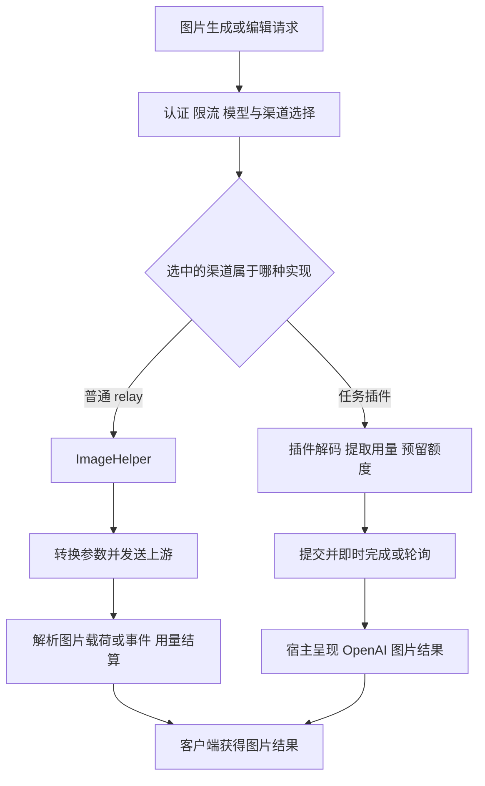

## 1. 【new-api】06-多模态与协议分支

> 文档遵循 md-output 规范；标题层级与编号以知识库规则和格式化脚本为准。离线资料的使用方法见 [[【new-api】14-离线参考入口与完整性审计]]。
> 源码快照：`9b473a3fe4fed8d18980fd8d3c6a8908847a5f25`。仅做静态代码导读，未执行线上业务验证。

专题入口：[[【new-api】00-总览与阅读地图]]

[TOC]

---

### 1.1 修订记录

| 编号 | 版本 |  修订人  | 修订内容                           | 日期       |
| :--: | :--- | :------: | :--------------------------------- | :--------- |
| 001  | 1.0  | jie.chen | 基于源码创建架构与产品链路导读     | 2026-11-03 |
| 002  | 1.1  | jie.chen | 补充离线入口并移除本机源码链接依赖 | 2026-11-03 |

---

### 1.2 不要把接口格式、厂商和返回方式混在一起

“OpenAI 格式”说的是协议；“某个厂商”说的是上游来源；“SSE”说的是输出传输方式；“异步任务”说的是业务执行生命周期。这四个维度可以组合。

例如一个使用 OpenAI 风格路径的图片请求，可能由 JS 任务插件处理；一个 Responses 请求可能走普通 Go relay，也可能落到声明该协议的任务插件。具体分流由模型、候选渠道与插件绑定共同决定。

---

### 1.3 入口矩阵

| 功能                | 代表入口                                                  | 核心处理方向                       | 和普通文本的差别                                        |
| :------------------ | :-------------------------------------------------------- | :--------------------------------- | :------------------------------------------------------ |
| 文本对话            | `POST /v1/chat/completions`、`/v1/completions`            | `TextHelper`                       | 基准链路，见 [[【new-api】05-一次AI调用的完整生命周期]] |
| Claude 消息         | `POST /v1/messages`                                       | `ClaudeHelper`                     | 请求、事件、错误格式不同                                |
| Gemini 内容         | `POST /v1beta/models/*path`                               | Gemini 相关 Helper                 | 模型与动作含在路径中                                    |
| Responses           | `POST /v1/responses`                                      | 共享宿主入口：普通 relay 或插件    | 支持能力取决于被选路径                                  |
| Responses 压缩      | `POST /v1/responses/compact`                              | `ResponsesHelper` 的相关模式       | 输入输出及用量语义不同                                  |
| 图片生成 / 编辑     | `POST /v1/images/generations`、`/v1/images/edits`         | 共享宿主入口：`ImageHelper` 或插件 | JSON / multipart、图像载荷与数量                        |
| 音频转写 / 翻译     | `POST /v1/audio/transcriptions`、`/translations`          | `AudioHelper`                      | 文件上传、音频格式与时长                                |
| 语音合成            | `POST /v1/audio/speech`                                   | `AudioHelper`                      | 输入文本、输出可能为二进制音频                          |
| 向量                | `POST /v1/embeddings` 等                                  | `EmbeddingHelper` 等               | 返回数值向量，不是聊天内容                              |
| 重排                | `POST /v1/rerank`                                         | `RerankHelper`                     | 为候选文本排序                                          |
| 实时会话            | `GET /v1/realtime`                                        | WebSocket / `WssHelper`            | 双向事件、持续连接、专用计费路径                        |
| Responses WebSocket | `GET /v1/responses`                                       | `ResponsesWebSocket`               | 首个事件后选择渠道，每个创建事件执行对应限流            |
| 视频                | `POST /v1/videos`、`/v1/video/generations`                | 任务入口与插件                     | 提交、等待、查询、取产物                                |
| 通用插件任务        | `POST /v1/tasks/:key`                                     | 任务宿主                           | Key 指插件；查询同路径参数表示任务 ID                   |
| 厂商原生任务        | 插件声明的原生路径及前缀路径                              | 动态插件路由                       | 保留厂商接口风格                                        |
| Midjourney          | `/mj/*`、`/:mode/mj/*`                                    | 专用控制器和 relay                 | 保留专用任务 / 图像链路                                 |
| 专用搜索工具        | `/v1/alpha/search`、`/v1/tools/search`、`/v1/tools/fetch` | 专门的 Helper                      | 不等于任意 function call 都由网关执行                   |

这张表是代码入口清单，不是每个渠道的能力承诺。部分路径只在兼容渠道或特定设置下有意义。

---

### 1.4 图片链路的两种实现

图片的 `n` 是请求数量，不等于响应 JSON 中数组长度。兼容上游可能把一个图片的 URL 与 Base64 分开，或返回只有提示词的元素。当前规则按有效图片载荷、可信且受限的上游数量或事件计数结算；不能把 `len(data)` 当作通用图片数量。

普通图片流如果客户端提前断开，不能据已收到的少量图片就保证少扣费。插件的 `openai_image` 可在单个 HTTP 请求内等待任务完成，最后仍返回图片 JSON：**内部是任务，不代表外部一定先拿任务 ID。**

---

### 1.5 Responses 有多条生命周期

普通 Go relay 处理正常的上游 Responses 交互。插件承接的 Responses 则显式声明接受 `sync`、`stream`、`background` 哪些模式：同步等待、流式呈现或立即返回待完成状态。

插件产生的持久任务可通过宿主检索接口获取；不能把插件检索能力推广到任意普通 relay 响应 ID。`GET /v1/responses` 是 WebSocket 入口，`GET /v1/responses/:response_id` 则是另一个操作。

共享宿主路径并非“某插件声明模型就包办所有调用”。普通兼容渠道和插件渠道可共同参与候选；普通渠道胜出时跳过插件解码和模式检查，后续重试保持对应的实现路径。详见 [[【new-api】10-异步任务与JavaScript插件]]。

---

### 1.6 实时连接和普通流的区别

SSE 主要是服务端向客户端持续发事件。WebSocket 是双向连接，客户端在一条连接中继续发送事件，服务端也可持续推送。Realtime 有音频等用量与专用预扣 / 后结算方法；Responses WebSocket 的事件处理也不能简单等同于普通 HTTP 请求次数。

图中的共同主干仍是身份、权限、供应、协议、用量和记录，但每类传输的断开、重试与结算边界必须看各自处理器。

---

### 1.7 明确没有实现的兼容接口

当前 `router/relay-router.go` 中，图片 variations、若干 files 接口、fine-tunes 接口及删除模型接口绑定的是 `RelayNotImplemented`。Claude count_tokens 路由被注释；Gemini `:countTokens` 被明确拦到未找到处理。

所以“代码里能搜到函数名”或“路径长得像官方 API”都不足以说明功能已对外开放。任务视频、音乐和原生插件路径，继续看 [[【new-api】10-异步任务与JavaScript插件]]。

---

### 1.8 参考资料

- [[new-api-ref--router--relay-router.go.txt]]:15，定位 `func SetRelayRouter`。
- [[new-api-ref--router--task-plugin-protocol-router.go.txt]]:27，定位 `func taskPluginProtocolHandlers`。
- [[new-api-ref--router--video-router.go.txt]]:10，定位 `func SetVideoRouter`。
- [[new-api-ref--router--task-router.go.txt]]:14，定位 `func SetTaskRouter`。
- [[new-api-ref--relay--image_handler.go.txt]]:24，定位 `func ImageHelper`。
- [[new-api-ref--relay--audio_handler.go.txt]]:18，定位 `func AudioHelper`。
- [[new-api-ref--controller--responses_websocket.go.txt]]:114，定位 `func ResponsesWebSocket`。
- [[new-api-ref--docs--plugin-api--v1.md.txt]]:480，定位 `## Host protocols`。
