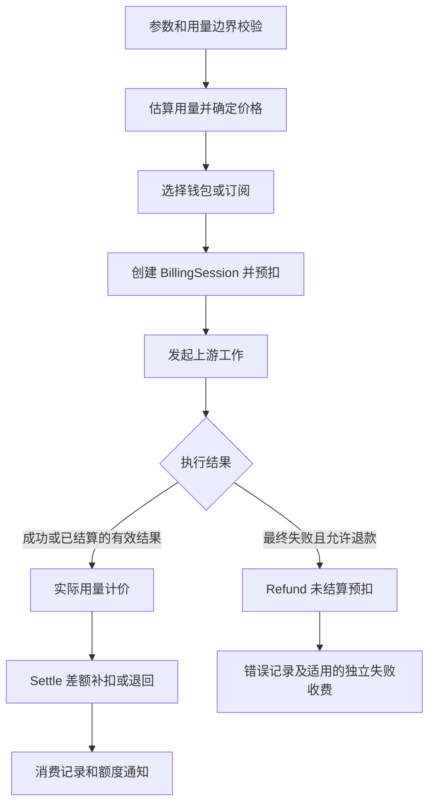

## 1. 【new-api】07-计费预扣结算与退款

> 文档遵循 md-output 规范；标题层级与编号以知识库规则和格式化脚本为准。离线资料的使用方法见 [[【new-api】14-离线参考入口与完整性审计]]。
> 源码快照：`9b473a3fe4fed8d18980fd8d3c6a8908847a5f25`。仅做静态代码导读，未执行线上业务验证。

专题入口：[[【new-api】00-总览与阅读地图]]

> **跨电脑参考补充：** [[【new-api】18-后端业务规则与失败处理]]、[[【new-api】20-ModelDock实现交接与验收清单]]。ModelDock 已确定另建 Python 后端；参考事实与新设计建议分开记录。

[TOC]

---

### 1.1 修订记录

| 编号 | 版本 |  修订人  | 修订内容                           | 日期       |
| :--: | :--- | :------: | :--------------------------------- | :--------- |
| 001  | 1.0  | jie.chen | 基于源码创建架构与产品链路导读     | 2026-11-03 |
| 002  | 1.1  | jie.chen | 补充离线入口并移除本机源码链接依赖 | 2026-11-03 |

---

### 1.2 先把四件事分开

| 概念                   | 回答的问题             | 例子                                     |
| :--------------------- | :--------------------- | :--------------------------------------- |
| 用量 Usage             | 实际用了多少资源       | 输入 token、输出 token、图片数、视频秒数 |
| 定价规则               | 每种资源如何换算成费用 | 表达式价格、历史倍率或按次规则           |
| 资金来源 FundingSource | 从用户的哪个池子扣     | 钱包或订阅额度                           |
| API Key 预算           | 这个调用凭据还能花多少 | 有限额令牌的剩余额度                     |

创建一个额度很大的 Key 并不会给钱包充值。“不限额 Key”也不意味着用户有无限资金。钱包 / 订阅与 Key 预算是不同约束，并不是把同一次调用向用户收两次钱。

---

### 1.3 为什么要先预扣，再结算

请求发出前通常不知道模型最终输出多少，也不知道长任务最终实际用量。系统先根据请求和定价估算预算，预留资金与令牌额度；完成后根据实际用量调整差额。

这是普通请求的概念主线，存在免费模型跳过预扣、信任额度旁路等分支。不能假设每个请求都真实提前扣掉一笔同样大小的钱。

---

### 1.4 普通请求实际怎样组织

`PrepareRequestBilling` 做敏感内容检查（按配置）、token 估算、模型价格计算，然后调用 `PreConsumeBilling`。请求里的 `RelayInfo.Billing` 保存 `BillingSession`。

一次请求跨渠道重试时复用账务会话，而不是把每次尝试都当成新的用户订单。在发送前需要更高预留时，用相应 Reserve 方法补足；图片实际发送参数变化等路径尤其需要关注这个边界。

结果处理器从上游结果获得 Usage，再进入文本、音频、图片或表达式结算路径，最终由 `SettleBilling` 等方法收尾。没有新会话的兼容路径仍可能回退旧结算逻辑。

---

### 1.5 钱包与订阅如何选择

| 用户偏好             | 当前选择规则摘要                                                     |
| :------------------- | :------------------------------------------------------------------- |
| `wallet_only`        | 仅钱包                                                               |
| `subscription_only`  | 仅订阅                                                               |
| `wallet_first`       | 先钱包；符合额度不足条件时尝试订阅                                   |
| `subscription_first` | 先订阅；无活跃订阅时尝试钱包；已有订阅不足时还要满足允许钱包溢出条件 |

这不是“钱包和订阅随便拼起来凑够一笔”。会话选定一个资金来源，失败回退受业务条件限制。数据库错误等系统失败不能统统当成余额不足来切换资金来源。

订阅的周期重置、到期和分组权益见 [[【new-api】09-充值订阅与运营闭环]]。

---

### 1.6 三类价格体系

#### 1.6.1 普通模型表达式

表达式定义输入、输出、缓存、图像或音频等计价项与条件。普通 token 表达式系数采用美元 / 百万 token 的含义，`fixed()` 表示固定金额，但内部求值到 quota 有专门尺度转换，不能直接把表达式返回值当美元。

同一用量不能重复收费：显式给缓存等类别独立定价时，需要在输入或输出兜底量中扣除相应类别。上下文长度 `len` 与计价输入 `p` 不是一个概念。完整算例见 [[【new-api】08-计费数学与完整算例]]。

#### 1.6.2 历史倍率与按次价格

旧规则仍有运行与兼容路径，管理界面将其标为弃用。新建规则与老实例历史配置可能不同，阅读代码要先知道本次模型实际用哪一种。

#### 1.6.3 任务插件表达式

插件返回 `seconds`、`image_count` 等用量事实，宿主按 schema 校验后通过 `u()` 取值计算费用。任务表达式结果直接表示美元，与普通表达式的内部尺度不同。

同一模型可有 `<pluginKey>::<model>` 的插件专属价格覆盖。普通 relay 的表达式不能直接调用任务 `u()`。插件负责报告用量，宿主负责计算钱和扣账。

---

### 1.7 为什么失败不总是全额退款

- 普通请求的最终失败处理调用 `RefundFailedRequestBilling`，但已结算账务不会再次退款。
- `BillingSession` 将资金来源和令牌调整分开处理，并用状态阻止重复结算或误退已提交资金；这不是横跨所有数据的单个全局事务。
- 退款部分工作异步执行，数据库或缓存失败会记录错误，不可只看到“已发起退款”就认定所有账已一致。
- 失败处理还可能触发配置相关的违规费用；它与正常生成费用退款是两个业务动作。
- 已交付的流、客户端中断、即时完成任务等有专门语义。尤其原生插件流已有事件输出后，不走简单的“任何异常都退预扣”模型。
- 老系统遗留任务的超时退款有明确版本时间边界，不能把现代任务规则机械套给历史行。

---

### 1.8 长任务为什么需要价格快照

视频可能今天提交，稍后才完成。若管理员在等待期间改价，结算不能随意换成另一个计价合同。任务保存计费上下文，包括资金来源、订阅 ID、令牌 ID、模型名与表达式快照等，供后续轮询结算。

当前任务从提交预留到完成差额调整，和普通 HTTP 会话内收尾不同；详见 [[【new-api】10-异步任务与JavaScript插件]]。任务的公开状态、资金调整和日志是不同关注点，不应由“任务显示成功”推断所有持久化动作均无故障。

---

### 1.9 设计上保护什么

请求数量、时长与 token 上限需要受限；quota 换算集中在 `common/quota_math.go`，避免溢出变成负扣费。图片数量还要依据有效图像而不是 JSON 结构。审计信息记录异常换算，方便管理员定位。

这些是源码与仓库账务规则定义的边界，不是本笔记执行压力测试或验证所有场景后的合规结论。想用熟悉的数据库概念理解预留与状态转换，可以关联 [[事务]]；但跨资金、令牌、缓存与日志的处理不能简单看成一个 ACID 事务。

---

### 1.10 参考资料

- [[new-api-ref--relay--request_billing.go.txt]]:25，定位 `func PrepareRequestBilling`。
- [[new-api-ref--relay--request_billing.go.txt]]:72，定位 `func RefundFailedRequestBilling`。
- [[new-api-ref--service--billing.go.txt]]:24，定位 `func PreConsumeBilling`。
- [[new-api-ref--service--billing.go.txt]]:65，定位 `func SettleBilling`。
- [[new-api-ref--service--billing_session.go.txt]]:30，定位 `type BillingSession struct`。
- [[new-api-ref--service--billing_session.go.txt]]:389，定位 `func NewBillingSession`。
- [[new-api-ref--service--funding_source.go.txt]]:15，定位 `type FundingSource interface`。
- [[new-api-ref--model--task.go.txt]]:164，定位 `type TaskBillingContext struct`。
- [[new-api-ref--pkg--billingexpr--expr.md.txt]]:1，定位 `# Billing Expression System`。
- [[new-api-ref--common--quota_math.go.txt]]:1，定位 `package common`。
