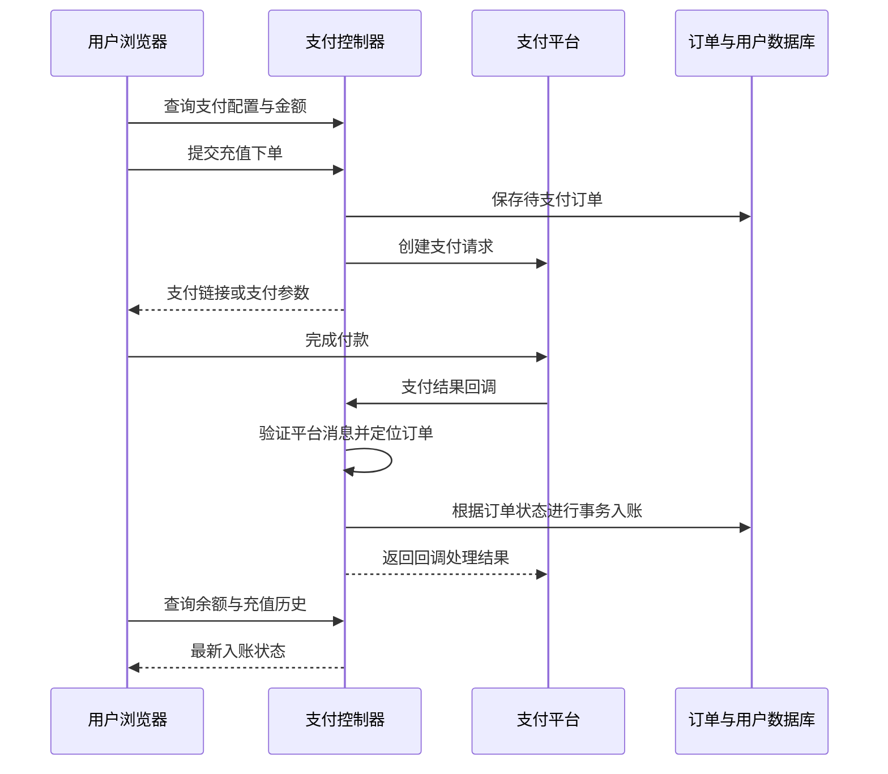
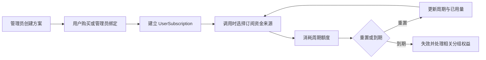

## 1. 【new-api】09-充值订阅与运营闭环

> 文档遵循 md-output 规范；标题层级与编号以知识库规则和格式化脚本为准。离线资料的使用方法见 [[【new-api】14-离线参考入口与完整性审计]]。
> 源码快照：`9b473a3fe4fed8d18980fd8d3c6a8908847a5f25`。仅做静态代码导读，未执行线上业务验证。

专题入口：[[【new-api】00-总览与阅读地图]]

> **跨电脑参考补充：** [[【new-api】15-数据库关系约束与建模说明]]、[[【new-api】18-后端业务规则与失败处理]]。ModelDock 已确定另建 Python 后端；参考事实与新设计建议分开记录。

[TOC]

---

### 1.1 修订记录

| 编号 | 版本 |  修订人  | 修订内容                           | 日期       |
| :--: | :--- | :------: | :--------------------------------- | :--------- |
| 001  | 1.0  | jie.chen | 基于源码创建架构与产品链路导读     | 2026-11-03 |
| 002  | 1.1  | jie.chen | 补充离线入口并移除本机源码链接依赖 | 2026-11-03 |

---

### 1.2 充值和订阅买到的是两种东西

充值增加钱包余额；订阅创建一个有有效期、额度周期和相关权益的对象。购买订阅可以走外部支付，也可能按方案配置允许用钱包余额支付。

API Key 的额度只是调用凭据的预算上限，不属于充值方式。实际调用从哪个资金池扣款，见 [[【new-api】07-计费预扣结算与退款]]。

---

### 1.3 充值主链路

图为共同业务阶段，具体平台创建远程订单与本地保存的精确顺序见各控制器。付款页面跳回成功页，不等于数据库已经成功入账；真正结果以服务端可信支付确认与本地订单状态为准。

仓库包含 Epay、Stripe、Creem、Waffo、Waffo Pancake 等支付路径。这是已有实现清单，不表示当前站点全部启用。

---

### 1.4 为什么回调必须识别重复订单

支付平台可能重复发送同一个成功事件，用户也可能重复刷新页面。如果每收到一次就增加一次余额，用户会被重复入账。

以 Epay 为具体例子：`EpayNotify` 验证回调 → `model.RechargeEpay` 开启事务 → 查对应订单并使用共享行锁封装 → 已成功则按已完成处理 → 待支付才修改订单状态并增加用户额度 → 事务后同步缓存与写充值日志。

其进程内订单锁是优化；真正跨实例的状态判断依赖数据库路径。各平台的重复事件返回处理不完全一致，不应宣称所有回调都以同一个函数实现。

这和既有 [[事务]] 中“多步操作要么都成功、要么都回滚”的思想有关。但缓存同步和日志可能在事务外，所以要区分“账本已变更”和“所有读视图立即一致”。

---

### 1.5 订阅生命周期

方案 `SubscriptionPlan` 描述价格、时长、额度和重置策略等；订单 `SubscriptionOrder` 描述这次购买；`UserSubscription` 描述用户已经得到的权益。三个对象不要混为一谈。

产品可配置日、周、月或自定义周期重置，也有不重置的情况。订阅还可影响用户分组，保存恢复或降级信息。后台有额度重置与到期处理相关任务。

订阅不足时能否转用钱包，既受用户偏好影响，也受订阅的 `AllowWalletOverflow` 等规则影响。不能以“账户还有钱包余额”推断每次订阅调用一定会成功。

---

### 1.6 其他运营入口如何进入资产闭环

| 功能           | 触发链路                                           | 与主链路的关系             |
| :------------- | :------------------------------------------------- | :------------------------- |
| 兑换码         | 管理员创建兑换额度 → 用户提交兑换 → 校验并增加额度 | 提供另一种钱包入账方式     |
| 签到           | 查询状态 → 用户签到 → 按配置与重复限制发放额度     | 运营赠送，不是上游免费     |
| 邀请           | 获取邀请码 → 关联邀请用户 → 累积与转移邀请额度     | 单独记录邀请资产与转移     |
| 人工补单       | 管理员查订单 → 满足条件后执行完成操作              | 处理支付流程的运营异常     |
| 管理员订阅操作 | 创建、绑定、重置、失效或删除订阅                   | 权益维护，而非普通消费请求 |
| 额度提醒       | 消费后检查阈值 → 发消息或邮件                      | 提醒用户补充额度           |

是否可用、赠送额度和展示入口都受配置控制。这里描述代码中的业务分支，没有读取实际用户资产或支付密钥。

---

### 1.7 用户说“钱扣了但余额没到”，查哪里

先确定“钱”指支付平台实际付款还是网关内部 quota。外部付款问题按支付订单号串起创建记录、平台回调、签名验证、订单状态与入账日志；内部调用问题按请求 ID 或任务 ID 查预扣、结算、退款。

充值是增加资产，消费是减少资产，任务差额是调整已预留资产。把三者分开，才能避免把一个任务退款问题当成支付回调问题。更多排查入口见 [[【new-api】12-数据存储启动部署与运维]]。

---

### 1.8 参考资料

- [[new-api-ref--controller--topup.go.txt]]:407，定位 `func EpayNotify`。
- [[new-api-ref--model--topup.go.txt]]:177，定位 `func RechargeEpay`。
- [[new-api-ref--model--topup.go.txt]]:236，定位 `func Recharge(`。
- [[new-api-ref--model--subscription.go.txt]]:146，定位 `type SubscriptionPlan struct`。
- [[new-api-ref--model--subscription.go.txt]]:214，定位 `type SubscriptionOrder struct`。
- [[new-api-ref--model--subscription.go.txt]]:253，定位 `type UserSubscription struct`。
- [[new-api-ref--service--subscription_reset_task.go.txt]]:28，定位 `func StartSubscriptionQuotaResetTask`。
- [[new-api-ref--router--api-router.go.txt]]:177，定位 `subscriptionRoute :=`。
