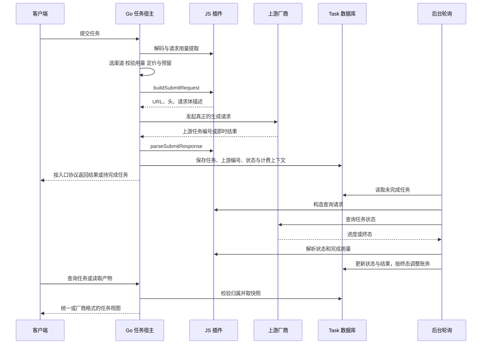
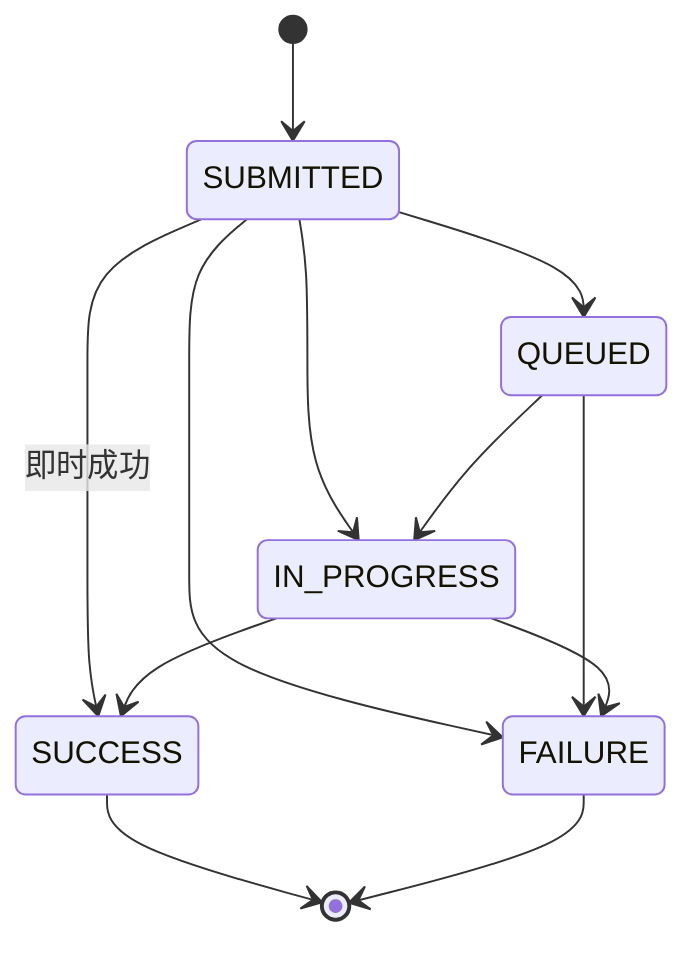

## 1. 【new-api】10-异步任务与JavaScript插件

> 文档遵循 md-output 规范；标题层级与编号以知识库规则和格式化脚本为准。离线资料的使用方法见 [[【new-api】14-离线参考入口与完整性审计]]。
> 源码快照：`9b473a3fe4fed8d18980fd8d3c6a8908847a5f25`。仅做静态代码导读，未执行线上业务验证。

专题入口：[[【new-api】00-总览与阅读地图]]

> **跨电脑参考补充：** [[【new-api】16-数据库字段字典]]、[[【new-api】18-后端业务规则与失败处理]]、[[【new-api】20-ModelDock实现交接与验收清单]]。ModelDock 已确定另建 Python 后端；参考事实与新设计建议分开记录。

[TOC]

---

### 1.1 修订记录

| 编号 | 版本 |  修订人  | 修订内容                           | 日期       |
| :--: | :--- | :------: | :--------------------------------- | :--------- |
| 001  | 1.0  | jie.chen | 基于源码创建架构与产品链路导读     | 2026-11-03 |
| 002  | 1.1  | jie.chen | 补充离线入口并移除本机源码链接依赖 | 2026-11-03 |

---

### 1.2 为什么视频需要另一条链路

普通文本通常能在一次连接中给出结果。视频、音乐等任务可能需要排队和较长生成时间，系统必须在原始请求结束后仍然记住：谁提交、走哪条渠道、上游任务 ID 是什么、预留了多少额度，以及如何查询结果。

任务还可能即时完成，或由宿主在一次 HTTP 请求里等待完成。因此“Task”是内部生命周期模型，不完全等于“客户端必须轮询”。

---

### 1.3 提交到完成的时间线



这是普通异步分支。即时完成走提交阶段收尾；同步宿主协议可能在返回前等待并推动轮询。后台查询必须复用原任务的渠道与身份信息，不能随便找另一个供应商来查询。

一个实现细节尤其重要：成功持久化任务后，提交阶段就会调用 `SettleBilling` 收尾本次请求的账务会话；后续轮询通过任务持久化的额度与计费上下文进行差额结算或退款。不是让内存中的同一个 BillingSession 持续等到几小时后。已向客户端交付的原生流另有持久化失败时的结算例外。

---

### 1.4 任务保存了什么

| 字段或对象                       | 意义                                           |
| :------------------------------- | :--------------------------------------------- |
| `TaskID`                         | 网关对外的任务标识                             |
| `PrivateData.UpstreamTaskID`     | 供应商真正的任务编号                           |
| `UserId / ChannelId / Platform`  | 归属用户、供应线路和插件平台                   |
| `Status / Progress / FailReason` | 当前生命周期状态                               |
| `Data`                           | 最近一次有效上游结果快照                       |
| `PluginState`                    | 插件希望跨轮询保存的自有状态                   |
| `BillingContext` 等私有信息      | 计价快照、资金来源、令牌与订阅等               |
| `Execution`                      | 请求来源和插件身份记录，不等于冻结全部插件代码 |

`Task.Data` 每轮可能被替换。需要跨轮保存的值放在返回的 `state` 中，不能依赖一个 JS 模块级变量一直存在。私有上游 ID、凭据等不能直接当作普通任务视图透出。

---

### 1.5 状态机与故障分支



这是常见推进关系；实际还定义 NOT_START、UNKNOWN，上游状态由适配器映射。UNKNOWN 表示无法理解响应，不应随意改成“仍在运行”。

当前轮询规则区分临时故障和确定失败：404/410 可导致失败退款；401/403 保持任务状态并增加失败次数；429、5xx 和传输故障也累计失败。连续失败超过阈值或达到外层超时会进入失败处理。默认阈值在当前 API 文档中为 20 次，外层默认期限 72 小时，实际由配置决定。

终态状态更新使用比较旧状态的方式争取处理权，避免轮询与超时清理互相覆盖。它保护状态推进，但不能据此宣称所有账务、日志和外部请求都获得端到端 exactly-once 保证。

---

### 1.6 你熟悉 JS，可以从哪些钩子读起

| 插件部分                              | 做什么                                     | 宿主做什么                       |
| :------------------------------------ | :----------------------------------------- | :------------------------------- |
| `meta`                                | 声明模型、路由、协议、用量 schema          | 编译校验、建立路由索引、展示配置 |
| `native` 解码与呈现                   | 把厂商入口转成意图；把任务视图转回厂商格式 | 认证、任务归属、持久化           |
| 协议对象                              | 接受宿主协议请求并呈现结果                 | 管理固定 URL 与 HTTP 生命周期    |
| `extractUsage`                        | 报告提交时预计资源数量                     | 校验数量、求值价格、预扣         |
| `buildSubmitRequest`                  | 描述将发送给厂商的请求                     | 真正执行网络请求                 |
| `parseSubmitResponse`                 | 识别上游任务 ID、快照、即时完成信息        | 建立任务记录与响应               |
| 查询相关钩子                          | 构造查询、映射进度和结果                   | 调度、失败计数与任务更新         |
| `extractUsageOnComplete`              | 报告实际完成用量                           | 按快照结算                       |
| `listArtifacts / buildContentRequest` | 描述生成文件与获取方式                     | 验权、代理内容、签名访问等       |

插件由 moejs 引擎执行，不是 Node.js 服务。不能假定可以直接使用 Node 的文件系统、任意 npm 包或标准浏览器 API；可用能力由宿主 API 明确定义。

#### 1.6.1 一个局部示例

```js
// 仅展示 native 解码钩子，不是可安装的完整插件。
export const native = {
  createJob(ctx) {
    return {
      kind: 'submit',
      model: ctx.body.value.model,
      requestBody: ctx.body.value,
    }
  },
}
```

这段 JS 不直接扣钱包。它只是告诉 Go：“这是提交意图，模型是这个，请按这份标准请求继续处理。”要写真实插件，先完整阅读源码中的 Task Plugin API v1，并对照 `.d.ts` 与 schema。

---

### 1.7 三种入口怎样会合

1. 通用任务入口 `/v1/tasks/:key`：调用者明确指定插件。
2. 宿主协议：插件声明 `openai_responses`、`openai_video` 或 `openai_image`，URL 由宿主管理。
3. 原生路由：插件声明厂商自己的提交与查询路径，宿主按规则提供原路径与插件前缀路径。

多个插件可以声明同一模型或共享原生路径，实际执行者由合格渠道决定。任务插件渠道类型为 61；类型 60 的 New API 渠道可按声明绑定插件扩展。插件上传启用前检查路由冲突，版本切换会更新运行中的路由代。

这里“插件更新”与“任务价格快照”是不同事。任务中记录插件身份来源，不等于本文已经验证任意旧任务都永久执行当时那份代码。

---

### 1.8 文件、结果保留与流式例外

- 大文件上传通过宿主给 JS 的不透明 `fileRef` 访问描述完成，JS 不直接取得临时文件路径。
- 任务成功后，产物通常通过任务归属检查或受控签名地址读取，相关路径可从上游获取或代理内容。当前 `GetTaskArtifactStore` 明确返回禁用的持久存储实现，不能把预留的存储接口当作已经具备永久视频托管能力；其他具体媒体缓存路径也不等于永久对象存储。
- 原生提交可声明不保留即时结果；这时任务行仍可用于计费和日志，但检索结果会不可用。图片宿主协议也有即时结果丢弃规则。
- 原生 SSE 已向客户端交付事件后，宿主会继续处理上游并按该流规则结算；客户端离开不等于停止供应商工作或免费。
- 如果某个视频是对旧任务的 remix 或继续操作，宿主验证原任务归属并约束渠道，不能只拿一个陌生任务 ID 继续生成。

账务细节见 [[【new-api】07-计费预扣结算与退款]]，跨协议选择见 [[【new-api】06-多模态与协议分支]]，后台调度见 [[【new-api】12-数据存储启动部署与运维]]。

---

### 1.9 参考资料

- [[new-api-ref--docs--plugin-api--v1.md.txt]]:1，定位 `# Task Plugin API v1`。
- [[new-api-ref--router--task-router.go.txt]]:14，定位 `func SetTaskRouter`。
- [[new-api-ref--router--plugin-router.go.txt]]:1，定位 `package router`。
- [[new-api-ref--relay--relay_task.go.txt]]:1，定位 `package relay`。
- [[new-api-ref--controller--relay.go.txt]]:725，定位 `task.InsertWithContext`。
- [[new-api-ref--controller--relay.go.txt]]:741，定位 `stage = "settle"`。
- [[new-api-ref--service--task_polling.go.txt]]:135，定位 `func RunTaskPollingOnce`。
- [[new-api-ref--service--task_polling.go.txt]]:71，定位 `func sweepTimedOutTasks`。
- [[new-api-ref--service--task_billing.go.txt]]:1，定位 `package service`。
- [[new-api-ref--model--task.go.txt]]:50，定位 `type Task struct`。
- [[new-api-ref--pkg--jsplugin--engine.go.txt]]:1，定位 `package jsplugin`。
- [[new-api-ref--service--task_artifact_store.go.txt]]:61，定位 `func GetTaskArtifactStore`。
