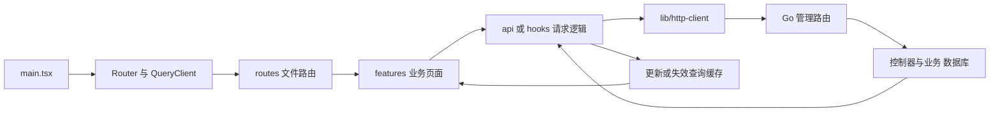

## 1. 【new-api】11-React前端到Go后端

> 文档遵循 md-output 规范；标题层级与编号以知识库规则和格式化脚本为准。离线资料的使用方法见 [[【new-api】14-离线参考入口与完整性审计]]。
> 源码快照：`9b473a3fe4fed8d18980fd8d3c6a8908847a5f25`。仅做静态代码导读，未执行线上业务验证。

专题入口：[[【new-api】00-总览与阅读地图]]

> **跨电脑参考补充：** [[【new-api】17-接口契约与协议边界]]、[[【new-api】19-前端页面与视觉规范]]。ModelDock 已确定另建 Python 后端；参考事实与新设计建议分开记录。

[TOC]

---

### 1.1 修订记录

| 编号 | 版本 |  修订人  | 修订内容                           | 日期       |
| :--: | :--- | :------: | :--------------------------------- | :--------- |
| 001  | 1.0  | jie.chen | 基于源码创建架构与产品链路导读     | 2026-11-03 |
| 002  | 1.1  | jie.chen | 补充离线入口并移除本机源码链接依赖 | 2026-11-03 |

---

### 1.2 这是你最熟悉的切入点

当前前端是 React 19 + TypeScript，使用 Rsbuild 构建、TanStack Router 管路由、TanStack Query 管服务端数据、Zustand 管本地共享状态。样式和 UI 基础包含 Tailwind CSS 4 与 Base UI。包管理器声明为 Bun。

这些名称描述仓库实际技术栈，不要求先研究全部库。先抓住“路由 → 页面 → 请求 → 服务端 → 缓存更新 → 页面重渲染”。

---

### 1.3 从入口到页面

`web/src/main.tsx` 创建 QueryClient 与 Router，挂载主题等 Provider，再渲染应用。路由树来自文件路由生成结果 `routeTree.gen.ts`，页面源文件放在 `routes/`，业务实现集中在 `features/`。

应用启动还会读缓存状态、通过共享查询刷新 `/api/status` 相关数据，用于站点名称、图标与功能配置等。不能把前端显示的缓存状态当作最终权限依据。

这是常见组织方式，具体 feature 的文件拆分不同，不能要求所有目录都有同名的 api.ts 或 hooks。

---

### 1.4 三种状态分别放哪里

| 状态             | 典型归属             | 例子                               |
| :--------------- | :------------------- | :--------------------------------- |
| 服务端事实       | TanStack Query       | 渠道列表、余额、定价、用户信息查询 |
| 前端共享状态     | Zustand 等 store     | 当前认证信息、通知、展示偏好       |
| 当前组件局部状态 | React 状态或表单管理 | 弹窗是否打开、未提交的编辑内容     |

用户点“保存”时，表单草稿不会自动成为真实配置；必须等待服务端校验与持久化成功，再更新页面使用的查询数据。

---

### 1.5 例子：在前端创建 API Key

1. `features/keys` 展示列表和创建表单。
2. 用户设置名称、预算、模型限制、分组等信息。
3. 请求经 `http-client.ts` 自动附加控制台 Access Token。
4. `POST /api/token/` 经用户鉴权和操作审计到达 `controller.AddToken`。
5. 控制器校验输入与当前用户范围，写入 `model.Token`。
6. 前端处理成功或错误，再刷新 Key 列表；用户获得模型调用凭据。
7. 这个 Key 之后用于 `/v1/*` 等 AI 入口，其生命周期与创建它时使用的控制台 Access Token 不同。

你可以从 TS 文件开始顺着 URL 跨到 Go，不必先通读整个 backend。身份区别见 [[【new-api】03-账号登录与三种凭据]]。

---

### 1.6 试验台为何不用普通 API Key 登录方式

`/pg/chat/completions` 使用用户认证和分发中间件。`controller.Playground` 建立试验台所需上下文，使用临时令牌对象表达当前用户与分组，再进入普通 `Relay`。

它仍会走上游调用与用户资金计费，不能理解为“网页试用天然免费”。账务中 `IsPlayground` 区分普通持久 API Key 的额度处理，避免凭空要求用户先创建一个真实 Token 行。

前端试验台有浏览器本地保存消息与参数的逻辑，所以不能据此推断服务器维护了完整聊天历史。常规 relay 需要客户端按协议携带必要上下文，除非具体协议或上游提供另一个状态机制。

`features/chat` 还包含读取可用 Key、拼接聊天工具链接等功能；它与试验台并不完全是同一个产品入口。

---

### 1.7 错误与国际化如何连起来

HTTP 层错误与 JSON 业务响应中的失败应分别处理。请求封装负责认证刷新、部分通用错误处理和重复 GET 合并；具体页面仍需要根据返回结构展示成功、失败、空状态。

前端 `i18next` 使用英文源文本作为翻译 key，当前支持七种语言。控制台 API 中的业务消息通常由前端翻译；直接面对 AI 客户端的后端错误、邮件等使用后端国际化。产品语言和 Intl 数字日期区域码也不是同一个字符串概念。

这些规则让同一条业务错误能在不同页面正确呈现，却不会改变服务端真实权限。隐藏按钮不等于阻止调用接口。

---

### 1.8 构建后如何与 Go 放到一起

前端构建输出到 `web/dist`；`main.go` 用 `go:embed` 把产物编进 Go 二进制，Web 路由负责静态资源与 SPA 回退。开发时前后端可分别运行，生产默认可以由一个 Go 服务同时提供网页与 API。

`FRONTEND_BASE_URL` 在对应节点条件下影响网页兜底重定向，主节点会忽略这个变量；它不是把所有 API 代理到另一个前端地址。部署视图见 [[【new-api】12-数据存储启动部署与运维]]。

---

### 1.9 参考资料

- [[new-api-ref--web--src--main.tsx.txt]]:46，定位 `const queryClient`。
- [[new-api-ref--web--src--lib--http-client.ts.txt]]:49，定位 `export const api`。
- [[new-api-ref--web--src--stores--auth-store.ts.txt]]:104，定位 `export const useAuthStore`。
- [[new-api-ref--web--src--features--keys--api.ts.txt]]:36，定位 `export`。
- [[new-api-ref--controller--token.go.txt]]:299，定位 `func AddToken`。
- [[new-api-ref--controller--playground.go.txt]]:17，定位 `func Playground`。
- [[new-api-ref--web--src--features--playground--constants.ts.txt]]:37，定位 `CHAT_COMPLETIONS:`。
- [[new-api-ref--web--src--features--playground--lib--storage--storage.ts.txt]]:103，定位 `localStorage.setItem`。
- [[new-api-ref--router--web-router.go.txt]]:21，定位 `func SetWebRouter`。
- [[new-api-ref--main.go.txt]]:43，定位 `//go:embed web/dist`。
