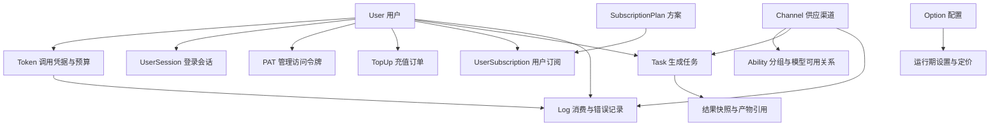
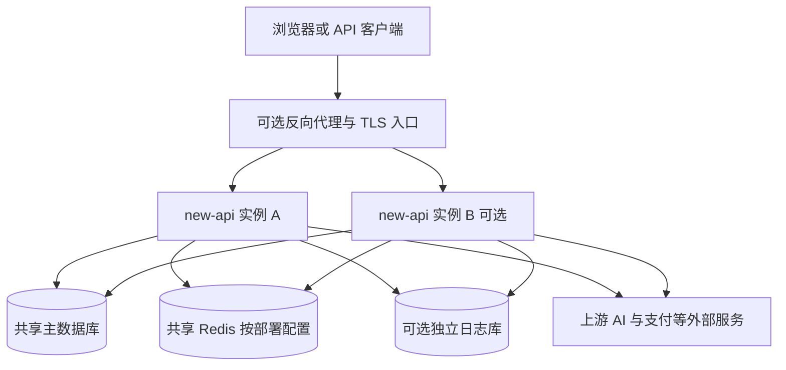

## 1. 【new-api】12-数据存储启动部署与运维

> 文档遵循 md-output 规范；标题层级与编号以知识库规则和格式化脚本为准。离线资料的使用方法见 [[【new-api】14-离线参考入口与完整性审计]]。
> 源码快照：`9b473a3fe4fed8d18980fd8d3c6a8908847a5f25`。仅做静态代码导读，未执行线上业务验证。

专题入口：[[【new-api】00-总览与阅读地图]]

> **跨电脑参考补充：** [[【new-api】15-数据库关系约束与建模说明]]、[[【new-api】16-数据库字段字典]]。ModelDock 已确定另建 Python 后端；参考事实与新设计建议分开记录。

[TOC]

---

### 1.1 修订记录

| 编号 | 版本 |  修订人  | 修订内容                           | 日期       |
| :--: | :--- | :------: | :--------------------------------- | :--------- |
| 001  | 1.0  | jie.chen | 基于源码创建架构与产品链路导读     | 2026-11-03 |
| 002  | 1.1  | jie.chen | 补充离线入口并移除本机源码链接依赖 | 2026-11-03 |

---

### 1.2 核心数据关系

这是逻辑业务关系图，不代表每条边都是数据库外键。模型元数据用于描述 AI 模型，Go `model/` 包则负责数据库对象，二者名字相似但层次不同。

---

### 1.3 四类存储分别做什么

| 存储                             | 作用                                                           | 不能误解成                       |
| :------------------------------- | :------------------------------------------------------------- | :------------------------------- |
| 主数据库                         | 用户、渠道、Token、订单、订阅、任务、配置等持久事实            | 可随意丢弃的缓存                 |
| 日志数据库                       | 调用、消费、错误与相关记录；可与主库共用                       | 用户真实余额的唯一权威           |
| Redis 与内存缓存                 | 按具体模块缓存用户、令牌、渠道能力和配置，支持限流、事件分发等 | 每张业务表都完整实时复制到 Redis |
| 本地文件 / 请求体缓存 / 产物缓存 | 构建资源、日志文件、临时大请求或特定媒体缓存                   | 所有上传与生成文件的永久对象存储 |

主库支持 SQLite、MySQL、PostgreSQL；独立日志库还能选择 ClickHouse。未配置独立日志 DSN 时 `LOG_DB = DB`，并没有自动部署第二个数据库。

Redis 是可选依赖；启用 Redis 会影响缓存模式和多实例通信。单机内存缓存和跨实例共享状态的行为不同，不应直接把单节点经验推广到多节点。

---

### 1.4 程序启动顺序

1. `main` 识别插件 CLI 子命令或进入正常服务启动。
2. `InitResources` 读取环境配置、准备日志与 HTTP 客户端，初始化主数据库及授权等资源。
3. 检查站点初始化状态，加载配置，初始化日志数据库、Redis、性能统计与国际化等。
4. 准备渠道缓存与价格信息，启动配置同步、插件同步、权限策略同步等后台工作。
5. 注入任务适配器工厂，注册周期系统任务，启动系统任务执行器。
6. 创建 Gin，引入请求 ID、日志、国际化、异常恢复等中间件，注册管理、relay、任务和网页路由。
7. 启动 HTTP 服务；退出时给正在进行的请求一定时间收尾，并处理相应缓存落盘。

详细顺序以 `main.go` 为准；不是所有失败都同样处理。例如国际化初始化失败记录错误后仍可继续，而数据库等关键资源失败会阻止正常启动。

---

### 1.5 没有用户请求时，程序仍在做什么

| 后台工作           | 业务价值                                 | 典型入口                                          |
| :----------------- | :--------------------------------------- | :------------------------------------------------ |
| 渠道缓存同步       | 管理员变更渠道后，运行节点看到新供应状态 | `model.SyncChannelCache`                          |
| 配置与插件同步     | 把存储配置同步到运行态                   | `model.SyncOptions`、`controller.SyncTaskPlugins` |
| 授权策略同步       | 多节点看到管理权限变化                   | `authz.StartPolicySync`                           |
| 统计聚合           | 为看板提供按时间聚合的数据               | `model.UpdateQuotaData`                           |
| 订阅重置           | 推进订阅周期、额度与到期逻辑             | `StartSubscriptionQuotaResetTask`                 |
| 渠道测试、模型更新 | 检查供应状态、同步上游模型变化           | 注册的周期系统任务                                |
| 异步任务轮询       | 视频等任务完成后结算并更新结果           | `RunTaskPollingOnce`                              |
| 系统实例上报       | 展示哪些节点仍在线                       | `StartSystemInstanceReporter`                     |
| 认证资料清理       | 清理过期认证相关临时数据                 | `StartAuthArtifactCleanup`                        |
| 日志清理           | 按管理员任务清理历史记录                 | 系统任务执行器                                    |
| 供应凭据刷新       | 保持特定渠道凭据可用                     | `StartCodexCredentialAutoRefreshTask`             |

系统任务执行器对主节点条件作判断，使用数据库租约与执行历史来协调多实例。它不是额外部署的 Celery worker，也不要求凭空添加 Kafka 或 RabbitMQ。租约用于协调，并不代表整个系统所有动作都具有绝对一次执行语义。

---

### 1.6 部署视图

单节点可用 SQLite 并直接提供网页。多节点需要考虑共享数据库、会话相关配置、缓存同步、节点身份和系统任务协调；图只表达架构，不是一份经过实机验证的生产部署方案。

`Dockerfile` 先用 Bun 构建前端，再构建 Go 二进制，最后放入运行镜像。示例 Compose 组织 new-api、Redis 与 PostgreSQL，并给出其他数据库的可选配置。Electron 则会启动本地二进制，再打开本地网页窗口，本质上复用同一套服务。

SSE 与 WebSocket 需要代理支持持续连接及对应升级行为。代码中特别避免对整个 relay 统一应用会破坏 SSE 的 gzip 中间件；管理 API 的 gzip 不应被误解成所有响应都压缩。

---

### 1.7 日志与看板是三种视角

| 视角            | 观察什么                                 | 产品入口                                     |
| :-------------- | :--------------------------------------- | :------------------------------------------- |
| 消费 / 错误日志 | 单次请求模型、用量、额度、渠道与结束情况 | `/api/log/*`                                 |
| 审计记录        | 谁进行了敏感或管理操作                   | `/api/audit`、`/api/audit/self`              |
| 运行和统计      | 请求趋势、性能、节点、后台任务、服务错误 | `/api/data/*`、`/api/perf-metrics`、系统信息 |

`request_id` 串联一次调用；`task_id` 串联一个跨时间任务；`trade_no` 等订单号串联充值。三个 ID 不能互换。

统计可能经过缓存和周期聚合，不应要求看板每个数字与刚完成请求瞬时完全一致。普通调用日志也不等于一份可恢复的完整聊天记录。

---

### 1.8 按现象找链路

| 现象                     | 先查                                 | 再查                                                                           |
| :----------------------- | :----------------------------------- | :----------------------------------------------------------------------------- |
| 无法登录或反复回登录页   | 认证请求、刷新结果、Cookie 与会话    | [[【new-api】03-账号登录与三种凭据]]、前端认证状态                             |
| API Key 有效却被拒绝     | 用户状态、模型/IP/分组限制、余额     | [[【new-api】04-渠道模型分组与故障重试]]、[[【new-api】07-计费预扣结算与退款]] |
| 无可用渠道               | 能力关系、启用状态、路径 / 插件过滤  | 渠道选择策略与缓存                                                             |
| 开始有字，随后中断       | 流结束状态、上游连接、超时           | [[【new-api】05-一次AI调用的完整生命周期]]、[[【new-api】06-多模态与协议分支]] |
| 钱包扣款与预期不符       | 用量、价格快照、资金来源、预扣差额   | [[【new-api】07-计费预扣结算与退款]]、[[【new-api】08-计费数学与完整算例]]     |
| 视频一直排队             | 系统任务执行器、原渠道、轮询失败计数 | [[【new-api】10-异步任务与JavaScript插件]]                                     |
| 外部付款成功却未到账     | 回调与订单状态                       | [[【new-api】09-充值订阅与运营闭环]]                                           |
| 保存配置后部分节点未生效 | 配置 / 渠道 / 插件同步状态           | 节点与缓存差异                                                                 |

这一页没有访问实际数据库、生产日志或服务端口；以上是从代码建立的排查地图。

---

### 1.9 参考资料

- [[new-api-ref--main.go.txt]]:49，定位 `func main()`。
- [[new-api-ref--main.go.txt]]:282，定位 `func InitResources`。
- [[new-api-ref--model--main.go.txt]]:186，定位 `func InitDB`。
- [[new-api-ref--model--main.go.txt]]:235，定位 `func InitLogDB`。
- [[new-api-ref--model--user.go.txt]]:79，定位 `type User struct`。
- [[new-api-ref--model--token.go.txt]]:14，定位 `type Token struct`。
- [[new-api-ref--model--log.go.txt]]:57，定位 `type Log struct`。
- [[new-api-ref--service--system_task.go.txt]]:123，定位 `func StartSystemTaskRunner`。
- [[new-api-ref--Dockerfile.txt]]:1，定位 `FROM oven/bun`。
- [[new-api-ref--docker-compose.yml.txt]]:17，定位 `services:`。
- [[new-api-ref--electron--main.js.txt]]:277，定位 `serverProcess = spawn`。
