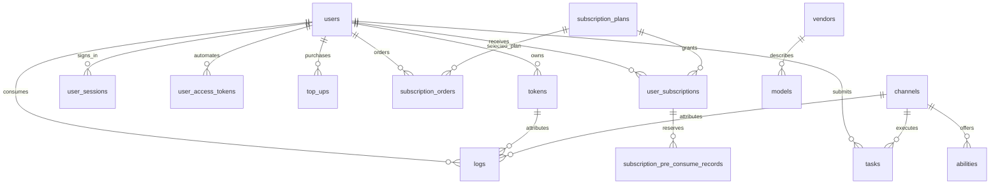

## 1. 【new-api】15-数据库关系约束与建模说明

> 文档遵循 md-output 规范；标题层级与编号以知识库规则和格式化脚本为准。事实依据固定为源码快照 `9b473a3fe4fed8d18980fd8d3c6a8908847a5f25`，Python 方案单独标为建议。

[TOC]

---

### 1.1 修订记录

| 编号 | 版本 |  修订人  | 修订内容               | 日期       |
| :--: | :--- | :------: | :--------------------- | :--------- |
| 001  | 1.0  | jie.chen | 补齐跨电脑离线参考资料 | 2026-11-03 |

---

### 1.2 先分清五件事

1. **表**保存可持续查询的业务状态，如 User、Token、Task。
2. **嵌套对象**可能被序列化进一列 JSON，如 TaskPrivateData，不因此多出一张表。
3. **返回 DTO**只为接口组织数据，如 Pricing、UserBase，不等于建库清单。
4. **逻辑关系**由 `user_id` 等字段关联，不代表数据库已经声明 FOREIGN KEY。
5. **缓存与聚合**是加速读写的视图，不能取代钱包、订单与任务状态的业务事实。

原项目直接把钱包余额放在 `User.Quota`；不存在本资料替它假想的 `wallets` 总账表。普通计费会话 `BillingSession` 是进程内对象，不是统一持久化账本。Python 新项目可以另外设计账本，但那是新设计。

---

### 1.3 核心实体的关系

**这是逻辑 ER 图，不是实际外键 DDL。** 零值、历史行、软删除和删除后的日志保留，都可能使关系不是严格的数据库强制一对多。Task 的 TokenId、SubscriptionId 藏在私有 JSON 中，不能画成已存在的标准外键列。模型 metadata、渠道 `Models` 字符串、abilities 中的模型名也不等同于一个完整正规化的关联模型。

---

### 1.4 表族和业务职责

| 表族             | 源码实体                                                                                                                     | 作用与边界                                                       |
| :--------------- | :--------------------------------------------------------------------------------------------------------------------------- | :--------------------------------------------------------------- |
| 账号             | User                                                                                                                         | 用户身份、角色、分组、钱包与累计计数；历史外部身份字段仍存在     |
| 登录与访问       | UserSession、AuthFlow、ExternalIdentityClaim、PasskeyCredential、LoginEncryptionKey、TwoFA、TwoFABackupCode、UserAccessToken | 会话、认证过程、外部身份占用、设备凭据、PAT；不是 AI 调用预算    |
| 权限             | CasbinRule、AuthzRole                                                                                                        | 管理资源权限和角色配置；分组不等于权限角色                       |
| 外部身份         | CustomOAuthProvider、UserOAuthBinding                                                                                        | 自定义身份提供方与绑定记录                                       |
| 调用凭据         | Token                                                                                                                        | 用户 API Key，预算、模型/IP/分组限制和过期状态                   |
| 供应             | Channel、Ability                                                                                                             | 上游连接配置，以及可用于选择渠道的能力索引                       |
| 展示与定价上下文 | Model、Vendor、PrefillGroup、Option                                                                                          | 模型描述、供应商元信息、预填配置、键值配置；不要误认作四种钱包   |
| 收款与权益       | TopUp、SubscriptionPlan、SubscriptionOrder、UserSubscription、SubscriptionPreConsumeRecord                                   | 充值订单、订阅产品、购买订单、有效权益和预扣记录                 |
| 运营             | Redemption、Checkin                                                                                                          | 兑换与签到记录；赠送额度仍有成本                                 |
| 长任务           | Task、TaskPlugin、Midjourney                                                                                                 | 通用任务、插件管理、历史专用任务；不要求新系统保留全部历史路线   |
| 观察             | Log、AuditLog、QuotaData、PerfMetric                                                                                         | 消费日志、操作审计、用量聚合、性能指标；不能把日志统计当采购发票 |
| 系统             | Setup、SystemInstance、SystemTask、SystemTaskLock                                                                            | 初始化标记、节点心跳、后台作业与租约                             |

字段完整声明在 [[【new-api】16-数据库字段字典]]，机器可读版本为 [[new-api-database-declarations.json]]。

---

### 1.5 关键字段的业务含义

| 字段                                      | 含义                                                            | 常见误解                                             |
| :---------------------------------------- | :-------------------------------------------------------------- | :--------------------------------------------------- |
| User.Quota / UsedQuota                    | 钱包可用额度 / 累计消费计量                                     | 不等于人民币，也不等于模型 token 数                  |
| Token.RemainQuota / UnlimitedQuota        | Key 的预算与是否跳过 Key 预算上限                               | 不是单独充值账户；不限额不代表钱包无限               |
| Channel.Key / BaseURL                     | 上游认证材料 / 连接地址                                         | 不是用户登录 Key，不能发给浏览器                     |
| Ability.Group + Model + ChannelId         | 路由能力的复合主键                                              | 同一渠道可服务多模型、多分组                         |
| TopUp.TradeNo / Status                    | 一笔充值的业务单号 / 入账状态                                   | 浏览器支付成功页不是入账事实                         |
| TopUp.Amount / Money                      | 内部充值数量 / 支付金额相关字段                                 | 二者不能无条件相等，转换依赖支付路径和配置           |
| SubscriptionPlan.PriceAmount              | 商品价格，声明为 decimal(10,6)，Go 属性仍是 float64             | 不能只看到 Go 类型就决定新库也用浮点钱               |
| UserSubscription.AmountTotal / AmountUsed | 周期额度总量 / 已使用量                                         | 不等于用户钱包余额                                   |
| SubscriptionPreConsumeRecord.RequestId    | 订阅预扣的唯一请求标识                                          | 只覆盖此类预扣，不是全系统统一幂等账本               |
| Task.Quota / PrivateData                  | 当前任务额度与后续执行、结算上下文                              | 完成状态本身不证明资金已一致                         |
| Task.TaskID                               | 对外任务定位字段；新任务生成 task\_ 前缀，历史可能承载第三方 ID | 当前字段仅声明普通索引，不能凭业务直觉说已有唯一约束 |
| Log.ChannelId                             | 关联渠道，JSON 键为 channel                                     | JSON 名与数据库列名、Go 名不是同一个命名层           |
| Log.Other / AuditLog.Other                | 扩展消费信息 / 审计结构                                         | 不是随便存请求体与密钥的垃圾桶                       |

---

### 1.6 唯一性、索引与删除

- `Ability` 声明 `(Group, Model, ChannelId)` 复合主键，用来区分同一渠道的不同供给能力。
- `Token.Key`、`TopUp.TradeNo`、`SubscriptionOrder.TradeNo`、`SubscriptionPreConsumeRecord.RequestId`、`UserAccessToken.TokenHash` 等存在唯一声明；各自只在相应表的作用域内生效。
- `UserSession.SID` 与 `Option.Key` 是业务主键，不是所有表都有自增 `id`。
- `UserSubscription` 的活跃订阅索引按用户、状态、到期时间组合；消费日志按时间、用户等组合；索引顺序见字段字典原始标签。
- `User`、`Token`、`Redemption`、`PrefillGroup` 等有 DeletedAt；不要将“查询默认排除软删除”误认为旧唯一值自动释放。预填组和 Token 唯一性还有专门迁移路径。
- 禁止从 ER 图补出 `ON DELETE CASCADE`。例如删除用户后消费凭据与审计如何保留，应作为 ModelDock 明确的数据保留决策。

字段字典保存声明，相关 `token_migration.go`、`prefill_group_migration.go`、`option_migration.go` 等迁移证据在附件中。默认值、索引名称和方言变化最终要靠新项目自己的迁移测试。

---

### 1.7 JSON 字段和结构化快照

| 容器                       | 保存内容                                                     | 为什么不拆成普通请求参数                                   |
| :------------------------- | :----------------------------------------------------------- | :--------------------------------------------------------- |
| Channel.ChannelInfo        | 多 Key 状态、轮询位置等                                      | 上游凭据调度状态与渠道生命周期相关                         |
| Task.Properties            | 原始/上游模型名等                                            | 任务查询与归属                                             |
| Task.PrivateData           | 上游任务 ID、结果 URL、资金来源、令牌 ID、插件状态、计费快照 | 后台恢复执行、差额结算；接口禁止直接泄露                   |
| TaskBillingContext         | 模型/分组价格上下文、按次策略、表达式快照                    | 管理员改价后仍按提交时语义结算                             |
| User.Setting、Option.Value | 用户偏好、全局配置                                           | 有些是 JSON 文本，有些是纯字符串；不能把所有 Value 当 JSON |

`TaskPrivateData` 中可能出现 Key 等私密内容；不要把“叫 PrivateData”理解为“已自动加密”。资料保存的是源码结构，不含运行中的真实凭据或用户数据。

---

### 1.8 数据库与事务边界

主库支持 SQLite、MySQL、PostgreSQL；日志库可另外配置，且支持 ClickHouse。普通日志 `Log` 和审计 `AuditLog` 的 ClickHouse 建表实现不同；AuditLog 迁移未配置与普通用量日志相同的 TTL。不能把主库 ORM 标签当作 ClickHouse 的建表语句。

跨 `DB`、`LOG_DB`、Redis、上游 HTTP 的调用不属于一个数据库事务。原项目的行锁封装在 MySQL/PostgreSQL 使用 FOR UPDATE，在 SQLite 跳过该语法。因此本文没有把原项目描述为“跨所有存储强一致”。

**ModelDock 建议：** 第一版明确选一种生产主库；为资金变化建立可追踪、可幂等的操作记录；在事务内以条件更新或行锁保护余额；事务外执行上游请求；用持久化补偿状态处理提交成功但回写失败。计费和支付要有可重放的对账流程。这些是新系统设计要求，不是对原项目的现有实现声明。

---

### 1.9 关联阅读

[[【new-api】00-总览与阅读地图]]、[[【new-api】14-离线参考入口与完整性审计]]、[[【new-api】12-数据存储启动部署与运维]]、[[【new-api】16-数据库字段字典]]、[[【new-api】18-后端业务规则与失败处理]]。
