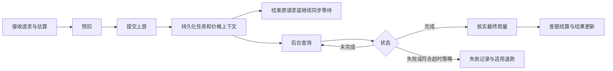

## 1. 【new-api】18-后端业务规则与失败处理

> 文档遵循 md-output 规范；标题层级与编号以知识库规则和格式化脚本为准。事实依据固定为源码快照 `9b473a3fe4fed8d18980fd8d3c6a8908847a5f25`，Python 方案单独标为建议。

[TOC]

---

### 1.1 修订记录

| 编号 | 版本 |  修订人  | 修订内容               | 日期       |
| :--: | :--- | :------: | :--------------------- | :--------- |
| 001  | 1.0  | jie.chen | 补齐跨电脑离线参考资料 | 2026-11-03 |

---

### 1.2 实现时先保留什么

普通模型调用的目标是：确认调用者 → 检查可用范围 → 选择供应 → 明确价格 → 预留额度 → 请求上游 → 返回结果并归集用量 → 结算差额 → 记录可追溯结果。

具体原始顺序并非每步都在一个控制器：普通 HTTP relay 中，Distribute 已先选渠道，再进入控制器解析/校验和构造 RelayInfo；预扣位于外层重试循环之前。Python 实现可以调整模块组织，但不能破坏同一逻辑请求的资金归属与结算唯一性。

---

### 1.3 需要保存的运行上下文

| 上下文 | 必须能回答的问题                                 | 保存位置的原项目事实                   |
| :----- | :----------------------------------------------- | :------------------------------------- |
| 身份   | 哪个用户、哪个 Key、哪个管理身份                 | 中间件写入请求上下文                   |
| 选路   | 原始模型、上游模型、分组、渠道、尝试次数         | RelayInfo、分发上下文                  |
| 定价   | 规则版本、分组倍率、价格输入、用量解释           | PriceData、表达式快照等                |
| 账务   | 资金来源、订阅 ID、预扣、Key 预算、结算/退款状态 | BillingSession；任务另存私有账务上下文 |
| 响应   | 是否开始输出、累计 Usage、上游 request ID        | 对应协议处理器与流状态                 |
| 追踪   | 网关 request ID、任务 ID、最终结果               | 日志和任务执行快照                     |

上下文不要成为任意键值的全局对象。尤其上游凭据只能在服务端流转，公共日志与前端 DTO 需要明确投影。

---

### 1.4 身份、授权和资源归属

原项目有控制台登录、管理 PAT、模型 API Key 三种用途。管理员角色也不代表每条敏感操作可以忽略细粒度权限。用户查询任务、Key、日志、订阅等资源时，必须将当前身份与资源归属放在服务端检查。

原 `UserSession` 保存刷新凭据散列与版本，`UserAccessToken` 保存 PAT 的 TokenHash；Token 表则是另一种 AI Key 模型。不要将一种凭据的存储事实推广到另一种。新系统如何发放、显示、撤销和存储密钥要单独设计。

本页是业务依赖说明，不是认证安全审计。ModelDock 开发认证功能时仍需针对选定方案核对当时适用的认证、会话和 CSRF 要求，并执行回归测试。

---

### 1.5 路由与失败转移

候选渠道必须同时满足模型能力、分组可用范围、渠道状态、Key 限制等条件。优先级表达先选哪一层，权重表达同层如何分配；不能把权重当价格折扣。渠道模型映射只改变发往供应商的名称，对外名称与计费归属仍需保留。

普通请求在重试时复用账务会话；新的尝试要从原始请求副本构造上游参数，避免前一次转换污染下一次。是否重试还受错误分类、已输出内容、渠道数量与重试配置影响。

**ModelDock 建议：** 不给无明确幂等保障的上游 POST 开启无脑自动重试。超时意味着“不知道对方是否已接受”，不意味着“没发生费用”。任务提交应记录未知结果并对账，而不是无限创建新任务。

---

### 1.6 计费的四个核心不变量

1. 一次调用的“资金账户”与“Key 预算”是两个限制，但用户只承担一次服务费用。
2. 估算用量与实际用量是两份事实：预扣不等于最终消费；实际费用高于预扣时还需要补扣路径。
3. 同一请求的最终结算和退款不能重复执行；已确认的有效消费不能被普通失败回调再次退掉。
4. 参数和计算结果不能因为负数、NaN、无穷大或超范围换算变成负收费。计价输入要区分缺失、零值、非法值。

原项目普通表达式、历史倍率、任务插件表达式有不同尺度，见 07/08。Python 即使没有机器整数溢出，也会受数据库 bigint、外部 JSON 数字、Decimal 舍入和计价上限约束，不能省略边界校验。

钱包资金与订阅资金通常为某次会话选择一个来源，不是把两个余额随意拼起来。订阅不足是否溢出到钱包依赖偏好与权益配置。免费模型和信任额度旁路属于原实现的特殊分支，不能将它们当作所有请求的默认流程。

---

### 1.7 普通请求失败矩阵

| 时刻                   | 上游可能产生费用 | 原实现应核对的动作             | ModelDock 验收目标                   |
| :--------------------- | :--------------- | :----------------------------- | :----------------------------------- |
| 参数/权限/路由失败     | 通常没有         | 未进入上游；核对是否预扣       | 不残留资金预留                       |
| 预扣不足               | 没有发出此次工作 | 返回额度不足                   | 不扣 Key 却漏回滚资金，或反过来      |
| 连接失败/请求超时      | 可能             | 重试与退款依错误和会话状态决定 | 有追踪 ID 和明确未知结果策略         |
| 已交付部分流后异常     | 可能已生成       | 保留流中断与 Usage 语义        | 不在同一响应拼入另一条完整回答       |
| 上游成功，结算写入失败 | 已发生           | 错误日志与会话保护             | 进入可恢复对账，不伪装零费用         |
| 退款持久化失败         | 未必有消费       | 退款错误处理                   | 可重放补偿，不能只打印日志就视为解决 |
| 客户端主动断开         | 不一定停止       | 协议与上下文处理               | 明确上游取消能力和最终计费来源       |

原系统部分退款异步执行，资金、令牌、日志与缓存不是一个跨资源事务。本资料不把建议中的持久化补偿描述为原系统已经完整实现。

---

### 1.8 支付与订阅的状态

充值订单、订阅购买订单和用户订阅权益是不同对象。回调必须识别交易、验证可信性，再依据本地订单状态入账；重复成功回调不能再次加钱。支付返回页只能提示查询，不能作为给用户发额度的可信依据。

原 Epay 路径通过事务与行锁封装检查订单状态；进程内订单锁不能单独保证多实例安全。其他支付平台路径各有实现，不能复制一张通用时序图就认为它们的签名与幂等语义相同。

订阅创建后还存在周期重置、到期、取消和分组恢复；充值退款、调用退款、订阅取消不是同一操作。重置和并发消费必须避免互相覆盖，订阅到期时也要考虑已发出的未完成请求。

**ModelDock 建议状态：** 支付订单可区分待支付、已确认、已入账、失败、关闭及退款状态；具体名字和合并方式由新设计决定。账务事件设置业务幂等键。此处没有声称原 TopUp 使用这整套枚举。

---

### 1.9 异步任务必须脱离 HTTP 连接存活

原任务公开状态有 `NOT_START`、`SUBMITTED`、`QUEUED`、`IN_PROGRESS`、`SUCCESS`、`FAILURE`、`UNKNOWN`；协议层可能映射成 queued/completed/failed，不能把两套枚举混存而不做转换。

图表达业务阶段，不声称上游提交与本地持久化是一个原子事务。原流程的提交会话在 Task 保存后结算并关闭；后续轮询依据持久化任务信息调整费用，不会继续持有最初 HTTP 的 BillingSession。

原任务包含执行/插件身份快照和计费快照；后者用来避免运行中改价改变旧任务合同。`retainResult:false` 可导致即时结果不保留；`taskArtifactStore` 在当前快照不是一套可用的永久对象存储，不能据此承诺永久下载。

**ModelDock 建议：** 使用持久化任务和数据库竞争保护，让不同 worker 处理同一任务时只能有一个终态结算获胜；分开记录“上游成功”“账务已结算”“产物已保存”。进程重启、重复轮询、超时后迟到成功都需要确定策略。

---

### 1.10 用量来源与数据规范化

- 文本：分清总输入、缓存命中、缓存写入、输出及多模态 token；显式独立计价的类别不能再混入普通输入重复收费。
- 图片：OpenAI 兼容响应可能将同一图的 URL/base64 分开；原逻辑按有效载荷及上游合法数量处理，不按 `len(data)` 通用计数。
- 视频/音频：时长、数量可能来自请求、媒体元数据或上游 usage，全部需要上限。请求 duration=-1 表示供应商决定时，预留不能变成负费用。
- 上游没有可信 usage 时，是否估算、按次收费或暂挂需要选定规则；不能默默置零或随意编造最终用量。
- 使用量事实由适配器报告，价格由计费模块计算。不要让每个厂商适配器各自扣用户余额。

---

### 1.11 后台任务、缓存与运维

原系统既有内存也有可选 Redis；后台涉及订阅重置、过期处理、渠道探测、任务轮询、清理和系统实例心跳。启用多副本后，要区分各实例自己的工作与需租约/锁保护的共享工作。

ModelDock 至少保留 request_id、task_id、payment trade_no 三类关联键；将用户可见日志、管理员审计和运行日志分开。上游实际采购成本要另有供应商账单对账，消费日志和 Channel.UsedQuota 不是已核实成本台账。

---

### 1.12 关联阅读

[[【new-api】00-总览与阅读地图]]、[[【new-api】14-离线参考入口与完整性审计]]、[[【new-api】04-渠道模型分组与故障重试]]、[[【new-api】07-计费预扣结算与退款]]、[[【new-api】09-充值订阅与运营闭环]]、[[【new-api】10-异步任务与JavaScript插件]]。
