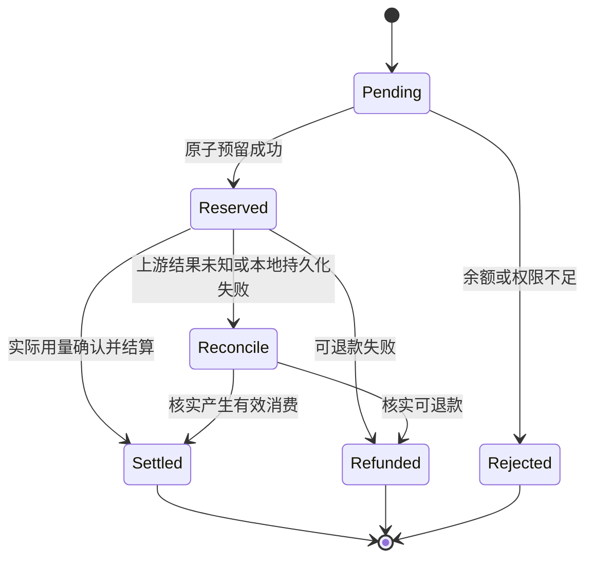

## 1. 【new-api】20-ModelDock实现交接与验收清单

> 文档遵循 md-output 规范；标题层级与编号以知识库规则和格式化脚本为准。事实依据固定为源码快照 `9b473a3fe4fed8d18980fd8d3c6a8908847a5f25`，Python 方案单独标为建议。

[TOC]

---

### 1.1 修订记录

| 编号 | 版本 |  修订人  | 修订内容               | 日期       |
| :--: | :--- | :------: | :--------------------- | :--------- |
| 001  | 1.0  | jie.chen | 补齐跨电脑离线参考资料 | 2026-11-03 |

---

### 1.2 已确认与待确定

已确认：产品名 ModelDock；新建 Python 后端；new-api 仅作为业务逻辑、数据库与前端样式参考；知识库与离线附件是跨电脑参考入口。当前没有创建 ModelDock 仓库，没有重写或部署任何后端。

待确定：Python Web 框架、生产数据库、前端框架、第一版用户类型、上游供应商/模型、支付方式、币种/额度单位、定价和退款规则、域名部署、是否多实例、是否支持异步视频/插件/订阅。这里列出决策项，不能让未来 AI 自行声称“用户之前已经选定”。

---

### 1.3 可以直接交给下一次开发会话的说明

```text
项目名称：ModelDock。
我要从零做 Python 后端，不在 new-api Go 仓库上二开。
请先读取本知识库专题的 14、15、17、18、19、20、21，再按需看 00—13 和 16。
原项目快照为 9b473a3fe4fed8d18980fd8d3c6a8908847a5f25。
离线附件位于知识库的 附件/new-api离线参考-9b473a3/。
请把原项目事实、ModelDock 建议、待确认决策分开。
不要把 490 个结构体字段当成 490 个实际数据库列。
不要把 OpenAPI 当成完整运行时接口列表，也不要复制演示图片里的价格和数据。
先输出本次功能范围、数据库设计和接口契约，再开始相应实现。
计费须包含预留、结算、退款、幂等和故障恢复；任务不能只放内存。
前端参考 19 的视觉层级和交互规范，保留必要来源说明。
无证据的厂商协议、现价和支付规则需要另外核实，不要根据旧快照猜测。
```

以上是供用户主动采用的交接说明，不自动授权发布、付费或调用生产系统。

---

### 1.4 Python 职责映射建议

```text
modeldock/
  app/
    api/             # 管理接口、模型接口、回调；处理 HTTP 边界
    schemas/         # 输入输出对象，保留缺失/零/null 的区别
    services/
      routing/       # 候选渠道、优先级、权重、失败分类
      billing/       # 估算、预留、价格快照、结算和退款
      payments/      # 下单、可信确认、幂等入账
      tasks/         # 任务状态与轮询、补偿
      identity/      # 身份与资源权限
    providers/       # 各供应商请求、响应和 usage 规范化
    persistence/     # ORM、事务、迁移、查询
    infrastructure/  # HTTP 客户端、缓存、日志、对象存储
    workers/         # 独立后台执行入口
  tests/             # 业务契约、账务不变量、集成场景
```

这是可调整的职责示例，不是已创建目录，也不强制某个框架。可以先做模块化单体：API 与 worker 分进程部署仍可共享代码包，无须一开始拆很多微服务。

协议转换器接收类型明确的请求并返回规范化响应/Usage，不直接拿数据库连接扣款。计费模块不依赖页面状态。异步 HTTP 不等于 CPU 计算自动并行；同步 ORM/阻塞请求不得无意堵住事件循环。进程内定时任务也不能当作多副本可靠任务队列。

---

### 1.5 新设计需要明确的账务状态

建议至少能区分请求账务的“待预留、已预留、已结算、已退款、需对账”。为每个状态定义允许的前驱、重复请求响应和恢复动作。状态名与实现粒度可再选；原项目并没有在数据库里完整保存这一套统一状态表。



该图是 **ModelDock 建议**。若实际费用超过预留、Key 预算不足、订阅刚好重置/过期，应定义是否追加预留、形成待处理欠额或走其他显式策略；不能在成功交付后静默抛弃费用。已结算后的人工调整应另记事件，不把原结算覆盖掉。

---

### 1.6 建议的交付顺序，尚非已批准需求

| 阶段          | 可考虑的范围                                                   | 完成标准                                     |
| :------------ | :------------------------------------------------------------- | :------------------------------------------- |
| 1：调用闭环   | 用户、API Key、一个供应商、非流式/流式文本、明确价格、用量日志 | 一次调用能从用户操作追溯到上游请求与最终扣费 |
| 2：资金闭环   | 管理员调整额度或一个实际选定的支付渠道、订单与可信回调、对账   | 重复回调不重复入账，异常可恢复               |
| 3：运营稳定性 | 渠道启停、限流、模型权限、失败分类、监控和告警                 | 能解释失败、流中断和余额差异                 |
| 4：能力扩展   | 多供应商、图片/音频、订阅、异步任务                            | 各分支都有独立用量、状态和验收规则           |
| 5：可选生态   | 插件市场、复杂动态计价、桌面端、外部部署管理                   | 有明确用户需求时再评估                       |

上表只帮助控制实现顺序，不能偷偷删除用户后来提出的功能。定价、采购和支付服务成本要分别核算；新-api 的计费能力不自动带来经营利润。

---

### 1.7 必须可验证的验收场景

下表是未来实现需要执行的测试要求，**本次未执行这些业务测试**。

| 编号 | 场景                                      | 期望证明的行为                               |
| :--- | :---------------------------------------- | :------------------------------------------- |
| B01  | wallet_only；Key 不限额但钱包不足         | 调用仍被钱包资金约束阻止                     |
| B02  | 两请求并发竞争有限余额                    | 不同时承诺超过可用余额；结果可解释           |
| B03  | 预留 100，实际 70                         | 总净扣费 70，退回 30；Key 预算和资金来源一致 |
| B04  | 预留 100，实际 130                        | 执行已定义的追加/待处理策略，不能默默少记 30 |
| B05  | 同一结算/退款重复投递                     | 资金只变化一次                               |
| B06  | 第一次渠道失败、第二次成功                | 一个逻辑请求一份用户费用，尝试记录可追溯     |
| B07  | 输出若干 SSE 事件后断开                   | 不拼接新回答；用量与结算遵循明确策略         |
| B08  | 上游成功后 DB 写入失败                    | 不伪装成未消费；有持久化恢复/对账路径        |
| B09  | 负数、超大 token/n/duration，NaN/Infinity | 在相应边界拒绝或安全处理，不产生负收费       |
| B10  | 显式 false/0 与字段未传                   | 按契约区分，转换和默认值不吞零               |
| B11  | 任务提交后管理员改价                      | 按任务确定的价格快照结算                     |
| B12  | 两 worker 同时处理任务成功                | 只有一次终态账务变化                         |
| B13  | 任务超时后上游迟到成功                    | 按已定义对账策略收尾，不同时“退款且免费成功” |
| B14  | 订阅重置/过期与消费并发                   | 不丢消费，不错误恢复周期额度                 |
| P01  | 同一支付成功通知重复十次                  | 只入账一次，重复通知有一致响应               |
| P02  | 非可信通知、金额/币种/订单不匹配          | 不入账并留下无秘密的审计信息                 |
| P03  | 支付已确认、通知处理进程重启              | 重试后能完成入账，不丢单或重复加钱           |
| A01  | 用户访问另一用户 Key/日志/任务            | 后端拒绝，与前端是否隐藏入口无关             |
| A02  | 撤销凭据后再次调用                        | 在定义的失效窗口内拒绝                       |
| U01  | 列表为空、请求失败、长时间加载            | 三种界面状态明确，输入与分页合理保留         |
| U02  | 暗色、窄屏、长文案、键盘操作              | 主要信息可读，弹窗/提交按钮可操作            |
| D01  | 空库迁移与重复启动                        | 不重复建错约束或改坏默认值                   |
| D02  | 已有数据升级与恢复                        | 保留数据、索引与资金关系，可验证备份恢复     |

示例中的 100、70、130 是抽象的内部额度单位，不是实际货币报价。三个资金问题需要同时验收：用户实际资金、Key 预算与审计证据，不能只断言 API 返回成功。

---

### 1.8 不要从参考项目继承的隐含假设

- 不默认支持全部上游厂商或全部兼容协议；未实现的端点需要明确回应。
- 不为方便而沿用所有历史兼容字段、旧价格倍率或旧任务边界。
- 不将主库、日志库、缓存、支付平台、上游请求视为一个原子事务。
- 不因为 Python 改写而认定原字体、图标、截图或复制代码的来源要求消失。
- 不把演示截图中的数据、旧模型价格、成功率或模型数量写入生产宣传。
- 不在缺少明确业务需求时复刻复杂 JS 插件运行时；可以先把供应商接入实现为清晰的 Python 模块。

---

### 1.9 关联阅读

[[【new-api】00-总览与阅读地图]]、[[【new-api】14-离线参考入口与完整性审计]]、[[【new-api】15-数据库关系约束与建模说明]]、[[【new-api】17-接口契约与协议边界]]、[[【new-api】18-后端业务规则与失败处理]]、[[【new-api】19-前端页面与视觉规范]]。
